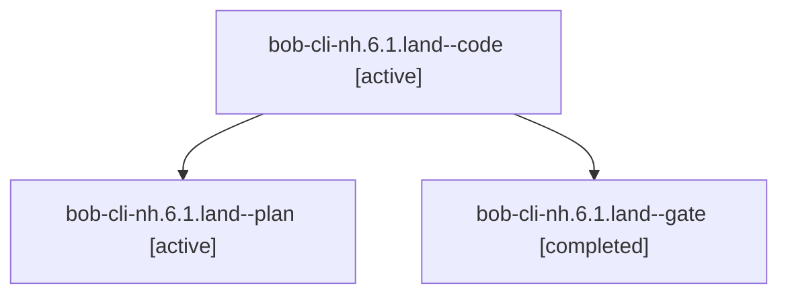

# Session: bob-cli-nh.6.1.land

[Agent Hoods](../README.md) / [bbugyi200](../users/bbugyi200/README.md) / [athena](../users/bbugyi200/machines/athena/README.md) / [bob-cli-nh](../users/bbugyi200/machines/athena/hoods/bob-cli-nh/README.md) / bob-cli-nh.6.1.land

Owner: `bbugyi200.athena` · Hood: `bob-cli-nh` · Members: 3 · Bead: [bob-cli-nh.6.1](https://github.com/bobs-org/bob-cli--beads/blob/main/pages/bob-cli-nh/bob-cli-nh.6.1.md)

## Lineage



The diagram is an optional enhancement; the ordered table below contains the same lineage in accessible text.

| Role | Agent | State | Model / provider | Timing | Commits | Prompt | Chat |
|---|---|---|---|---|---:|---|---|
| <a id="member-code"></a>code | bob-cli-nh.6.1.land--code | active | muse-spark-1.3-contributor / muse | 2026-11-19T22:34:59.255789+00:00 | 0 | — | — |
| <a id="member-plan"></a>plan | bob-cli-nh.6.1.land--plan | active | gpt-6-astra / codex | 2026-11-19T22:20:41.467375+00:00 | 0 | [Prompt](../agents/bbugyi200.athena.bob-cli-nh.6.1.land--plan/prompt.md) | [Chat](../agents/bbugyi200.athena.bob-cli-nh.6.1.land--plan/chat.md) |
| <a id="member-gate"></a>gate | bob-cli-nh.6.1.land--gate | completed | gpt-6-astra / codex | 2026-11-19T22:34:13.845616+00:00 → 2026-11-19T22:34:21.790511+00:00 | 0 | — | [Chat](../agents/bbugyi200.athena.bob-cli-nh.6.1.land--gate/chat.md) |

## Variables

| Role | Variable | Value |
|---|---|---|
| plan | `artifacts` | \[{bead: bob-cli-nh.6.1, kind: file, label: Property-card landing: unregister and host cleanup reproductions on 2f1e016, path: /home/bryan/.sase/artifacts/agents/gh\_bobs-org\_\_bob-cli/20261119094543/nh… |

#### artifacts

**Role:** `plan`

```yaml
- bead: bob-cli-nh.6.1
  kind: file
  label: Property-card landing: unregister and host cleanup reproductions on 2f1e016
  path: /home/bryan/.sase/artifacts/agents/gh_bobs-org__bob-cli/20261119094543/nh61-landing-probes-0e95b3acdd32.tgz
  ref: file:explicit:dec33b788961cadeb2b4261a
  source_path: /tmp/nh61-landing-probes.tgz
```

Values are truncated for display; see each member's agent meta.json for the full values.

## Neighbors

| Agent | Relation | State |
|---|---|---|
| [bob-cli-nh.6](bbugyi200.athena.bob-cli-nh.6.md) (session · 3) | ancestor | active 1, completed 2 |
| [bob-cli-nh.6.1.1](bbugyi200.athena.bob-cli-nh.6.1.1.md) (session · 3) | bob-cli-nh.6.1 hood | completed 3 |
| [bob-cli-nh.6.1.1](../agents/bbugyi200.athena.bob-cli-nh.6.1.1/README.md) | bob-cli-nh.6.1 hood | completed |
| [bob-cli-nh.6.1.2](bbugyi200.athena.bob-cli-nh.6.1.2.md) (session · 5) | bob-cli-nh.6.1 hood | completed 2, failed 3 |
| [bob-cli-nh.6.1.2](../agents/bbugyi200.athena.bob-cli-nh.6.1.2/README.md) | bob-cli-nh.6.1 hood | completed |
| [bob-cli-nh.6.1.3](bbugyi200.athena.bob-cli-nh.6.1.3.md) (session · 7) | bob-cli-nh.6.1 hood | completed 4, failed 3 |
| [bob-cli-nh.1](bbugyi200.athena.bob-cli-nh.1.md) (session · 11) | bob-cli-nh hood | completed 8, failed 3 |
| [bob-cli-nh.2](bbugyi200.athena.bob-cli-nh.2.md) (session · 3) | bob-cli-nh hood | completed 3 |
| [bob-cli-nh.2](../agents/bbugyi200.athena.bob-cli-nh.2/README.md) | bob-cli-nh hood | completed |
| [bob-cli-nh.3](bbugyi200.athena.bob-cli-nh.3.md) (session · 5) | bob-cli-nh hood | completed 5 |
| [bob-cli-nh.4](bbugyi200.athena.bob-cli-nh.4.md) (session · 3) | bob-cli-nh hood | active 1, completed 2 |
| [bob-cli-nh.4.1.1](bbugyi200.athena.bob-cli-nh.4.1.1.md) (session · 7) | bob-cli-nh hood | completed 5, failed 2 |
| [bob-cli-nh.4.1.2](../agents/bbugyi200.athena.bob-cli-nh.4.1.2/README.md) | bob-cli-nh hood | completed |
| [bob-cli-nh.4.1.3](../agents/bbugyi200.athena.bob-cli-nh.4.1.3/README.md) | bob-cli-nh hood | completed |
| [bob-cli-nh.4.1.4](bbugyi200.athena.bob-cli-nh.4.1.4.md) (session · 9) | bob-cli-nh hood | completed 5, failed 4 |
| [bob-cli-nh.4.1.land](bbugyi200.athena.bob-cli-nh.4.1.land.md) (session · 3) | bob-cli-nh hood | active 2, completed 1 |
| [bob-cli-nh.5](../agents/bbugyi200.athena.bob-cli-nh.5/README.md) | bob-cli-nh hood | waiting |
| [bob-cli-nh.7](../agents/bbugyi200.athena.bob-cli-nh.7/README.md) | bob-cli-nh hood | waiting |
| [bob-cli-nh.8](../agents/bbugyi200.athena.bob-cli-nh.8/README.md) | bob-cli-nh hood | waiting |
| [bob-cli-nh.9](../agents/bbugyi200.athena.bob-cli-nh.9/README.md) | bob-cli-nh hood | waiting |
| [bob-cli-nh.land](../agents/bbugyi200.athena.bob-cli-nh.land/README.md) | bob-cli-nh hood | waiting |
