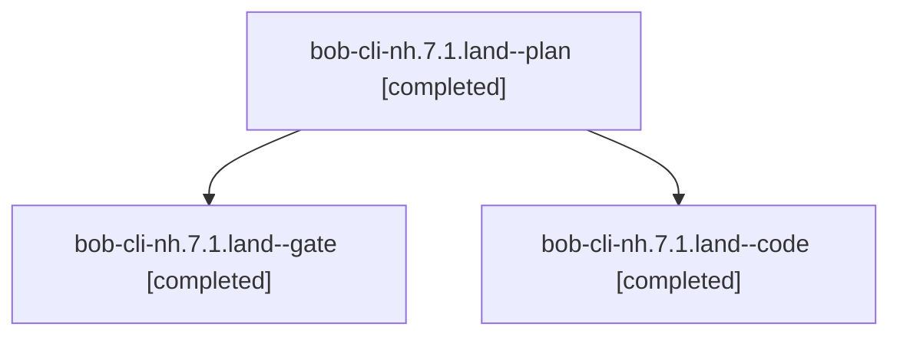

# Session: bob-cli-nh.7.1.land

[Agent Hoods](../README.md) / [bbugyi200](../users/bbugyi200/README.md) / [athena](../users/bbugyi200/machines/athena/README.md) / [bob-cli-nh](../users/bbugyi200/machines/athena/hoods/bob-cli-nh/README.md) / bob-cli-nh.7.1.land

Owner: `bbugyi200.athena` · Hood: `bob-cli-nh` · Members: 3 · Bead: [bob-cli-nh.7.1](https://github.com/bobs-org/bob-cli--beads/blob/main/pages/bob-cli-nh/bob-cli-nh.7.1.md)

## Lineage



The diagram is an optional enhancement; the ordered table below contains the same lineage in accessible text.

| Role | Agent | State | Model / provider | Timing | Commits | Prompt | Chat |
|---|---|---|---|---|---:|---|---|
| <a id="member-plan"></a>plan | bob-cli-nh.7.1.land--plan | completed | gpt-6-astra / codex | 2026-11-20T12:59:59.475863+00:00 → 2026-11-20T14:39:19.176314+00:00 | 0 | [Prompt](../agents/bbugyi200.athena.bob-cli-nh.7.1.land--plan/prompt.md) | [Chat](../agents/bbugyi200.athena.bob-cli-nh.7.1.land--plan/chat.md) |
| <a id="member-gate"></a>gate | bob-cli-nh.7.1.land--gate | completed | gpt-6-astra / codex | 2026-11-20T13:09:24.333556+00:00 → 2026-11-20T13:09:30.875092+00:00 | 0 | — | [Chat](../agents/bbugyi200.athena.bob-cli-nh.7.1.land--gate/chat.md) |
| <a id="member-code"></a>code | bob-cli-nh.7.1.land--code | completed | opus / claude | 2026-11-20T13:10:05.639082+00:00 → 2026-11-20T14:39:19.176314+00:00 | 0 | — | [Chat](../agents/bbugyi200.athena.bob-cli-nh.7.1.land--code/chat.md) |

## Variables

| Role | Variable | Value |
|---|---|---|
| code | `artifacts` | \[{bead: bob-cli-nh.7.1, kind: file, label: Intention card landing real-Obsidian e2e report (76/76 incl. 11 landing checks), path: /home/bryan/.sase/artifacts/agents/gh\_bobs-org\_\_bob-cli/2026112008093… |
| plan | `artifacts` | \[{bead: bob-cli-nh.7.1, kind: file, label: Intention-card landing probes on bob-plugins b1a655a, path: /home/bryan/.sase/artifacts/agents/gh\_bobs-org\_\_bob-cli/20261119181921/nh-intention-landing-prob… |

#### artifacts

**Role:** `code`

```yaml
- bead: bob-cli-nh.7.1
  kind: file
  label: Intention card landing real-Obsidian e2e report (76/76 incl. 11 landing checks)
  path: /home/bryan/.sase/artifacts/agents/gh_bobs-org__bob-cli/20261120080937/intention-card-landing-e2e-report-5ab905fc2ed9.json
  ref: file:explicit:9737dd6645f25a93018c0166
  source_path: /tmp/intention-card-landing-e2e-report.json
- bead: bob-cli-nh.7.1
  kind: file
  label: Intention card landing e2e screenshots (51 PNGs, light/dark/narrow)
  path: /home/bryan/.sase/artifacts/agents/gh_bobs-org__bob-cli/20261120080937/intention-landing-e2e-shots.tar-4d94436c34b2.gz
  ref: file:explicit:4820d61d1f9c53aee056efff
  source_path: /tmp/intention-landing-e2e-shots.tar.gz
- bead: bob-cli-nh.7.1
  kind: file
  label: Intention card landing e2e report on integrated bob-plugins e902351 (76/76)
  path: /home/bryan/.sase/artifacts/agents/gh_bobs-org__bob-cli/20261120080937/intention-card-landing-e2e-integrated-report-04b4f8f28992.json
  ref: file:explicit:e6601daf2586a75d5cf4e3e3
  source_path: /tmp/intention-card-landing-e2e-integrated-report.json
- bead: bob-cli-nh.7.1
  kind: file
  label: Intention card landing e2e screenshots on integrated tree (51 PNGs)
  path: /home/bryan/.sase/artifacts/agents/gh_bobs-org__bob-cli/20261120080937/intention-landing-e2e-integrated-shots.tar-d076fc79f50b.gz
  ref: file:explicit:24a4fa999755e98ed0346c97
  source_path: /tmp/intention-landing-e2e-integrated-shots.tar.gz
```

#### artifacts

**Role:** `plan`

```yaml
- bead: bob-cli-nh.7.1
  kind: file
  label: Intention-card landing probes on bob-plugins b1a655a
  path: /home/bryan/.sase/artifacts/agents/gh_bobs-org__bob-cli/20261119181921/nh-intention-landing-probes-4d362f40484d.jsonl
  ref: file:explicit:6b496c43f135269d2bbcaada
  source_path: /tmp/nh-intention-landing-probes.jsonl
```

Values are truncated for display; see each member's agent meta.json for the full values.

## Neighbors

| Agent | Relation | State |
|---|---|---|
| [bob-cli-nh.7](bbugyi200.athena.bob-cli-nh.7.md) (session · 3) | ancestor | active 1, completed 2 |
| [bob-cli-nh.7.1.1](bbugyi200.athena.bob-cli-nh.7.1.1.md) (session · 7) | bob-cli-nh.7.1 hood | completed 4, failed 3 |
| [bob-cli-nh.7.1.2](../agents/bbugyi200.athena.bob-cli-nh.7.1.2/README.md) | bob-cli-nh.7.1 hood | completed |
| [bob-cli-nh.7.1.3](../agents/bbugyi200.athena.bob-cli-nh.7.1.3/README.md) | bob-cli-nh.7.1 hood | completed |
| [bob-cli-nh.7.1.4](../agents/bbugyi200.athena.bob-cli-nh.7.1.4/README.md) | bob-cli-nh.7.1 hood | completed |
| [bob-cli-nh.1](bbugyi200.athena.bob-cli-nh.1.md) (session · 11) | bob-cli-nh hood | completed 8, failed 3 |
| [bob-cli-nh.2](bbugyi200.athena.bob-cli-nh.2.md) (session · 3) | bob-cli-nh hood | completed 3 |
| [bob-cli-nh.2](../agents/bbugyi200.athena.bob-cli-nh.2/README.md) | bob-cli-nh hood | completed |
| [bob-cli-nh.3](bbugyi200.athena.bob-cli-nh.3.md) (session · 5) | bob-cli-nh hood | completed 5 |
| [bob-cli-nh.4](bbugyi200.athena.bob-cli-nh.4.md) (session · 3) | bob-cli-nh hood | active 1, completed 2 |
| [bob-cli-nh.4.1.1](bbugyi200.athena.bob-cli-nh.4.1.1.md) (session · 7) | bob-cli-nh hood | completed 5, failed 2 |
| [bob-cli-nh.4.1.2](../agents/bbugyi200.athena.bob-cli-nh.4.1.2/README.md) | bob-cli-nh hood | completed |
| [bob-cli-nh.4.1.3](../agents/bbugyi200.athena.bob-cli-nh.4.1.3/README.md) | bob-cli-nh hood | completed |
| [bob-cli-nh.4.1.4](bbugyi200.athena.bob-cli-nh.4.1.4.md) (session · 9) | bob-cli-nh hood | completed 5, failed 4 |
| [bob-cli-nh.4.1.land](bbugyi200.athena.bob-cli-nh.4.1.land.md) (session · 5) | bob-cli-nh hood | completed 4, failed 1 |
| [bob-cli-nh.5](../agents/bbugyi200.athena.bob-cli-nh.5/README.md) | bob-cli-nh hood | completed |
| [bob-cli-nh.6](bbugyi200.athena.bob-cli-nh.6.md) (session · 3) | bob-cli-nh hood | active 1, completed 2 |
| [bob-cli-nh.6.1.1](bbugyi200.athena.bob-cli-nh.6.1.1.md) (session · 3) | bob-cli-nh hood | completed 3 |
| [bob-cli-nh.6.1.1](../agents/bbugyi200.athena.bob-cli-nh.6.1.1/README.md) | bob-cli-nh hood | completed |
| [bob-cli-nh.6.1.2](bbugyi200.athena.bob-cli-nh.6.1.2.md) (session · 5) | bob-cli-nh hood | completed 2, failed 3 |
| [bob-cli-nh.6.1.2](../agents/bbugyi200.athena.bob-cli-nh.6.1.2/README.md) | bob-cli-nh hood | completed |
| [bob-cli-nh.6.1.3](bbugyi200.athena.bob-cli-nh.6.1.3.md) (session · 7) | bob-cli-nh hood | completed 4, failed 3 |
| [bob-cli-nh.6.1.land](bbugyi200.athena.bob-cli-nh.6.1.land.md) (session · 5) | bob-cli-nh hood | completed 5 |
| [bob-cli-nh.8](../agents/bbugyi200.athena.bob-cli-nh.8/README.md) | bob-cli-nh hood | waiting |
| [bob-cli-nh.9](../agents/bbugyi200.athena.bob-cli-nh.9/README.md) | bob-cli-nh hood | waiting |
| [bob-cli-nh.land](../agents/bbugyi200.athena.bob-cli-nh.land/README.md) | bob-cli-nh hood | waiting |
