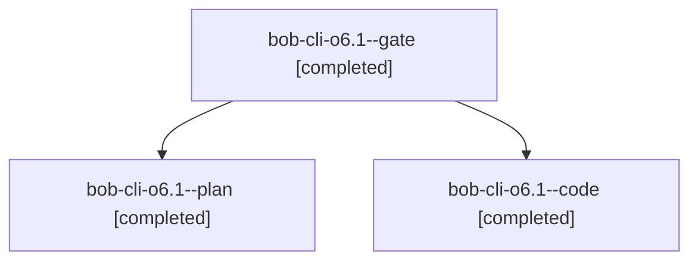

# Session: bob-cli-o6.1

[Agent Hoods](../README.md) / [bbugyi200](../users/bbugyi200/README.md) / [athena](../users/bbugyi200/machines/athena/README.md) / [bob-cli-o6](../users/bbugyi200/machines/athena/hoods/bob-cli-o6/README.md) / bob-cli-o6.1

Owner: `bbugyi200.athena` · Hood: `bob-cli-o6` · Members: 3 · Bead: [bob-cli-o6.1](https://github.com/bobs-org/bob-cli--beads/blob/main/pages/bob-cli-o6/bob-cli-o6.1.md)

## Lineage



The diagram is an optional enhancement; the ordered table below contains the same lineage in accessible text.

| Role | Agent | State | Model / provider | Timing | Commits | Prompt | Chat |
|---|---|---|---|---|---:|---|---|
| <a id="member-gate"></a>gate | bob-cli-o6.1--gate | completed | opus / claude | 2026-11-20T17:01:05.531872+00:00 → 2026-11-20T17:01:12.263122+00:00 | 0 | — | [Chat](../agents/bbugyi200.athena.bob-cli-o6.1--gate/chat.md) |
| <a id="member-plan"></a>plan | bob-cli-o6.1--plan | completed | opus / claude | 2026-11-20T16:51:28.769353+00:00 → 2026-11-20T18:26:51.688205+00:00 | 0 | [Prompt](../agents/bbugyi200.athena.bob-cli-o6.1--plan/prompt.md) | [Chat](../agents/bbugyi200.athena.bob-cli-o6.1--plan/chat.md) |
| <a id="member-code"></a>code | bob-cli-o6.1--code | completed | opus / claude | 2026-11-20T17:01:47.333631+00:00 → 2026-11-20T18:26:51.688205+00:00 | 0 | — | [Chat](../agents/bbugyi200.athena.bob-cli-o6.1--code/chat.md) |

## Variables

| Role | Variable | Value |
|---|---|---|
| code | `artifacts` | \[{bead: bob-cli-o6.1, kind: file, label: Title-slot spike report (real Obsidian 1.15.1, bob-ledger-tools 1.145.0), path: /home/bryan/.sase/artifacts/agents/gh\_bobs-org\_\_bob-cli/20261120120118/title-s… |

#### artifacts

**Role:** `code`

```yaml
- bead: bob-cli-o6.1
  kind: file
  label: Title-slot spike report (real Obsidian 1.15.1, bob-ledger-tools 1.145.0)
  path: /home/bryan/.sase/artifacts/agents/gh_bobs-org__bob-cli/20261120120118/title-slot-spike-report-a784c3b5fc58.json
  ref: file:explicit:54ed5cd5a3b1c9ca6c6e93a7
  source_path: /tmp/title-slot-spike/final3/title-slot-spike-report.json
- bead: bob-cli-o6.1
  kind: image
  label: Title slot · Live Preview · light · wide
  path: /home/bryan/.sase/artifacts/agents/gh_bobs-org__bob-cli/20261120120118/wide-live-light-dedd99c041e8.png
  ref: file:explicit:7445c06d4941d3f1da6db75d
  source_path: /tmp/title-slot-spike/final3/shots/wide-live-light.png
- bead: bob-cli-o6.1
  kind: image
  label: Title slot · Reading · light · wide
  path: /home/bryan/.sase/artifacts/agents/gh_bobs-org__bob-cli/20261120120118/wide-reading-light-9152bf96a6cf.png
  ref: file:explicit:a7c76d388b6c68a3b3f2f727
  source_path: /tmp/title-slot-spike/final3/shots/wide-reading-light.png
- bead: bob-cli-o6.1
  kind: image
  label: Title slot · Live Preview · dark · wide
  path: /home/bryan/.sase/artifacts/agents/gh_bobs-org__bob-cli/20261120120118/wide-live-dark-d3ee9d626a92.png
  ref: file:explicit:a6554bf2ff05cfc86047f952
  source_path: /tmp/title-slot-spike/final3/shots/wide-live-dark.png
- bead: bob-cli-o6.1
  kind: image
  label: Title slot · Reading · dark · wide
  path: /home/bryan/.sase/artifacts/agents/gh_bobs-org__bob-cli/20261120120118/wide-reading-dark-d607b7d8e70f.png
  ref: file:explicit:64d464d81a9f0ae2ffe4f882
  source_path: /tmp/title-slot-spike/final3/shots/wide-reading-dark.png
- bead: bob-cli-o6.1
  kind: image
  label: Title slot · Live Preview · tall 600px card
  path: /home/bryan/.sase/artifacts/agents/gh_bobs-org__bob-cli/20261120120118/tall-live-600-4cdcf219fea1.png
  ref: file:explicit:68c92af0c392d037f818b460
  source_path: /tmp/title-slot-spike/final3/shots/tall-live-600.png
- bead: bob-cli-o6.1
  kind: image
  label: Title slot · Live Preview · card grown to 1400px
  path: /home/bryan/.sase/artifacts/agents/gh_bobs-org__bob-cli/20261120120118/tall-live-grown-1400-ee26402e47b0.png
  ref: file:explicit:e3d5351361f5ec48f64c37af
  source_path: /tmp/title-slot-spike/final3/shots/tall-live-grown-1400.png
- bead: bob-cli-o6.1
  kind: image
  label: Title slot · Live Preview · 375px
  path: /home/bryan/.sase/artifacts/agents/gh_bobs-org__bob-cli/20261120120118/narrow-375-live-07e69544a26a.png
  ref: file:explicit:7c3998bd670bf99871eb2591
  source_path: /tmp/title-slot-spike/final3/shots/narrow-375-live.png
- bead: bob-cli-o6.1
  kind: image
  label: Title slot · Reading · 375px
  path: /home/bryan/.sase/artifacts/agents/gh_bobs-org__bob-cli/20261120120118/narrow-375-reading-df60fe519d80.png
  ref: file:explicit:701020bf46a1f4159b2faf3b
  source_path: /tmp/title-slot-spike/final3/shots/narrow-375-reading.png
```

Values are truncated for display; see each member's agent meta.json for the full values.

## Neighbors

| Agent | Relation | State |
|---|---|---|
| [bob-cli-o6.2](bbugyi200.athena.bob-cli-o6.2.md) (session · 3) | bob-cli-o6 hood | completed 3 |
| [bob-cli-o6.3](bbugyi200.athena.bob-cli-o6.3.md) (session · 3) | bob-cli-o6 hood | completed 3 |
| [bob-cli-o6.4](bbugyi200.athena.bob-cli-o6.4.md) (session · 3) | bob-cli-o6 hood | active 1, completed 2 |
| [bob-cli-o6.4.1.1](bbugyi200.athena.bob-cli-o6.4.1.1.md) (session · 3) | bob-cli-o6 hood | active 2, completed 1 |
| [bob-cli-o6.4.1.2](../agents/bbugyi200.athena.bob-cli-o6.4.1.2/README.md) | bob-cli-o6 hood | waiting |
| [bob-cli-o6.4.1.3](bbugyi200.athena.bob-cli-o6.4.1.3.md) (session · 2) | bob-cli-o6 hood | active 1, completed 1 |
| [bob-cli-o6.4.1.land](../agents/bbugyi200.athena.bob-cli-o6.4.1.land/README.md) | bob-cli-o6 hood | waiting |
| [bob-cli-o6.5](bbugyi200.athena.bob-cli-o6.5.md) (session · 3) | bob-cli-o6 hood | active 2, completed 1 |
| [bob-cli-o6.6](../agents/bbugyi200.athena.bob-cli-o6.6/README.md) | bob-cli-o6 hood | waiting |
| [bob-cli-o6.7](../agents/bbugyi200.athena.bob-cli-o6.7/README.md) | bob-cli-o6 hood | waiting |
| [bob-cli-o6.land](../agents/bbugyi200.athena.bob-cli-o6.land/README.md) | bob-cli-o6 hood | waiting |
