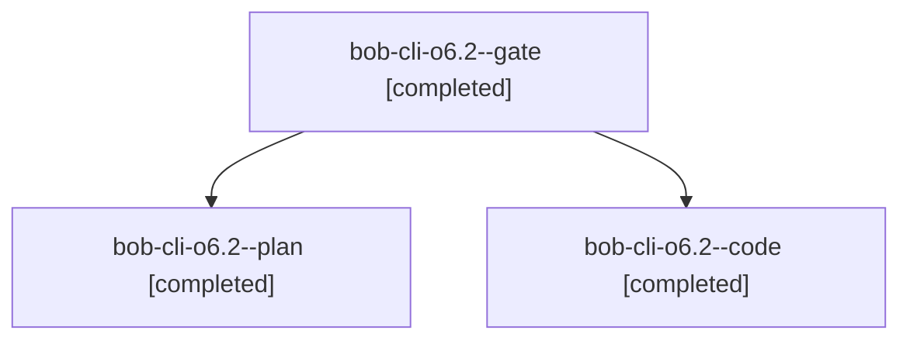

# Session: bob-cli-o6.2

[Agent Hoods](../README.md) / [bbugyi200](../users/bbugyi200/README.md) / [athena](../users/bbugyi200/machines/athena/README.md) / [bob-cli-o6](../users/bbugyi200/machines/athena/hoods/bob-cli-o6/README.md) / bob-cli-o6.2

Owner: `bbugyi200.athena` · Hood: `bob-cli-o6` · Members: 3 · Bead: [bob-cli-o6.2](https://github.com/bobs-org/bob-cli--beads/blob/main/pages/bob-cli-o6/bob-cli-o6.2.md)

## Lineage



The diagram is an optional enhancement; the ordered table below contains the same lineage in accessible text.

| Role | Agent | State | Model / provider | Timing | Commits | Prompt | Chat |
|---|---|---|---|---|---:|---|---|
| <a id="member-gate"></a>gate | bob-cli-o6.2--gate | completed | opus / claude | 2026-11-20T17:01:02.350274+00:00 → 2026-11-20T17:01:09.247714+00:00 | 0 | — | [Chat](../agents/bbugyi200.athena.bob-cli-o6.2--gate/chat.md) |
| <a id="member-plan"></a>plan | bob-cli-o6.2--plan | completed | opus / claude | 2026-11-20T16:51:21.856621+00:00 → 2026-11-20T17:49:20.947979+00:00 | 0 | [Prompt](../agents/bbugyi200.athena.bob-cli-o6.2--plan/prompt.md) | [Chat](../agents/bbugyi200.athena.bob-cli-o6.2--plan/chat.md) |
| <a id="member-code"></a>code | bob-cli-o6.2--code | completed | opus / claude | 2026-11-20T17:02:06.587053+00:00 → 2026-11-20T17:49:20.947979+00:00 | 0 | — | [Chat](../agents/bbugyi200.athena.bob-cli-o6.2--code/chat.md) |

## Variables

| Role | Variable | Value |
|---|---|---|
| code | `artifacts` | \[{bead: bob-cli-o6.2, kind: file, label: Identity kit title-block preview report (56 captures, assertions pass), path: /home/bryan/.sase/artifacts/agents/gh\_bobs-org\_\_bob-cli/20261120120114/report-a5… |

#### artifacts

**Role:** `code`

```yaml
- bead: bob-cli-o6.2
  kind: file
  label: Identity kit title-block preview report (56 captures, assertions pass)
  path: /home/bryan/.sase/artifacts/agents/gh_bobs-org__bob-cli/20261120120114/report-a5991f4a42fb.json
  ref: file:explicit:46d23740114adb12f11c021c
  source_path: /tmp/tbv/tb/report.json
- bead: bob-cli-o6.2
  kind: file
  label: Identity kit title-block preview index
  path: /home/bryan/.sase/artifacts/agents/gh_bobs-org__bob-cli/20261120120114/index-9fc3e4d15f32.html
  ref: file:explicit:d0db68c8b8e4d000bccb5052
  source_path: /tmp/tbv/tb/index.html
- bead: bob-cli-o6.2
  kind: image
  label: Grayscale album/record/day with identical titles
  path: /home/bryan/.sase/artifacts/agents/gh_bobs-org__bob-cli/20261120120114/grayscale-contact-sheet-24d6ee4799c5.png
  ref: file:explicit:81e02cfaafb6ccf00d465f0c
  source_path: /tmp/tbv/tb/grayscale-contact-sheet.png
```

Values are truncated for display; see each member's agent meta.json for the full values.

## Neighbors

| Agent | Relation | State |
|---|---|---|
| [bob-cli-o6.1](bbugyi200.athena.bob-cli-o6.1.md) (session · 3) | bob-cli-o6 hood | completed 3 |
| [bob-cli-o6.3](bbugyi200.athena.bob-cli-o6.3.md) (session · 3) | bob-cli-o6 hood | completed 3 |
| [bob-cli-o6.4](bbugyi200.athena.bob-cli-o6.4.md) (session · 3) | bob-cli-o6 hood | active 1, completed 2 |
| [bob-cli-o6.4.1.1](../agents/bbugyi200.athena.bob-cli-o6.4.1.1/README.md) | bob-cli-o6 hood | active |
| [bob-cli-o6.4.1.2](../agents/bbugyi200.athena.bob-cli-o6.4.1.2/README.md) | bob-cli-o6 hood | waiting |
| [bob-cli-o6.4.1.3](../agents/bbugyi200.athena.bob-cli-o6.4.1.3/README.md) | bob-cli-o6 hood | active |
| [bob-cli-o6.4.1.land](../agents/bbugyi200.athena.bob-cli-o6.4.1.land/README.md) | bob-cli-o6 hood | waiting |
| [bob-cli-o6.5](bbugyi200.athena.bob-cli-o6.5.md) (session · 3) | bob-cli-o6 hood | active 2, completed 1 |
| [bob-cli-o6.6](../agents/bbugyi200.athena.bob-cli-o6.6/README.md) | bob-cli-o6 hood | waiting |
| [bob-cli-o6.7](../agents/bbugyi200.athena.bob-cli-o6.7/README.md) | bob-cli-o6 hood | waiting |
| [bob-cli-o6.land](../agents/bbugyi200.athena.bob-cli-o6.land/README.md) | bob-cli-o6 hood | waiting |
