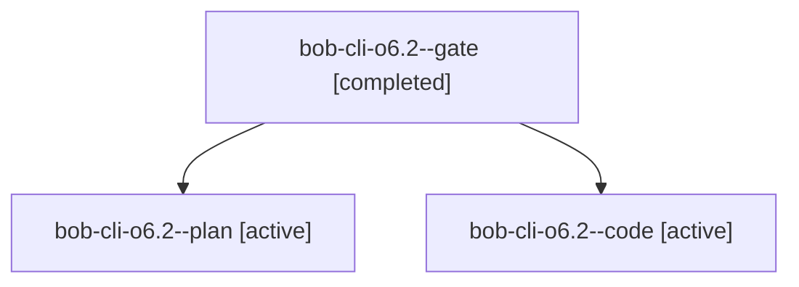

# Session: bob-cli-o6.2

[Agent Hoods](../README.md) / [bbugyi200](../users/bbugyi200/README.md) / [athena](../users/bbugyi200/machines/athena/README.md) / [bob-cli-o6](../users/bbugyi200/machines/athena/hoods/bob-cli-o6/README.md) / bob-cli-o6.2

Owner: `bbugyi200.athena` · Hood: `bob-cli-o6` · Members: 3 · Bead: [bob-cli-o6.2](https://github.com/bobs-org/bob-cli--beads/blob/main/pages/bob-cli-o6/bob-cli-o6.2.md)

## Lineage

The diagram is an optional enhancement; the ordered table below contains the same lineage in accessible text.

| Role | Agent | State | Model / provider | Timing | Commits | Prompt | Chat |
|---|---|---|---|---|---:|---|---|
| gate | bob-cli-o6.2--gate | completed | opus / claude | 2026-11-20T17:01:02.350274+00:00 → 2026-11-20T17:01:09.247714+00:00 | 0 | — | [Chat](../agents/bbugyi200.athena.bob-cli-o6.2--gate/chat.md) |
| plan | bob-cli-o6.2--plan | active | opus / claude | 2026-11-20T16:51:21.856621+00:00 | 0 | [Prompt](../agents/bbugyi200.athena.bob-cli-o6.2--plan/prompt.md) | [Chat](../agents/bbugyi200.athena.bob-cli-o6.2--plan/chat.md) |
| code | bob-cli-o6.2--code | active | opus / claude | 2026-11-20T17:02:06.587053+00:00 | 0 | — | — |

## Neighbors

| Agent | Relation | State |
|---|---|---|
| [bob-cli-o6.1](bbugyi200.athena.bob-cli-o6.1.md) (session · 3) | bob-cli-o6 hood | active 2, completed 1 |
| [bob-cli-o6.3](bbugyi200.athena.bob-cli-o6.3.md) (session · 3) | bob-cli-o6 hood | active 2, completed 1 |
| [bob-cli-o6.4](../agents/bbugyi200.athena.bob-cli-o6.4/README.md) | bob-cli-o6 hood | waiting |
| [bob-cli-o6.5](../agents/bbugyi200.athena.bob-cli-o6.5/README.md) | bob-cli-o6 hood | waiting |
| [bob-cli-o6.6](../agents/bbugyi200.athena.bob-cli-o6.6/README.md) | bob-cli-o6 hood | waiting |
| [bob-cli-o6.7](../agents/bbugyi200.athena.bob-cli-o6.7/README.md) | bob-cli-o6 hood | waiting |
| [bob-cli-o6.land](../agents/bbugyi200.athena.bob-cli-o6.land/README.md) | bob-cli-o6 hood | waiting |
