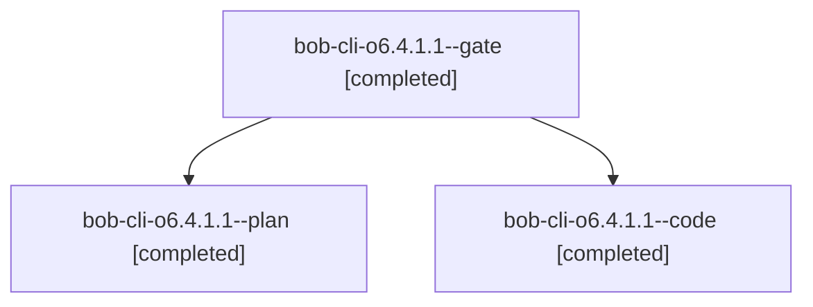

# Session: bob-cli-o6.4.1.1

[Agent Hoods](../README.md) / [bbugyi200](../users/bbugyi200/README.md) / [athena](../users/bbugyi200/machines/athena/README.md) / [bob-cli-o6](../users/bbugyi200/machines/athena/hoods/bob-cli-o6/README.md) / bob-cli-o6.4.1.1

Owner: `bbugyi200.athena` · Hood: `bob-cli-o6` · Members: 3 · Bead: [bob-cli-o6.4.1.1](https://github.com/bobs-org/bob-cli--beads/blob/main/pages/bob-cli-o6/bob-cli-o6.4.1.1.md)

## Lineage



The diagram is an optional enhancement; the ordered table below contains the same lineage in accessible text.

| Role | Agent | State | Model / provider | Timing | Commits | Prompt | Chat |
|---|---|---|---|---|---:|---|---|
| <a id="member-gate"></a>gate | bob-cli-o6.4.1.1--gate | completed | opus / claude | 2026-11-20T18:58:01.366630+00:00 → 2026-11-20T18:58:08.171875+00:00 | 0 | — | [Chat](../agents/bbugyi200.athena.bob-cli-o6.4.1.1--gate/chat.md) |
| <a id="member-plan"></a>plan | bob-cli-o6.4.1.1--plan | completed | opus / claude | 2026-11-20T18:44:40.905209+00:00 → 2026-11-20T20:05:03.417120+00:00 | 0 | [Prompt](../agents/bbugyi200.athena.bob-cli-o6.4.1.1--plan/prompt.md) | [Chat](../agents/bbugyi200.athena.bob-cli-o6.4.1.1--plan/chat.md) |
| <a id="member-code"></a>code | bob-cli-o6.4.1.1--code | completed | opus / claude | 2026-11-20T18:58:41.460645+00:00 → 2026-11-20T20:05:03.417120+00:00 | 0 | — | [Chat](../agents/bbugyi200.athena.bob-cli-o6.4.1.1--code/chat.md) |

## Variables

| Role | Variable | Value |
|---|---|---|
| code | `artifacts` | \[{bead: bob-cli-o6.4.1.1, kind: file, label: Album UI e2e report (real Obsidian, 129/130; Ctrl+J failure pre-existing on master), path: /home/bryan/.sase/artifacts/agents/gh\_bobs-org\_\_bob-cli/2026112… |

#### artifacts

**Role:** `code`

```yaml
- bead: bob-cli-o6.4.1.1
  kind: file
  label: Album UI e2e report (real Obsidian, 129/130; Ctrl+J failure pre-existing on master)
  path: /home/bryan/.sase/artifacts/agents/gh_bobs-org__bob-cli/20261120135814/report-f5d2e9f3dd47.json
  ref: file:explicit:5911d19e7c9aae058cbad08d
  source_path: /tmp/o6411-e2e/report.json
- bead: bob-cli-o6.4.1.1
  kind: image
  label: eat.md Reading: album card in the title slot
  path: /home/bryan/.sase/artifacts/agents/gh_bobs-org__bob-cli/20261120135814/album-records-reading-d541db25da42.png
  ref: file:explicit:63b2e58aa15bb66b78b40933
  source_path: /tmp/o6411-e2e/shots/album-records-reading.png
- bead: bob-cli-o6.4.1.1
  kind: image
  label: eat.md Live Preview: album card in the title slot
  path: /home/bryan/.sase/artifacts/agents/gh_bobs-org__bob-cli/20261120135814/album-records-live-ffd076a8815d.png
  ref: file:explicit:0db478a43c806e285e9af985
  source_path: /tmp/o6411-e2e/shots/album-records-live.png
- bead: bob-cli-o6.4.1.1
  kind: image
  label: eat.md album card at 375px
  path: /home/bryan/.sase/artifacts/agents/gh_bobs-org__bob-cli/20261120135814/album-header-375-light-aa31c974af76.png
  ref: file:explicit:cc79220b38c7fa09e7f2b143
  source_path: /tmp/o6411-e2e/shots/album-header-375-light.png
- bead: bob-cli-o6.4.1.1
  kind: image
  label: eat.md Live Preview: cursor on the H1 reveals it under the card
  path: /home/bryan/.sase/artifacts/agents/gh_bobs-org__bob-cli/20261120135814/album-live-h1-revealed-1814d76b7ad1.png
  ref: file:explicit:34d56e5c34205c66a34ba821
  source_path: /tmp/o6411-e2e/shots/album-live-h1-revealed.png
- bead: bob-cli-o6.4.1.1
  kind: file
  label: Property-card preview report (bank+album structural 20/20, gated 8/8 pixel-identical)
  path: /home/bryan/.sase/artifacts/agents/gh_bobs-org__bob-cli/20261120135814/report-5519c3121195.json
  ref: file:explicit:c1d737b81078a806eca0ce52
  source_path: /tmp/o6411-preview/report.json
- bead: bob-cli-o6.4.1.1
  kind: image
  label: Album card preview index (light/dark x 1280/375 x folded/expanded/pending)
  path: /home/bryan/.sase/artifacts/agents/gh_bobs-org__bob-cli/20261120135814/album-index-9f7b2861f1d5.png
  ref: file:explicit:9bff905d85249923b188a56d
  source_path: /tmp/o6411-preview/album-index.png
```

Values are truncated for display; see each member's agent meta.json for the full values.

## Neighbors

| Agent | Relation | State |
|---|---|---|
| [bob-cli-o6.4](bbugyi200.athena.bob-cli-o6.4.md) (session · 3) | ancestor | completed 2, dismissed 1 |
| [bob-cli-o6.4.1.2](bbugyi200.athena.bob-cli-o6.4.1.2.md) (session · 3) | bob-cli-o6.4.1 hood | completed 3 |
| [bob-cli-o6.4.1.3](bbugyi200.athena.bob-cli-o6.4.1.3.md) (session · 3) | bob-cli-o6.4.1 hood | completed 3 |
| [bob-cli-o6.4.1.land](bbugyi200.athena.bob-cli-o6.4.1.land.md) (session · 3) | bob-cli-o6.4.1 hood | active 2, completed 1 |
| [bob-cli-o6.4.1.land](../agents/bbugyi200.athena.bob-cli-o6.4.1.land/README.md) | bob-cli-o6.4.1 hood | completed |
| [bob-cli-o6.1](bbugyi200.athena.bob-cli-o6.1.md) (session · 3) | bob-cli-o6 hood | completed 3 |
| [bob-cli-o6.2](bbugyi200.athena.bob-cli-o6.2.md) (session · 3) | bob-cli-o6 hood | completed 3 |
| [bob-cli-o6.3](bbugyi200.athena.bob-cli-o6.3.md) (session · 3) | bob-cli-o6 hood | completed 3 |
| [bob-cli-o6.5](bbugyi200.athena.bob-cli-o6.5.md) (session · 3) | bob-cli-o6 hood | completed 3 |
| [bob-cli-o6.6](bbugyi200.athena.bob-cli-o6.6.md) (session · 3) | bob-cli-o6 hood | completed 2, dismissed 1 |
| [bob-cli-o6.6.1.1](../agents/bbugyi200.athena.bob-cli-o6.6.1.1/README.md) | bob-cli-o6 hood | completed |
| [bob-cli-o6.6.1.2](bbugyi200.athena.bob-cli-o6.6.1.2.md) (session · 23) | bob-cli-o6 hood | completed 12, failed 11 |
| [bob-cli-o6.6.1.3](../agents/bbugyi200.athena.bob-cli-o6.6.1.3/README.md) | bob-cli-o6 hood | completed |
| [bob-cli-o6.6.1.4](../agents/bbugyi200.athena.bob-cli-o6.6.1.4/README.md) | bob-cli-o6 hood | completed |
| [bob-cli-o6.6.1.5](../agents/bbugyi200.athena.bob-cli-o6.6.1.5/README.md) | bob-cli-o6 hood | completed |
| [bob-cli-o6.6.1.land](../agents/bbugyi200.athena.bob-cli-o6.6.1.land/README.md) | bob-cli-o6 hood | completed |
| [bob-cli-o6.7](../agents/bbugyi200.athena.bob-cli-o6.7/README.md) | bob-cli-o6 hood | completed |
| [bob-cli-o6.land](../agents/bbugyi200.athena.bob-cli-o6.land/README.md) | bob-cli-o6 hood | completed |
