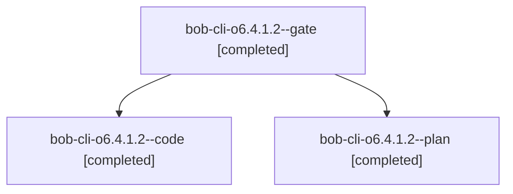

# Session: bob-cli-o6.4.1.2

[Agent Hoods](../README.md) / [bbugyi200](../users/bbugyi200/README.md) / [athena](../users/bbugyi200/machines/athena/README.md) / [bob-cli-o6](../users/bbugyi200/machines/athena/hoods/bob-cli-o6/README.md) / bob-cli-o6.4.1.2

Owner: `bbugyi200.athena` · Hood: `bob-cli-o6` · Members: 3 · Bead: [bob-cli-o6.4.1.2](https://github.com/bobs-org/bob-cli--beads/blob/main/pages/bob-cli-o6/bob-cli-o6.4.1.2.md)

## Lineage



The diagram is an optional enhancement; the ordered table below contains the same lineage in accessible text.

| Role | Agent | State | Model / provider | Timing | Commits | Prompt | Chat |
|---|---|---|---|---|---:|---|---|
| <a id="member-gate"></a>gate | bob-cli-o6.4.1.2--gate | completed | opus / claude | 2026-11-20T23:07:07.951789+00:00 → 2026-11-20T23:07:15.553015+00:00 | 0 | — | [Chat](../agents/bbugyi200.athena.bob-cli-o6.4.1.2--gate/chat.md) |
| <a id="member-code"></a>code | bob-cli-o6.4.1.2--code | completed | grok-4.6 / grok | 2026-11-20T23:07:47.890686+00:00 → 2026-11-21T02:09:41.906883+00:00 | 0 | — | [Chat](../agents/bbugyi200.athena.bob-cli-o6.4.1.2--code/chat.md) |
| <a id="member-plan"></a>plan | bob-cli-o6.4.1.2--plan | completed | opus / claude | 2026-11-20T22:56:55.344602+00:00 → 2026-11-21T02:09:41.906883+00:00 | 0 | [Prompt](../agents/bbugyi200.athena.bob-cli-o6.4.1.2--plan/prompt.md) | [Chat](../agents/bbugyi200.athena.bob-cli-o6.4.1.2--plan/chat.md) |

## Variables

| Role | Variable | Value |
|---|---|---|
| code | `artifacts` | \[{bead: bob-cli-o6.4.1.2, kind: file, label: Record card e2e report (full, 180/180), path: /home/bryan/.sase/artifacts/agents/gh\_bobs-org\_\_bob-cli/20261120180721/record-card-title-b76d75a4736d.json,… |

#### artifacts

**Role:** `code`

```yaml
- bead: bob-cli-o6.4.1.2
  kind: file
  label: Record card e2e report (full, 180/180)
  path: /home/bryan/.sase/artifacts/agents/gh_bobs-org__bob-cli/20261120180721/record-card-title-b76d75a4736d.json
  ref: file:explicit:f0c604b18ca234048e388234
  source_path: /tmp/record-card-title.json
- bead: bob-cli-o6.4.1.2
  kind: file
  label: Record walk e2e report (16/16)
  path: /home/bryan/.sase/artifacts/agents/gh_bobs-org__bob-cli/20261120180721/record-walk-title-f793ca528486.json
  ref: file:explicit:8a936446acea27130b062c71
  source_path: /tmp/record-walk-title.json
- bead: bob-cli-o6.4.1.2
  kind: file
  label: Property-card preview report (bank/album/record structural 28/28)
  path: /home/bryan/.sase/artifacts/agents/gh_bobs-org__bob-cli/20261120180721/report-42cb87b8a084.json
  ref: file:explicit:889bc05d45700ad156272d37
  source_path: /tmp/record-title-preview/report.json
- bead: bob-cli-o6.4.1.2
  kind: image
  label: Record card Reading screenshot
  path: /home/bryan/.sase/artifacts/agents/gh_bobs-org__bob-cli/20261120180721/record-sheet-frontmatter-only-reading-30c8da5fea0f.png
  ref: file:explicit:8e372fc39a43c7a4771c778e
  source_path: /tmp/record-card-title-shots/record-sheet-frontmatter-only-reading.png
- bead: bob-cli-o6.4.1.2
  kind: image
  label: Record card Live Preview screenshot
  path: /home/bryan/.sase/artifacts/agents/gh_bobs-org__bob-cli/20261120180721/record-sheet-live-light-wide-b18335d42ce0.png
  ref: file:explicit:2edf25fd83d5065a3b3014d2
  source_path: /tmp/record-card-title-shots/record-sheet-live-light-wide.png
- bead: bob-cli-o6.4.1.2
  kind: image
  label: Record card Live Preview reveal screenshot
  path: /home/bryan/.sase/artifacts/agents/gh_bobs-org__bob-cli/20261120180721/record-sheet-live-reveal-75ddeffb6aff.png
  ref: file:explicit:98520cdab33c58285c8eb69e
  source_path: /tmp/record-card-title-shots/record-sheet-live-reveal.png
- bead: bob-cli-o6.4.1.2
  kind: image
  label: Record card 375px screenshot
  path: /home/bryan/.sase/artifacts/agents/gh_bobs-org__bob-cli/20261120180721/record-sheet-live-light-375-4decdccac8a6.png
  ref: file:explicit:af21f8ba1f5314bedb0dfa65
  source_path: /tmp/record-card-title-shots/record-sheet-live-light-375.png
- bead: bob-cli-o6.4.1.2
  kind: image
  label: Record card preview 1280 expanded (current)
  path: /home/bryan/.sase/artifacts/agents/gh_bobs-org__bob-cli/20261120180721/record-light-1280-expanded-current-2027172dfd63.png
  ref: file:explicit:d10bae27ca21fa092df9a860
  source_path: /tmp/record-title-preview/record-light-1280-expanded-current.png
- bead: bob-cli-o6.4.1.2
  kind: image
  label: Record walk Live Preview screenshot
  path: /home/bryan/.sase/artifacts/agents/gh_bobs-org__bob-cli/20261120180721/live-preview-eafeb16bc8d6.png
  ref: file:explicit:d42cb2cd025278e448e5df6c
  source_path: /tmp/record-walk-title-shots/live-preview.png
```

Values are truncated for display; see each member's agent meta.json for the full values.

## Neighbors

| Agent | Relation | State |
|---|---|---|
| [bob-cli-o6.4](bbugyi200.athena.bob-cli-o6.4.md) (session · 3) | ancestor | active 1, completed 2 |
| [bob-cli-o6.4.1.1](bbugyi200.athena.bob-cli-o6.4.1.1.md) (session · 3) | bob-cli-o6.4.1 hood | completed 3 |
| [bob-cli-o6.4.1.3](bbugyi200.athena.bob-cli-o6.4.1.3.md) (session · 3) | bob-cli-o6.4.1 hood | completed 3 |
| [bob-cli-o6.4.1.land](bbugyi200.athena.bob-cli-o6.4.1.land.md) (session · 3) | bob-cli-o6.4.1 hood | active 2, completed 1 |
| [bob-cli-o6.4.1.land](../agents/bbugyi200.athena.bob-cli-o6.4.1.land/README.md) | bob-cli-o6.4.1 hood | completed |
| [bob-cli-o6.1](bbugyi200.athena.bob-cli-o6.1.md) (session · 3) | bob-cli-o6 hood | completed 3 |
| [bob-cli-o6.2](bbugyi200.athena.bob-cli-o6.2.md) (session · 3) | bob-cli-o6 hood | completed 3 |
| [bob-cli-o6.3](bbugyi200.athena.bob-cli-o6.3.md) (session · 3) | bob-cli-o6 hood | completed 3 |
| [bob-cli-o6.5](bbugyi200.athena.bob-cli-o6.5.md) (session · 3) | bob-cli-o6 hood | completed 3 |
| [bob-cli-o6.6](bbugyi200.athena.bob-cli-o6.6.md) (session · 3) | bob-cli-o6 hood | active 1, completed 2 |
| [bob-cli-o6.6.1.1](../agents/bbugyi200.athena.bob-cli-o6.6.1.1/README.md) | bob-cli-o6 hood | completed |
| [bob-cli-o6.6.1.2](bbugyi200.athena.bob-cli-o6.6.1.2.md) (session · 16) | bob-cli-o6 hood | active 1, completed 8, failed 7 |
| [bob-cli-o6.6.1.3](../agents/bbugyi200.athena.bob-cli-o6.6.1.3/README.md) | bob-cli-o6 hood | waiting |
| [bob-cli-o6.6.1.4](../agents/bbugyi200.athena.bob-cli-o6.6.1.4/README.md) | bob-cli-o6 hood | waiting |
| [bob-cli-o6.6.1.5](../agents/bbugyi200.athena.bob-cli-o6.6.1.5/README.md) | bob-cli-o6 hood | waiting |
| [bob-cli-o6.6.1.land](../agents/bbugyi200.athena.bob-cli-o6.6.1.land/README.md) | bob-cli-o6 hood | waiting |
| [bob-cli-o6.7](../agents/bbugyi200.athena.bob-cli-o6.7/README.md) | bob-cli-o6 hood | waiting |
| [bob-cli-o6.land](../agents/bbugyi200.athena.bob-cli-o6.land/README.md) | bob-cli-o6 hood | waiting |
