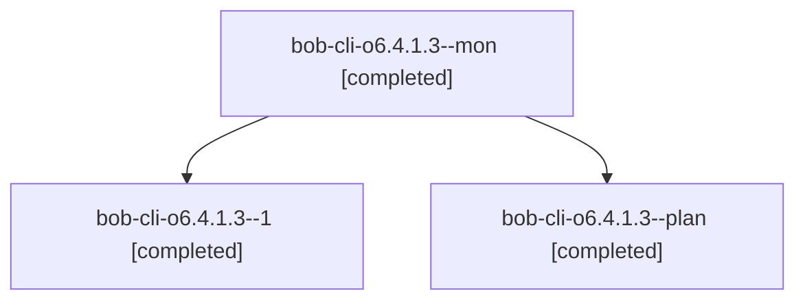

# Session: bob-cli-o6.4.1.3

[Agent Hoods](../README.md) / [bbugyi200](../users/bbugyi200/README.md) / [athena](../users/bbugyi200/machines/athena/README.md) / [bob-cli-o6](../users/bbugyi200/machines/athena/hoods/bob-cli-o6/README.md) / bob-cli-o6.4.1.3

Owner: `bbugyi200.athena` · Hood: `bob-cli-o6` · Members: 3 · Bead: [bob-cli-o6.4.1.3](https://github.com/bobs-org/bob-cli--beads/blob/main/pages/bob-cli-o6/bob-cli-o6.4.1.3.md)

## Lineage



The diagram is an optional enhancement; the ordered table below contains the same lineage in accessible text.

| Role | Agent | State | Model / provider | Timing | Commits | Prompt | Chat |
|---|---|---|---|---|---:|---|---|
| <a id="member-mon"></a>mon | bob-cli-o6.4.1.3--mon | completed | opus / claude | 2026-11-20T19:33:42.550016+00:00 → 2026-11-20T19:46:30.257395+00:00 | 0 | — | [Chat](../agents/bbugyi200.athena.bob-cli-o6.4.1.3--mon/chat.md) |
| <a id="member-1"></a>1 | bob-cli-o6.4.1.3--1 | completed | opus / claude | 2026-11-20T20:10:44.193997+00:00 → 2026-11-20T20:14:07.264698+00:00 | 0 | [Prompt](../agents/bbugyi200.athena.bob-cli-o6.4.1.3--1/prompt.md) | [Chat](../agents/bbugyi200.athena.bob-cli-o6.4.1.3--1/chat.md) |
| <a id="member-plan"></a>plan | bob-cli-o6.4.1.3--plan | completed | opus / claude | 2026-11-20T18:44:34.624994+00:00 → 2026-11-20T19:35:01.083369+00:00 | 0 | [Prompt](../agents/bbugyi200.athena.bob-cli-o6.4.1.3--plan/prompt.md) | [Chat](../agents/bbugyi200.athena.bob-cli-o6.4.1.3--plan/chat.md) |

## Variables

| Role | Variable | Value |
|---|---|---|
| plan | `artifacts` | \[{bead: bob-cli-o6.4.1.3, kind: markdown, label: bank-and-editors e2e and preview summary, path: /home/bryan/.sase/artifacts/agents/gh\_bobs-org\_\_bob-cli/20261120134401/e2e-summary-e4fe2b882c77.md, re… |

#### artifacts

**Role:** `plan`

```yaml
- bead: bob-cli-o6.4.1.3
  kind: markdown
  label: bank-and-editors e2e and preview summary
  path: /home/bryan/.sase/artifacts/agents/gh_bobs-org__bob-cli/20261120134401/e2e-summary-e4fe2b882c77.md
  ref: file:explicit:c18918352df0c879b13cfa09
  source_path: /tmp/o6413-artifacts/e2e-summary.md
- bead: bob-cli-o6.4.1.3
  kind: file
  label: bank Setup real-Obsidian e2e report (current tree)
  path: /home/bryan/.sase/artifacts/agents/gh_bobs-org__bob-cli/20261120134401/report-ddfe945c8a78.json
  ref: file:explicit:74d6baad122ff5d4a098008d
  source_path: /tmp/o6413-e2e-setup3/report.json
- bead: bob-cli-o6.4.1.3
  kind: image
  label: bank card, album card editor, and Record Card headers with species badges (real Obsidian + preview)
  path: /home/bryan/.sase/artifacts/agents/gh_bobs-org__bob-cli/20261120134401/key-screenshots-ba98621b422e.png
  ref: file:explicit:06ac5bda11561f50cbb70939
  source_path: /tmp/o6413-artifacts/key-screenshots.png
- bead: bob-cli-o6.4.1.3
  kind: file
  label: bank/album/record e2e reports, logs, screenshots, base comparisons, and property-card previews
  path: /home/bryan/.sase/artifacts/agents/gh_bobs-org__bob-cli/20261120134401/e2e-evidence.tar-124c3b7e67ae.gz
  ref: file:explicit:f9426b02e3616fb0a9bd0b33
  source_path: /tmp/o6413-artifacts/e2e-evidence.tar.gz
```

Values are truncated for display; see each member's agent meta.json for the full values.

## Neighbors

| Agent | Relation | State |
|---|---|---|
| [bob-cli-o6.4](bbugyi200.athena.bob-cli-o6.4.md) (session · 3) | ancestor | active 1, completed 2 |
| [bob-cli-o6.4.1.1](bbugyi200.athena.bob-cli-o6.4.1.1.md) (session · 3) | bob-cli-o6.4.1 hood | completed 3 |
| [bob-cli-o6.4.1.2](bbugyi200.athena.bob-cli-o6.4.1.2.md) (session · 3) | bob-cli-o6.4.1 hood | completed 3 |
| [bob-cli-o6.4.1.land](bbugyi200.athena.bob-cli-o6.4.1.land.md) (session · 3) | bob-cli-o6.4.1 hood | active 2, completed 1 |
| [bob-cli-o6.4.1.land](../agents/bbugyi200.athena.bob-cli-o6.4.1.land/README.md) | bob-cli-o6.4.1 hood | completed |
| [bob-cli-o6.1](bbugyi200.athena.bob-cli-o6.1.md) (session · 3) | bob-cli-o6 hood | completed 3 |
| [bob-cli-o6.2](bbugyi200.athena.bob-cli-o6.2.md) (session · 3) | bob-cli-o6 hood | completed 3 |
| [bob-cli-o6.3](bbugyi200.athena.bob-cli-o6.3.md) (session · 3) | bob-cli-o6 hood | completed 3 |
| [bob-cli-o6.5](bbugyi200.athena.bob-cli-o6.5.md) (session · 3) | bob-cli-o6 hood | completed 3 |
| [bob-cli-o6.6](../agents/bbugyi200.athena.bob-cli-o6.6/README.md) | bob-cli-o6 hood | waiting |
| [bob-cli-o6.7](../agents/bbugyi200.athena.bob-cli-o6.7/README.md) | bob-cli-o6 hood | waiting |
| [bob-cli-o6.land](../agents/bbugyi200.athena.bob-cli-o6.land/README.md) | bob-cli-o6 hood | waiting |
