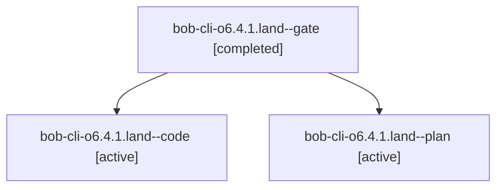

# Session: bob-cli-o6.4.1.land

[Agent Hoods](../README.md) / [bbugyi200](../users/bbugyi200/README.md) / [athena](../users/bbugyi200/machines/athena/README.md) / [bob-cli-o6](../users/bbugyi200/machines/athena/hoods/bob-cli-o6/README.md) / bob-cli-o6.4.1.land

Owner: `bbugyi200.athena` · Hood: `bob-cli-o6` · Members: 3 · Bead: [bob-cli-o6.4.1](https://github.com/bobs-org/bob-cli--beads/blob/main/pages/bob-cli-o6/bob-cli-o6.4.1.md)

## Lineage



The diagram is an optional enhancement; the ordered table below contains the same lineage in accessible text.

| Role | Agent | State | Model / provider | Timing | Commits | Prompt | Chat |
|---|---|---|---|---|---:|---|---|
| <a id="member-gate"></a>gate | bob-cli-o6.4.1.land--gate | completed | gpt-6-astra / codex | 2026-11-21T02:22:28.603655+00:00 → 2026-11-21T02:22:35.260404+00:00 | 0 | — | [Chat](../agents/bbugyi200.athena.bob-cli-o6.4.1.land--gate/chat.md) |
| <a id="member-code"></a>code | bob-cli-o6.4.1.land--code | active | gpt-6-luna / codex | 2026-11-21T02:23:07.887404+00:00 | 0 | — | — |
| <a id="member-plan"></a>plan | bob-cli-o6.4.1.land--plan | active | gpt-6-astra / codex | 2026-11-21T02:09:59.322773+00:00 | 0 | [Prompt](../agents/bbugyi200.athena.bob-cli-o6.4.1.land--plan/prompt.md) | [Chat](../agents/bbugyi200.athena.bob-cli-o6.4.1.land--plan/chat.md) |

## Variables

| Role | Variable | Value |
|---|---|---|
| plan | `artifacts` | \[{bead: bob-cli-o6.4.1, kind: file, label: Collection-card landing focused unit audit: 213 passing tests on b8b7baf, path: /home/bryan/.sase/artifacts/agents/gh\_bobs-org\_\_bob-cli/20261120134403/o6-co… |

#### artifacts

**Role:** `plan`

```yaml
- bead: bob-cli-o6.4.1
  kind: file
  label: Collection-card landing focused unit audit: 213 passing tests on b8b7baf
  path: /home/bryan/.sase/artifacts/agents/gh_bobs-org__bob-cli/20261120134403/o6-collection-audit-tests-ecc010b53183.log
  ref: file:explicit:853697ae77344b5b2c077384
  source_path: /tmp/o6-collection-audit-tests.log
```

Values are truncated for display; see each member's agent meta.json for the full values.

## Neighbors

| Agent | Relation | State |
|---|---|---|
| [bob-cli-o6.4](bbugyi200.athena.bob-cli-o6.4.md) (session · 3) | ancestor | active 1, completed 2 |
| [bob-cli-o6.4.1.1](bbugyi200.athena.bob-cli-o6.4.1.1.md) (session · 3) | bob-cli-o6.4.1 hood | completed 3 |
| [bob-cli-o6.4.1.2](bbugyi200.athena.bob-cli-o6.4.1.2.md) (session · 3) | bob-cli-o6.4.1 hood | completed 3 |
| [bob-cli-o6.4.1.3](bbugyi200.athena.bob-cli-o6.4.1.3.md) (session · 3) | bob-cli-o6.4.1 hood | completed 3 |
| [bob-cli-o6.1](bbugyi200.athena.bob-cli-o6.1.md) (session · 3) | bob-cli-o6 hood | completed 3 |
| [bob-cli-o6.2](bbugyi200.athena.bob-cli-o6.2.md) (session · 3) | bob-cli-o6 hood | completed 3 |
| [bob-cli-o6.3](bbugyi200.athena.bob-cli-o6.3.md) (session · 3) | bob-cli-o6 hood | completed 3 |
| [bob-cli-o6.5](bbugyi200.athena.bob-cli-o6.5.md) (session · 3) | bob-cli-o6 hood | completed 3 |
| [bob-cli-o6.6](bbugyi200.athena.bob-cli-o6.6.md) (session · 3) | bob-cli-o6 hood | active 1, completed 2 |
| [bob-cli-o6.6.1.1](../agents/bbugyi200.athena.bob-cli-o6.6.1.1/README.md) | bob-cli-o6 hood | completed |
| [bob-cli-o6.6.1.2](../agents/bbugyi200.athena.bob-cli-o6.6.1.2/README.md) | bob-cli-o6 hood | active |
| [bob-cli-o6.6.1.3](../agents/bbugyi200.athena.bob-cli-o6.6.1.3/README.md) | bob-cli-o6 hood | waiting |
| [bob-cli-o6.6.1.4](../agents/bbugyi200.athena.bob-cli-o6.6.1.4/README.md) | bob-cli-o6 hood | waiting |
| [bob-cli-o6.6.1.5](../agents/bbugyi200.athena.bob-cli-o6.6.1.5/README.md) | bob-cli-o6 hood | waiting |
| [bob-cli-o6.6.1.land](../agents/bbugyi200.athena.bob-cli-o6.6.1.land/README.md) | bob-cli-o6 hood | waiting |
| [bob-cli-o6.7](../agents/bbugyi200.athena.bob-cli-o6.7/README.md) | bob-cli-o6 hood | waiting |
| [bob-cli-o6.land](../agents/bbugyi200.athena.bob-cli-o6.land/README.md) | bob-cli-o6 hood | waiting |
