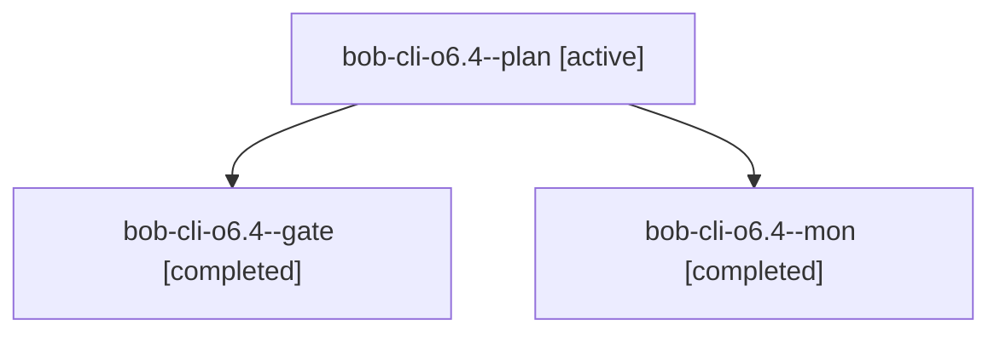

# Session: bob-cli-o6.4

[Agent Hoods](../README.md) / [bbugyi200](../users/bbugyi200/README.md) / [athena](../users/bbugyi200/machines/athena/README.md) / [bob-cli-o6](../users/bbugyi200/machines/athena/hoods/bob-cli-o6/README.md) / bob-cli-o6.4

Owner: `bbugyi200.athena` · Hood: `bob-cli-o6` · Members: 3 · Bead: [bob-cli-o6.4](https://github.com/bobs-org/bob-cli--beads/blob/main/pages/bob-cli-o6/bob-cli-o6.4.md)

## Lineage

The diagram is an optional enhancement; the ordered table below contains the same lineage in accessible text.

| Role | Agent | State | Model / provider | Timing | Commits | Prompt | Chat |
|---|---|---|---|---|---:|---|---|
| plan | bob-cli-o6.4--plan | active | opus / claude | 2026-11-20T18:27:12.015044+00:00 → 2026-11-20T18:43:01.397047+00:00 | 0 | [Prompt](../agents/bbugyi200.athena.bob-cli-o6.4--plan/prompt.md) | [Chat](../agents/bbugyi200.athena.bob-cli-o6.4--plan/chat.md) |
| gate | bob-cli-o6.4--gate | completed | opus / claude | 2026-11-20T18:42:44.874132+00:00 → 2026-11-20T18:42:55.229957+00:00 | 0 | — | [Chat](../agents/bbugyi200.athena.bob-cli-o6.4--gate/chat.md) |
| mon | bob-cli-o6.4--mon | completed | opus / claude | 2026-11-20T18:42:54.111688+00:00 → 2026-11-20T18:44:57.170408+00:00 | 0 | — | [Chat](../agents/bbugyi200.athena.bob-cli-o6.4--mon/chat.md) |

## Neighbors

| Agent | Relation | State |
|---|---|---|
| [bob-cli-o6.4.1.1](bbugyi200.athena.bob-cli-o6.4.1.1.md) (session · 3) | descendant | completed 3 |
| [bob-cli-o6.4.1.2](bbugyi200.athena.bob-cli-o6.4.1.2.md) (session · 3) | descendant | completed 3 |
| [bob-cli-o6.4.1.3](bbugyi200.athena.bob-cli-o6.4.1.3.md) (session · 3) | descendant | completed 3 |
| [bob-cli-o6.4.1.land](bbugyi200.athena.bob-cli-o6.4.1.land.md) (session · 3) | descendant | active 2, completed 1 |
| [bob-cli-o6.4.1.land](../agents/bbugyi200.athena.bob-cli-o6.4.1.land/README.md) | descendant | completed |
| [bob-cli-o6.1](bbugyi200.athena.bob-cli-o6.1.md) (session · 3) | bob-cli-o6 hood | completed 3 |
| [bob-cli-o6.2](bbugyi200.athena.bob-cli-o6.2.md) (session · 3) | bob-cli-o6 hood | completed 3 |
| [bob-cli-o6.3](bbugyi200.athena.bob-cli-o6.3.md) (session · 3) | bob-cli-o6 hood | completed 3 |
| [bob-cli-o6.5](bbugyi200.athena.bob-cli-o6.5.md) (session · 3) | bob-cli-o6 hood | completed 3 |
| [bob-cli-o6.6](bbugyi200.athena.bob-cli-o6.6.md) (session · 3) | bob-cli-o6 hood | active 1, completed 2 |
| [bob-cli-o6.6.1.1](../agents/bbugyi200.athena.bob-cli-o6.6.1.1/README.md) | bob-cli-o6 hood | completed |
| [bob-cli-o6.6.1.2](bbugyi200.athena.bob-cli-o6.6.1.2.md) (session · 23) | bob-cli-o6 hood | completed 12, failed 11 |
| [bob-cli-o6.6.1.3](../agents/bbugyi200.athena.bob-cli-o6.6.1.3/README.md) | bob-cli-o6 hood | completed |
| [bob-cli-o6.6.1.4](../agents/bbugyi200.athena.bob-cli-o6.6.1.4/README.md) | bob-cli-o6 hood | completed |
| [bob-cli-o6.6.1.5](../agents/bbugyi200.athena.bob-cli-o6.6.1.5/README.md) | bob-cli-o6 hood | completed |
| [bob-cli-o6.6.1.land](../agents/bbugyi200.athena.bob-cli-o6.6.1.land/README.md) | bob-cli-o6 hood | completed |
| [bob-cli-o6.7](../agents/bbugyi200.athena.bob-cli-o6.7/README.md) | bob-cli-o6 hood | waiting |
| [bob-cli-o6.land](../agents/bbugyi200.athena.bob-cli-o6.land/README.md) | bob-cli-o6 hood | waiting |
