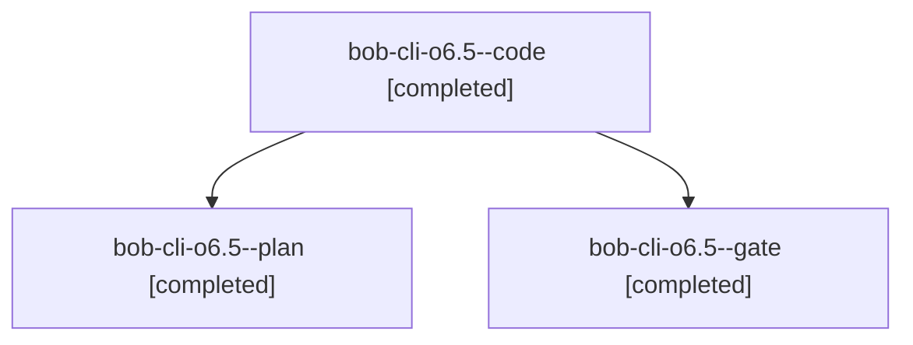

# Session: bob-cli-o6.5

[Agent Hoods](../README.md) / [bbugyi200](../users/bbugyi200/README.md) / [athena](../users/bbugyi200/machines/athena/README.md) / [bob-cli-o6](../users/bbugyi200/machines/athena/hoods/bob-cli-o6/README.md) / bob-cli-o6.5

Owner: `bbugyi200.athena` · Hood: `bob-cli-o6` · Members: 3 · Bead: [bob-cli-o6.5](https://github.com/bobs-org/bob-cli--beads/blob/main/pages/bob-cli-o6/bob-cli-o6.5.md)

## Lineage



The diagram is an optional enhancement; the ordered table below contains the same lineage in accessible text.

| Role | Agent | State | Model / provider | Timing | Commits | Prompt | Chat |
|---|---|---|---|---|---:|---|---|
| <a id="member-code"></a>code | bob-cli-o6.5--code | completed | opus / claude | 2026-11-20T18:38:56.803360+00:00 → 2026-11-20T19:40:43.804374+00:00 | 0 | — | [Chat](../agents/bbugyi200.athena.bob-cli-o6.5--code/chat.md) |
| <a id="member-plan"></a>plan | bob-cli-o6.5--plan | completed | opus / claude | 2026-11-20T18:27:20.516737+00:00 → 2026-11-20T19:40:43.804374+00:00 | 0 | [Prompt](../agents/bbugyi200.athena.bob-cli-o6.5--plan/prompt.md) | [Chat](../agents/bbugyi200.athena.bob-cli-o6.5--plan/chat.md) |
| <a id="member-gate"></a>gate | bob-cli-o6.5--gate | completed | opus / claude | 2026-11-20T18:37:45.939845+00:00 → 2026-11-20T18:37:53.169053+00:00 | 0 | — | [Chat](../agents/bbugyi200.athena.bob-cli-o6.5--gate/chat.md) |

## Variables

| Role | Variable | Value |
|---|---|---|
| code | `artifacts` | \[{bead: bob-cli-o6.5, kind: file, label: day-period-cards real-Obsidian e2e report (82/82 PASS, ledger-tools 1.146.0), path: /home/bryan/.sase/artifacts/agents/gh\_bobs-org\_\_bob-cli/20261120133758/o65… |

#### artifacts

**Role:** `code`

```yaml
- bead: bob-cli-o6.5
  kind: file
  label: day-period-cards real-Obsidian e2e report (82/82 PASS, ledger-tools 1.146.0)
  path: /home/bryan/.sase/artifacts/agents/gh_bobs-org__bob-cli/20261120133758/o65-day-period-cards-e2e-report-61757aff4bd6.json
  ref: file:explicit:8446f75d3c5fc1b954fdc8e7
  source_path: /tmp/o65-day-period-cards-e2e-report.json
- bead: bob-cli-o6.5
  kind: file
  label: preview-intention-card report (52 captures)
  path: /home/bryan/.sase/artifacts/agents/gh_bobs-org__bob-cli/20261120133758/o65-day-period-cards-preview-report-abd515342938.json
  ref: file:explicit:526c6d191f83b84ea35eb8c1
  source_path: /tmp/o65-day-period-cards-preview-report.json
- bead: bob-cli-o6.5
  kind: image
  label: e2e: today and week, Live Preview and Reading, light and dark
  path: /home/bryan/.sase/artifacts/agents/gh_bobs-org__bob-cli/20261120133758/o65-e2e-sheet-today-week-5b622da959b9.png
  ref: file:explicit:800d52b5866507824f14ae0b
  source_path: /tmp/o65-e2e-sheet-today-week.png
- bead: bob-cli-o6.5
  kind: image
  label: e2e: empty day, legacy daily, ghost, reveal-on-cursor
  path: /home/bryan/.sase/artifacts/agents/gh_bobs-org__bob-cli/20261120133758/o65-e2e-sheet-empty-legacy-ghost-reveal-752676389efc.png
  ref: file:explicit:f644ddee5d89c2b8b81b22ad
  source_path: /tmp/o65-e2e-sheet-empty-legacy-ghost-reveal.png
- bead: bob-cli-o6.5
  kind: image
  label: e2e: 375px today, week, legacy
  path: /home/bryan/.sase/artifacts/agents/gh_bobs-org__bob-cli/20261120133758/o65-e2e-sheet-375-822899b245e0.png
  ref: file:explicit:ab70904ec3f5e73ecd6b1e70
  source_path: /tmp/o65-e2e-sheet-375.png
- bead: bob-cli-o6.5
  kind: image
  label: preview: empty today ghost, past empty, future, legacy
  path: /home/bryan/.sase/artifacts/agents/gh_bobs-org__bob-cli/20261120133758/o65-new-days-e39886c12072.png
  ref: file:explicit:d2a2c24fb1efffb5026ed1ba
  source_path: /tmp/o65-new-days.png
- bead: bob-cli-o6.5
  kind: image
  label: preview: week children, quarter, year light and dark
  path: /home/bryan/.sase/artifacts/agents/gh_bobs-org__bob-cli/20261120133758/o65-new-periods-69765d14b80d.png
  ref: file:explicit:f41ca288c10dd6dc97169faa
  source_path: /tmp/o65-new-periods.png
- bead: bob-cli-o6.5
  kind: image
  label: preview: 375px day, week, quarter, populated day
  path: /home/bryan/.sase/artifacts/agents/gh_bobs-org__bob-cli/20261120133758/o65-new-375-857982c08e78.png
  ref: file:explicit:04c2de58cec3c97532141a44
  source_path: /tmp/o65-new-375.png
- bead: bob-cli-o6.5
  kind: image
  label: preview before/after: populated day card
  path: /home/bryan/.sase/artifacts/agents/gh_bobs-org__bob-cli/20261120133758/o65-cmp-three-with-both-bands-light-1280-bc74b1ed7883.png
  ref: file:explicit:fa36383bd08442974d1067e1
  source_path: /tmp/o65-cmp-three-with-both-bands-light-1280.png
```

Values are truncated for display; see each member's agent meta.json for the full values.

## Neighbors

| Agent | Relation | State |
|---|---|---|
| [bob-cli-o6.1](bbugyi200.athena.bob-cli-o6.1.md) (session · 3) | bob-cli-o6 hood | completed 3 |
| [bob-cli-o6.2](bbugyi200.athena.bob-cli-o6.2.md) (session · 3) | bob-cli-o6 hood | completed 3 |
| [bob-cli-o6.3](bbugyi200.athena.bob-cli-o6.3.md) (session · 3) | bob-cli-o6 hood | completed 3 |
| [bob-cli-o6.4](bbugyi200.athena.bob-cli-o6.4.md) (session · 3) | bob-cli-o6 hood | active 1, completed 2 |
| [bob-cli-o6.4.1.1](bbugyi200.athena.bob-cli-o6.4.1.1.md) (session · 3) | bob-cli-o6 hood | completed 3 |
| [bob-cli-o6.4.1.2](bbugyi200.athena.bob-cli-o6.4.1.2.md) (session · 3) | bob-cli-o6 hood | completed 3 |
| [bob-cli-o6.4.1.3](bbugyi200.athena.bob-cli-o6.4.1.3.md) (session · 3) | bob-cli-o6 hood | completed 3 |
| [bob-cli-o6.4.1.land](bbugyi200.athena.bob-cli-o6.4.1.land.md) (session · 3) | bob-cli-o6 hood | active 2, completed 1 |
| [bob-cli-o6.4.1.land](../agents/bbugyi200.athena.bob-cli-o6.4.1.land/README.md) | bob-cli-o6 hood | completed |
| [bob-cli-o6.6](bbugyi200.athena.bob-cli-o6.6.md) (session · 3) | bob-cli-o6 hood | active 1, completed 2 |
| [bob-cli-o6.6.1.1](../agents/bbugyi200.athena.bob-cli-o6.6.1.1/README.md) | bob-cli-o6 hood | completed |
| [bob-cli-o6.6.1.2](bbugyi200.athena.bob-cli-o6.6.1.2.md) (session · 16) | bob-cli-o6 hood | active 1, completed 8, failed 7 |
| [bob-cli-o6.6.1.3](../agents/bbugyi200.athena.bob-cli-o6.6.1.3/README.md) | bob-cli-o6 hood | waiting |
| [bob-cli-o6.6.1.4](../agents/bbugyi200.athena.bob-cli-o6.6.1.4/README.md) | bob-cli-o6 hood | waiting |
| [bob-cli-o6.6.1.5](../agents/bbugyi200.athena.bob-cli-o6.6.1.5/README.md) | bob-cli-o6 hood | waiting |
| [bob-cli-o6.6.1.land](../agents/bbugyi200.athena.bob-cli-o6.6.1.land/README.md) | bob-cli-o6 hood | waiting |
| [bob-cli-o6.7](../agents/bbugyi200.athena.bob-cli-o6.7/README.md) | bob-cli-o6 hood | waiting |
| [bob-cli-o6.land](../agents/bbugyi200.athena.bob-cli-o6.land/README.md) | bob-cli-o6 hood | waiting |
