# Session: bob-cli-o6.6.1.2

[Agent Hoods](../README.md) / [bbugyi200](../users/bbugyi200/README.md) / [athena](../users/bbugyi200/machines/athena/README.md) / [bob-cli-o6](../users/bbugyi200/machines/athena/hoods/bob-cli-o6/README.md) / bob-cli-o6.6.1.2

Owner: `bbugyi200.athena` · Hood: `bob-cli-o6` · Members: 23 · Bead: [bob-cli-o6.6.1.2](https://github.com/bobs-org/bob-cli--beads/blob/main/pages/bob-cli-o6/bob-cli-o6.6.1.2.md)

## Lineage

```mermaid
flowchart TD
  n0["bob-cli-o6.6.1.2--mon-0 [failed]"]
  n1["bob-cli-o6.6.1.2--mon-7 [failed]"]
  n0 --> n1
  n2["bob-cli-o6.6.1.2--mon-6 [failed]"]
  n0 --> n2
  n3["bob-cli-o6.6.1.2--mon-2 [failed]"]
  n0 --> n3
  n4["bob-cli-o6.6.1.2--1 [completed]"]
  n0 --> n4
  n5["bob-cli-o6.6.1.2--4 [completed]"]
  n0 --> n5
  n6["bob-cli-o6.6.1.2--b [completed]"]
  n0 --> n6
  n7["bob-cli-o6.6.1.2--mon-9 [failed]"]
  n0 --> n7
  n8["bob-cli-o6.6.1.2--a [completed]"]
  n0 --> n8
  n9["bob-cli-o6.6.1.2--3 [completed]"]
  n0 --> n9
  n10["bob-cli-o6.6.1.2--mon [failed]"]
  n0 --> n10
  n11["bob-cli-o6.6.1.2--mon-8 [failed]"]
  n0 --> n11
  n12["bob-cli-o6.6.1.2--mon-1 [failed]"]
  n0 --> n12
  n13["bob-cli-o6.6.1.2--9 [completed]"]
  n0 --> n13
  n14["bob-cli-o6.6.1.2--8 [completed]"]
  n0 --> n14
  n15["bob-cli-o6.6.1.2--mon-4 [failed]"]
  n0 --> n15
  n16["bob-cli-o6.6.1.2--6 [completed]"]
  n0 --> n16
  n17["bob-cli-o6.6.1.2--5 [completed]"]
  n0 --> n17
  n18["bob-cli-o6.6.1.2--mon-3 [failed]"]
  n0 --> n18
  n19["bob-cli-o6.6.1.2--2 [completed]"]
  n0 --> n19
  n20["bob-cli-o6.6.1.2--mon-5 [failed]"]
  n0 --> n20
  n21["bob-cli-o6.6.1.2--plan [completed]"]
  n0 --> n21
  n22["bob-cli-o6.6.1.2--7 [completed]"]
  n0 --> n22
```



The diagram is an optional enhancement; the ordered table below contains the same lineage in accessible text.

| Role | Agent | State | Model / provider | Timing | Commits | Prompt | Chat |
|---|---|---|---|---|---:|---|---|
| <a id="member-mon-0"></a>mon-0 | bob-cli-o6.6.1.2--mon-0 | failed | gpt-6-luna / codex | 2026-11-21T14:35:20.741950+00:00 → 2026-11-21T14:41:55.519433+00:00 | 0 | — | [Chat](../agents/bbugyi200.athena.bob-cli-o6.6.1.2--mon-0/chat.md) |
| <a id="member-mon-7"></a>mon-7 | bob-cli-o6.6.1.2--mon-7 | failed | gpt-6-luna / codex | 2026-11-21T16:37:52.056443+00:00 → 2026-11-21T16:42:44.683139+00:00 | 0 | — | [Chat](../agents/bbugyi200.athena.bob-cli-o6.6.1.2--mon-7/chat.md) |
| <a id="member-mon-6"></a>mon-6 | bob-cli-o6.6.1.2--mon-6 | failed | gpt-6-luna / codex | 2026-11-21T16:10:17.477211+00:00 → 2026-11-21T16:32:38.775589+00:00 | 0 | — | [Chat](../agents/bbugyi200.athena.bob-cli-o6.6.1.2--mon-6/chat.md) |
| <a id="member-mon-2"></a>mon-2 | bob-cli-o6.6.1.2--mon-2 | failed | gpt-6-luna / codex | 2026-11-21T15:15:46.315210+00:00 → 2026-11-21T15:23:11.976339+00:00 | 0 | — | [Chat](../agents/bbugyi200.athena.bob-cli-o6.6.1.2--mon-2/chat.md) |
| <a id="member-1"></a>1 | bob-cli-o6.6.1.2--1 | completed | gpt-6-luna / codex | 2026-11-21T14:31:49.960236+00:00 → 2026-11-21T14:36:09.817621+00:00 | 0 | [Prompt](../agents/bbugyi200.athena.bob-cli-o6.6.1.2--1/prompt.md) | [Chat](../agents/bbugyi200.athena.bob-cli-o6.6.1.2--1/chat.md) |
| <a id="member-4"></a>4 | bob-cli-o6.6.1.2--4 | completed | gpt-6-luna / codex | 2026-11-21T15:23:11.932558+00:00 → 2026-11-21T15:34:30.478848+00:00 | 0 | [Prompt](../agents/bbugyi200.athena.bob-cli-o6.6.1.2--4/prompt.md) | [Chat](../agents/bbugyi200.athena.bob-cli-o6.6.1.2--4/chat.md) |
| <a id="member-b"></a>b | bob-cli-o6.6.1.2--b | completed | gpt-6-luna / codex | 2026-11-21T17:03:02.006852+00:00 → 2026-11-21T17:19:00.125997+00:00 | 0 | [Prompt](../agents/bbugyi200.athena.bob-cli-o6.6.1.2--b/prompt.md) | [Chat](../agents/bbugyi200.athena.bob-cli-o6.6.1.2--b/chat.md) |
| <a id="member-mon-9"></a>mon-9 | bob-cli-o6.6.1.2--mon-9 | failed | gpt-6-luna / codex | 2026-11-21T16:58:43.556821+00:00 → 2026-11-21T17:03:02.136666+00:00 | 0 | — | [Chat](../agents/bbugyi200.athena.bob-cli-o6.6.1.2--mon-9/chat.md) |
| <a id="member-a"></a>a | bob-cli-o6.6.1.2--a | completed | gpt-6-luna / codex | 2026-11-21T16:50:42.267484+00:00 → 2026-11-21T16:59:24.339173+00:00 | 0 | [Prompt](../agents/bbugyi200.athena.bob-cli-o6.6.1.2--a/prompt.md) | [Chat](../agents/bbugyi200.athena.bob-cli-o6.6.1.2--a/chat.md) |
| <a id="member-3"></a>3 | bob-cli-o6.6.1.2--3 | completed | gpt-6-luna / codex | 2026-11-21T15:09:25.495348+00:00 → 2026-11-21T15:16:31.969369+00:00 | 0 | [Prompt](../agents/bbugyi200.athena.bob-cli-o6.6.1.2--3/prompt.md) | [Chat](../agents/bbugyi200.athena.bob-cli-o6.6.1.2--3/chat.md) |
| <a id="member-mon"></a>mon | bob-cli-o6.6.1.2--mon | failed | gpt-6-luna / codex | 2026-11-21T14:28:19.205624+00:00 → 2026-11-21T14:31:50.113172+00:00 | 0 | — | [Chat](../agents/bbugyi200.athena.bob-cli-o6.6.1.2--mon/chat.md) |
| <a id="member-mon-8"></a>mon-8 | bob-cli-o6.6.1.2--mon-8 | failed | gpt-6-luna / codex | 2026-11-21T16:46:13.100402+00:00 → 2026-11-21T16:50:42.644115+00:00 | 0 | — | [Chat](../agents/bbugyi200.athena.bob-cli-o6.6.1.2--mon-8/chat.md) |
| <a id="member-mon-1"></a>mon-1 | bob-cli-o6.6.1.2--mon-1 | failed | gpt-6-luna / codex | 2026-11-21T14:59:22.195214+00:00 → 2026-11-21T15:09:25.892637+00:00 | 0 | — | [Chat](../agents/bbugyi200.athena.bob-cli-o6.6.1.2--mon-1/chat.md) |
| <a id="member-9"></a>9 | bob-cli-o6.6.1.2--9 | completed | gpt-6-luna / codex | 2026-11-21T16:42:44.538379+00:00 → 2026-11-21T16:46:44.533233+00:00 | 0 | [Prompt](../agents/bbugyi200.athena.bob-cli-o6.6.1.2--9/prompt.md) | [Chat](../agents/bbugyi200.athena.bob-cli-o6.6.1.2--9/chat.md) |
| <a id="member-8"></a>8 | bob-cli-o6.6.1.2--8 | completed | gpt-6-luna / codex | 2026-11-21T16:32:38.368985+00:00 → 2026-11-21T16:38:47.683614+00:00 | 0 | [Prompt](../agents/bbugyi200.athena.bob-cli-o6.6.1.2--8/prompt.md) | [Chat](../agents/bbugyi200.athena.bob-cli-o6.6.1.2--8/chat.md) |
| <a id="member-mon-4"></a>mon-4 | bob-cli-o6.6.1.2--mon-4 | failed | gpt-6-luna / codex | 2026-11-21T15:38:42.061111+00:00 → 2026-11-21T15:42:43.828797+00:00 | 0 | — | [Chat](../agents/bbugyi200.athena.bob-cli-o6.6.1.2--mon-4/chat.md) |
| <a id="member-6"></a>6 | bob-cli-o6.6.1.2--6 | completed | gpt-6-luna / codex | 2026-11-21T15:42:43.769283+00:00 → 2026-11-21T15:49:22.260370+00:00 | 0 | [Prompt](../agents/bbugyi200.athena.bob-cli-o6.6.1.2--6/prompt.md) | [Chat](../agents/bbugyi200.athena.bob-cli-o6.6.1.2--6/chat.md) |
| <a id="member-5"></a>5 | bob-cli-o6.6.1.2--5 | completed | gpt-6-luna / codex | 2026-11-21T15:35:42.934147+00:00 → 2026-11-21T15:39:25.776378+00:00 | 0 | [Prompt](../agents/bbugyi200.athena.bob-cli-o6.6.1.2--5/prompt.md) | [Chat](../agents/bbugyi200.athena.bob-cli-o6.6.1.2--5/chat.md) |
| <a id="member-mon-3"></a>mon-3 | bob-cli-o6.6.1.2--mon-3 | failed | gpt-6-luna / codex | 2026-11-21T15:33:35.346886+00:00 → 2026-11-21T15:35:42.981622+00:00 | 0 | — | [Chat](../agents/bbugyi200.athena.bob-cli-o6.6.1.2--mon-3/chat.md) |
| <a id="member-2"></a>2 | bob-cli-o6.6.1.2--2 | completed | gpt-6-luna / codex | 2026-11-21T14:41:55.187923+00:00 → 2026-11-21T15:00:45.911669+00:00 | 0 | [Prompt](../agents/bbugyi200.athena.bob-cli-o6.6.1.2--2/prompt.md) | [Chat](../agents/bbugyi200.athena.bob-cli-o6.6.1.2--2/chat.md) |
| <a id="member-mon-5"></a>mon-5 | bob-cli-o6.6.1.2--mon-5 | failed | gpt-6-luna / codex | 2026-11-21T15:48:35.911745+00:00 → 2026-11-21T15:55:28.830418+00:00 | 0 | — | [Chat](../agents/bbugyi200.athena.bob-cli-o6.6.1.2--mon-5/chat.md) |
| <a id="member-plan"></a>plan | bob-cli-o6.6.1.2--plan | completed | gpt-6-luna / codex | 2026-11-21T13:56:57.173500+00:00 → 2026-11-21T14:30:08.511752+00:00 | 0 | [Prompt](../agents/bbugyi200.athena.bob-cli-o6.6.1.2--plan/prompt.md) | [Chat](../agents/bbugyi200.athena.bob-cli-o6.6.1.2--plan/chat.md) |
| <a id="member-7"></a>7 | bob-cli-o6.6.1.2--7 | completed | gpt-6-luna / codex | 2026-11-21T15:55:28.426969+00:00 → 2026-11-21T16:29:34.829835+00:00 | 0 | [Prompt](../agents/bbugyi200.athena.bob-cli-o6.6.1.2--7/prompt.md) | [Chat](../agents/bbugyi200.athena.bob-cli-o6.6.1.2--7/chat.md) |

## Variables

| Role | Variable | Value |
|---|---|---|
| b | `artifacts` | \[{bead: bob-cli-o6.6.1.2, kind: file, label: Final title-block walkthrough report with screenshot review, path: /home/bryan/.sase/artifacts/agents/gh\_bobs-org\_\_bob-cli/20261121120223/report-06cc08d0d… |

#### artifacts

**Role:** `b`

```yaml
- bead: bob-cli-o6.6.1.2
  kind: file
  label: Final title-block walkthrough report with screenshot review
  path: /home/bryan/.sase/artifacts/agents/gh_bobs-org__bob-cli/20261121120223/report-06cc08d0da39.json
  ref: file:explicit:482569fb7e27dee2e605a59e
  source_path: /tmp/bob-title-block-final-rerun/report.json
- bead: bob-cli-o6.6.1.2
  kind: file
  label: Final title-block screenshots with SHA256 index
  path: /home/bryan/.sase/artifacts/agents/gh_bobs-org__bob-cli/20261121120223/title-block-final-rerun-screenshots.tar-aa97c444ac99.gz
  ref: file:explicit:44d1ed39ec272bcbd1055e2c
  source_path: /tmp/bob-title-block-final-rerun/title-block-final-rerun-screenshots.tar.gz
- bead: bob-cli-o6.6.1.2
  kind: markdown
  label: Direct visual review of all final title-block screenshots
  path: /home/bryan/.sase/artifacts/agents/gh_bobs-org__bob-cli/20261121120223/visual-review-b61535b2e3de.md
  ref: file:explicit:5e5662fc420f6fa1e25b3397
  source_path: /tmp/bob-title-block-final-rerun/visual-review.md
```

Values are truncated for display; see each member's agent meta.json for the full values.

## Neighbors

| Agent | Relation | State |
|---|---|---|
| [bob-cli-o6.6](bbugyi200.athena.bob-cli-o6.6.md) (session · 3) | ancestor | completed 2, dismissed 1 |
| [bob-cli-o6.6.1.1](../agents/bbugyi200.athena.bob-cli-o6.6.1.1/README.md) | bob-cli-o6.6.1 hood | completed |
| [bob-cli-o6.6.1.3](../agents/bbugyi200.athena.bob-cli-o6.6.1.3/README.md) | bob-cli-o6.6.1 hood | completed |
| [bob-cli-o6.6.1.4](../agents/bbugyi200.athena.bob-cli-o6.6.1.4/README.md) | bob-cli-o6.6.1 hood | completed |
| [bob-cli-o6.6.1.5](../agents/bbugyi200.athena.bob-cli-o6.6.1.5/README.md) | bob-cli-o6.6.1 hood | completed |
| [bob-cli-o6.6.1.land](../agents/bbugyi200.athena.bob-cli-o6.6.1.land/README.md) | bob-cli-o6.6.1 hood | completed |
| [bob-cli-o6.1](bbugyi200.athena.bob-cli-o6.1.md) (session · 3) | bob-cli-o6 hood | completed 3 |
| [bob-cli-o6.2](bbugyi200.athena.bob-cli-o6.2.md) (session · 3) | bob-cli-o6 hood | completed 3 |
| [bob-cli-o6.3](bbugyi200.athena.bob-cli-o6.3.md) (session · 3) | bob-cli-o6 hood | completed 3 |
| [bob-cli-o6.4](bbugyi200.athena.bob-cli-o6.4.md) (session · 3) | bob-cli-o6 hood | completed 2, dismissed 1 |
| [bob-cli-o6.4.1.1](bbugyi200.athena.bob-cli-o6.4.1.1.md) (session · 3) | bob-cli-o6 hood | completed 3 |
| [bob-cli-o6.4.1.2](bbugyi200.athena.bob-cli-o6.4.1.2.md) (session · 3) | bob-cli-o6 hood | completed 3 |
| [bob-cli-o6.4.1.3](bbugyi200.athena.bob-cli-o6.4.1.3.md) (session · 3) | bob-cli-o6 hood | completed 3 |
| [bob-cli-o6.4.1.land](bbugyi200.athena.bob-cli-o6.4.1.land.md) (session · 3) | bob-cli-o6 hood | active 2, completed 1 |
| [bob-cli-o6.4.1.land](../agents/bbugyi200.athena.bob-cli-o6.4.1.land/README.md) | bob-cli-o6 hood | completed |
| [bob-cli-o6.5](bbugyi200.athena.bob-cli-o6.5.md) (session · 3) | bob-cli-o6 hood | completed 3 |
| [bob-cli-o6.7](../agents/bbugyi200.athena.bob-cli-o6.7/README.md) | bob-cli-o6 hood | completed |
| [bob-cli-o6.land](../agents/bbugyi200.athena.bob-cli-o6.land/README.md) | bob-cli-o6 hood | completed |
