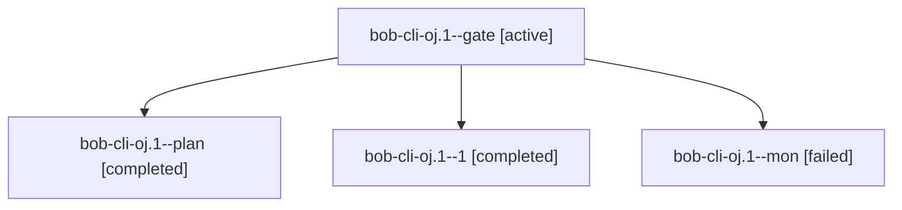

# Session: bob-cli-oj.1

[Agent Hoods](../README.md) / [bbugyi200](../users/bbugyi200/README.md) / [athena](../users/bbugyi200/machines/athena/README.md) / [bob-cli-oj](../users/bbugyi200/machines/athena/hoods/bob-cli-oj/README.md) / bob-cli-oj.1

Owner: `bbugyi200.athena` · Hood: `bob-cli-oj` · Members: 4 · Bead: [bob-cli-oj.1](https://github.com/bobs-org/bob-cli--beads/blob/main/pages/bob-cli-oj/bob-cli-oj.1.md)

## Lineage

The diagram is an optional enhancement; the ordered table below contains the same lineage in accessible text.

| Role | Agent | State | Model / provider | Timing | Commits | Prompt | Chat |
|---|---|---|---|---|---:|---|---|
| gate | bob-cli-oj.1--gate | active | gpt-6-astra / codex | 2026-11-21T13:48:03.650356+00:00 | 0 | — | — |
| plan | bob-cli-oj.1--plan | completed | gpt-6-astra / codex | 2026-11-21T13:17:13.899550+00:00 → 2026-11-21T13:35:15.244951+00:00 | 0 | [Prompt](../agents/bbugyi200.athena.bob-cli-oj.1--plan/prompt.md) | [Chat](../agents/bbugyi200.athena.bob-cli-oj.1--plan/chat.md) |
| 1 | bob-cli-oj.1--1 | completed | gpt-6-astra / codex | 2026-11-21T13:37:42.667094+00:00 → 2026-11-21T13:46:29.803529+00:00 | 0 | [Prompt](../agents/bbugyi200.athena.bob-cli-oj.1--1/prompt.md) | [Chat](../agents/bbugyi200.athena.bob-cli-oj.1--1/chat.md) |
| mon | bob-cli-oj.1--mon | failed | gpt-6-astra / codex | 2026-11-21T13:34:39.551879+00:00 → 2026-11-21T13:37:42.777588+00:00 | 0 | — | [Chat](../agents/bbugyi200.athena.bob-cli-oj.1--mon/chat.md) |

## Neighbors

| Agent | Relation | State |
|---|---|---|
| [bob-cli-oj.2](../agents/bbugyi200.athena.bob-cli-oj.2/README.md) | bob-cli-oj hood | completed |
| [bob-cli-oj.3](bbugyi200.athena.bob-cli-oj.3.md) (session · 3) | bob-cli-oj hood | active 1, completed 2 |
| [bob-cli-oj.3.1.1](../agents/bbugyi200.athena.bob-cli-oj.3.1.1/README.md) | bob-cli-oj hood | completed |
| [bob-cli-oj.3.1.2](bbugyi200.athena.bob-cli-oj.3.1.2.md) (session · 5) | bob-cli-oj hood | completed 4, failed 1 |
| [bob-cli-oj.3.1.3](../agents/bbugyi200.athena.bob-cli-oj.3.1.3/README.md) | bob-cli-oj hood | waiting |
| [bob-cli-oj.3.1.4](../agents/bbugyi200.athena.bob-cli-oj.3.1.4/README.md) | bob-cli-oj hood | waiting |
| [bob-cli-oj.3.1.land](../agents/bbugyi200.athena.bob-cli-oj.3.1.land/README.md) | bob-cli-oj hood | waiting |
| [bob-cli-oj.4](../agents/bbugyi200.athena.bob-cli-oj.4/README.md) | bob-cli-oj hood | waiting |
| [bob-cli-oj.5](../agents/bbugyi200.athena.bob-cli-oj.5/README.md) | bob-cli-oj hood | waiting |
| [bob-cli-oj.6](../agents/bbugyi200.athena.bob-cli-oj.6/README.md) | bob-cli-oj hood | waiting |
| [bob-cli-oj.7](../agents/bbugyi200.athena.bob-cli-oj.7/README.md) | bob-cli-oj hood | waiting |
| [bob-cli-oj.8](../agents/bbugyi200.athena.bob-cli-oj.8/README.md) | bob-cli-oj hood | waiting |
| [bob-cli-oj.land](../agents/bbugyi200.athena.bob-cli-oj.land/README.md) | bob-cli-oj hood | waiting |
