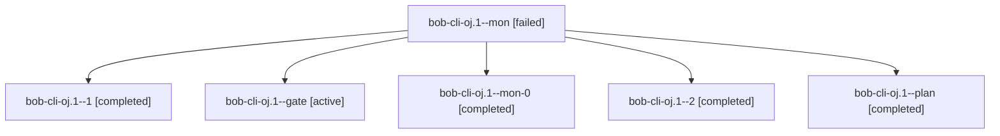

# Session: bob-cli-oj.1

[Agent Hoods](../README.md) / [bbugyi200](../users/bbugyi200/README.md) / [athena](../users/bbugyi200/machines/athena/README.md) / [bob-cli-oj](../users/bbugyi200/machines/athena/hoods/bob-cli-oj/README.md) / bob-cli-oj.1

Owner: `bbugyi200.athena` · Hood: `bob-cli-oj` · Members: 6 · Bead: [bob-cli-oj.1](https://github.com/bobs-org/bob-cli--beads/blob/main/pages/bob-cli-oj/bob-cli-oj.1.md)

## Lineage



The diagram is an optional enhancement; the ordered table below contains the same lineage in accessible text.

| Role | Agent | State | Model / provider | Timing | Commits | Prompt | Chat |
|---|---|---|---|---|---:|---|---|
| <a id="member-mon"></a>mon | bob-cli-oj.1--mon | failed | gpt-6-astra / codex | 2026-11-21T14:32:42.034015+00:00 → 2026-11-21T14:35:26.746698+00:00 | 0 | — | [Chat](../agents/bbugyi200.athena.bob-cli-oj.1--mon/chat.md) |
| <a id="member-1"></a>1 | bob-cli-oj.1--1 | completed | gpt-6-astra / codex | 2026-11-21T14:35:26.576246+00:00 → 2026-11-21T14:43:22.180815+00:00 | 0 | [Prompt](../agents/bbugyi200.athena.bob-cli-oj.1--1/prompt.md) | [Chat](../agents/bbugyi200.athena.bob-cli-oj.1--1/chat.md) |
| <a id="member-gate"></a>gate | bob-cli-oj.1--gate | active | gpt-6-astra / codex | 2026-11-21T13:48:03.650356+00:00 | 0 | — | — |
| <a id="member-mon-0"></a>mon-0 | bob-cli-oj.1--mon-0 | completed | gpt-6-astra / codex | 2026-11-21T14:41:52.988433+00:00 → 2026-11-21T14:44:44.968158+00:00 | 0 | — | [Chat](../agents/bbugyi200.athena.bob-cli-oj.1--mon-0/chat.md) |
| <a id="member-2"></a>2 | bob-cli-oj.1--2 | completed | gpt-6-astra / codex | 2026-11-21T14:44:44.664054+00:00 → 2026-11-21T14:47:13.357100+00:00 | 0 | [Prompt](../agents/bbugyi200.athena.bob-cli-oj.1--2/prompt.md) | [Chat](../agents/bbugyi200.athena.bob-cli-oj.1--2/chat.md) |
| <a id="member-plan"></a>plan | bob-cli-oj.1--plan | completed | gpt-6-astra / codex | 2026-11-21T14:22:29.176712+00:00 → 2026-11-21T14:34:17.685756+00:00 | 0 | [Prompt](../agents/bbugyi200.athena.bob-cli-oj.1--plan/prompt.md) | [Chat](../agents/bbugyi200.athena.bob-cli-oj.1--plan/chat.md) |

## Variables

| Role | Variable | Value |
|---|---|---|
| plan | `artifacts` | \[{bead: bob-cli-oj.1, kind: file, label: Recovered Navigation 2.96.1 source and tests matching approved deployment hashes, path: /home/bryan/.sase/artifacts/agents/gh\_bobs-org\_\_bob-cli/20261121092148… |

#### artifacts

**Role:** `plan`

```yaml
- bead: bob-cli-oj.1
  kind: file
  label: Recovered Navigation 2.96.1 source and tests matching approved deployment hashes
  path: /home/bryan/.sase/artifacts/agents/gh_bobs-org__bob-cli/20261121092148/bob-cli-oj1-restored-source.tar-114014f49575.gz
  ref: file:explicit:f0588487197e47234e4910fc
  source_path: /tmp/bob-cli-oj1-restored-source.tar.gz
```

Values are truncated for display; see each member's agent meta.json for the full values.

## Neighbors

| Agent | Relation | State |
|---|---|---|
| [bob-cli-oj.2](../agents/bbugyi200.athena.bob-cli-oj.2/README.md) | bob-cli-oj hood | completed |
| [bob-cli-oj.3](bbugyi200.athena.bob-cli-oj.3.md) (session · 3) | bob-cli-oj hood | active 1, completed 2 |
| [bob-cli-oj.3.1.1](../agents/bbugyi200.athena.bob-cli-oj.3.1.1/README.md) | bob-cli-oj hood | completed |
| [bob-cli-oj.3.1.2](bbugyi200.athena.bob-cli-oj.3.1.2.md) (session · 5) | bob-cli-oj hood | completed 4, failed 1 |
| [bob-cli-oj.3.1.3](../agents/bbugyi200.athena.bob-cli-oj.3.1.3/README.md) | bob-cli-oj hood | completed |
| [bob-cli-oj.3.1.4](../agents/bbugyi200.athena.bob-cli-oj.3.1.4/README.md) | bob-cli-oj hood | completed |
| [bob-cli-oj.3.1.land](bbugyi200.athena.bob-cli-oj.3.1.land.md) (session · 3) | bob-cli-oj hood | completed 3 |
| [bob-cli-oj.4](bbugyi200.athena.bob-cli-oj.4.md) (session · 7) | bob-cli-oj hood | completed 6, failed 1 |
| [bob-cli-oj.5](bbugyi200.athena.bob-cli-oj.5.md) (session · 3) | bob-cli-oj hood | active 1, completed 2 |
| [bob-cli-oj.5.1.1](../agents/bbugyi200.athena.bob-cli-oj.5.1.1/README.md) | bob-cli-oj hood | completed |
| [bob-cli-oj.5.1.2](../agents/bbugyi200.athena.bob-cli-oj.5.1.2/README.md) | bob-cli-oj hood | completed |
| [bob-cli-oj.5.1.3](../agents/bbugyi200.athena.bob-cli-oj.5.1.3/README.md) | bob-cli-oj hood | waiting |
| [bob-cli-oj.5.1.4](../agents/bbugyi200.athena.bob-cli-oj.5.1.4/README.md) | bob-cli-oj hood | waiting |
| [bob-cli-oj.5.1.land](../agents/bbugyi200.athena.bob-cli-oj.5.1.land/README.md) | bob-cli-oj hood | waiting |
| [bob-cli-oj.6](../agents/bbugyi200.athena.bob-cli-oj.6/README.md) | bob-cli-oj hood | completed |
| [bob-cli-oj.7](../agents/bbugyi200.athena.bob-cli-oj.7/README.md) | bob-cli-oj hood | waiting |
| [bob-cli-oj.8](../agents/bbugyi200.athena.bob-cli-oj.8/README.md) | bob-cli-oj hood | waiting |
| [bob-cli-oj.land](../agents/bbugyi200.athena.bob-cli-oj.land/README.md) | bob-cli-oj hood | waiting |
