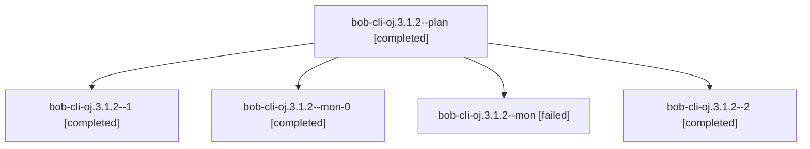

# Session: bob-cli-oj.3.1.2

[Agent Hoods](../README.md) / [bbugyi200](../users/bbugyi200/README.md) / [athena](../users/bbugyi200/machines/athena/README.md) / [bob-cli-oj](../users/bbugyi200/machines/athena/hoods/bob-cli-oj/README.md) / bob-cli-oj.3.1.2

Owner: `bbugyi200.athena` · Hood: `bob-cli-oj` · Members: 5 · Bead: [bob-cli-oj.3.1.2](https://github.com/bobs-org/bob-cli--beads/blob/main/pages/bob-cli-oj/bob-cli-oj.3.1.2.md)

## Lineage

The diagram is an optional enhancement; the ordered table below contains the same lineage in accessible text.

| Role | Agent | State | Model / provider | Timing | Commits | Prompt | Chat |
|---|---|---|---|---|---:|---|---|
| plan | bob-cli-oj.3.1.2--plan | completed | gpt-6-luna / codex | 2026-11-21T13:26:18.279749+00:00 → 2026-11-21T13:45:39.479316+00:00 | 0 | [Prompt](../agents/bbugyi200.athena.bob-cli-oj.3.1.2--plan/prompt.md) | [Chat](../agents/bbugyi200.athena.bob-cli-oj.3.1.2--plan/chat.md) |
| 1 | bob-cli-oj.3.1.2--1 | completed | gpt-6-luna / codex | 2026-11-21T13:49:20.142966+00:00 → 2026-11-21T13:52:11.402713+00:00 | 0 | [Prompt](../agents/bbugyi200.athena.bob-cli-oj.3.1.2--1/prompt.md) | [Chat](../agents/bbugyi200.athena.bob-cli-oj.3.1.2--1/chat.md) |
| mon-0 | bob-cli-oj.3.1.2--mon-0 | completed | gpt-6-luna / codex | 2026-11-21T13:51:33.207246+00:00 → 2026-11-21T13:55:42.273262+00:00 | 0 | — | [Chat](../agents/bbugyi200.athena.bob-cli-oj.3.1.2--mon-0/chat.md) |
| mon | bob-cli-oj.3.1.2--mon | failed | gpt-6-luna / codex | 2026-11-21T13:44:47.781354+00:00 → 2026-11-21T13:49:20.564215+00:00 | 0 | — | [Chat](../agents/bbugyi200.athena.bob-cli-oj.3.1.2--mon/chat.md) |
| 2 | bob-cli-oj.3.1.2--2 | completed | gpt-6-luna / codex | 2026-11-21T13:55:42.142942+00:00 → 2026-11-21T13:58:52.497874+00:00 | [1](../agents/bbugyi200.athena.bob-cli-oj.3.1.2--2/README.md#commits) | [Prompt](../agents/bbugyi200.athena.bob-cli-oj.3.1.2--2/prompt.md) | [Chat](../agents/bbugyi200.athena.bob-cli-oj.3.1.2--2/chat.md) |

## Commits

| Role | Repo | Commit | Subject | Committed |
|---|---|---|---|---|
| 2 | bob-cli | [`ce0dcc5`](https://github.com/bobs-org/bob-cli/commit/ce0dcc54cec50104991b4ad943de0566e7eba2b6) | feat(records): apply grouped walk updates | 2026-11-21 08:58:17 EST |

## Neighbors

| Agent | Relation | State |
|---|---|---|
| [bob-cli-oj.3](bbugyi200.athena.bob-cli-oj.3.md) (session · 3) | ancestor | active 1, completed 2 |
| [bob-cli-oj.3.1.1](../agents/bbugyi200.athena.bob-cli-oj.3.1.1/README.md) | bob-cli-oj.3.1 hood | completed |
| [bob-cli-oj.3.1.3](../agents/bbugyi200.athena.bob-cli-oj.3.1.3/README.md) | bob-cli-oj.3.1 hood | completed |
| [bob-cli-oj.3.1.4](../agents/bbugyi200.athena.bob-cli-oj.3.1.4/README.md) | bob-cli-oj.3.1 hood | completed |
| [bob-cli-oj.3.1.land](bbugyi200.athena.bob-cli-oj.3.1.land.md) (session · 3) | bob-cli-oj.3.1 hood | completed 3 |
| [bob-cli-oj.1](bbugyi200.athena.bob-cli-oj.1.md) (session · 6) | bob-cli-oj hood | active 1, completed 4, failed 1 |
| [bob-cli-oj.2](../agents/bbugyi200.athena.bob-cli-oj.2/README.md) | bob-cli-oj hood | completed |
| [bob-cli-oj.4](../agents/bbugyi200.athena.bob-cli-oj.4/README.md) | bob-cli-oj hood | waiting |
| [bob-cli-oj.5](../agents/bbugyi200.athena.bob-cli-oj.5/README.md) | bob-cli-oj hood | waiting |
| [bob-cli-oj.6](../agents/bbugyi200.athena.bob-cli-oj.6/README.md) | bob-cli-oj hood | waiting |
| [bob-cli-oj.7](../agents/bbugyi200.athena.bob-cli-oj.7/README.md) | bob-cli-oj hood | waiting |
| [bob-cli-oj.8](../agents/bbugyi200.athena.bob-cli-oj.8/README.md) | bob-cli-oj hood | waiting |
| [bob-cli-oj.land](../agents/bbugyi200.athena.bob-cli-oj.land/README.md) | bob-cli-oj hood | waiting |
