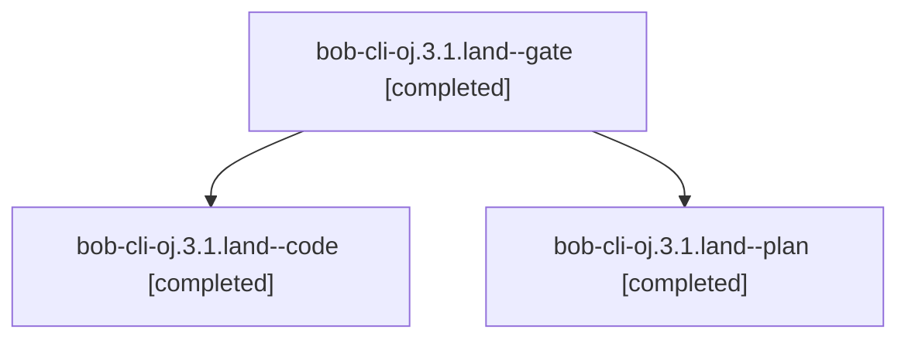

# Session: bob-cli-oj.3.1.land

[Agent Hoods](../README.md) / [bbugyi200](../users/bbugyi200/README.md) / [athena](../users/bbugyi200/machines/athena/README.md) / [bob-cli-oj](../users/bbugyi200/machines/athena/hoods/bob-cli-oj/README.md) / bob-cli-oj.3.1.land

Owner: `bbugyi200.athena` · Hood: `bob-cli-oj` · Members: 3 · Bead: [bob-cli-oj.3.1](https://github.com/bobs-org/bob-cli--beads/blob/main/pages/bob-cli-oj/bob-cli-oj.3.1.md)

## Lineage

The diagram is an optional enhancement; the ordered table below contains the same lineage in accessible text.

| Role | Agent | State | Model / provider | Timing | Commits | Prompt | Chat |
|---|---|---|---|---|---:|---|---|
| gate | bob-cli-oj.3.1.land--gate | completed | gpt-6-astra / codex | 2026-11-21T15:26:04.545731+00:00 → 2026-11-21T15:26:11.585847+00:00 | 0 | — | [Chat](../agents/bbugyi200.athena.bob-cli-oj.3.1.land--gate/chat.md) |
| code | bob-cli-oj.3.1.land--code | completed | grok-4.6 / grok | 2026-11-21T15:26:45.186939+00:00 → 2026-11-21T16:16:55.628941+00:00 | [1](../agents/bbugyi200.athena.bob-cli-oj.3.1.land--code/README.md#commits) | — | [Chat](../agents/bbugyi200.athena.bob-cli-oj.3.1.land--code/chat.md) |
| plan | bob-cli-oj.3.1.land--plan | completed | gpt-6-astra / codex | 2026-11-21T15:16:45.384941+00:00 → 2026-11-21T16:16:55.628941+00:00 | 0 | [Prompt](../agents/bbugyi200.athena.bob-cli-oj.3.1.land--plan/prompt.md) | [Chat](../agents/bbugyi200.athena.bob-cli-oj.3.1.land--plan/chat.md) |

## Commits

| Role | Repo | Commit | Subject | Committed |
|---|---|---|---|---|
| code | bob-cli | [`7ac4fee`](https://github.com/bobs-org/bob-cli/commit/7ac4feeb043503a050e253dfe499da32c9ac1e04) | fix(albums): restore walk\_by at original slot and bind emitted selection | 2026-11-21 11:15:03 EST |

## Neighbors

| Agent | Relation | State |
|---|---|---|
| [bob-cli-oj.3](bbugyi200.athena.bob-cli-oj.3.md) (session · 3) | ancestor | active 1, completed 2 |
| [bob-cli-oj.3.1.1](../agents/bbugyi200.athena.bob-cli-oj.3.1.1/README.md) | bob-cli-oj.3.1 hood | completed |
| [bob-cli-oj.3.1.2](bbugyi200.athena.bob-cli-oj.3.1.2.md) (session · 5) | bob-cli-oj.3.1 hood | completed 4, failed 1 |
| [bob-cli-oj.3.1.3](../agents/bbugyi200.athena.bob-cli-oj.3.1.3/README.md) | bob-cli-oj.3.1 hood | completed |
| [bob-cli-oj.3.1.4](../agents/bbugyi200.athena.bob-cli-oj.3.1.4/README.md) | bob-cli-oj.3.1 hood | completed |
| [bob-cli-oj.1](bbugyi200.athena.bob-cli-oj.1.md) (session · 6) | bob-cli-oj hood | active 1, completed 4, failed 1 |
| [bob-cli-oj.2](../agents/bbugyi200.athena.bob-cli-oj.2/README.md) | bob-cli-oj hood | completed |
| [bob-cli-oj.4](bbugyi200.athena.bob-cli-oj.4.md) (session · 7) | bob-cli-oj hood | completed 6, failed 1 |
| [bob-cli-oj.5](bbugyi200.athena.bob-cli-oj.5.md) (session · 3) | bob-cli-oj hood | active 1, completed 2 |
| [bob-cli-oj.5.1.1](../agents/bbugyi200.athena.bob-cli-oj.5.1.1/README.md) | bob-cli-oj hood | completed |
| [bob-cli-oj.5.1.2](../agents/bbugyi200.athena.bob-cli-oj.5.1.2/README.md) | bob-cli-oj hood | completed |
| [bob-cli-oj.5.1.3](../agents/bbugyi200.athena.bob-cli-oj.5.1.3/README.md) | bob-cli-oj hood | completed |
| [bob-cli-oj.5.1.4](../agents/bbugyi200.athena.bob-cli-oj.5.1.4/README.md) | bob-cli-oj hood | completed |
| [bob-cli-oj.5.1.land](../agents/bbugyi200.athena.bob-cli-oj.5.1.land/README.md) | bob-cli-oj hood | waiting |
| [bob-cli-oj.6](../agents/bbugyi200.athena.bob-cli-oj.6/README.md) | bob-cli-oj hood | completed |
| [bob-cli-oj.7](../agents/bbugyi200.athena.bob-cli-oj.7/README.md) | bob-cli-oj hood | waiting |
| [bob-cli-oj.8](../agents/bbugyi200.athena.bob-cli-oj.8/README.md) | bob-cli-oj hood | waiting |
| [bob-cli-oj.land](../agents/bbugyi200.athena.bob-cli-oj.land/README.md) | bob-cli-oj hood | waiting |
