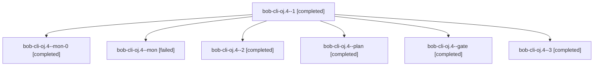

# Session: bob-cli-oj.4

[Agent Hoods](../README.md) / [bbugyi200](../users/bbugyi200/README.md) / [athena](../users/bbugyi200/machines/athena/README.md) / [bob-cli-oj](../users/bbugyi200/machines/athena/hoods/bob-cli-oj/README.md) / bob-cli-oj.4

Owner: `bbugyi200.athena` · Hood: `bob-cli-oj` · Members: 7 · Bead: [bob-cli-oj.4](https://github.com/bobs-org/bob-cli--beads/blob/main/pages/bob-cli-oj/bob-cli-oj.4.md)

## Lineage

The diagram is an optional enhancement; the ordered table below contains the same lineage in accessible text.

| Role | Agent | State | Model / provider | Timing | Commits | Prompt | Chat |
|---|---|---|---|---|---:|---|---|
| 1 | bob-cli-oj.4--1 | completed | gpt-6-luna / codex | 2026-11-21T16:44:34.092405+00:00 → 2026-11-21T16:57:17.910875+00:00 | 0 | [Prompt](../agents/bbugyi200.athena.bob-cli-oj.4--1/prompt.md) | [Chat](../agents/bbugyi200.athena.bob-cli-oj.4--1/chat.md) |
| mon-0 | bob-cli-oj.4--mon-0 | completed | gpt-6-luna / codex | 2026-11-21T16:55:48.698880+00:00 → 2026-11-21T16:59:42.276741+00:00 | 0 | — | [Chat](../agents/bbugyi200.athena.bob-cli-oj.4--mon-0/chat.md) |
| mon | bob-cli-oj.4--mon | failed | gpt-6-luna / codex | 2026-11-21T16:41:38.826120+00:00 → 2026-11-21T16:44:34.480260+00:00 | 0 | — | [Chat](../agents/bbugyi200.athena.bob-cli-oj.4--mon/chat.md) |
| 2 | bob-cli-oj.4--2 | completed | gpt-6-luna / codex | 2026-11-21T16:59:42.082162+00:00 → 2026-11-21T17:02:27.561934+00:00 | 0 | [Prompt](../agents/bbugyi200.athena.bob-cli-oj.4--2/prompt.md) | [Chat](../agents/bbugyi200.athena.bob-cli-oj.4--2/chat.md) |
| plan | bob-cli-oj.4--plan | completed | gpt-6-luna / codex | 2026-11-21T16:13:41.593728+00:00 → 2026-11-21T16:43:15.139304+00:00 | 0 | [Prompt](../agents/bbugyi200.athena.bob-cli-oj.4--plan/prompt.md) | [Chat](../agents/bbugyi200.athena.bob-cli-oj.4--plan/chat.md) |
| gate | bob-cli-oj.4--gate | completed | gpt-6-luna / codex | 2026-11-21T17:05:33.596742+00:00 → 2026-11-21T17:05:53.095153+00:00 | 0 | — | [Chat](../agents/bbugyi200.athena.bob-cli-oj.4--gate/chat.md) |
| 3 | bob-cli-oj.4--3 | completed | gpt-6-luna / codex | 2026-11-21T17:06:33.168696+00:00 → 2026-11-21T17:08:52.385367+00:00 | 0 | [Prompt](../agents/bbugyi200.athena.bob-cli-oj.4--3/prompt.md) | [Chat](../agents/bbugyi200.athena.bob-cli-oj.4--3/chat.md) |

## Neighbors

| Agent | Relation | State |
|---|---|---|
| [bob-cli-oj.1](bbugyi200.athena.bob-cli-oj.1.md) (session · 6) | bob-cli-oj hood | active 1, completed 4, failed 1 |
| [bob-cli-oj.2](../agents/bbugyi200.athena.bob-cli-oj.2/README.md) | bob-cli-oj hood | completed |
| [bob-cli-oj.3](bbugyi200.athena.bob-cli-oj.3.md) (session · 3) | bob-cli-oj hood | active 1, completed 2 |
| [bob-cli-oj.3.1.1](../agents/bbugyi200.athena.bob-cli-oj.3.1.1/README.md) | bob-cli-oj hood | completed |
| [bob-cli-oj.3.1.2](bbugyi200.athena.bob-cli-oj.3.1.2.md) (session · 5) | bob-cli-oj hood | completed 4, failed 1 |
| [bob-cli-oj.3.1.3](../agents/bbugyi200.athena.bob-cli-oj.3.1.3/README.md) | bob-cli-oj hood | completed |
| [bob-cli-oj.3.1.4](../agents/bbugyi200.athena.bob-cli-oj.3.1.4/README.md) | bob-cli-oj hood | completed |
| [bob-cli-oj.3.1.land](bbugyi200.athena.bob-cli-oj.3.1.land.md) (session · 3) | bob-cli-oj hood | completed 3 |
| [bob-cli-oj.5](bbugyi200.athena.bob-cli-oj.5.md) (session · 3) | bob-cli-oj hood | active 2, completed 1 |
| [bob-cli-oj.6](../agents/bbugyi200.athena.bob-cli-oj.6/README.md) | bob-cli-oj hood | waiting |
| [bob-cli-oj.7](../agents/bbugyi200.athena.bob-cli-oj.7/README.md) | bob-cli-oj hood | waiting |
| [bob-cli-oj.8](../agents/bbugyi200.athena.bob-cli-oj.8/README.md) | bob-cli-oj hood | waiting |
| [bob-cli-oj.land](../agents/bbugyi200.athena.bob-cli-oj.land/README.md) | bob-cli-oj hood | waiting |
