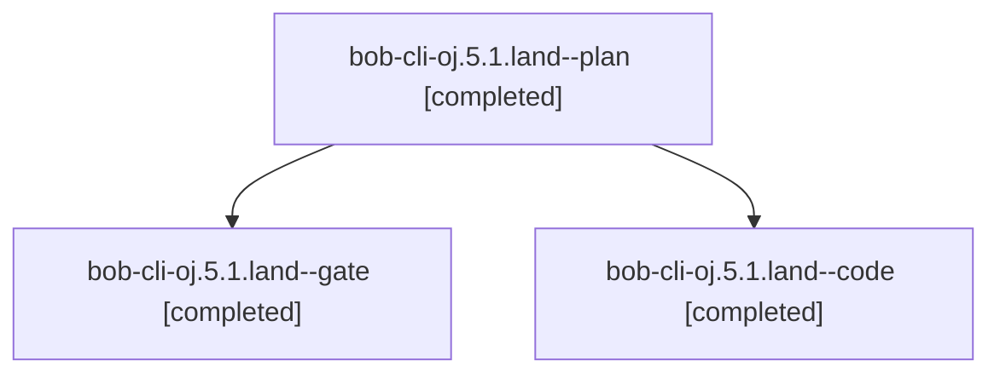

# Session: bob-cli-oj.5.1.land

[Agent Hoods](../README.md) / [bbugyi200](../users/bbugyi200/README.md) / [athena](../users/bbugyi200/machines/athena/README.md) / [bob-cli-oj](../users/bbugyi200/machines/athena/hoods/bob-cli-oj/README.md) / bob-cli-oj.5.1.land

Owner: `bbugyi200.athena` · Hood: `bob-cli-oj` · Members: 3 · Bead: [bob-cli-oj.5.1](https://github.com/bobs-org/bob-cli--beads/blob/main/pages/bob-cli-oj/bob-cli-oj.5.1.md)

## Lineage



The diagram is an optional enhancement; the ordered table below contains the same lineage in accessible text.

| Role | Agent | State | Model / provider | Timing | Commits | Prompt | Chat |
|---|---|---|---|---|---:|---|---|
| <a id="member-plan"></a>plan | bob-cli-oj.5.1.land--plan | completed | opus / claude | 2026-11-21T21:00:07.353507+00:00 → 2026-11-21T22:13:04.119198+00:00 | 0 | [Prompt](../agents/bbugyi200.athena.bob-cli-oj.5.1.land--plan/prompt.md) | [Chat](../agents/bbugyi200.athena.bob-cli-oj.5.1.land--plan/chat.md) |
| <a id="member-gate"></a>gate | bob-cli-oj.5.1.land--gate | completed | opus / claude | 2026-11-21T21:15:46.629595+00:00 → 2026-11-21T21:15:57.217473+00:00 | 0 | — | [Chat](../agents/bbugyi200.athena.bob-cli-oj.5.1.land--gate/chat.md) |
| <a id="member-code"></a>code | bob-cli-oj.5.1.land--code | completed | opus / claude | 2026-11-21T21:16:34.855879+00:00 → 2026-11-21T22:13:04.119198+00:00 | 0 | — | [Chat](../agents/bbugyi200.athena.bob-cli-oj.5.1.land--code/chat.md) |

## Variables

| Role | Variable | Value |
|---|---|---|
| code | `artifacts` | \[{bead: bob-cli-oj.5.1, kind: file, label: Group rail declutter preview archive (128 renders, index, manifest, contrast, inspection note, footer shots), path: /home/bryan/.sase/artifacts/agents/gh\_bo… |

#### artifacts

**Role:** `code`

```yaml
- bead: bob-cli-oj.5.1
  kind: file
  label: Group rail declutter preview archive (128 renders, index, manifest, contrast, inspection note, footer shots)
  path: /home/bryan/.sase/artifacts/agents/gh_bobs-org__bob-cli/20261121161603/group-rail-declutter-preview.tar-81868a8f46fa.gz
  ref: file:explicit:9cf5815b4f609e0391edbda8
  source_path: /tmp/gr_declutter/group-rail-declutter-preview.tar.gz
- bead: bob-cli-oj.5.1
  kind: markdown
  label: Group rail declutter preview inspection note
  path: /home/bryan/.sase/artifacts/agents/gh_bobs-org__bob-cli/20261121161603/inspection-635003a0e820.md
  ref: file:explicit:0810648fd519b42127cbe1ed
  source_path: /tmp/gr_declutter/preview-final/inspection.md
- bead: bob-cli-oj.5.1
  kind: markdown
  label: Group rail declutter contrast table (worst case per theme, state, element)
  path: /home/bryan/.sase/artifacts/agents/gh_bobs-org__bob-cli/20261121161603/contrast-bcfa438180c8.md
  ref: file:explicit:2d421ffa815baa593e33d56d
  source_path: /tmp/gr_declutter/preview-final/contrast.md
- bead: bob-cli-oj.5.1
  kind: file
  label: Intention card e2e report (declutter, merged tree): 81/82, yaml-done-returns = bob-cli-ot
  path: /home/bryan/.sase/artifacts/agents/gh_bobs-org__bob-cli/20261121161603/report-c00c50b34175.json
  ref: file:explicit:6d9a9dfc810fb1ef3a31ed2c
  source_path: /tmp/gr_declutter/e2e-final/intention-card/report.json
- bead: bob-cli-oj.5.1
  kind: file
  label: Record card e2e report (declutter, merged tree): 180/180 pass
  path: /home/bryan/.sase/artifacts/agents/gh_bobs-org__bob-cli/20261121161603/report-4a25bbb18147.json
  ref: file:explicit:52e2fe78b6593e1d06652c85
  source_path: /tmp/gr_declutter/e2e-final/record-card/report.json
- bead: bob-cli-oj.5.1
  kind: file
  label: Record walk e2e report (declutter, merged tree): passed
  path: /home/bryan/.sase/artifacts/agents/gh_bobs-org__bob-cli/20261121161603/report-50be8260b879.json
  ref: file:explicit:608eb22989c8cad86c532146
  source_path: /tmp/gr_declutter/e2e-final/record-walk/report.json
- bead: bob-cli-oj.5.1
  kind: file
  label: Walker footer e2e report (declutter, merged tree): group arms + skip marks pass; geometryStable base failure (bob-cli-oj.6 #3)
  path: /home/bryan/.sase/artifacts/agents/gh_bobs-org__bob-cli/20261121161603/report-24cf2a979304.json
  ref: file:explicit:43eb9c4ca9480d51ed367145
  source_path: /tmp/gr_declutter/e2e-final/walker-footer/report.json
```

Values are truncated for display; see each member's agent meta.json for the full values.

## Neighbors

| Agent | Relation | State |
|---|---|---|
| [bob-cli-oj.5](bbugyi200.athena.bob-cli-oj.5.md) (session · 3) | ancestor | active 1, completed 2 |
| [bob-cli-oj.5.1.1](../agents/bbugyi200.athena.bob-cli-oj.5.1.1/README.md) | bob-cli-oj.5.1 hood | completed |
| [bob-cli-oj.5.1.2](../agents/bbugyi200.athena.bob-cli-oj.5.1.2/README.md) | bob-cli-oj.5.1 hood | completed |
| [bob-cli-oj.5.1.3](../agents/bbugyi200.athena.bob-cli-oj.5.1.3/README.md) | bob-cli-oj.5.1 hood | completed |
| [bob-cli-oj.5.1.4](../agents/bbugyi200.athena.bob-cli-oj.5.1.4/README.md) | bob-cli-oj.5.1 hood | completed |
| [bob-cli-oj.1](bbugyi200.athena.bob-cli-oj.1.md) (session · 6) | bob-cli-oj hood | active 1, completed 4, failed 1 |
| [bob-cli-oj.2](../agents/bbugyi200.athena.bob-cli-oj.2/README.md) | bob-cli-oj hood | completed |
| [bob-cli-oj.3](bbugyi200.athena.bob-cli-oj.3.md) (session · 3) | bob-cli-oj hood | active 1, completed 2 |
| [bob-cli-oj.3.1.1](../agents/bbugyi200.athena.bob-cli-oj.3.1.1/README.md) | bob-cli-oj hood | completed |
| [bob-cli-oj.3.1.2](bbugyi200.athena.bob-cli-oj.3.1.2.md) (session · 5) | bob-cli-oj hood | completed 4, failed 1 |
| [bob-cli-oj.3.1.3](../agents/bbugyi200.athena.bob-cli-oj.3.1.3/README.md) | bob-cli-oj hood | completed |
| [bob-cli-oj.3.1.4](../agents/bbugyi200.athena.bob-cli-oj.3.1.4/README.md) | bob-cli-oj hood | completed |
| [bob-cli-oj.3.1.land](bbugyi200.athena.bob-cli-oj.3.1.land.md) (session · 3) | bob-cli-oj hood | completed 3 |
| [bob-cli-oj.4](bbugyi200.athena.bob-cli-oj.4.md) (session · 7) | bob-cli-oj hood | completed 6, failed 1 |
| [bob-cli-oj.6](../agents/bbugyi200.athena.bob-cli-oj.6/README.md) | bob-cli-oj hood | completed |
| [bob-cli-oj.7](../agents/bbugyi200.athena.bob-cli-oj.7/README.md) | bob-cli-oj hood | completed |
| [bob-cli-oj.8](bbugyi200.athena.bob-cli-oj.8.md) (session · 3) | bob-cli-oj hood | completed 3 |
| [bob-cli-oj.land](bbugyi200.athena.bob-cli-oj.land.md) (session · 2) | bob-cli-oj hood | completed 2 |
