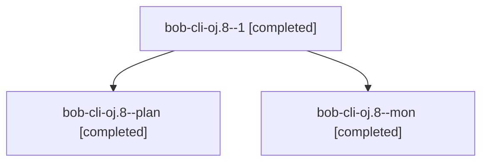

# Session: bob-cli-oj.8

[Agent Hoods](../README.md) / [bbugyi200](../users/bbugyi200/README.md) / [athena](../users/bbugyi200/machines/athena/README.md) / [bob-cli-oj](../users/bbugyi200/machines/athena/hoods/bob-cli-oj/README.md) / bob-cli-oj.8

Owner: `bbugyi200.athena` · Hood: `bob-cli-oj` · Members: 3 · Bead: [bob-cli-oj.8](https://github.com/bobs-org/bob-cli--beads/blob/main/pages/bob-cli-oj/bob-cli-oj.8.md)

## Lineage

The diagram is an optional enhancement; the ordered table below contains the same lineage in accessible text.

| Role | Agent | State | Model / provider | Timing | Commits | Prompt | Chat |
|---|---|---|---|---|---:|---|---|
| 1 | bob-cli-oj.8--1 | completed | muse-spark-1.3-contributor / muse | 2026-11-22T00:59:35.591006+00:00 → 2026-11-22T01:11:39.336427+00:00 | [1](../agents/bbugyi200.athena.bob-cli-oj.8--1/README.md#commits) | [Prompt](../agents/bbugyi200.athena.bob-cli-oj.8--1/prompt.md) | [Chat](../agents/bbugyi200.athena.bob-cli-oj.8--1/chat.md) |
| plan | bob-cli-oj.8--plan | completed | muse-spark-1.3-contributor / muse | 2026-11-22T00:37:42.105405+00:00 → 2026-11-22T00:54:02.133035+00:00 | 0 | [Prompt](../agents/bbugyi200.athena.bob-cli-oj.8--plan/prompt.md) | [Chat](../agents/bbugyi200.athena.bob-cli-oj.8--plan/chat.md) |
| mon | bob-cli-oj.8--mon | completed | muse-spark-1.3-contributor / muse | 2026-11-22T00:40:44.290561+00:00 → 2026-11-22T00:59:35.934616+00:00 | 0 | — | [Chat](../agents/bbugyi200.athena.bob-cli-oj.8--mon/chat.md) |

## Commits

| Role | Repo | Commit | Subject | Committed |
|---|---|---|---|---|
| 1 | — | `016cb00` | docs(glossary): record grouped walks and group stops in record-note and walker-footer | 2026-11-21 20:10:48 EST |

## Neighbors

| Agent | Relation | State |
|---|---|---|
| [bob-cli-oj.1](bbugyi200.athena.bob-cli-oj.1.md) (session · 6) | bob-cli-oj hood | active 1, completed 4, failed 1 |
| [bob-cli-oj.2](../agents/bbugyi200.athena.bob-cli-oj.2/README.md) | bob-cli-oj hood | completed |
| [bob-cli-oj.3](bbugyi200.athena.bob-cli-oj.3.md) (session · 3) | bob-cli-oj hood | completed 2, dismissed 1 |
| [bob-cli-oj.3.1.1](../agents/bbugyi200.athena.bob-cli-oj.3.1.1/README.md) | bob-cli-oj hood | completed |
| [bob-cli-oj.3.1.2](bbugyi200.athena.bob-cli-oj.3.1.2.md) (session · 5) | bob-cli-oj hood | completed 4, failed 1 |
| [bob-cli-oj.3.1.3](../agents/bbugyi200.athena.bob-cli-oj.3.1.3/README.md) | bob-cli-oj hood | completed |
| [bob-cli-oj.3.1.4](../agents/bbugyi200.athena.bob-cli-oj.3.1.4/README.md) | bob-cli-oj hood | completed |
| [bob-cli-oj.3.1.land](bbugyi200.athena.bob-cli-oj.3.1.land.md) (session · 3) | bob-cli-oj hood | completed 3 |
| [bob-cli-oj.4](bbugyi200.athena.bob-cli-oj.4.md) (session · 7) | bob-cli-oj hood | completed 6, failed 1 |
| [bob-cli-oj.5](bbugyi200.athena.bob-cli-oj.5.md) (session · 3) | bob-cli-oj hood | completed 2, dismissed 1 |
| [bob-cli-oj.5.1.1](../agents/bbugyi200.athena.bob-cli-oj.5.1.1/README.md) | bob-cli-oj hood | completed |
| [bob-cli-oj.5.1.2](../agents/bbugyi200.athena.bob-cli-oj.5.1.2/README.md) | bob-cli-oj hood | completed |
| [bob-cli-oj.5.1.3](../agents/bbugyi200.athena.bob-cli-oj.5.1.3/README.md) | bob-cli-oj hood | completed |
| [bob-cli-oj.5.1.4](../agents/bbugyi200.athena.bob-cli-oj.5.1.4/README.md) | bob-cli-oj hood | completed |
| [bob-cli-oj.5.1.land](bbugyi200.athena.bob-cli-oj.5.1.land.md) (session · 3) | bob-cli-oj hood | completed 3 |
| [bob-cli-oj.6](../agents/bbugyi200.athena.bob-cli-oj.6/README.md) | bob-cli-oj hood | completed |
| [bob-cli-oj.7](../agents/bbugyi200.athena.bob-cli-oj.7/README.md) | bob-cli-oj hood | completed |
| [bob-cli-oj.land](bbugyi200.athena.bob-cli-oj.land.md) (session · 2) | bob-cli-oj hood | completed 2 |
