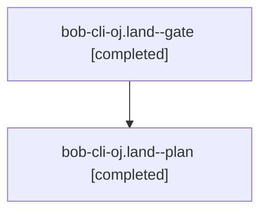

# Session: bob-cli-oj.land

[Agent Hoods](../README.md) / [bbugyi200](../users/bbugyi200/README.md) / [athena](../users/bbugyi200/machines/athena/README.md) / [bob-cli-oj](../users/bbugyi200/machines/athena/hoods/bob-cli-oj/README.md) / bob-cli-oj.land

Owner: `bbugyi200.athena` · Hood: `bob-cli-oj` · Members: 2 · Bead: [bob-cli-oj](https://github.com/bobs-org/bob-cli--beads/blob/main/pages/bob-cli-oj/README.md)

## Lineage



The diagram is an optional enhancement; the ordered table below contains the same lineage in accessible text.

| Role | Agent | State | Model / provider | Timing | Commits | Prompt | Chat |
|---|---|---|---|---|---:|---|---|
| <a id="member-gate"></a>gate | bob-cli-oj.land--gate | completed | opus / claude | 2026-11-22T02:15:57.534467+00:00 → 2026-11-22T02:16:55.831987+00:00 | 0 | — | [Chat](../agents/bbugyi200.athena.bob-cli-oj.land--gate/chat.md) |
| <a id="member-plan"></a>plan | bob-cli-oj.land--plan | completed | opus / claude | 2026-11-22T01:16:47.395559+00:00 → 2026-11-22T02:16:03.022996+00:00 | [1](../agents/bbugyi200.athena.bob-cli-oj.land--plan/README.md#commits) | [Prompt](../agents/bbugyi200.athena.bob-cli-oj.land--plan/prompt.md) | [Chat](../agents/bbugyi200.athena.bob-cli-oj.land--plan/chat.md) |

## Commits

| Role | Repo | Commit | Subject | Committed |
|---|---|---|---|---|
| plan | — | `f3cf08c` | docs(glossary): regenerate the reference glossary for the grouped-walk strands | 2026-11-21 21:14:08 EST |

## Variables

| Role | Variable | Value |
|---|---|---|
| plan | `artifacts` | \[{bead: bob-cli-ot, kind: file, label: Intention-card e2e on bob-plugins 28d76fd with the Done hit-test probe: 80/82, Done covered by DIV.status-bar-item, path: /home/bryan/.sase/artifacts/agents/gh\_… |

#### artifacts

**Role:** `plan`

```yaml
- bead: bob-cli-ot
  kind: file
  label: Intention-card e2e on bob-plugins 28d76fd with the Done hit-test probe: 80/82, Done covered by DIV.status-bar-item
  path: /home/bryan/.sase/artifacts/agents/gh_bobs-org__bob-cli/20261121074252/ic-before-c40e0df9175d.json
  ref: file:explicit:8575826c2e1c03c5f0632d87
  source_path: /tmp/oj-land/ic-before.json
- bead: bob-cli-ot
  kind: file
  label: Intention-card e2e after the YAML Done top-left placement fix: 82/82 (ledger-tools 1.157.1)
  path: /home/bryan/.sase/artifacts/agents/gh_bobs-org__bob-cli/20261121074252/ic-after2-fb6da7b3e606.json
  ref: file:explicit:222f8b8c90e888648853404e
  source_path: /tmp/oj-land/ic-after2.json
- bead: bob-cli-ot
  kind: image
  label: YAML excursion after fix: Done at top left, refusal notice at top right, footer clear
  path: /home/bryan/.sase/artifacts/agents/gh_bobs-org__bob-cli/20261121074252/intention-yaml-invalid-refused-42d7b1b736c4.png
  ref: file:explicit:fe38a1bb6d78093df0d04a5e
  source_path: /tmp/oj-land/ic-after2-shots/intention-yaml-invalid-refused.png
- bead: bob-cli-ot
  kind: image
  label: YAML excursion before fix: full-width Done bar at pane bottom hidden under the status-bar walker footer
  path: /home/bryan/.sase/artifacts/agents/gh_bobs-org__bob-cli/20261121074252/intention-yaml-source-45a707f8d11f.png
  ref: file:explicit:20d004eff4ac80fb4c3e2bcf
  source_path: /tmp/oj-land/ic-before-shots/intention-yaml-source.png
```

Values are truncated for display; see each member's agent meta.json for the full values.

## Neighbors

| Agent | Relation | State |
|---|---|---|
| [bob-cli-oj.1](bbugyi200.athena.bob-cli-oj.1.md) (session · 6) | bob-cli-oj hood | active 1, completed 4, failed 1 |
| [bob-cli-oj.2](../agents/bbugyi200.athena.bob-cli-oj.2/README.md) | bob-cli-oj hood | completed |
| [bob-cli-oj.3](bbugyi200.athena.bob-cli-oj.3.md) (session · 3) | bob-cli-oj hood | active 1, completed 2 |
| [bob-cli-oj.3.1.1](../agents/bbugyi200.athena.bob-cli-oj.3.1.1/README.md) | bob-cli-oj hood | completed |
| [bob-cli-oj.3.1.2](bbugyi200.athena.bob-cli-oj.3.1.2.md) (session · 5) | bob-cli-oj hood | completed 4, failed 1 |
| [bob-cli-oj.3.1.3](../agents/bbugyi200.athena.bob-cli-oj.3.1.3/README.md) | bob-cli-oj hood | completed |
| [bob-cli-oj.3.1.4](../agents/bbugyi200.athena.bob-cli-oj.3.1.4/README.md) | bob-cli-oj hood | completed |
| [bob-cli-oj.3.1.land](bbugyi200.athena.bob-cli-oj.3.1.land.md) (session · 3) | bob-cli-oj hood | completed 3 |
| [bob-cli-oj.4](bbugyi200.athena.bob-cli-oj.4.md) (session · 7) | bob-cli-oj hood | completed 6, failed 1 |
| [bob-cli-oj.5](bbugyi200.athena.bob-cli-oj.5.md) (session · 3) | bob-cli-oj hood | completed 2, dismissed 1 |
| [bob-cli-oj.5.1.1](../agents/bbugyi200.athena.bob-cli-oj.5.1.1/README.md) | bob-cli-oj hood | completed |
| [bob-cli-oj.5.1.2](../agents/bbugyi200.athena.bob-cli-oj.5.1.2/README.md) | bob-cli-oj hood | completed |
| [bob-cli-oj.5.1.3](../agents/bbugyi200.athena.bob-cli-oj.5.1.3/README.md) | bob-cli-oj hood | completed |
| [bob-cli-oj.5.1.4](../agents/bbugyi200.athena.bob-cli-oj.5.1.4/README.md) | bob-cli-oj hood | completed |
| [bob-cli-oj.5.1.land](bbugyi200.athena.bob-cli-oj.5.1.land.md) (session · 3) | bob-cli-oj hood | completed 3 |
| [bob-cli-oj.6](../agents/bbugyi200.athena.bob-cli-oj.6/README.md) | bob-cli-oj hood | completed |
| [bob-cli-oj.7](../agents/bbugyi200.athena.bob-cli-oj.7/README.md) | bob-cli-oj hood | completed |
| [bob-cli-oj.8](bbugyi200.athena.bob-cli-oj.8.md) (session · 3) | bob-cli-oj hood | completed 3 |
