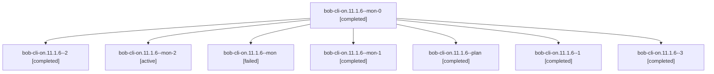

# Session: bob-cli-on.11.1.6

[Agent Hoods](../README.md) / [bbugyi200](../users/bbugyi200/README.md) / [athena](../users/bbugyi200/machines/athena/README.md) / [bob-cli-on](../users/bbugyi200/machines/athena/hoods/bob-cli-on/README.md) / bob-cli-on.11.1.6

Owner: `bbugyi200.athena` · Hood: `bob-cli-on` · Members: 8 · Bead: [bob-cli-on.11.1.6](https://github.com/bobs-org/bob-cli--beads/blob/main/pages/bob-cli-on/bob-cli-on.11.1.6.md)

## Lineage



The diagram is an optional enhancement; the ordered table below contains the same lineage in accessible text.

| Role | Agent | State | Model / provider | Timing | Commits | Prompt | Chat |
|---|---|---|---|---|---:|---|---|
| <a id="member-mon-0"></a>mon-0 | bob-cli-on.11.1.6--mon-0 | completed | gpt-6-luna / codex | 2026-11-23T00:05:30.835431+00:00 → 2026-11-23T00:19:08.812098+00:00 | 0 | — | [Chat](../agents/bbugyi200.athena.bob-cli-on.11.1.6--mon-0/chat.md) |
| <a id="member-2"></a>2 | bob-cli-on.11.1.6--2 | completed | gpt-6-luna / codex | 2026-11-23T00:19:08.639182+00:00 → 2026-11-23T00:24:59.306224+00:00 | 0 | [Prompt](../agents/bbugyi200.athena.bob-cli-on.11.1.6--2/prompt.md) | [Chat](../agents/bbugyi200.athena.bob-cli-on.11.1.6--2/chat.md) |
| <a id="member-mon-2"></a>mon-2 | bob-cli-on.11.1.6--mon-2 | active | gpt-6-luna / codex | 2026-11-23T00:30:17.500404+00:00 | 0 | — | — |
| <a id="member-mon"></a>mon | bob-cli-on.11.1.6--mon | failed | gpt-6-luna / codex | 2026-11-22T23:05:43.569431+00:00 → 2026-11-22T23:52:53.039876+00:00 | 0 | — | [Chat](../agents/bbugyi200.athena.bob-cli-on.11.1.6--mon/chat.md) |
| <a id="member-mon-1"></a>mon-1 | bob-cli-on.11.1.6--mon-1 | completed | gpt-6-luna / codex | 2026-11-23T00:24:19.156738+00:00 → 2026-11-23T00:27:29.287013+00:00 | 0 | — | [Chat](../agents/bbugyi200.athena.bob-cli-on.11.1.6--mon-1/chat.md) |
| <a id="member-plan"></a>plan | bob-cli-on.11.1.6--plan | completed | gpt-6-luna / codex | 2026-11-22T22:03:50.432584+00:00 → 2026-11-22T23:49:52.695052+00:00 | [1](../agents/bbugyi200.athena.bob-cli-on.11.1.6--plan/README.md#commits) | [Prompt](../agents/bbugyi200.athena.bob-cli-on.11.1.6--plan/prompt.md) | [Chat](../agents/bbugyi200.athena.bob-cli-on.11.1.6--plan/chat.md) |
| <a id="member-1"></a>1 | bob-cli-on.11.1.6--1 | completed | gpt-6-luna / codex | 2026-11-22T23:52:52.637954+00:00 → 2026-11-23T00:07:07.692783+00:00 | 0 | [Prompt](../agents/bbugyi200.athena.bob-cli-on.11.1.6--1/prompt.md) | [Chat](../agents/bbugyi200.athena.bob-cli-on.11.1.6--1/chat.md) |
| <a id="member-3"></a>3 | bob-cli-on.11.1.6--3 | completed | gpt-6-luna / codex | 2026-11-23T00:27:29.237349+00:00 → 2026-11-23T00:30:59.357374+00:00 | 0 | [Prompt](../agents/bbugyi200.athena.bob-cli-on.11.1.6--3/prompt.md) | [Chat](../agents/bbugyi200.athena.bob-cli-on.11.1.6--3/chat.md) |

## Commits

| Role | Repo | Commit | Subject | Committed |
|---|---|---|---|---|
| plan | bob-cli | [`c17dd80`](https://github.com/bobs-org/bob-cli/commit/c17dd80a0b238a96c22e293badf82cdd54e4ced8) | docs(requirements): clarify managed Done close card availability | 2026-11-22 18:06:50 EST |

## Variables

| Role | Variable | Value |
|---|---|---|
| plan | `artifacts` | \[{bead: bob-cli-io, kind: markdown, label: frees-marks timing flake evidence, path: /home/bryan/.sase/artifacts/agents/gh\_bobs-org\_\_bob-cli/20261122150041/bob-plugins-frees-marks-flake-evidence-58afb… |

#### artifacts

**Role:** `plan`

```yaml
- bead: bob-cli-io
  kind: markdown
  label: frees-marks timing flake evidence
  path: /home/bryan/.sase/artifacts/agents/gh_bobs-org__bob-cli/20261122150041/bob-plugins-frees-marks-flake-evidence-58afbcf699f1.md
  ref: file:explicit:126e4722920ec437412c1a5b
  source_path: /tmp/bob-plugins-frees-marks-flake-evidence.md
```

Values are truncated for display; see each member's agent meta.json for the full values.

## Neighbors

| Agent | Relation | State |
|---|---|---|
| [bob-cli-on.11](bbugyi200.athena.bob-cli-on.11.md) (session · 3) | ancestor | active 1, completed 2 |
| [bob-cli-on.11.1.1](../agents/bbugyi200.athena.bob-cli-on.11.1.1/README.md) | bob-cli-on.11.1 hood | completed |
| [bob-cli-on.11.1.2](../agents/bbugyi200.athena.bob-cli-on.11.1.2/README.md) | bob-cli-on.11.1 hood | completed |
| [bob-cli-on.11.1.3](bbugyi200.athena.bob-cli-on.11.1.3.md) (session · 5) | bob-cli-on.11.1 hood | completed 3, failed 2 |
| [bob-cli-on.11.1.4](../agents/bbugyi200.athena.bob-cli-on.11.1.4/README.md) | bob-cli-on.11.1 hood | completed |
| [bob-cli-on.11.1.5](../agents/bbugyi200.athena.bob-cli-on.11.1.5/README.md) | bob-cli-on.11.1 hood | completed |
| [bob-cli-on.11.1.land](../agents/bbugyi200.athena.bob-cli-on.11.1.land/README.md) | bob-cli-on.11.1 hood | waiting |
| [bob-cli-on.1](../agents/bbugyi200.athena.bob-cli-on.1/README.md) | bob-cli-on hood | completed |
| [bob-cli-on.10](bbugyi200.athena.bob-cli-on.10.md) (session · 3) | bob-cli-on hood | active 1, completed 2 |
| [bob-cli-on.10.1.1](../agents/bbugyi200.athena.bob-cli-on.10.1.1/README.md) | bob-cli-on hood | completed |
| [bob-cli-on.10.1.2](../agents/bbugyi200.athena.bob-cli-on.10.1.2/README.md) | bob-cli-on hood | completed |
| [bob-cli-on.10.1.3](../agents/bbugyi200.athena.bob-cli-on.10.1.3/README.md) | bob-cli-on hood | completed |
| [bob-cli-on.10.1.4](../agents/bbugyi200.athena.bob-cli-on.10.1.4/README.md) | bob-cli-on hood | completed |
| [bob-cli-on.10.1.5](../agents/bbugyi200.athena.bob-cli-on.10.1.5/README.md) | bob-cli-on hood | completed |
| [bob-cli-on.10.1.6](../agents/bbugyi200.athena.bob-cli-on.10.1.6/README.md) | bob-cli-on hood | completed |
| [bob-cli-on.10.1.land](bbugyi200.athena.bob-cli-on.10.1.land.md) (session · 3) | bob-cli-on hood | completed 3 |
| [bob-cli-on.12](../agents/bbugyi200.athena.bob-cli-on.12/README.md) | bob-cli-on hood | waiting |
| [bob-cli-on.13](bbugyi200.athena.bob-cli-on.13.md) (session · 5) | bob-cli-on hood | completed 4, failed 1 |
| [bob-cli-on.14](../agents/bbugyi200.athena.bob-cli-on.14/README.md) | bob-cli-on hood | completed |
| [bob-cli-on.15](bbugyi200.athena.bob-cli-on.15.md) (session · 3) | bob-cli-on hood | active 1, completed 2 |
| [bob-cli-on.15.1.1](../agents/bbugyi200.athena.bob-cli-on.15.1.1/README.md) | bob-cli-on hood | completed |
| [bob-cli-on.15.1.2](../agents/bbugyi200.athena.bob-cli-on.15.1.2/README.md) | bob-cli-on hood | completed |
| [bob-cli-on.15.1.3](bbugyi200.athena.bob-cli-on.15.1.3.md) (session · 5) | bob-cli-on hood | completed 4, failed 1 |
| [bob-cli-on.15.1.4](bbugyi200.athena.bob-cli-on.15.1.4.md) (session · 5) | bob-cli-on hood | completed 4, failed 1 |
| [bob-cli-on.15.1.5](bbugyi200.athena.bob-cli-on.15.1.5.md) (session · 2) | bob-cli-on hood | active 1, completed 1 |
| [bob-cli-on.15.1.land](../agents/bbugyi200.athena.bob-cli-on.15.1.land/README.md) | bob-cli-on hood | waiting |
| [bob-cli-on.16](bbugyi200.athena.bob-cli-on.16.md) (session · 9) | bob-cli-on hood | completed 9 |
| [bob-cli-on.17](../agents/bbugyi200.athena.bob-cli-on.17/README.md) | bob-cli-on hood | waiting |
| [bob-cli-on.2](bbugyi200.athena.bob-cli-on.2.md) (session · 5) | bob-cli-on hood | completed 4, failed 1 |
| [bob-cli-on.3](../agents/bbugyi200.athena.bob-cli-on.3/README.md) | bob-cli-on hood | completed |
| [bob-cli-on.4](../agents/bbugyi200.athena.bob-cli-on.4/README.md) | bob-cli-on hood | completed |
| [bob-cli-on.5](../agents/bbugyi200.athena.bob-cli-on.5/README.md) | bob-cli-on hood | completed |
| [bob-cli-on.6](bbugyi200.athena.bob-cli-on.6.md) (session · 3) | bob-cli-on hood | active 1, completed 2 |
| [bob-cli-on.6.1.1](../agents/bbugyi200.athena.bob-cli-on.6.1.1/README.md) | bob-cli-on hood | completed |
| [bob-cli-on.6.1.2](../agents/bbugyi200.athena.bob-cli-on.6.1.2/README.md) | bob-cli-on hood | completed |
| [bob-cli-on.6.1.3](../agents/bbugyi200.athena.bob-cli-on.6.1.3/README.md) | bob-cli-on hood | completed |
| [bob-cli-on.6.1.4](../agents/bbugyi200.athena.bob-cli-on.6.1.4/README.md) | bob-cli-on hood | completed |
| [bob-cli-on.6.1.5](../agents/bbugyi200.athena.bob-cli-on.6.1.5/README.md) | bob-cli-on hood | completed |
| [bob-cli-on.6.1.land](bbugyi200.athena.bob-cli-on.6.1.land.md) (session · 3) | bob-cli-on hood | active 2, completed 1 |
| [bob-cli-on.6.1.land](../agents/bbugyi200.athena.bob-cli-on.6.1.land/README.md) | bob-cli-on hood | completed |
| [bob-cli-on.7](../agents/bbugyi200.athena.bob-cli-on.7/README.md) | bob-cli-on hood | completed |
| [bob-cli-on.8](bbugyi200.athena.bob-cli-on.8.md) (session · 3) | bob-cli-on hood | active 1, completed 2 |
| [bob-cli-on.8.1.1](../agents/bbugyi200.athena.bob-cli-on.8.1.1/README.md) | bob-cli-on hood | completed |
| [bob-cli-on.8.1.2](../agents/bbugyi200.athena.bob-cli-on.8.1.2/README.md) | bob-cli-on hood | completed |
| [bob-cli-on.8.1.3](../agents/bbugyi200.athena.bob-cli-on.8.1.3/README.md) | bob-cli-on hood | completed |
| [bob-cli-on.8.1.4](../agents/bbugyi200.athena.bob-cli-on.8.1.4/README.md) | bob-cli-on hood | completed |
| [bob-cli-on.8.1.5](bbugyi200.athena.bob-cli-on.8.1.5.md) (session · 5) | bob-cli-on hood | completed 4, failed 1 |
| [bob-cli-on.8.1.6](../agents/bbugyi200.athena.bob-cli-on.8.1.6/README.md) | bob-cli-on hood | completed |
| [bob-cli-on.8.1.land](bbugyi200.athena.bob-cli-on.8.1.land.md) (session · 3) | bob-cli-on hood | completed 3 |
| [bob-cli-on.9](bbugyi200.athena.bob-cli-on.9.md) (session · 5) | bob-cli-on hood | completed 5 |
| [bob-cli-on.land](../agents/bbugyi200.athena.bob-cli-on.land/README.md) | bob-cli-on hood | waiting |
