# Session: bob-cli-on.11.1.7.2

[Agent Hoods](../README.md) / [bbugyi200](../users/bbugyi200/README.md) / [athena](../users/bbugyi200/machines/athena/README.md) / [bob-cli-on](../users/bbugyi200/machines/athena/hoods/bob-cli-on/README.md) / bob-cli-on.11.1.7.2

Owner: `bbugyi200.athena` · Hood: `bob-cli-on` · Members: 13 · Bead: [bob-cli-on.11.1.7.2](https://github.com/bobs-org/bob-cli--beads/blob/main/pages/bob-cli-on/bob-cli-on.11.1.7.2.md)

## Lineage

```mermaid
flowchart TD
  n0["bob-cli-on.11.1.7.2--mon-1 [failed]"]
  n1["bob-cli-on.11.1.7.2--5 [completed]"]
  n0 --> n1
  n2["bob-cli-on.11.1.7.2--6 [completed]"]
  n0 --> n2
  n3["bob-cli-on.11.1.7.2--4 [completed]"]
  n0 --> n3
  n4["bob-cli-on.11.1.7.2--mon-3 [failed]"]
  n0 --> n4
  n5["bob-cli-on.11.1.7.2--1 [completed]"]
  n0 --> n5
  n6["bob-cli-on.11.1.7.2--mon-0 [failed]"]
  n0 --> n6
  n7["bob-cli-on.11.1.7.2--mon [completed]"]
  n0 --> n7
  n8["bob-cli-on.11.1.7.2--mon-2 [failed]"]
  n0 --> n8
  n9["bob-cli-on.11.1.7.2--2 [completed]"]
  n0 --> n9
  n10["bob-cli-on.11.1.7.2--mon-4 [completed]"]
  n0 --> n10
  n11["bob-cli-on.11.1.7.2--3 [completed]"]
  n0 --> n11
  n12["bob-cli-on.11.1.7.2--plan [completed]"]
  n0 --> n12
```



The diagram is an optional enhancement; the ordered table below contains the same lineage in accessible text.

| Role | Agent | State | Model / provider | Timing | Commits | Prompt | Chat |
|---|---|---|---|---|---:|---|---|
| <a id="member-mon-1"></a>mon-1 | bob-cli-on.11.1.7.2--mon-1 | failed | gpt-6-luna / codex | 2026-11-23T02:32:39.453780+00:00 → 2026-11-23T03:24:52.669674+00:00 | 0 | — | [Chat](../agents/bbugyi200.athena.bob-cli-on.11.1.7.2--mon-1/chat.md) |
| <a id="member-5"></a>5 | bob-cli-on.11.1.7.2--5 | completed | gpt-6-luna / codex | 2026-11-23T04:41:12.228611+00:00 → 2026-11-23T04:48:42.027695+00:00 | 0 | [Prompt](../agents/bbugyi200.athena.bob-cli-on.11.1.7.2--5/prompt.md) | [Chat](../agents/bbugyi200.athena.bob-cli-on.11.1.7.2--5/chat.md) |
| <a id="member-6"></a>6 | bob-cli-on.11.1.7.2--6 | completed | gpt-6-luna / codex | 2026-11-23T05:06:16.885189+00:00 → 2026-11-23T05:13:17.157117+00:00 | 0 | [Prompt](../agents/bbugyi200.athena.bob-cli-on.11.1.7.2--6/prompt.md) | [Chat](../agents/bbugyi200.athena.bob-cli-on.11.1.7.2--6/chat.md) |
| <a id="member-4"></a>4 | bob-cli-on.11.1.7.2--4 | completed | gpt-6-luna / codex | 2026-11-23T04:11:14.458082+00:00 → 2026-11-23T04:23:39.492226+00:00 | [1](../agents/bbugyi200.athena.bob-cli-on.11.1.7.2--4/README.md#commits) | [Prompt](../agents/bbugyi200.athena.bob-cli-on.11.1.7.2--4/prompt.md) | [Chat](../agents/bbugyi200.athena.bob-cli-on.11.1.7.2--4/chat.md) |
| <a id="member-mon-3"></a>mon-3 | bob-cli-on.11.1.7.2--mon-3 | failed | gpt-6-luna / codex | 2026-11-23T04:19:50.542260+00:00 → 2026-11-23T04:41:12.648026+00:00 | 0 | — | [Chat](../agents/bbugyi200.athena.bob-cli-on.11.1.7.2--mon-3/chat.md) |
| <a id="member-1"></a>1 | bob-cli-on.11.1.7.2--1 | completed | gpt-6-luna / codex | 2026-11-23T02:11:49.625440+00:00 → 2026-11-23T02:17:41.047652+00:00 | 0 | [Prompt](../agents/bbugyi200.athena.bob-cli-on.11.1.7.2--1/prompt.md) | [Chat](../agents/bbugyi200.athena.bob-cli-on.11.1.7.2--1/chat.md) |
| <a id="member-mon-0"></a>mon-0 | bob-cli-on.11.1.7.2--mon-0 | failed | gpt-6-luna / codex | 2026-11-23T02:15:37.219347+00:00 → 2026-11-23T02:19:55.378110+00:00 | 0 | — | [Chat](../agents/bbugyi200.athena.bob-cli-on.11.1.7.2--mon-0/chat.md) |
| <a id="member-mon"></a>mon | bob-cli-on.11.1.7.2--mon | completed | gpt-6-luna / codex | 2026-11-23T02:09:30.016213+00:00 → 2026-11-23T02:11:50.056599+00:00 | 0 | — | [Chat](../agents/bbugyi200.athena.bob-cli-on.11.1.7.2--mon/chat.md) |
| <a id="member-mon-2"></a>mon-2 | bob-cli-on.11.1.7.2--mon-2 | failed | gpt-6-luna / codex | 2026-11-23T03:52:04.357115+00:00 → 2026-11-23T04:11:14.728795+00:00 | 0 | — | [Chat](../agents/bbugyi200.athena.bob-cli-on.11.1.7.2--mon-2/chat.md) |
| <a id="member-2"></a>2 | bob-cli-on.11.1.7.2--2 | completed | gpt-6-luna / codex | 2026-11-23T02:19:55.221203+00:00 → 2026-11-23T03:07:14.533875+00:00 | [1](../agents/bbugyi200.athena.bob-cli-on.11.1.7.2--2/README.md#commits) | [Prompt](../agents/bbugyi200.athena.bob-cli-on.11.1.7.2--2/prompt.md) | [Chat](../agents/bbugyi200.athena.bob-cli-on.11.1.7.2--2/chat.md) |
| <a id="member-mon-4"></a>mon-4 | bob-cli-on.11.1.7.2--mon-4 | completed | gpt-6-luna / codex | 2026-11-23T04:46:52.999246+00:00 → 2026-11-23T05:06:17.241385+00:00 | 0 | — | [Chat](../agents/bbugyi200.athena.bob-cli-on.11.1.7.2--mon-4/chat.md) |
| <a id="member-3"></a>3 | bob-cli-on.11.1.7.2--3 | completed | gpt-6-luna / codex | 2026-11-23T03:24:52.485473+00:00 → 2026-11-23T03:54:04.664277+00:00 | 0 | [Prompt](../agents/bbugyi200.athena.bob-cli-on.11.1.7.2--3/prompt.md) | [Chat](../agents/bbugyi200.athena.bob-cli-on.11.1.7.2--3/chat.md) |
| <a id="member-plan"></a>plan | bob-cli-on.11.1.7.2--plan | completed | gpt-6-luna / codex | 2026-11-23T01:38:13.031672+00:00 → 2026-11-23T02:10:35.651528+00:00 | 0 | [Prompt](../agents/bbugyi200.athena.bob-cli-on.11.1.7.2--plan/prompt.md) | [Chat](../agents/bbugyi200.athena.bob-cli-on.11.1.7.2--plan/chat.md) |

## Commits

| Role | Repo | Commit | Subject | Committed |
|---|---|---|---|---|
| 2 | bob-cli | [`bf00529`](https://github.com/bobs-org/bob-cli/commit/bf005290ab7e2da5f019102b16ff81d495fe6855) | docs(task-requirements): document requirement close behavior | 2026-11-22 21:33:47 EST |
| 4 | bob-cli | [`3966100`](https://github.com/bobs-org/bob-cli/commit/396610031495186d77f64f580a02a3ceb8f114ac) | feat(props): repair ownership, reversible writes, and CLI contract | 2026-11-22 22:55:51 EST |

## Variables

| Role | Variable | Value |
|---|---|---|
| 2 | `artifacts` | \[{bead: bob-cli-m1, kind: markdown, label: bob-plugins full-suite timing evidence 2026-11-23, path: /home/bryan/.sase/artifacts/agents/gh\_bobs-org\_\_bob-cli/20261122211916/sase-plugin-perf-flake-evide… |
| 3 | `artifacts` | \[{bead: bob-cli-io, kind: markdown, label: bob-cli-on.11.1.7.2 frees-marks timing flake reproduction, path: /home/bryan/.sase/artifacts/agents/gh\_bobs-org\_\_bob-cli/20261122222407/bob-cli-on-11-1-7-2-… |

#### artifacts

**Role:** `2`

```yaml
- bead: bob-cli-m1
  kind: markdown
  label: bob-plugins full-suite timing evidence 2026-11-23
  path: /home/bryan/.sase/artifacts/agents/gh_bobs-org__bob-cli/20261122211916/sase-plugin-perf-flake-evidence-c8be14b8aa99.md
  ref: file:explicit:2044c3e6f2658ebe4d459b4f
```

#### artifacts

**Role:** `3`

```yaml
- bead: bob-cli-io
  kind: markdown
  label: bob-cli-on.11.1.7.2 frees-marks timing flake reproduction
  path: /home/bryan/.sase/artifacts/agents/gh_bobs-org__bob-cli/20261122222407/bob-cli-on-11-1-7-2-frees-marks-flake-0ca4e550c7cd.md
  ref: file:explicit:9b5706bffebea9355fd829cf
  source_path: /tmp/bob-cli-on-11-1-7-2-frees-marks-flake.md
```

Values are truncated for display; see each member's agent meta.json for the full values.

## Neighbors

| Agent | Relation | State |
|---|---|---|
| [bob-cli-on.11](bbugyi200.athena.bob-cli-on.11.md) (session · 3) | ancestor | active 1, completed 2 |
| [bob-cli-on.11.1.7.1](../agents/bbugyi200.athena.bob-cli-on.11.1.7.1/README.md) | bob-cli-on.11.1.7 hood | completed |
| [bob-cli-on.11.1.7.land](bbugyi200.athena.bob-cli-on.11.1.7.land.md) (session · 3) | bob-cli-on.11.1.7 hood | completed 3 |
| [bob-cli-on.11.1.1](../agents/bbugyi200.athena.bob-cli-on.11.1.1/README.md) | bob-cli-on.11.1 hood | completed |
| [bob-cli-on.11.1.2](../agents/bbugyi200.athena.bob-cli-on.11.1.2/README.md) | bob-cli-on.11.1 hood | completed |
| [bob-cli-on.11.1.3](bbugyi200.athena.bob-cli-on.11.1.3.md) (session · 5) | bob-cli-on.11.1 hood | completed 3, failed 2 |
| [bob-cli-on.11.1.4](../agents/bbugyi200.athena.bob-cli-on.11.1.4/README.md) | bob-cli-on.11.1 hood | completed |
| [bob-cli-on.11.1.5](../agents/bbugyi200.athena.bob-cli-on.11.1.5/README.md) | bob-cli-on.11.1 hood | completed |
| [bob-cli-on.11.1.6](bbugyi200.athena.bob-cli-on.11.1.6.md) (session · 9) | bob-cli-on.11.1 hood | completed 8, failed 1 |
| [bob-cli-on.11.1.land](bbugyi200.athena.bob-cli-on.11.1.land.md) (session · 3) | bob-cli-on.11.1 hood | active 1, completed 2 |
| [bob-cli-on.1](../agents/bbugyi200.athena.bob-cli-on.1/README.md) | bob-cli-on hood | completed |
| [bob-cli-on.10](bbugyi200.athena.bob-cli-on.10.md) (session · 3) | bob-cli-on hood | active 1, completed 2 |
| [bob-cli-on.10.1.1](../agents/bbugyi200.athena.bob-cli-on.10.1.1/README.md) | bob-cli-on hood | completed |
| [bob-cli-on.10.1.2](../agents/bbugyi200.athena.bob-cli-on.10.1.2/README.md) | bob-cli-on hood | completed |
| [bob-cli-on.10.1.3](../agents/bbugyi200.athena.bob-cli-on.10.1.3/README.md) | bob-cli-on hood | completed |
| [bob-cli-on.10.1.4](../agents/bbugyi200.athena.bob-cli-on.10.1.4/README.md) | bob-cli-on hood | completed |
| [bob-cli-on.10.1.5](../agents/bbugyi200.athena.bob-cli-on.10.1.5/README.md) | bob-cli-on hood | completed |
| [bob-cli-on.10.1.6](../agents/bbugyi200.athena.bob-cli-on.10.1.6/README.md) | bob-cli-on hood | completed |
| [bob-cli-on.10.1.land](bbugyi200.athena.bob-cli-on.10.1.land.md) (session · 3) | bob-cli-on hood | completed 3 |
| [bob-cli-on.12](../agents/bbugyi200.athena.bob-cli-on.12/README.md) | bob-cli-on hood | waiting |
| [bob-cli-on.13](bbugyi200.athena.bob-cli-on.13.md) (session · 5) | bob-cli-on hood | completed 4, failed 1 |
| [bob-cli-on.14](../agents/bbugyi200.athena.bob-cli-on.14/README.md) | bob-cli-on hood | completed |
| [bob-cli-on.15](bbugyi200.athena.bob-cli-on.15.md) (session · 3) | bob-cli-on hood | active 1, completed 2 |
| [bob-cli-on.15.1.1](../agents/bbugyi200.athena.bob-cli-on.15.1.1/README.md) | bob-cli-on hood | completed |
| [bob-cli-on.15.1.2](../agents/bbugyi200.athena.bob-cli-on.15.1.2/README.md) | bob-cli-on hood | completed |
| [bob-cli-on.15.1.3](bbugyi200.athena.bob-cli-on.15.1.3.md) (session · 5) | bob-cli-on hood | completed 4, failed 1 |
| [bob-cli-on.15.1.4](bbugyi200.athena.bob-cli-on.15.1.4.md) (session · 5) | bob-cli-on hood | completed 4, failed 1 |
| [bob-cli-on.15.1.5](bbugyi200.athena.bob-cli-on.15.1.5.md) (session · 9) | bob-cli-on hood | completed 5, failed 4 |
| [bob-cli-on.15.1.land](../agents/bbugyi200.athena.bob-cli-on.15.1.land/README.md) | bob-cli-on hood | completed |
| [bob-cli-on.16](bbugyi200.athena.bob-cli-on.16.md) (session · 9) | bob-cli-on hood | completed 9 |
| [bob-cli-on.17](../agents/bbugyi200.athena.bob-cli-on.17/README.md) | bob-cli-on hood | waiting |
| [bob-cli-on.2](bbugyi200.athena.bob-cli-on.2.md) (session · 5) | bob-cli-on hood | completed 4, failed 1 |
| [bob-cli-on.3](../agents/bbugyi200.athena.bob-cli-on.3/README.md) | bob-cli-on hood | completed |
| [bob-cli-on.4](../agents/bbugyi200.athena.bob-cli-on.4/README.md) | bob-cli-on hood | completed |
| [bob-cli-on.5](../agents/bbugyi200.athena.bob-cli-on.5/README.md) | bob-cli-on hood | completed |
| [bob-cli-on.6](bbugyi200.athena.bob-cli-on.6.md) (session · 3) | bob-cli-on hood | active 1, completed 2 |
| [bob-cli-on.6.1.1](../agents/bbugyi200.athena.bob-cli-on.6.1.1/README.md) | bob-cli-on hood | completed |
| [bob-cli-on.6.1.2](../agents/bbugyi200.athena.bob-cli-on.6.1.2/README.md) | bob-cli-on hood | completed |
| [bob-cli-on.6.1.3](../agents/bbugyi200.athena.bob-cli-on.6.1.3/README.md) | bob-cli-on hood | completed |
| [bob-cli-on.6.1.4](../agents/bbugyi200.athena.bob-cli-on.6.1.4/README.md) | bob-cli-on hood | completed |
| [bob-cli-on.6.1.5](../agents/bbugyi200.athena.bob-cli-on.6.1.5/README.md) | bob-cli-on hood | completed |
| [bob-cli-on.6.1.land](bbugyi200.athena.bob-cli-on.6.1.land.md) (session · 3) | bob-cli-on hood | active 2, completed 1 |
| [bob-cli-on.6.1.land](../agents/bbugyi200.athena.bob-cli-on.6.1.land/README.md) | bob-cli-on hood | completed |
| [bob-cli-on.7](../agents/bbugyi200.athena.bob-cli-on.7/README.md) | bob-cli-on hood | completed |
| [bob-cli-on.8](bbugyi200.athena.bob-cli-on.8.md) (session · 3) | bob-cli-on hood | active 1, completed 2 |
| [bob-cli-on.8.1.1](../agents/bbugyi200.athena.bob-cli-on.8.1.1/README.md) | bob-cli-on hood | completed |
| [bob-cli-on.8.1.2](../agents/bbugyi200.athena.bob-cli-on.8.1.2/README.md) | bob-cli-on hood | completed |
| [bob-cli-on.8.1.3](../agents/bbugyi200.athena.bob-cli-on.8.1.3/README.md) | bob-cli-on hood | completed |
| [bob-cli-on.8.1.4](../agents/bbugyi200.athena.bob-cli-on.8.1.4/README.md) | bob-cli-on hood | completed |
| [bob-cli-on.8.1.5](bbugyi200.athena.bob-cli-on.8.1.5.md) (session · 5) | bob-cli-on hood | completed 4, failed 1 |
| [bob-cli-on.8.1.6](../agents/bbugyi200.athena.bob-cli-on.8.1.6/README.md) | bob-cli-on hood | completed |
| [bob-cli-on.8.1.land](bbugyi200.athena.bob-cli-on.8.1.land.md) (session · 3) | bob-cli-on hood | completed 3 |
| [bob-cli-on.9](bbugyi200.athena.bob-cli-on.9.md) (session · 5) | bob-cli-on hood | completed 5 |
| [bob-cli-on.land](../agents/bbugyi200.athena.bob-cli-on.land/README.md) | bob-cli-on hood | waiting |
