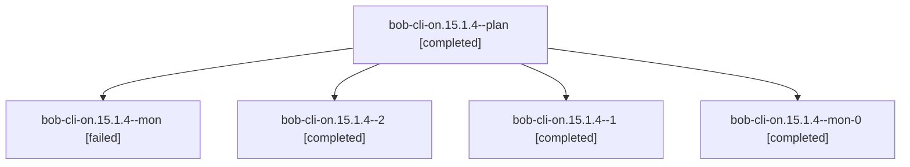

# Session: bob-cli-on.15.1.4

[Agent Hoods](../README.md) / [bbugyi200](../users/bbugyi200/README.md) / [athena](../users/bbugyi200/machines/athena/README.md) / [bob-cli-on](../users/bbugyi200/machines/athena/hoods/bob-cli-on/README.md) / bob-cli-on.15.1.4

Owner: `bbugyi200.athena` · Hood: `bob-cli-on` · Members: 5 · Bead: [bob-cli-on.15.1.4](https://github.com/bobs-org/bob-cli--beads/blob/main/pages/bob-cli-on/bob-cli-on.15.1.4.md)

## Lineage

The diagram is an optional enhancement; the ordered table below contains the same lineage in accessible text.

| Role | Agent | State | Model / provider | Timing | Commits | Prompt | Chat |
|---|---|---|---|---|---:|---|---|
| plan | bob-cli-on.15.1.4--plan | completed | muse-spark-1.3-contributor / muse | 2026-11-22T22:58:03.061279+00:00 → 2026-11-22T23:24:38.246560+00:00 | 0 | [Prompt](../agents/bbugyi200.athena.bob-cli-on.15.1.4--plan/prompt.md) | [Chat](../agents/bbugyi200.athena.bob-cli-on.15.1.4--plan/chat.md) |
| mon | bob-cli-on.15.1.4--mon | failed | muse-spark-1.3-contributor / muse | 2026-11-22T23:20:46.222688+00:00 → 2026-11-22T23:42:50.847062+00:00 | 0 | — | [Chat](../agents/bbugyi200.athena.bob-cli-on.15.1.4--mon/chat.md) |
| 2 | bob-cli-on.15.1.4--2 | completed | muse-spark-1.3-contributor / muse | 2026-11-23T00:12:34.671369+00:00 → 2026-11-23T00:25:31.359146+00:00 | 0 | [Prompt](../agents/bbugyi200.athena.bob-cli-on.15.1.4--2/prompt.md) | [Chat](../agents/bbugyi200.athena.bob-cli-on.15.1.4--2/chat.md) |
| 1 | bob-cli-on.15.1.4--1 | completed | muse-spark-1.3-contributor / muse | 2026-11-22T23:42:50.483450+00:00 → 2026-11-22T23:49:15.403951+00:00 | 0 | [Prompt](../agents/bbugyi200.athena.bob-cli-on.15.1.4--1/prompt.md) | [Chat](../agents/bbugyi200.athena.bob-cli-on.15.1.4--1/chat.md) |
| mon-0 | bob-cli-on.15.1.4--mon-0 | completed | muse-spark-1.3-contributor / muse | 2026-11-22T23:45:19.813380+00:00 → 2026-11-23T00:12:34.844330+00:00 | 0 | — | [Chat](../agents/bbugyi200.athena.bob-cli-on.15.1.4--mon-0/chat.md) |

## Neighbors

| Agent | Relation | State |
|---|---|---|
| [bob-cli-on.15](bbugyi200.athena.bob-cli-on.15.md) (session · 3) | ancestor | active 1, completed 2 |
| [bob-cli-on.15.1.1](../agents/bbugyi200.athena.bob-cli-on.15.1.1/README.md) | bob-cli-on.15.1 hood | completed |
| [bob-cli-on.15.1.2](../agents/bbugyi200.athena.bob-cli-on.15.1.2/README.md) | bob-cli-on.15.1 hood | completed |
| [bob-cli-on.15.1.3](bbugyi200.athena.bob-cli-on.15.1.3.md) (session · 5) | bob-cli-on.15.1 hood | completed 4, failed 1 |
| [bob-cli-on.15.1.5](bbugyi200.athena.bob-cli-on.15.1.5.md) (session · 9) | bob-cli-on.15.1 hood | completed 5, failed 4 |
| [bob-cli-on.15.1.land](../agents/bbugyi200.athena.bob-cli-on.15.1.land/README.md) | bob-cli-on.15.1 hood | completed |
| [bob-cli-on.1](../agents/bbugyi200.athena.bob-cli-on.1/README.md) | bob-cli-on hood | completed |
| [bob-cli-on.10](bbugyi200.athena.bob-cli-on.10.md) (session · 3) | bob-cli-on hood | active 1, completed 2 |
| [bob-cli-on.10.1.1](../agents/bbugyi200.athena.bob-cli-on.10.1.1/README.md) | bob-cli-on hood | completed |
| [bob-cli-on.10.1.2](../agents/bbugyi200.athena.bob-cli-on.10.1.2/README.md) | bob-cli-on hood | completed |
| [bob-cli-on.10.1.3](../agents/bbugyi200.athena.bob-cli-on.10.1.3/README.md) | bob-cli-on hood | completed |
| [bob-cli-on.10.1.4](../agents/bbugyi200.athena.bob-cli-on.10.1.4/README.md) | bob-cli-on hood | completed |
| [bob-cli-on.10.1.5](../agents/bbugyi200.athena.bob-cli-on.10.1.5/README.md) | bob-cli-on hood | completed |
| [bob-cli-on.10.1.6](../agents/bbugyi200.athena.bob-cli-on.10.1.6/README.md) | bob-cli-on hood | completed |
| [bob-cli-on.10.1.land](bbugyi200.athena.bob-cli-on.10.1.land.md) (session · 3) | bob-cli-on hood | completed 3 |
| [bob-cli-on.11](bbugyi200.athena.bob-cli-on.11.md) (session · 3) | bob-cli-on hood | active 1, completed 2 |
| [bob-cli-on.11.1.1](../agents/bbugyi200.athena.bob-cli-on.11.1.1/README.md) | bob-cli-on hood | completed |
| [bob-cli-on.11.1.2](../agents/bbugyi200.athena.bob-cli-on.11.1.2/README.md) | bob-cli-on hood | completed |
| [bob-cli-on.11.1.3](bbugyi200.athena.bob-cli-on.11.1.3.md) (session · 5) | bob-cli-on hood | completed 3, failed 2 |
| [bob-cli-on.11.1.4](../agents/bbugyi200.athena.bob-cli-on.11.1.4/README.md) | bob-cli-on hood | completed |
| [bob-cli-on.11.1.5](../agents/bbugyi200.athena.bob-cli-on.11.1.5/README.md) | bob-cli-on hood | completed |
| [bob-cli-on.11.1.6](bbugyi200.athena.bob-cli-on.11.1.6.md) (session · 9) | bob-cli-on hood | completed 8, failed 1 |
| [bob-cli-on.11.1.7.1](../agents/bbugyi200.athena.bob-cli-on.11.1.7.1/README.md) | bob-cli-on hood | completed |
| [bob-cli-on.11.1.7.2](bbugyi200.athena.bob-cli-on.11.1.7.2.md) (session · 13) | bob-cli-on hood | completed 9, failed 4 |
| [bob-cli-on.11.1.7.land](bbugyi200.athena.bob-cli-on.11.1.7.land.md) (session · 3) | bob-cli-on hood | completed 3 |
| [bob-cli-on.11.1.land](bbugyi200.athena.bob-cli-on.11.1.land.md) (session · 3) | bob-cli-on hood | active 1, completed 2 |
| [bob-cli-on.12](../agents/bbugyi200.athena.bob-cli-on.12/README.md) | bob-cli-on hood | completed |
| [bob-cli-on.13](bbugyi200.athena.bob-cli-on.13.md) (session · 5) | bob-cli-on hood | completed 4, failed 1 |
| [bob-cli-on.14](../agents/bbugyi200.athena.bob-cli-on.14/README.md) | bob-cli-on hood | completed |
| [bob-cli-on.16](bbugyi200.athena.bob-cli-on.16.md) (session · 9) | bob-cli-on hood | completed 9 |
| [bob-cli-on.17](../agents/bbugyi200.athena.bob-cli-on.17/README.md) | bob-cli-on hood | completed |
| [bob-cli-on.2](bbugyi200.athena.bob-cli-on.2.md) (session · 5) | bob-cli-on hood | completed 4, failed 1 |
| [bob-cli-on.3](../agents/bbugyi200.athena.bob-cli-on.3/README.md) | bob-cli-on hood | completed |
| [bob-cli-on.4](../agents/bbugyi200.athena.bob-cli-on.4/README.md) | bob-cli-on hood | completed |
| [bob-cli-on.5](../agents/bbugyi200.athena.bob-cli-on.5/README.md) | bob-cli-on hood | completed |
| [bob-cli-on.6](bbugyi200.athena.bob-cli-on.6.md) (session · 3) | bob-cli-on hood | active 1, completed 2 |
| [bob-cli-on.6.1.1](../agents/bbugyi200.athena.bob-cli-on.6.1.1/README.md) | bob-cli-on hood | completed |
| [bob-cli-on.6.1.2](../agents/bbugyi200.athena.bob-cli-on.6.1.2/README.md) | bob-cli-on hood | completed |
| [bob-cli-on.6.1.3](../agents/bbugyi200.athena.bob-cli-on.6.1.3/README.md) | bob-cli-on hood | completed |
| [bob-cli-on.6.1.4](../agents/bbugyi200.athena.bob-cli-on.6.1.4/README.md) | bob-cli-on hood | completed |
| [bob-cli-on.6.1.5](../agents/bbugyi200.athena.bob-cli-on.6.1.5/README.md) | bob-cli-on hood | completed |
| [bob-cli-on.6.1.land](bbugyi200.athena.bob-cli-on.6.1.land.md) (session · 3) | bob-cli-on hood | active 2, completed 1 |
| [bob-cli-on.6.1.land](../agents/bbugyi200.athena.bob-cli-on.6.1.land/README.md) | bob-cli-on hood | completed |
| [bob-cli-on.7](../agents/bbugyi200.athena.bob-cli-on.7/README.md) | bob-cli-on hood | completed |
| [bob-cli-on.8](bbugyi200.athena.bob-cli-on.8.md) (session · 3) | bob-cli-on hood | active 1, completed 2 |
| [bob-cli-on.8.1.1](../agents/bbugyi200.athena.bob-cli-on.8.1.1/README.md) | bob-cli-on hood | completed |
| [bob-cli-on.8.1.2](../agents/bbugyi200.athena.bob-cli-on.8.1.2/README.md) | bob-cli-on hood | completed |
| [bob-cli-on.8.1.3](../agents/bbugyi200.athena.bob-cli-on.8.1.3/README.md) | bob-cli-on hood | completed |
| [bob-cli-on.8.1.4](../agents/bbugyi200.athena.bob-cli-on.8.1.4/README.md) | bob-cli-on hood | completed |
| [bob-cli-on.8.1.5](bbugyi200.athena.bob-cli-on.8.1.5.md) (session · 5) | bob-cli-on hood | completed 4, failed 1 |
| [bob-cli-on.8.1.6](../agents/bbugyi200.athena.bob-cli-on.8.1.6/README.md) | bob-cli-on hood | completed |
| [bob-cli-on.8.1.land](bbugyi200.athena.bob-cli-on.8.1.land.md) (session · 3) | bob-cli-on hood | completed 3 |
| [bob-cli-on.9](bbugyi200.athena.bob-cli-on.9.md) (session · 5) | bob-cli-on hood | completed 5 |
| [bob-cli-on.land](bbugyi200.athena.bob-cli-on.land.md) (session · 3) | bob-cli-on hood | completed 3 |
