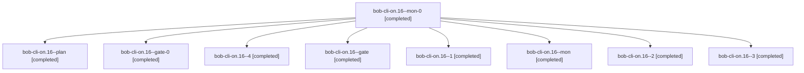

# Session: bob-cli-on.16

[Agent Hoods](../README.md) / [bbugyi200](../users/bbugyi200/README.md) / [athena](../users/bbugyi200/machines/athena/README.md) / [bob-cli-on](../users/bbugyi200/machines/athena/hoods/bob-cli-on/README.md) / bob-cli-on.16

Owner: `bbugyi200.athena` · Hood: `bob-cli-on` · Members: 9 · Bead: [bob-cli-on.16](https://github.com/bobs-org/bob-cli--beads/blob/main/pages/bob-cli-on/bob-cli-on.16.md)

## Lineage



The diagram is an optional enhancement; the ordered table below contains the same lineage in accessible text.

| Role | Agent | State | Model / provider | Timing | Commits | Prompt | Chat |
|---|---|---|---|---|---:|---|---|
| <a id="member-mon-0"></a>mon-0 | bob-cli-on.16--mon-0 | completed | gpt-6-luna / codex | 2026-11-22T04:18:17.037627+00:00 → 2026-11-22T04:23:37.096778+00:00 | 0 | — | [Chat](../agents/bbugyi200.athena.bob-cli-on.16--mon-0/chat.md) |
| <a id="member-plan"></a>plan | bob-cli-on.16--plan | completed | gpt-6-luna / codex | 2026-11-22T04:05:14.559542+00:00 → 2026-11-22T04:09:42.132936+00:00 | 0 | [Prompt](../agents/bbugyi200.athena.bob-cli-on.16--plan/prompt.md) | [Chat](../agents/bbugyi200.athena.bob-cli-on.16--plan/chat.md) |
| <a id="member-gate-0"></a>gate-0 | bob-cli-on.16--gate-0 | completed | gpt-6-luna / codex | 2026-11-22T11:52:41.050552+00:00 → 2026-11-22T11:53:21.309751+00:00 | 0 | — | [Chat](../agents/bbugyi200.athena.bob-cli-on.16--gate-0/chat.md) |
| <a id="member-4"></a>4 | bob-cli-on.16--4 | completed | gpt-6-luna / codex | 2026-11-22T11:53:57.671694+00:00 → 2026-11-22T11:57:23.205485+00:00 | 0 | [Prompt](../agents/bbugyi200.athena.bob-cli-on.16--4/prompt.md) | [Chat](../agents/bbugyi200.athena.bob-cli-on.16--4/chat.md) |
| <a id="member-gate"></a>gate | bob-cli-on.16--gate | completed | gpt-6-luna / codex | 2026-11-22T11:39:31.135453+00:00 → 2026-11-22T11:39:53.093163+00:00 | 0 | — | [Chat](../agents/bbugyi200.athena.bob-cli-on.16--gate/chat.md) |
| <a id="member-1"></a>1 | bob-cli-on.16--1 | completed | gpt-6-luna / codex | 2026-11-22T04:14:29.537166+00:00 → 2026-11-22T04:18:52.596362+00:00 | 0 | [Prompt](../agents/bbugyi200.athena.bob-cli-on.16--1/prompt.md) | [Chat](../agents/bbugyi200.athena.bob-cli-on.16--1/chat.md) |
| <a id="member-mon"></a>mon | bob-cli-on.16--mon | completed | gpt-6-luna / codex | 2026-11-22T04:09:10.188605+00:00 → 2026-11-22T04:14:29.703284+00:00 | 0 | — | [Chat](../agents/bbugyi200.athena.bob-cli-on.16--mon/chat.md) |
| <a id="member-2"></a>2 | bob-cli-on.16--2 | completed | gpt-6-luna / codex | 2026-11-22T04:23:36.851532+00:00 → 2026-11-22T04:31:05.651169+00:00 | 0 | [Prompt](../agents/bbugyi200.athena.bob-cli-on.16--2/prompt.md) | [Chat](../agents/bbugyi200.athena.bob-cli-on.16--2/chat.md) |
| <a id="member-3"></a>3 | bob-cli-on.16--3 | completed | gpt-6-luna / codex | 2026-11-22T11:40:35.999484+00:00 → 2026-11-22T11:46:44.167684+00:00 | 0 | [Prompt](../agents/bbugyi200.athena.bob-cli-on.16--3/prompt.md) | [Chat](../agents/bbugyi200.athena.bob-cli-on.16--3/chat.md) |

## Variables

| Role | Variable | Value |
|---|---|---|
| 2 | `artifacts` | \[{bead: bob-cli-on.16, kind: file, label: Rename-drawer REQUIREMENTS to NOTES dry-run report, path: /home/bryan/.sase/artifacts/agents/gh\_bobs-org\_\_bob-cli/20261121232257/rename-drawer-0441482c7f76.j… |
| 3 | `artifacts` | \[{bead: bob-cli-on.16, kind: file, label: Task tidy dry-run report, path: /home/bryan/.sase/artifacts/agents/gh\_bobs-org\_\_bob-cli/20261122063952/task-tidy-7cb098570ab7.json, ref: file:explicit:a379f9… |

#### artifacts

**Role:** `2`

```yaml
- bead: bob-cli-on.16
  kind: file
  label: Rename-drawer REQUIREMENTS to NOTES dry-run report
  path: /home/bryan/.sase/artifacts/agents/gh_bobs-org__bob-cli/20261121232257/rename-drawer-0441482c7f76.json
  ref: file:explicit:c841837767d4131bd902aedc
  source_path: /tmp/bob-cli-on.16/rename-drawer.json
- bead: bob-cli-on.16
  kind: markdown
  label: Dataview TASK query report
  path: /home/bryan/.sase/artifacts/agents/gh_bobs-org__bob-cli/20261121232257/dataview-task-query-report-f733ee8262fa.md
  ref: file:explicit:2d8cfb54491659ae7b7ca032
  source_path: /tmp/bob-cli-on.16/dataview-task-query-report.md
- bead: bob-cli-on.16
  kind: markdown
  label: Opt-in requirement review candidates
  path: /home/bryan/.sase/artifacts/agents/gh_bobs-org__bob-cli/20261121232257/requirement-opt-in-review-5c24ac6edeb2.md
  ref: file:explicit:a87edf6265c4dcbb64df4e95
  source_path: /tmp/bob-cli-on.16/requirement-opt-in-review.md
```

#### artifacts

**Role:** `3`

```yaml
- bead: bob-cli-on.16
  kind: file
  label: Task tidy dry-run report
  path: /home/bryan/.sase/artifacts/agents/gh_bobs-org__bob-cli/20261122063952/task-tidy-7cb098570ab7.json
  ref: file:explicit:a379f9265f5c0d47f72c412c
  source_path: /tmp/bob-cli-on.16/task-tidy.json
```

Values are truncated for display; see each member's agent meta.json for the full values.

## Neighbors

| Agent | Relation | State |
|---|---|---|
| [bob-cli-on.1](../agents/bbugyi200.athena.bob-cli-on.1/README.md) | bob-cli-on hood | completed |
| [bob-cli-on.10](bbugyi200.athena.bob-cli-on.10.md) (session · 3) | bob-cli-on hood | active 1, completed 2 |
| [bob-cli-on.10.1.1](../agents/bbugyi200.athena.bob-cli-on.10.1.1/README.md) | bob-cli-on hood | completed |
| [bob-cli-on.10.1.2](../agents/bbugyi200.athena.bob-cli-on.10.1.2/README.md) | bob-cli-on hood | completed |
| [bob-cli-on.10.1.3](../agents/bbugyi200.athena.bob-cli-on.10.1.3/README.md) | bob-cli-on hood | completed |
| [bob-cli-on.10.1.4](../agents/bbugyi200.athena.bob-cli-on.10.1.4/README.md) | bob-cli-on hood | completed |
| [bob-cli-on.10.1.5](../agents/bbugyi200.athena.bob-cli-on.10.1.5/README.md) | bob-cli-on hood | completed |
| [bob-cli-on.10.1.6](../agents/bbugyi200.athena.bob-cli-on.10.1.6/README.md) | bob-cli-on hood | completed |
| [bob-cli-on.10.1.land](bbugyi200.athena.bob-cli-on.10.1.land.md) (session · 3) | bob-cli-on hood | completed 3 |
| [bob-cli-on.11](bbugyi200.athena.bob-cli-on.11.md) (session · 3) | bob-cli-on hood | active 1, completed 2 |
| [bob-cli-on.11.1.1](../agents/bbugyi200.athena.bob-cli-on.11.1.1/README.md) | bob-cli-on hood | completed |
| [bob-cli-on.11.1.2](../agents/bbugyi200.athena.bob-cli-on.11.1.2/README.md) | bob-cli-on hood | completed |
| [bob-cli-on.11.1.3](bbugyi200.athena.bob-cli-on.11.1.3.md) (session · 5) | bob-cli-on hood | completed 3, failed 2 |
| [bob-cli-on.11.1.4](../agents/bbugyi200.athena.bob-cli-on.11.1.4/README.md) | bob-cli-on hood | completed |
| [bob-cli-on.11.1.5](../agents/bbugyi200.athena.bob-cli-on.11.1.5/README.md) | bob-cli-on hood | completed |
| [bob-cli-on.11.1.6](bbugyi200.athena.bob-cli-on.11.1.6.md) (session · 9) | bob-cli-on hood | completed 8, failed 1 |
| [bob-cli-on.11.1.7.1](../agents/bbugyi200.athena.bob-cli-on.11.1.7.1/README.md) | bob-cli-on hood | active |
| [bob-cli-on.11.1.7.2](../agents/bbugyi200.athena.bob-cli-on.11.1.7.2/README.md) | bob-cli-on hood | waiting |
| [bob-cli-on.11.1.7.land](../agents/bbugyi200.athena.bob-cli-on.11.1.7.land/README.md) | bob-cli-on hood | waiting |
| [bob-cli-on.11.1.land](bbugyi200.athena.bob-cli-on.11.1.land.md) (session · 3) | bob-cli-on hood | active 1, completed 2 |
| [bob-cli-on.12](../agents/bbugyi200.athena.bob-cli-on.12/README.md) | bob-cli-on hood | waiting |
| [bob-cli-on.13](bbugyi200.athena.bob-cli-on.13.md) (session · 5) | bob-cli-on hood | completed 4, failed 1 |
| [bob-cli-on.14](../agents/bbugyi200.athena.bob-cli-on.14/README.md) | bob-cli-on hood | completed |
| [bob-cli-on.15](bbugyi200.athena.bob-cli-on.15.md) (session · 3) | bob-cli-on hood | active 1, completed 2 |
| [bob-cli-on.15.1.1](../agents/bbugyi200.athena.bob-cli-on.15.1.1/README.md) | bob-cli-on hood | completed |
| [bob-cli-on.15.1.2](../agents/bbugyi200.athena.bob-cli-on.15.1.2/README.md) | bob-cli-on hood | completed |
| [bob-cli-on.15.1.3](bbugyi200.athena.bob-cli-on.15.1.3.md) (session · 5) | bob-cli-on hood | completed 4, failed 1 |
| [bob-cli-on.15.1.4](bbugyi200.athena.bob-cli-on.15.1.4.md) (session · 5) | bob-cli-on hood | completed 4, failed 1 |
| [bob-cli-on.15.1.5](bbugyi200.athena.bob-cli-on.15.1.5.md) (session · 6) | bob-cli-on hood | active 1, completed 3, failed 2 |
| [bob-cli-on.15.1.land](../agents/bbugyi200.athena.bob-cli-on.15.1.land/README.md) | bob-cli-on hood | waiting |
| [bob-cli-on.17](../agents/bbugyi200.athena.bob-cli-on.17/README.md) | bob-cli-on hood | waiting |
| [bob-cli-on.2](bbugyi200.athena.bob-cli-on.2.md) (session · 5) | bob-cli-on hood | completed 4, failed 1 |
| [bob-cli-on.3](../agents/bbugyi200.athena.bob-cli-on.3/README.md) | bob-cli-on hood | completed |
| [bob-cli-on.4](../agents/bbugyi200.athena.bob-cli-on.4/README.md) | bob-cli-on hood | completed |
| [bob-cli-on.5](../agents/bbugyi200.athena.bob-cli-on.5/README.md) | bob-cli-on hood | completed |
| [bob-cli-on.6](bbugyi200.athena.bob-cli-on.6.md) (session · 3) | bob-cli-on hood | active 1, completed 2 |
| [bob-cli-on.6.1.1](../agents/bbugyi200.athena.bob-cli-on.6.1.1/README.md) | bob-cli-on hood | completed |
| [bob-cli-on.6.1.2](../agents/bbugyi200.athena.bob-cli-on.6.1.2/README.md) | bob-cli-on hood | completed |
| [bob-cli-on.6.1.3](../agents/bbugyi200.athena.bob-cli-on.6.1.3/README.md) | bob-cli-on hood | completed |
| [bob-cli-on.6.1.4](../agents/bbugyi200.athena.bob-cli-on.6.1.4/README.md) | bob-cli-on hood | completed |
| [bob-cli-on.6.1.5](../agents/bbugyi200.athena.bob-cli-on.6.1.5/README.md) | bob-cli-on hood | completed |
| [bob-cli-on.6.1.land](bbugyi200.athena.bob-cli-on.6.1.land.md) (session · 3) | bob-cli-on hood | active 2, completed 1 |
| [bob-cli-on.6.1.land](../agents/bbugyi200.athena.bob-cli-on.6.1.land/README.md) | bob-cli-on hood | completed |
| [bob-cli-on.7](../agents/bbugyi200.athena.bob-cli-on.7/README.md) | bob-cli-on hood | completed |
| [bob-cli-on.8](bbugyi200.athena.bob-cli-on.8.md) (session · 3) | bob-cli-on hood | active 1, completed 2 |
| [bob-cli-on.8.1.1](../agents/bbugyi200.athena.bob-cli-on.8.1.1/README.md) | bob-cli-on hood | completed |
| [bob-cli-on.8.1.2](../agents/bbugyi200.athena.bob-cli-on.8.1.2/README.md) | bob-cli-on hood | completed |
| [bob-cli-on.8.1.3](../agents/bbugyi200.athena.bob-cli-on.8.1.3/README.md) | bob-cli-on hood | completed |
| [bob-cli-on.8.1.4](../agents/bbugyi200.athena.bob-cli-on.8.1.4/README.md) | bob-cli-on hood | completed |
| [bob-cli-on.8.1.5](bbugyi200.athena.bob-cli-on.8.1.5.md) (session · 5) | bob-cli-on hood | completed 4, failed 1 |
| … and 4 more in the [hood roster](../users/bbugyi200/machines/athena/hoods/bob-cli-on/README.md) | bob-cli-on hood | — |
