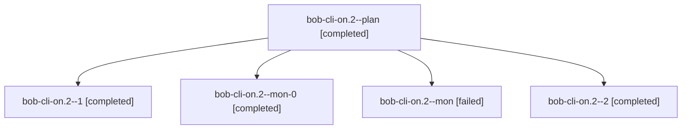

# Session: bob-cli-on.2

[Agent Hoods](../README.md) / [bbugyi200](../users/bbugyi200/README.md) / [athena](../users/bbugyi200/machines/athena/README.md) / [bob-cli-on](../users/bbugyi200/machines/athena/hoods/bob-cli-on/README.md) / bob-cli-on.2

Owner: `bbugyi200.athena` · Hood: `bob-cli-on` · Members: 5 · Bead: [bob-cli-on.2](https://github.com/bobs-org/bob-cli--beads/blob/main/pages/bob-cli-on/bob-cli-on.2.md)

## Lineage

The diagram is an optional enhancement; the ordered table below contains the same lineage in accessible text.

| Role | Agent | State | Model / provider | Timing | Commits | Prompt | Chat |
|---|---|---|---|---|---:|---|---|
| plan | bob-cli-on.2--plan | completed | grok-4.6 / grok | 2026-11-21T17:17:14.442641+00:00 → 2026-11-21T17:57:05.942399+00:00 | 0 | [Prompt](../agents/bbugyi200.athena.bob-cli-on.2--plan/prompt.md) | [Chat](../agents/bbugyi200.athena.bob-cli-on.2--plan/chat.md) |
| 1 | bob-cli-on.2--1 | completed | grok-4.6 / grok | 2026-11-21T18:09:55.521592+00:00 → 2026-11-21T18:25:08.432016+00:00 | 0 | [Prompt](../agents/bbugyi200.athena.bob-cli-on.2--1/prompt.md) | [Chat](../agents/bbugyi200.athena.bob-cli-on.2--1/chat.md) |
| mon-0 | bob-cli-on.2--mon-0 | completed | grok-4.6 / grok | 2026-11-21T18:23:26.008470+00:00 → 2026-11-21T18:34:36.426555+00:00 | 0 | — | [Chat](../agents/bbugyi200.athena.bob-cli-on.2--mon-0/chat.md) |
| mon | bob-cli-on.2--mon | failed | grok-4.6 / grok | 2026-11-21T17:54:04.188448+00:00 → 2026-11-21T18:09:55.746740+00:00 | 0 | — | [Chat](../agents/bbugyi200.athena.bob-cli-on.2--mon/chat.md) |
| 2 | bob-cli-on.2--2 | completed | grok-4.6 / grok | 2026-11-21T18:38:53.032377+00:00 → 2026-11-21T18:51:53.737866+00:00 | [1](../agents/bbugyi200.athena.bob-cli-on.2--2/README.md#commits) | [Prompt](../agents/bbugyi200.athena.bob-cli-on.2--2/prompt.md) | [Chat](../agents/bbugyi200.athena.bob-cli-on.2--2/chat.md) |

## Commits

| Role | Repo | Commit | Subject | Committed |
|---|---|---|---|---|
| 2 | bob-cli | [`532df82`](https://github.com/bobs-org/bob-cli/commit/532df8259187f65b6f66864669eb80b133fcb35e) | feat(task-reqs): keep readers and writers off requirement lines | 2026-11-21 13:50:46 EST |

## Neighbors

| Agent | Relation | State |
|---|---|---|
| [bob-cli-on.1](../agents/bbugyi200.athena.bob-cli-on.1/README.md) | bob-cli-on hood | completed |
| [bob-cli-on.10](bbugyi200.athena.bob-cli-on.10.md) (session · 3) | bob-cli-on hood | active 1, completed 2 |
| [bob-cli-on.10.1.1](../agents/bbugyi200.athena.bob-cli-on.10.1.1/README.md) | bob-cli-on hood | completed |
| [bob-cli-on.10.1.2](../agents/bbugyi200.athena.bob-cli-on.10.1.2/README.md) | bob-cli-on hood | completed |
| [bob-cli-on.10.1.3](../agents/bbugyi200.athena.bob-cli-on.10.1.3/README.md) | bob-cli-on hood | completed |
| [bob-cli-on.10.1.4](../agents/bbugyi200.athena.bob-cli-on.10.1.4/README.md) | bob-cli-on hood | waiting |
| [bob-cli-on.10.1.5](../agents/bbugyi200.athena.bob-cli-on.10.1.5/README.md) | bob-cli-on hood | completed |
| [bob-cli-on.10.1.6](../agents/bbugyi200.athena.bob-cli-on.10.1.6/README.md) | bob-cli-on hood | waiting |
| [bob-cli-on.10.1.land](../agents/bbugyi200.athena.bob-cli-on.10.1.land/README.md) | bob-cli-on hood | waiting |
| [bob-cli-on.11](../agents/bbugyi200.athena.bob-cli-on.11/README.md) | bob-cli-on hood | waiting |
| [bob-cli-on.12](../agents/bbugyi200.athena.bob-cli-on.12/README.md) | bob-cli-on hood | waiting |
| [bob-cli-on.13](../agents/bbugyi200.athena.bob-cli-on.13/README.md) | bob-cli-on hood | waiting |
| [bob-cli-on.14](../agents/bbugyi200.athena.bob-cli-on.14/README.md) | bob-cli-on hood | waiting |
| [bob-cli-on.15](../agents/bbugyi200.athena.bob-cli-on.15/README.md) | bob-cli-on hood | waiting |
| [bob-cli-on.16](../agents/bbugyi200.athena.bob-cli-on.16/README.md) | bob-cli-on hood | waiting |
| [bob-cli-on.17](../agents/bbugyi200.athena.bob-cli-on.17/README.md) | bob-cli-on hood | waiting |
| [bob-cli-on.3](../agents/bbugyi200.athena.bob-cli-on.3/README.md) | bob-cli-on hood | completed |
| [bob-cli-on.4](../agents/bbugyi200.athena.bob-cli-on.4/README.md) | bob-cli-on hood | completed |
| [bob-cli-on.5](../agents/bbugyi200.athena.bob-cli-on.5/README.md) | bob-cli-on hood | completed |
| [bob-cli-on.6](bbugyi200.athena.bob-cli-on.6.md) (session · 3) | bob-cli-on hood | active 1, completed 2 |
| [bob-cli-on.6.1.1](../agents/bbugyi200.athena.bob-cli-on.6.1.1/README.md) | bob-cli-on hood | completed |
| [bob-cli-on.6.1.2](../agents/bbugyi200.athena.bob-cli-on.6.1.2/README.md) | bob-cli-on hood | completed |
| [bob-cli-on.6.1.3](../agents/bbugyi200.athena.bob-cli-on.6.1.3/README.md) | bob-cli-on hood | completed |
| [bob-cli-on.6.1.4](../agents/bbugyi200.athena.bob-cli-on.6.1.4/README.md) | bob-cli-on hood | completed |
| [bob-cli-on.6.1.5](../agents/bbugyi200.athena.bob-cli-on.6.1.5/README.md) | bob-cli-on hood | completed |
| [bob-cli-on.6.1.land](../agents/bbugyi200.athena.bob-cli-on.6.1.land/README.md) | bob-cli-on hood | waiting |
| [bob-cli-on.7](../agents/bbugyi200.athena.bob-cli-on.7/README.md) | bob-cli-on hood | completed |
| [bob-cli-on.8](../agents/bbugyi200.athena.bob-cli-on.8/README.md) | bob-cli-on hood | waiting |
| [bob-cli-on.9](bbugyi200.athena.bob-cli-on.9.md) (session · 5) | bob-cli-on hood | completed 5 |
| [bob-cli-on.land](../agents/bbugyi200.athena.bob-cli-on.land/README.md) | bob-cli-on hood | waiting |
