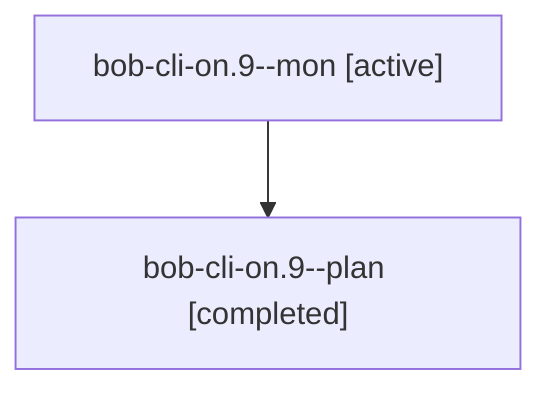

# Session: bob-cli-on.9

[Agent Hoods](../README.md) / [bbugyi200](../users/bbugyi200/README.md) / [athena](../users/bbugyi200/machines/athena/README.md) / [bob-cli-on](../users/bbugyi200/machines/athena/hoods/bob-cli-on/README.md) / bob-cli-on.9

Owner: `bbugyi200.athena` · Hood: `bob-cli-on` · Members: 2 · Bead: [bob-cli-on.9](https://github.com/bobs-org/bob-cli--beads/blob/main/pages/bob-cli-on/bob-cli-on.9.md)

## Lineage

The diagram is an optional enhancement; the ordered table below contains the same lineage in accessible text.

| Role | Agent | State | Model / provider | Timing | Commits | Prompt | Chat |
|---|---|---|---|---|---:|---|---|
| mon | bob-cli-on.9--mon | active | gpt-6-luna / codex | 2026-11-21T18:34:13.442039+00:00 | 0 | — | — |
| plan | bob-cli-on.9--plan | completed | gpt-6-luna / codex | 2026-11-21T17:17:16.428747+00:00 → 2026-11-21T18:38:51.986593+00:00 | [1](../agents/bbugyi200.athena.bob-cli-on.9--plan/README.md#commits) | [Prompt](../agents/bbugyi200.athena.bob-cli-on.9--plan/prompt.md) | [Chat](../agents/bbugyi200.athena.bob-cli-on.9--plan/chat.md) |

## Commits

| Role | Repo | Commit | Subject | Committed |
|---|---|---|---|---|
| plan | bob-cli | [`250c305`](https://github.com/bobs-org/bob-cli/commit/250c3053d652d1d6b48299557fc8272a809bab88) | docs(tasks): document requirement marks | 2026-11-21 13:37:40 EST |

## Neighbors

| Agent | Relation | State |
|---|---|---|
| [bob-cli-on.1](../agents/bbugyi200.athena.bob-cli-on.1/README.md) | bob-cli-on hood | completed |
| [bob-cli-on.10](bbugyi200.athena.bob-cli-on.10.md) (session · 3) | bob-cli-on hood | active 1, completed 2 |
| [bob-cli-on.10.1.1](../agents/bbugyi200.athena.bob-cli-on.10.1.1/README.md) | bob-cli-on hood | waiting |
| [bob-cli-on.10.1.2](../agents/bbugyi200.athena.bob-cli-on.10.1.2/README.md) | bob-cli-on hood | waiting |
| [bob-cli-on.10.1.3](../agents/bbugyi200.athena.bob-cli-on.10.1.3/README.md) | bob-cli-on hood | waiting |
| [bob-cli-on.10.1.4](../agents/bbugyi200.athena.bob-cli-on.10.1.4/README.md) | bob-cli-on hood | waiting |
| [bob-cli-on.10.1.5](../agents/bbugyi200.athena.bob-cli-on.10.1.5/README.md) | bob-cli-on hood | waiting |
| [bob-cli-on.10.1.6](../agents/bbugyi200.athena.bob-cli-on.10.1.6/README.md) | bob-cli-on hood | waiting |
| [bob-cli-on.10.1.land](../agents/bbugyi200.athena.bob-cli-on.10.1.land/README.md) | bob-cli-on hood | waiting |
| [bob-cli-on.11](../agents/bbugyi200.athena.bob-cli-on.11/README.md) | bob-cli-on hood | waiting |
| [bob-cli-on.12](../agents/bbugyi200.athena.bob-cli-on.12/README.md) | bob-cli-on hood | waiting |
| [bob-cli-on.13](../agents/bbugyi200.athena.bob-cli-on.13/README.md) | bob-cli-on hood | waiting |
| [bob-cli-on.14](../agents/bbugyi200.athena.bob-cli-on.14/README.md) | bob-cli-on hood | waiting |
| [bob-cli-on.15](../agents/bbugyi200.athena.bob-cli-on.15/README.md) | bob-cli-on hood | waiting |
| [bob-cli-on.16](../agents/bbugyi200.athena.bob-cli-on.16/README.md) | bob-cli-on hood | waiting |
| [bob-cli-on.17](../agents/bbugyi200.athena.bob-cli-on.17/README.md) | bob-cli-on hood | waiting |
| [bob-cli-on.2](bbugyi200.athena.bob-cli-on.2.md) (session · 5) | bob-cli-on hood | completed 4, failed 1 |
| [bob-cli-on.3](../agents/bbugyi200.athena.bob-cli-on.3/README.md) | bob-cli-on hood | completed |
| [bob-cli-on.4](../agents/bbugyi200.athena.bob-cli-on.4/README.md) | bob-cli-on hood | completed |
| [bob-cli-on.5](../agents/bbugyi200.athena.bob-cli-on.5/README.md) | bob-cli-on hood | waiting |
| [bob-cli-on.6](bbugyi200.athena.bob-cli-on.6.md) (session · 3) | bob-cli-on hood | active 1, completed 2 |
| [bob-cli-on.6.1.1](../agents/bbugyi200.athena.bob-cli-on.6.1.1/README.md) | bob-cli-on hood | active |
| [bob-cli-on.6.1.2](../agents/bbugyi200.athena.bob-cli-on.6.1.2/README.md) | bob-cli-on hood | waiting |
| [bob-cli-on.6.1.3](../agents/bbugyi200.athena.bob-cli-on.6.1.3/README.md) | bob-cli-on hood | waiting |
| [bob-cli-on.6.1.4](../agents/bbugyi200.athena.bob-cli-on.6.1.4/README.md) | bob-cli-on hood | waiting |
| [bob-cli-on.6.1.5](../agents/bbugyi200.athena.bob-cli-on.6.1.5/README.md) | bob-cli-on hood | waiting |
| [bob-cli-on.6.1.land](../agents/bbugyi200.athena.bob-cli-on.6.1.land/README.md) | bob-cli-on hood | waiting |
| [bob-cli-on.7](../agents/bbugyi200.athena.bob-cli-on.7/README.md) | bob-cli-on hood | waiting |
| [bob-cli-on.8](../agents/bbugyi200.athena.bob-cli-on.8/README.md) | bob-cli-on hood | waiting |
| [bob-cli-on.land](../agents/bbugyi200.athena.bob-cli-on.land/README.md) | bob-cli-on hood | waiting |
