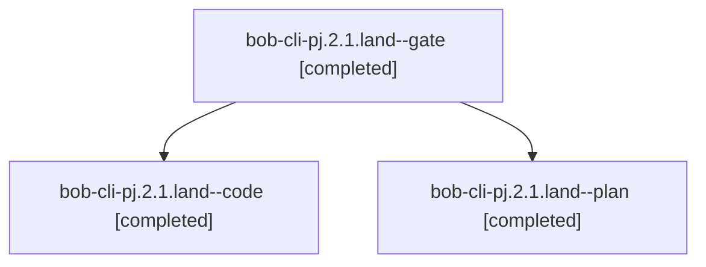

# Session: bob-cli-pj.2.1.land

[Agent Hoods](../README.md) / [bbugyi200](../users/bbugyi200/README.md) / [athena](../users/bbugyi200/machines/athena/README.md) / [bob-cli-pj](../users/bbugyi200/machines/athena/hoods/bob-cli-pj/README.md) / bob-cli-pj.2.1.land

Owner: `bbugyi200.athena` · Hood: `bob-cli-pj` · Members: 3 · Bead: [bob-cli-pj.2.1](https://github.com/bobs-org/bob-cli--beads/blob/main/pages/bob-cli-pj/bob-cli-pj.2.1.md)

## Lineage



The diagram is an optional enhancement; the ordered table below contains the same lineage in accessible text.

| Role | Agent | State | Model / provider | Timing | Commits | Prompt | Chat |
|---|---|---|---|---|---:|---|---|
| <a id="member-gate"></a>gate | bob-cli-pj.2.1.land--gate | completed | gpt-6-astra / codex | 2026-11-23T02:12:32.963236+00:00 → 2026-11-23T02:12:39.620209+00:00 | 0 | — | [Chat](../agents/bbugyi200.athena.bob-cli-pj.2.1.land--gate/chat.md) |
| <a id="member-code"></a>code | bob-cli-pj.2.1.land--code | completed | muse-spark-1.3-contributor / muse | 2026-11-23T02:13:15.891203+00:00 → 2026-11-23T03:02:56.949782+00:00 | [1](../agents/bbugyi200.athena.bob-cli-pj.2.1.land--code/README.md#commits) | — | [Chat](../agents/bbugyi200.athena.bob-cli-pj.2.1.land--code/chat.md) |
| <a id="member-plan"></a>plan | bob-cli-pj.2.1.land--plan | completed | gpt-6-astra / codex | 2026-11-23T02:01:24.840025+00:00 → 2026-11-23T03:02:56.949782+00:00 | 0 | [Prompt](../agents/bbugyi200.athena.bob-cli-pj.2.1.land--plan/prompt.md) | [Chat](../agents/bbugyi200.athena.bob-cli-pj.2.1.land--plan/chat.md) |

## Commits

| Role | Repo | Commit | Subject | Committed |
|---|---|---|---|---|
| code | bob-cli | [`15225a6`](https://github.com/bobs-org/bob-cli/commit/15225a6a7b86e887c7b35a655c719ce197efbc88) | feat(highlights-ref): converge refresh with live dependencies and lock-window settle | 2026-11-22 22:01:49 EST |

## Variables

| Role | Variable | Value |
|---|---|---|
| plan | `artifacts` | \[{bead: bob-cli-pj.2.1, kind: file, label: pj.2.1 landing docs-check: three Mac budget errors and one plugin advisory, path: /home/bryan/.sase/artifacts/agents/gh\_bobs-org\_\_bob-cli/20261122185334/pj-… |

#### artifacts

**Role:** `plan`

```yaml
- bead: bob-cli-pj.2.1
  kind: file
  label: pj.2.1 landing docs-check: three Mac budget errors and one plugin advisory
  path: /home/bryan/.sase/artifacts/agents/gh_bobs-org__bob-cli/20261122185334/pj-docs-check-279c7df0497b.log
  ref: file:explicit:f0ee94709e52d2aa9074a8ad
  source_path: /tmp/pj-docs-check.log
```

Values are truncated for display; see each member's agent meta.json for the full values.

## Neighbors

| Agent | Relation | State |
|---|---|---|
| [bob-cli-pj.2](bbugyi200.athena.bob-cli-pj.2.md) (session · 3) | ancestor | active 1, completed 2 |
| [bob-cli-pj.2.1.1](../agents/bbugyi200.athena.bob-cli-pj.2.1.1/README.md) | bob-cli-pj.2.1 hood | completed |
| [bob-cli-pj.2.1.2](../agents/bbugyi200.athena.bob-cli-pj.2.1.2/README.md) | bob-cli-pj.2.1 hood | completed |
| [bob-cli-pj.2.1.3](../agents/bbugyi200.athena.bob-cli-pj.2.1.3/README.md) | bob-cli-pj.2.1 hood | completed |
| [bob-cli-pj.1](../agents/bbugyi200.athena.bob-cli-pj.1/README.md) | bob-cli-pj hood | completed |
| [bob-cli-pj.land](bbugyi200.athena.bob-cli-pj.land.md) (session · 3) | bob-cli-pj hood | completed 3 |
