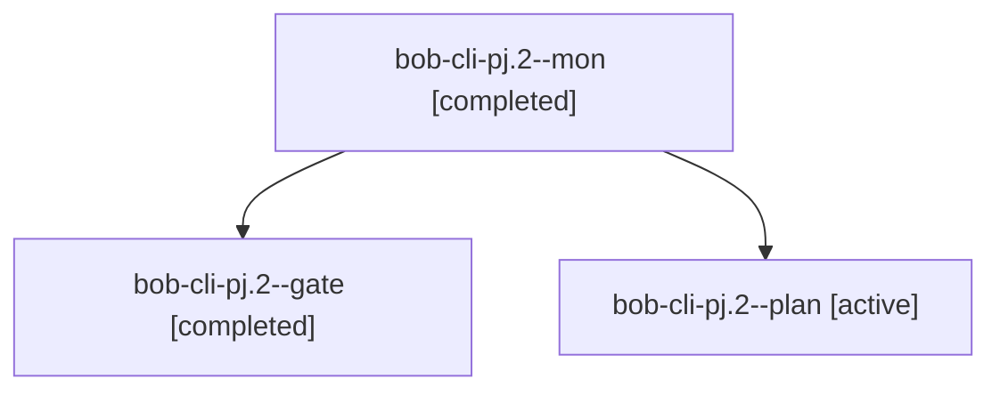

# Session: bob-cli-pj.2

[Agent Hoods](../README.md) / [bbugyi200](../users/bbugyi200/README.md) / [athena](../users/bbugyi200/machines/athena/README.md) / [bob-cli-pj](../users/bbugyi200/machines/athena/hoods/bob-cli-pj/README.md) / bob-cli-pj.2

Owner: `bbugyi200.athena` · Hood: `bob-cli-pj` · Members: 3 · Bead: [bob-cli-pj.2](https://github.com/bobs-org/bob-cli--beads/blob/main/pages/bob-cli-pj/bob-cli-pj.2.md)

## Lineage

The diagram is an optional enhancement; the ordered table below contains the same lineage in accessible text.

| Role | Agent | State | Model / provider | Timing | Commits | Prompt | Chat |
|---|---|---|---|---|---:|---|---|
| mon | bob-cli-pj.2--mon | completed | gpt-6-astra / codex | 2026-11-22T23:51:50.973759+00:00 → 2026-11-22T23:54:31.301672+00:00 | 0 | — | [Chat](../agents/bbugyi200.athena.bob-cli-pj.2--mon/chat.md) |
| gate | bob-cli-pj.2--gate | completed | gpt-6-astra / codex | 2026-11-22T23:51:38.932706+00:00 → 2026-11-22T23:51:51.832726+00:00 | 0 | — | [Chat](../agents/bbugyi200.athena.bob-cli-pj.2--gate/chat.md) |
| plan | bob-cli-pj.2--plan | active | gpt-6-astra / codex | 2026-11-22T23:44:01.188563+00:00 → 2026-11-22T23:51:57.994045+00:00 | 0 | [Prompt](../agents/bbugyi200.athena.bob-cli-pj.2--plan/prompt.md) | [Chat](../agents/bbugyi200.athena.bob-cli-pj.2--plan/chat.md) |

## Neighbors

| Agent | Relation | State |
|---|---|---|
| [bob-cli-pj.2.1.1](../agents/bbugyi200.athena.bob-cli-pj.2.1.1/README.md) | descendant | completed |
| [bob-cli-pj.2.1.2](../agents/bbugyi200.athena.bob-cli-pj.2.1.2/README.md) | descendant | completed |
| [bob-cli-pj.2.1.3](../agents/bbugyi200.athena.bob-cli-pj.2.1.3/README.md) | descendant | waiting |
| [bob-cli-pj.2.1.land](../agents/bbugyi200.athena.bob-cli-pj.2.1.land/README.md) | descendant | waiting |
| [bob-cli-pj.1](../agents/bbugyi200.athena.bob-cli-pj.1/README.md) | bob-cli-pj hood | completed |
| [bob-cli-pj.land](../agents/bbugyi200.athena.bob-cli-pj.land/README.md) | bob-cli-pj hood | waiting |
