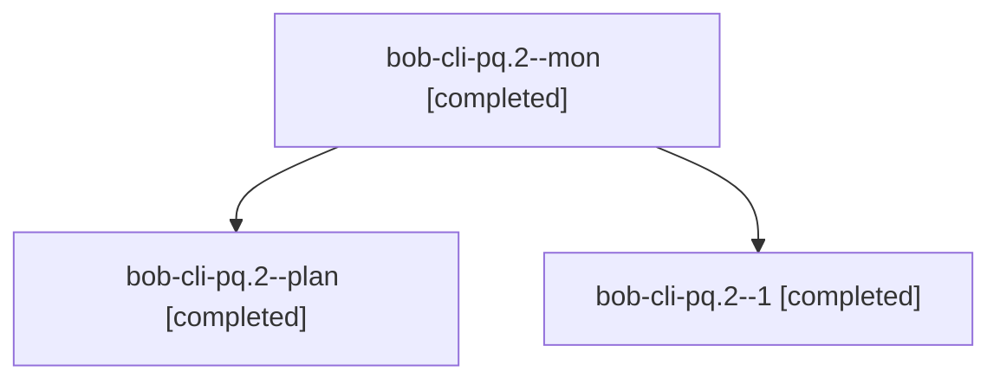

# Session: bob-cli-pq.2

[Agent Hoods](../README.md) / [bbugyi200](../users/bbugyi200/README.md) / [athena](../users/bbugyi200/machines/athena/README.md) / [bob-cli-pq](../users/bbugyi200/machines/athena/hoods/bob-cli-pq/README.md) / bob-cli-pq.2

Owner: `bbugyi200.athena` · Hood: `bob-cli-pq` · Members: 3 · Bead: [bob-cli-pq.2](https://github.com/bobs-org/bob-cli--beads/blob/main/pages/bob-cli-pq/bob-cli-pq.2.md)

## Lineage

The diagram is an optional enhancement; the ordered table below contains the same lineage in accessible text.

| Role | Agent | State | Model / provider | Timing | Commits | Prompt | Chat |
|---|---|---|---|---|---:|---|---|
| mon | bob-cli-pq.2--mon | completed | grok-4.6 / grok | 2026-11-23T09:59:21.499825+00:00 → 2026-11-23T10:06:21.418605+00:00 | 0 | — | [Chat](../agents/bbugyi200.athena.bob-cli-pq.2--mon/chat.md) |
| plan | bob-cli-pq.2--plan | completed | grok-4.6 / grok | 2026-11-23T09:30:37.678041+00:00 → 2026-11-23T10:01:05.287069+00:00 | 0 | [Prompt](../agents/bbugyi200.athena.bob-cli-pq.2--plan/prompt.md) | [Chat](../agents/bbugyi200.athena.bob-cli-pq.2--plan/chat.md) |
| 1 | bob-cli-pq.2--1 | completed | grok-4.6 / grok | 2026-11-23T10:06:20.904857+00:00 → 2026-11-23T10:11:19.889633+00:00 | [1](../agents/bbugyi200.athena.bob-cli-pq.2--1/README.md#commits) | [Prompt](../agents/bbugyi200.athena.bob-cli-pq.2--1/prompt.md) | [Chat](../agents/bbugyi200.athena.bob-cli-pq.2--1/chat.md) |

## Commits

| Role | Repo | Commit | Subject | Committed |
|---|---|---|---|---|
| 1 | bob-cli | [`87ee683`](https://github.com/bobs-org/bob-cli/commit/87ee683ae7ed698db10e79c892d2be109a45d737) | feat(task-reqs): annotate preview and agenda lines with req depth and state | 2026-11-23 05:10:41 EST |

## Neighbors

| Agent | Relation | State |
|---|---|---|
| [bob-cli-pq.1](../agents/bbugyi200.athena.bob-cli-pq.1/README.md) | bob-cli-pq hood | completed |
| [bob-cli-pq.3](bbugyi200.athena.bob-cli-pq.3.md) (session · 2) | bob-cli-pq hood | active 1, completed 1 |
| [bob-cli-pq.3](../agents/bbugyi200.athena.bob-cli-pq.3/README.md) | bob-cli-pq hood | completed |
| [bob-cli-pq.4](../agents/bbugyi200.athena.bob-cli-pq.4/README.md) | bob-cli-pq hood | waiting |
| [bob-cli-pq.5](bbugyi200.athena.bob-cli-pq.5.md) (session · 2) | bob-cli-pq hood | active 1, completed 1 |
| [bob-cli-pq.5](../agents/bbugyi200.athena.bob-cli-pq.5/README.md) | bob-cli-pq hood | completed |
| [bob-cli-pq.6](../agents/bbugyi200.athena.bob-cli-pq.6/README.md) | bob-cli-pq hood | waiting |
| [bob-cli-pq.7](../agents/bbugyi200.athena.bob-cli-pq.7/README.md) | bob-cli-pq hood | waiting |
| [bob-cli-pq.land](../agents/bbugyi200.athena.bob-cli-pq.land/README.md) | bob-cli-pq hood | waiting |
