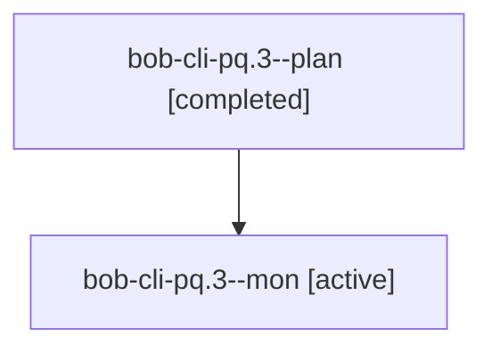

# Session: bob-cli-pq.3

[Agent Hoods](../README.md) / [bbugyi200](../users/bbugyi200/README.md) / [athena](../users/bbugyi200/machines/athena/README.md) / [bob-cli-pq](../users/bbugyi200/machines/athena/hoods/bob-cli-pq/README.md) / bob-cli-pq.3

Owner: `bbugyi200.athena` · Hood: `bob-cli-pq` · Members: 2 · Bead: [bob-cli-pq.3](https://github.com/bobs-org/bob-cli--beads/blob/main/pages/bob-cli-pq/bob-cli-pq.3.md)

## Lineage

The diagram is an optional enhancement; the ordered table below contains the same lineage in accessible text.

| Role | Agent | State | Model / provider | Timing | Commits | Prompt | Chat |
|---|---|---|---|---|---:|---|---|
| plan | bob-cli-pq.3--plan | completed | grok-4.6 / grok | 2026-11-23T08:56:15.438781+00:00 → 2026-11-23T09:02:02.395797+00:00 | 0 | [Prompt](../agents/bbugyi200.athena.bob-cli-pq.3--plan/prompt.md) | [Chat](../agents/bbugyi200.athena.bob-cli-pq.3--plan/chat.md) |
| mon | bob-cli-pq.3--mon | active | grok-4.6 / grok | 2026-11-23T09:01:06.751342+00:00 | 0 | — | — |

## Neighbors

| Agent | Relation | State |
|---|---|---|
| [bob-cli-pq.1](../agents/bbugyi200.athena.bob-cli-pq.1/README.md) | bob-cli-pq hood | completed |
| [bob-cli-pq.2](bbugyi200.athena.bob-cli-pq.2.md) (session · 3) | bob-cli-pq hood | completed 3 |
| [bob-cli-pq.4](../agents/bbugyi200.athena.bob-cli-pq.4/README.md) | bob-cli-pq hood | completed |
| [bob-cli-pq.5](bbugyi200.athena.bob-cli-pq.5.md) (session · 9) | bob-cli-pq hood | completed 6, failed 3 |
| [bob-cli-pq.5](../agents/bbugyi200.athena.bob-cli-pq.5/README.md) | bob-cli-pq hood | completed |
| [bob-cli-pq.6](bbugyi200.athena.bob-cli-pq.6.md) (session · 7) | bob-cli-pq hood | completed 4, failed 3 |
| [bob-cli-pq.7](../agents/bbugyi200.athena.bob-cli-pq.7/README.md) | bob-cli-pq hood | waiting |
| [bob-cli-pq.land](../agents/bbugyi200.athena.bob-cli-pq.land/README.md) | bob-cli-pq hood | waiting |
