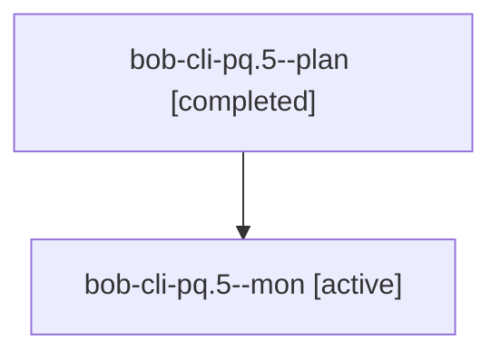

# Session: bob-cli-pq.5

[Agent Hoods](../README.md) / [bbugyi200](../users/bbugyi200/README.md) / [athena](../users/bbugyi200/machines/athena/README.md) / [bob-cli-pq](../users/bbugyi200/machines/athena/hoods/bob-cli-pq/README.md) / bob-cli-pq.5

Owner: `bbugyi200.athena` · Hood: `bob-cli-pq` · Members: 2 · Bead: [bob-cli-pq.5](https://github.com/bobs-org/bob-cli--beads/blob/main/pages/bob-cli-pq/bob-cli-pq.5.md)

## Lineage

The diagram is an optional enhancement; the ordered table below contains the same lineage in accessible text.

| Role | Agent | State | Model / provider | Timing | Commits | Prompt | Chat |
|---|---|---|---|---|---:|---|---|
| plan | bob-cli-pq.5--plan | completed | gpt-6-astra / codex | 2026-11-23T15:13:12.415560+00:00 → 2026-11-23T15:15:57.984988+00:00 | 0 | [Prompt](../agents/bbugyi200.athena.bob-cli-pq.5--plan/prompt.md) | [Chat](../agents/bbugyi200.athena.bob-cli-pq.5--plan/chat.md) |
| mon | bob-cli-pq.5--mon | active | gpt-6-astra / codex | 2026-11-23T15:15:24.359787+00:00 | 0 | — | — |

## Neighbors

| Agent | Relation | State |
|---|---|---|
| [bob-cli-pq.1](../agents/bbugyi200.athena.bob-cli-pq.1/README.md) | bob-cli-pq hood | completed |
| [bob-cli-pq.2](bbugyi200.athena.bob-cli-pq.2.md) (session · 3) | bob-cli-pq hood | completed 3 |
| [bob-cli-pq.3](bbugyi200.athena.bob-cli-pq.3.md) (session · 2) | bob-cli-pq hood | active 1, completed 1 |
| [bob-cli-pq.3](../agents/bbugyi200.athena.bob-cli-pq.3/README.md) | bob-cli-pq hood | completed |
| [bob-cli-pq.4](../agents/bbugyi200.athena.bob-cli-pq.4/README.md) | bob-cli-pq hood | completed |
| [bob-cli-pq.6](../agents/bbugyi200.athena.bob-cli-pq.6/README.md) | bob-cli-pq hood | waiting |
| [bob-cli-pq.7](../agents/bbugyi200.athena.bob-cli-pq.7/README.md) | bob-cli-pq hood | waiting |
| [bob-cli-pq.land](../agents/bbugyi200.athena.bob-cli-pq.land/README.md) | bob-cli-pq hood | waiting |
