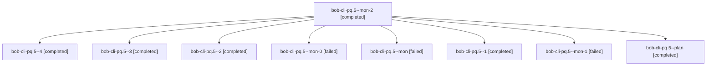

# Session: bob-cli-pq.5

[Agent Hoods](../README.md) / [bbugyi200](../users/bbugyi200/README.md) / [athena](../users/bbugyi200/machines/athena/README.md) / [bob-cli-pq](../users/bbugyi200/machines/athena/hoods/bob-cli-pq/README.md) / bob-cli-pq.5

Owner: `bbugyi200.athena` · Hood: `bob-cli-pq` · Members: 9 · Bead: [bob-cli-pq.5](https://github.com/bobs-org/bob-cli--beads/blob/main/pages/bob-cli-pq/bob-cli-pq.5.md)

## Lineage

The diagram is an optional enhancement; the ordered table below contains the same lineage in accessible text.

| Role | Agent | State | Model / provider | Timing | Commits | Prompt | Chat |
|---|---|---|---|---|---:|---|---|
| mon-2 | bob-cli-pq.5--mon-2 | completed | gpt-6-astra / codex | 2026-11-23T17:39:21.219697+00:00 → 2026-11-23T18:02:04.851646+00:00 | 0 | — | [Chat](../agents/bbugyi200.athena.bob-cli-pq.5--mon-2/chat.md) |
| 4 | bob-cli-pq.5--4 | completed | gpt-6-astra / codex | 2026-11-23T18:02:04.386536+00:00 → 2026-11-23T18:05:04.167547+00:00 | 0 | [Prompt](../agents/bbugyi200.athena.bob-cli-pq.5--4/prompt.md) | [Chat](../agents/bbugyi200.athena.bob-cli-pq.5--4/chat.md) |
| 3 | bob-cli-pq.5--3 | completed | gpt-6-astra / codex | 2026-11-23T17:37:52.882952+00:00 → 2026-11-23T17:39:58.070770+00:00 | 0 | [Prompt](../agents/bbugyi200.athena.bob-cli-pq.5--3/prompt.md) | [Chat](../agents/bbugyi200.athena.bob-cli-pq.5--3/chat.md) |
| 2 | bob-cli-pq.5--2 | completed | gpt-6-astra / codex | 2026-11-23T17:32:02.361672+00:00 → 2026-11-23T17:36:31.536679+00:00 | 0 | [Prompt](../agents/bbugyi200.athena.bob-cli-pq.5--2/prompt.md) | [Chat](../agents/bbugyi200.athena.bob-cli-pq.5--2/chat.md) |
| mon-0 | bob-cli-pq.5--mon-0 | failed | gpt-6-astra / codex | 2026-11-23T17:11:58.324862+00:00 → 2026-11-23T17:32:02.468454+00:00 | 0 | — | [Chat](../agents/bbugyi200.athena.bob-cli-pq.5--mon-0/chat.md) |
| mon | bob-cli-pq.5--mon | failed | gpt-6-astra / codex | 2026-11-23T16:50:39.443278+00:00 → 2026-11-23T17:06:54.732808+00:00 | 0 | — | [Chat](../agents/bbugyi200.athena.bob-cli-pq.5--mon/chat.md) |
| 1 | bob-cli-pq.5--1 | completed | gpt-6-astra / codex | 2026-11-23T17:06:54.316298+00:00 → 2026-11-23T17:12:24.383017+00:00 | 0 | [Prompt](../agents/bbugyi200.athena.bob-cli-pq.5--1/prompt.md) | [Chat](../agents/bbugyi200.athena.bob-cli-pq.5--1/chat.md) |
| mon-1 | bob-cli-pq.5--mon-1 | failed | gpt-6-astra / codex | 2026-11-23T17:36:01.192027+00:00 → 2026-11-23T17:37:53.386858+00:00 | 0 | — | [Chat](../agents/bbugyi200.athena.bob-cli-pq.5--mon-1/chat.md) |
| plan | bob-cli-pq.5--plan | completed | gpt-6-astra / codex | 2026-11-23T16:41:07.258554+00:00 → 2026-11-23T16:51:09.467011+00:00 | 0 | [Prompt](../agents/bbugyi200.athena.bob-cli-pq.5--plan/prompt.md) | [Chat](../agents/bbugyi200.athena.bob-cli-pq.5--plan/chat.md) |

## Neighbors

| Agent | Relation | State |
|---|---|---|
| [bob-cli-pq.1](../agents/bbugyi200.athena.bob-cli-pq.1/README.md) | bob-cli-pq hood | completed |
| [bob-cli-pq.2](bbugyi200.athena.bob-cli-pq.2.md) (session · 3) | bob-cli-pq hood | completed 3 |
| [bob-cli-pq.3](bbugyi200.athena.bob-cli-pq.3.md) (session · 2) | bob-cli-pq hood | active 1, completed 1 |
| [bob-cli-pq.3](../agents/bbugyi200.athena.bob-cli-pq.3/README.md) | bob-cli-pq hood | completed |
| [bob-cli-pq.4](../agents/bbugyi200.athena.bob-cli-pq.4/README.md) | bob-cli-pq hood | completed |
| [bob-cli-pq.6](../agents/bbugyi200.athena.bob-cli-pq.6/README.md) | bob-cli-pq hood | active |
| [bob-cli-pq.7](../agents/bbugyi200.athena.bob-cli-pq.7/README.md) | bob-cli-pq hood | waiting |
| [bob-cli-pq.land](../agents/bbugyi200.athena.bob-cli-pq.land/README.md) | bob-cli-pq hood | waiting |
