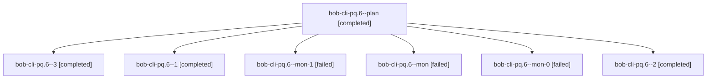

# Session: bob-cli-pq.6

[Agent Hoods](../README.md) / [bbugyi200](../users/bbugyi200/README.md) / [athena](../users/bbugyi200/machines/athena/README.md) / [bob-cli-pq](../users/bbugyi200/machines/athena/hoods/bob-cli-pq/README.md) / bob-cli-pq.6

Owner: `bbugyi200.athena` · Hood: `bob-cli-pq` · Members: 7 · Bead: [bob-cli-pq.6](https://github.com/bobs-org/bob-cli--beads/blob/main/pages/bob-cli-pq/bob-cli-pq.6.md)

## Lineage



The diagram is an optional enhancement; the ordered table below contains the same lineage in accessible text.

| Role | Agent | State | Model / provider | Timing | Commits | Prompt | Chat |
|---|---|---|---|---|---:|---|---|
| <a id="member-plan"></a>plan | bob-cli-pq.6--plan | completed | gpt-6-astra / codex | 2026-11-23T18:05:18.040230+00:00 → 2026-11-23T18:18:20.393648+00:00 | 0 | [Prompt](../agents/bbugyi200.athena.bob-cli-pq.6--plan/prompt.md) | [Chat](../agents/bbugyi200.athena.bob-cli-pq.6--plan/chat.md) |
| <a id="member-3"></a>3 | bob-cli-pq.6--3 | completed | gpt-6-astra / codex | 2026-11-23T19:23:16.185025+00:00 → 2026-11-23T19:33:25.871165+00:00 | 0 | [Prompt](../agents/bbugyi200.athena.bob-cli-pq.6--3/prompt.md) | [Chat](../agents/bbugyi200.athena.bob-cli-pq.6--3/chat.md) |
| <a id="member-1"></a>1 | bob-cli-pq.6--1 | completed | gpt-6-astra / codex | 2026-11-23T18:21:43.970171+00:00 → 2026-11-23T18:25:36.327919+00:00 | 0 | [Prompt](../agents/bbugyi200.athena.bob-cli-pq.6--1/prompt.md) | [Chat](../agents/bbugyi200.athena.bob-cli-pq.6--1/chat.md) |
| <a id="member-mon-1"></a>mon-1 | bob-cli-pq.6--mon-1 | failed | gpt-6-astra / codex | 2026-11-23T18:59:14.090923+00:00 → 2026-11-23T19:23:16.502093+00:00 | 0 | — | [Chat](../agents/bbugyi200.athena.bob-cli-pq.6--mon-1/chat.md) |
| <a id="member-mon"></a>mon | bob-cli-pq.6--mon | failed | gpt-6-astra / codex | 2026-11-23T18:17:42.057741+00:00 → 2026-11-23T18:21:44.209895+00:00 | 0 | — | [Chat](../agents/bbugyi200.athena.bob-cli-pq.6--mon/chat.md) |
| <a id="member-mon-0"></a>mon-0 | bob-cli-pq.6--mon-0 | failed | gpt-6-astra / codex | 2026-11-23T18:25:00.616281+00:00 → 2026-11-23T18:53:46.184104+00:00 | 0 | — | [Chat](../agents/bbugyi200.athena.bob-cli-pq.6--mon-0/chat.md) |
| <a id="member-2"></a>2 | bob-cli-pq.6--2 | completed | gpt-6-astra / codex | 2026-11-23T18:53:46.015806+00:00 → 2026-11-23T18:59:50.034403+00:00 | 0 | [Prompt](../agents/bbugyi200.athena.bob-cli-pq.6--2/prompt.md) | [Chat](../agents/bbugyi200.athena.bob-cli-pq.6--2/chat.md) |

## Variables

| Role | Variable | Value |
|---|---|---|
| 2 | `artifacts` | \[{bead: bob-cli-pq.6, kind: file, label: pq.6 clean-base Mac test compilation comparison, path: /home/bryan/.sase/artifacts/agents/gh\_bobs-org\_\_bob-cli/20261123135251/baseline-evidence-51886860c0a3.t… |
| 3 | `artifacts` | \[{bead: bob-cli-pq.6, kind: file, label: pq.6 final verification and baseline CI comparison, path: /home/bryan/.sase/artifacts/agents/gh\_bobs-org\_\_bob-cli/20261123142236/final-evidence-d6de70e96a02.t… |

#### artifacts

**Role:** `2`

```yaml
- bead: bob-cli-pq.6
  kind: file
  label: pq.6 clean-base Mac test compilation comparison
  path: /home/bryan/.sase/artifacts/agents/gh_bobs-org__bob-cli/20261123135251/baseline-evidence-51886860c0a3.txt
  ref: file:explicit:e56c77e214c8e923a7bb318b
  source_path: /home/bryan/.local/state/sase/workspaces/bobs-org/bob-cli/bob-cli_11/.git/pq6-logs/baseline-evidence.txt
```

#### artifacts

**Role:** `3`

```yaml
- bead: bob-cli-pq.6
  kind: file
  label: pq.6 final verification and baseline CI comparison
  path: /home/bryan/.sase/artifacts/agents/gh_bobs-org__bob-cli/20261123142236/final-evidence-d6de70e96a02.txt
  ref: file:explicit:0c22af796820864312c80144
  source_path: /home/bryan/.local/state/sase/workspaces/bobs-org/bob-cli/bob-cli_11/.git/pq6-logs/final-evidence.txt
```

Values are truncated for display; see each member's agent meta.json for the full values.

## Neighbors

| Agent | Relation | State |
|---|---|---|
| [bob-cli-pq.1](../agents/bbugyi200.athena.bob-cli-pq.1/README.md) | bob-cli-pq hood | completed |
| [bob-cli-pq.2](bbugyi200.athena.bob-cli-pq.2.md) (session · 3) | bob-cli-pq hood | completed 3 |
| [bob-cli-pq.3](bbugyi200.athena.bob-cli-pq.3.md) (session · 2) | bob-cli-pq hood | active 1, completed 1 |
| [bob-cli-pq.3](../agents/bbugyi200.athena.bob-cli-pq.3/README.md) | bob-cli-pq hood | completed |
| [bob-cli-pq.4](../agents/bbugyi200.athena.bob-cli-pq.4/README.md) | bob-cli-pq hood | completed |
| [bob-cli-pq.5](bbugyi200.athena.bob-cli-pq.5.md) (session · 9) | bob-cli-pq hood | completed 6, failed 3 |
| [bob-cli-pq.5](../agents/bbugyi200.athena.bob-cli-pq.5/README.md) | bob-cli-pq hood | completed |
| [bob-cli-pq.7](../agents/bbugyi200.athena.bob-cli-pq.7/README.md) | bob-cli-pq hood | completed |
| [bob-cli-pq.land](../agents/bbugyi200.athena.bob-cli-pq.land/README.md) | bob-cli-pq hood | completed |
