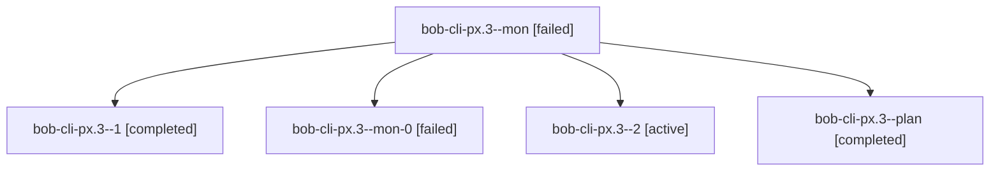

# Session: bob-cli-px.3

[Agent Hoods](../README.md) / [bbugyi200](../users/bbugyi200/README.md) / [athena](../users/bbugyi200/machines/athena/README.md) / [bob-cli-px](../users/bbugyi200/machines/athena/hoods/bob-cli-px/README.md) / bob-cli-px.3

Owner: `bbugyi200.athena` · Hood: `bob-cli-px` · Members: 5 · Bead: [bob-cli-px.3](https://github.com/bobs-org/bob-cli--beads/blob/main/pages/bob-cli-px/bob-cli-px.3.md)

## Lineage

The diagram is an optional enhancement; the ordered table below contains the same lineage in accessible text.

| Role | Agent | State | Model / provider | Timing | Commits | Prompt | Chat |
|---|---|---|---|---|---:|---|---|
| mon | bob-cli-px.3--mon | failed | gpt-6-luna / codex | 2026-11-24T18:55:47.089432+00:00 → 2026-11-24T18:59:48.273382+00:00 | 0 | — | [Chat](../agents/bbugyi200.athena.bob-cli-px.3--mon/chat.md) |
| 1 | bob-cli-px.3--1 | completed | gpt-6-luna / codex | 2026-11-24T18:59:47.841447+00:00 → 2026-11-24T19:09:21.279583+00:00 | 0 | [Prompt](../agents/bbugyi200.athena.bob-cli-px.3--1/prompt.md) | [Chat](../agents/bbugyi200.athena.bob-cli-px.3--1/chat.md) |
| mon-0 | bob-cli-px.3--mon-0 | failed | gpt-6-luna / codex | 2026-11-24T19:08:26.087711+00:00 → 2026-11-24T19:11:54.676300+00:00 | 0 | — | [Chat](../agents/bbugyi200.athena.bob-cli-px.3--mon-0/chat.md) |
| 2 | bob-cli-px.3--2 | active | gpt-6-luna / codex | 2026-11-24T19:11:54.278922+00:00 | 0 | [Prompt](../agents/bbugyi200.athena.bob-cli-px.3--2/prompt.md) | — |
| plan | bob-cli-px.3--plan | completed | gpt-6-luna / codex | 2026-11-24T18:12:59.716131+00:00 → 2026-11-24T18:56:48.269868+00:00 | 0 | [Prompt](../agents/bbugyi200.athena.bob-cli-px.3--plan/prompt.md) | [Chat](../agents/bbugyi200.athena.bob-cli-px.3--plan/chat.md) |

## Neighbors

| Agent | Relation | State |
|---|---|---|
| [bob-cli-px.1](../agents/bbugyi200.athena.bob-cli-px.1/README.md) | bob-cli-px hood | completed |
| [bob-cli-px.2](../agents/bbugyi200.athena.bob-cli-px.2/README.md) | bob-cli-px hood | completed |
| [bob-cli-px.4](../agents/bbugyi200.athena.bob-cli-px.4/README.md) | bob-cli-px hood | waiting |
| [bob-cli-px.5](../agents/bbugyi200.athena.bob-cli-px.5/README.md) | bob-cli-px hood | waiting |
| [bob-cli-px.6](../agents/bbugyi200.athena.bob-cli-px.6/README.md) | bob-cli-px hood | waiting |
| [bob-cli-px.land](../agents/bbugyi200.athena.bob-cli-px.land/README.md) | bob-cli-px hood | waiting |
