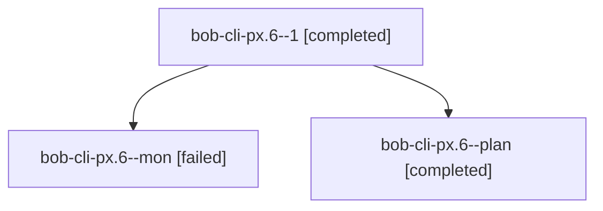

# Session: bob-cli-px.6

[Agent Hoods](../README.md) / [bbugyi200](../users/bbugyi200/README.md) / [athena](../users/bbugyi200/machines/athena/README.md) / [bob-cli-px](../users/bbugyi200/machines/athena/hoods/bob-cli-px/README.md) / bob-cli-px.6

Owner: `bbugyi200.athena` · Hood: `bob-cli-px` · Members: 3 · Bead: [bob-cli-px.6](https://github.com/bobs-org/bob-cli--beads/blob/main/pages/bob-cli-px/bob-cli-px.6.md)

## Lineage



The diagram is an optional enhancement; the ordered table below contains the same lineage in accessible text.

| Role | Agent | State | Model / provider | Timing | Commits | Prompt | Chat |
|---|---|---|---|---|---:|---|---|
| <a id="member-1"></a>1 | bob-cli-px.6--1 | completed | gpt-6-luna / codex | 2026-11-24T21:09:42.508790+00:00 → 2026-11-24T21:11:30.982127+00:00 | 0 | [Prompt](../agents/bbugyi200.athena.bob-cli-px.6--1/prompt.md) | [Chat](../agents/bbugyi200.athena.bob-cli-px.6--1/chat.md) |
| <a id="member-mon"></a>mon | bob-cli-px.6--mon | failed | gpt-6-luna / codex | 2026-11-24T21:05:03.853059+00:00 → 2026-11-24T21:09:42.938689+00:00 | 0 | — | [Chat](../agents/bbugyi200.athena.bob-cli-px.6--mon/chat.md) |
| <a id="member-plan"></a>plan | bob-cli-px.6--plan | completed | gpt-6-luna / codex | 2026-11-24T20:31:41.574072+00:00 → 2026-11-24T21:05:56.759744+00:00 | 0 | [Prompt](../agents/bbugyi200.athena.bob-cli-px.6--plan/prompt.md) | [Chat](../agents/bbugyi200.athena.bob-cli-px.6--plan/chat.md) |

## Variables

| Role | Variable | Value |
|---|---|---|
| plan | `artifacts` | \[{bead: bob-cli-px.6, kind: image, label: Mail Close Card warning-dark, path: /home/bryan/.sase/artifacts/agents/gh\_bobs-org\_\_bob-cli/20261124122339/warning-dark-e97a4925fbc0.png, ref: file:explicit:… |

#### artifacts

**Role:** `plan`

```yaml
- bead: bob-cli-px.6
  kind: image
  label: Mail Close Card warning-dark
  path: /home/bryan/.sase/artifacts/agents/gh_bobs-org__bob-cli/20261124122339/warning-dark-e97a4925fbc0.png
  ref: file:explicit:91758fc9fdedaa22e257bcbf
  source_path: /home/bryan/.cache/sase/tmp/agent-tmp/gh_bobs-org__bob-cli-ws0-261124_122339/mail-close-ui-rq1PBO/warning-dark.png
- bead: bob-cli-px.6
  kind: image
  label: Mail Close Card warning-light
  path: /home/bryan/.sase/artifacts/agents/gh_bobs-org__bob-cli/20261124122339/warning-light-fe3947709146.png
  ref: file:explicit:94b918e0c38dda3c76624b9d
  source_path: /home/bryan/.cache/sase/tmp/agent-tmp/gh_bobs-org__bob-cli-ws0-261124_122339/mail-close-ui-rq1PBO/warning-light.png
- bead: bob-cli-px.6
  kind: image
  label: Mail Close Card calm-dark
  path: /home/bryan/.sase/artifacts/agents/gh_bobs-org__bob-cli/20261124122339/calm-dark-8eb4af176c69.png
  ref: file:explicit:4765b66fc26701ce41b5151d
  source_path: /home/bryan/.cache/sase/tmp/agent-tmp/gh_bobs-org__bob-cli-ws0-261124_122339/mail-close-ui-rq1PBO/calm-dark.png
- bead: bob-cli-px.6
  kind: image
  label: Mail Close Card calm-light
  path: /home/bryan/.sase/artifacts/agents/gh_bobs-org__bob-cli/20261124122339/calm-light-02bf7d3b5d8e.png
  ref: file:explicit:2fad96314976ffc71c157af1
  source_path: /home/bryan/.cache/sase/tmp/agent-tmp/gh_bobs-org__bob-cli-ws0-261124_122339/mail-close-ui-rq1PBO/calm-light.png
```

Values are truncated for display; see each member's agent meta.json for the full values.

## Neighbors

| Agent | Relation | State |
|---|---|---|
| [bob-cli-px.1](../agents/bbugyi200.athena.bob-cli-px.1/README.md) | bob-cli-px hood | completed |
| [bob-cli-px.2](../agents/bbugyi200.athena.bob-cli-px.2/README.md) | bob-cli-px hood | completed |
| [bob-cli-px.3](bbugyi200.athena.bob-cli-px.3.md) (session · 9) | bob-cli-px hood | completed 5, failed 4 |
| [bob-cli-px.4](../agents/bbugyi200.athena.bob-cli-px.4/README.md) | bob-cli-px hood | completed |
| [bob-cli-px.5](../agents/bbugyi200.athena.bob-cli-px.5/README.md) | bob-cli-px hood | completed |
| [bob-cli-px.land](bbugyi200.athena.bob-cli-px.land.md) (session · 3) | bob-cli-px hood | active 2, completed 1 |
