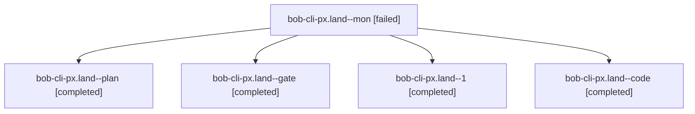

# Session: bob-cli-px.land

[Agent Hoods](../README.md) / [bbugyi200](../users/bbugyi200/README.md) / [athena](../users/bbugyi200/machines/athena/README.md) / [bob-cli-px](../users/bbugyi200/machines/athena/hoods/bob-cli-px/README.md) / bob-cli-px.land

Owner: `bbugyi200.athena` · Hood: `bob-cli-px` · Members: 5 · Bead: [bob-cli-px](https://github.com/bobs-org/bob-cli--beads/blob/main/pages/bob-cli-px/README.md)

## Lineage

The diagram is an optional enhancement; the ordered table below contains the same lineage in accessible text.

| Role | Agent | State | Model / provider | Timing | Commits | Prompt | Chat |
|---|---|---|---|---|---:|---|---|
| mon | bob-cli-px.land--mon | failed | muse-spark-1.3-contributor / muse | 2026-11-24T22:21:08.261942+00:00 → 2026-11-24T22:44:29.524362+00:00 | 0 | — | [Chat](../agents/bbugyi200.athena.bob-cli-px.land--mon/chat.md) |
| plan | bob-cli-px.land--plan | completed | opus / claude | 2026-11-24T21:11:44.202606+00:00 → 2026-11-24T22:24:01.179811+00:00 | 0 | [Prompt](../agents/bbugyi200.athena.bob-cli-px.land--plan/prompt.md) | [Chat](../agents/bbugyi200.athena.bob-cli-px.land--plan/chat.md) |
| gate | bob-cli-px.land--gate | completed | opus / claude | 2026-11-24T21:38:46.457653+00:00 → 2026-11-24T21:38:53.407170+00:00 | 0 | — | [Chat](../agents/bbugyi200.athena.bob-cli-px.land--gate/chat.md) |
| 1 | bob-cli-px.land--1 | completed | muse-spark-1.3-contributor / muse | 2026-11-24T22:44:29.473442+00:00 → 2026-11-24T22:48:52.365589+00:00 | 0 | [Prompt](../agents/bbugyi200.athena.bob-cli-px.land--1/prompt.md) | [Chat](../agents/bbugyi200.athena.bob-cli-px.land--1/chat.md) |
| code | bob-cli-px.land--code | completed | muse-spark-1.3-contributor / muse | 2026-11-24T21:39:26.424377+00:00 → 2026-11-24T22:24:01.179811+00:00 | 0 | — | [Chat](../agents/bbugyi200.athena.bob-cli-px.land--code/chat.md) |

## Neighbors

| Agent | Relation | State |
|---|---|---|
| [bob-cli-px.1](../agents/bbugyi200.athena.bob-cli-px.1/README.md) | bob-cli-px hood | completed |
| [bob-cli-px.2](../agents/bbugyi200.athena.bob-cli-px.2/README.md) | bob-cli-px hood | completed |
| [bob-cli-px.3](bbugyi200.athena.bob-cli-px.3.md) (session · 9) | bob-cli-px hood | completed 5, failed 4 |
| [bob-cli-px.4](../agents/bbugyi200.athena.bob-cli-px.4/README.md) | bob-cli-px hood | completed |
| [bob-cli-px.5](../agents/bbugyi200.athena.bob-cli-px.5/README.md) | bob-cli-px hood | completed |
| [bob-cli-px.6](bbugyi200.athena.bob-cli-px.6.md) (session · 3) | bob-cli-px hood | completed 2, failed 1 |
