# Session: bob-cli-q4.10.1.4

[Agent Hoods](../README.md) / [bbugyi200](../users/bbugyi200/README.md) / [athena](../users/bbugyi200/machines/athena/README.md) / [bob-cli-q4](../users/bbugyi200/machines/athena/hoods/bob-cli-q4/README.md) / bob-cli-q4.10.1.4

Owner: `bbugyi200.athena` · Hood: `bob-cli-q4` · Members: 31 · Bead: [bob-cli-q4.10.1.4](https://github.com/bobs-org/bob-cli--beads/blob/main/pages/bob-cli-q4/bob-cli-q4.10.1.4.md)

## Lineage

```mermaid
flowchart TD
  n0["bob-cli-q4.10.1.4--9 [completed]"]
  n1["bob-cli-q4.10.1.4--mon-6 [failed]"]
  n0 --> n1
  n2["bob-cli-q4.10.1.4--mon [failed]"]
  n0 --> n2
  n3["bob-cli-q4.10.1.4--mon-d [completed]"]
  n0 --> n3
  n4["bob-cli-q4.10.1.4--plan [completed]"]
  n0 --> n4
  n5["bob-cli-q4.10.1.4--1 [completed]"]
  n0 --> n5
  n6["bob-cli-q4.10.1.4--2 [completed]"]
  n0 --> n6
  n7["bob-cli-q4.10.1.4--mon-5 [failed]"]
  n0 --> n7
  n8["bob-cli-q4.10.1.4--f [completed]"]
  n0 --> n8
  n9["bob-cli-q4.10.1.4--7 [completed]"]
  n0 --> n9
  n10["bob-cli-q4.10.1.4--mon-a [failed]"]
  n0 --> n10
  n11["bob-cli-q4.10.1.4--4 [completed]"]
  n0 --> n11
  n12["bob-cli-q4.10.1.4--mon-7 [failed]"]
  n0 --> n12
  n13["bob-cli-q4.10.1.4--5 [completed]"]
  n0 --> n13
  n14["bob-cli-q4.10.1.4--mon-b [failed]"]
  n0 --> n14
  n15["bob-cli-q4.10.1.4--mon-1 [failed]"]
  n0 --> n15
  n16["bob-cli-q4.10.1.4--mon-9 [failed]"]
  n0 --> n16
  n17["bob-cli-q4.10.1.4--6 [completed]"]
  n0 --> n17
  n18["bob-cli-q4.10.1.4--mon-c [failed]"]
  n0 --> n18
  n19["bob-cli-q4.10.1.4--c [completed]"]
  n0 --> n19
  n20["bob-cli-q4.10.1.4--8 [completed]"]
  n0 --> n20
  n21["bob-cli-q4.10.1.4--mon-4 [failed]"]
  n0 --> n21
  n22["bob-cli-q4.10.1.4--b [completed]"]
  n0 --> n22
  n23["bob-cli-q4.10.1.4--3 [completed]"]
  n0 --> n23
  n24["bob-cli-q4.10.1.4--mon-2 [failed]"]
  n0 --> n24
  n25["bob-cli-q4.10.1.4--mon-0 [failed]"]
  n0 --> n25
  n26["bob-cli-q4.10.1.4--mon-3 [failed]"]
  n0 --> n26
  n27["bob-cli-q4.10.1.4--mon-8 [failed]"]
  n0 --> n27
  n28["bob-cli-q4.10.1.4--d [completed]"]
  n0 --> n28
  n29["bob-cli-q4.10.1.4--e [completed]"]
  n0 --> n29
  n30["bob-cli-q4.10.1.4--a [completed]"]
  n0 --> n30
```

The diagram is an optional enhancement; the ordered table below contains the same lineage in accessible text.

| Role | Agent | State | Model / provider | Timing | Commits | Prompt | Chat |
|---|---|---|---|---|---:|---|---|
| 9 | bob-cli-q4.10.1.4--9 | completed | gpt-6-luna / codex | 2026-11-26T00:21:17.074894+00:00 → 2026-11-26T00:30:33.974940+00:00 | 0 | [Prompt](../agents/bbugyi200.athena.bob-cli-q4.10.1.4--9/prompt.md) | [Chat](../agents/bbugyi200.athena.bob-cli-q4.10.1.4--9/chat.md) |
| mon-6 | bob-cli-q4.10.1.4--mon-6 | failed | gpt-6-luna / codex | 2026-11-26T00:02:04.426035+00:00 → 2026-11-26T00:06:34.969102+00:00 | 0 | — | [Chat](../agents/bbugyi200.athena.bob-cli-q4.10.1.4--mon-6/chat.md) |
| mon | bob-cli-q4.10.1.4--mon | failed | gpt-6-luna / codex | 2026-11-25T22:13:53.096483+00:00 → 2026-11-25T22:17:47.278884+00:00 | 0 | — | [Chat](../agents/bbugyi200.athena.bob-cli-q4.10.1.4--mon/chat.md) |
| mon-d | bob-cli-q4.10.1.4--mon-d | completed | gpt-6-luna / codex | 2026-11-26T01:14:57.254946+00:00 → 2026-11-26T01:24:04.500924+00:00 | 0 | — | [Chat](../agents/bbugyi200.athena.bob-cli-q4.10.1.4--mon-d/chat.md) |
| plan | bob-cli-q4.10.1.4--plan | completed | gpt-6-luna / codex | 2026-11-25T21:48:02.082773+00:00 → 2026-11-25T22:15:59.451447+00:00 | 0 | [Prompt](../agents/bbugyi200.athena.bob-cli-q4.10.1.4--plan/prompt.md) | [Chat](../agents/bbugyi200.athena.bob-cli-q4.10.1.4--plan/chat.md) |
| 1 | bob-cli-q4.10.1.4--1 | completed | gpt-6-luna / codex | 2026-11-25T22:17:47.161050+00:00 → 2026-11-25T22:25:09.072161+00:00 | 0 | [Prompt](../agents/bbugyi200.athena.bob-cli-q4.10.1.4--1/prompt.md) | [Chat](../agents/bbugyi200.athena.bob-cli-q4.10.1.4--1/chat.md) |
| 2 | bob-cli-q4.10.1.4--2 | completed | gpt-6-luna / codex | 2026-11-25T22:27:45.294238+00:00 → 2026-11-25T22:35:01.187205+00:00 | 0 | [Prompt](../agents/bbugyi200.athena.bob-cli-q4.10.1.4--2/prompt.md) | [Chat](../agents/bbugyi200.athena.bob-cli-q4.10.1.4--2/chat.md) |
| mon-5 | bob-cli-q4.10.1.4--mon-5 | failed | gpt-6-luna / codex | 2026-11-25T23:52:36.730161+00:00 → 2026-11-25T23:58:26.192781+00:00 | 0 | — | [Chat](../agents/bbugyi200.athena.bob-cli-q4.10.1.4--mon-5/chat.md) |
| f | bob-cli-q4.10.1.4--f | completed | gpt-6-luna / codex | 2026-11-26T01:24:04.084755+00:00 → 2026-11-26T01:26:50.239852+00:00 | 0 | [Prompt](../agents/bbugyi200.athena.bob-cli-q4.10.1.4--f/prompt.md) | [Chat](../agents/bbugyi200.athena.bob-cli-q4.10.1.4--f/chat.md) |
| 7 | bob-cli-q4.10.1.4--7 | completed | gpt-6-luna / codex | 2026-11-25T23:58:26.167207+00:00 → 2026-11-26T00:03:41.635744+00:00 | 0 | [Prompt](../agents/bbugyi200.athena.bob-cli-q4.10.1.4--7/prompt.md) | [Chat](../agents/bbugyi200.athena.bob-cli-q4.10.1.4--7/chat.md) |
| mon-a | bob-cli-q4.10.1.4--mon-a | failed | gpt-6-luna / codex | 2026-11-26T00:47:02.822909+00:00 → 2026-11-26T00:52:55.326809+00:00 | 0 | — | [Chat](../agents/bbugyi200.athena.bob-cli-q4.10.1.4--mon-a/chat.md) |
| 4 | bob-cli-q4.10.1.4--4 | completed | gpt-6-luna / codex | 2026-11-25T23:13:32.722332+00:00 → 2026-11-25T23:32:53.432620+00:00 | [1](../agents/bbugyi200.athena.bob-cli-q4.10.1.4--4/README.md#commits) | [Prompt](../agents/bbugyi200.athena.bob-cli-q4.10.1.4--4/prompt.md) | [Chat](../agents/bbugyi200.athena.bob-cli-q4.10.1.4--4/chat.md) |
| mon-7 | bob-cli-q4.10.1.4--mon-7 | failed | gpt-6-luna / codex | 2026-11-26T00:16:38.329638+00:00 → 2026-11-26T00:21:17.451786+00:00 | 0 | — | [Chat](../agents/bbugyi200.athena.bob-cli-q4.10.1.4--mon-7/chat.md) |
| 5 | bob-cli-q4.10.1.4--5 | completed | gpt-6-luna / codex | 2026-11-25T23:35:54.305044+00:00 → 2026-11-25T23:38:29.089813+00:00 | 0 | [Prompt](../agents/bbugyi200.athena.bob-cli-q4.10.1.4--5/prompt.md) | [Chat](../agents/bbugyi200.athena.bob-cli-q4.10.1.4--5/chat.md) |
| mon-b | bob-cli-q4.10.1.4--mon-b | failed | gpt-6-luna / codex | 2026-11-26T00:56:27.790319+00:00 → 2026-11-26T01:01:31.013937+00:00 | 0 | — | [Chat](../agents/bbugyi200.athena.bob-cli-q4.10.1.4--mon-b/chat.md) |
| mon-1 | bob-cli-q4.10.1.4--mon-1 | failed | gpt-6-luna / codex | 2026-11-25T22:33:15.940032+00:00 → 2026-11-25T22:37:52.225804+00:00 | 0 | — | [Chat](../agents/bbugyi200.athena.bob-cli-q4.10.1.4--mon-1/chat.md) |
| mon-9 | bob-cli-q4.10.1.4--mon-9 | failed | gpt-6-luna / codex | 2026-11-26T00:38:16.077900+00:00 → 2026-11-26T00:43:55.052110+00:00 | 0 | — | [Chat](../agents/bbugyi200.athena.bob-cli-q4.10.1.4--mon-9/chat.md) |
| 6 | bob-cli-q4.10.1.4--6 | completed | gpt-6-luna / codex | 2026-11-25T23:41:14.020084+00:00 → 2026-11-25T23:54:38.191228+00:00 | [1](../agents/bbugyi200.athena.bob-cli-q4.10.1.4--6/README.md#commits) | [Prompt](../agents/bbugyi200.athena.bob-cli-q4.10.1.4--6/prompt.md) | [Chat](../agents/bbugyi200.athena.bob-cli-q4.10.1.4--6/chat.md) |
| mon-c | bob-cli-q4.10.1.4--mon-c | failed | gpt-6-luna / codex | 2026-11-26T01:04:12.748574+00:00 → 2026-11-26T01:13:08.137132+00:00 | 0 | — | [Chat](../agents/bbugyi200.athena.bob-cli-q4.10.1.4--mon-c/chat.md) |
| c | bob-cli-q4.10.1.4--c | completed | gpt-6-luna / codex | 2026-11-26T00:52:54.960582+00:00 → 2026-11-26T00:58:28.814705+00:00 | [1](../agents/bbugyi200.athena.bob-cli-q4.10.1.4--c/README.md#commits) | [Prompt](../agents/bbugyi200.athena.bob-cli-q4.10.1.4--c/prompt.md) | [Chat](../agents/bbugyi200.athena.bob-cli-q4.10.1.4--c/chat.md) |
| 8 | bob-cli-q4.10.1.4--8 | completed | gpt-6-luna / codex | 2026-11-26T00:06:34.613548+00:00 → 2026-11-26T00:18:31.843047+00:00 | 0 | [Prompt](../agents/bbugyi200.athena.bob-cli-q4.10.1.4--8/prompt.md) | [Chat](../agents/bbugyi200.athena.bob-cli-q4.10.1.4--8/chat.md) |
| mon-4 | bob-cli-q4.10.1.4--mon-4 | failed | gpt-6-luna / codex | 2026-11-25T23:37:46.305432+00:00 → 2026-11-25T23:41:14.590463+00:00 | 0 | — | [Chat](../agents/bbugyi200.athena.bob-cli-q4.10.1.4--mon-4/chat.md) |
| b | bob-cli-q4.10.1.4--b | completed | gpt-6-luna / codex | 2026-11-26T00:43:54.870174+00:00 → 2026-11-26T00:50:00.959894+00:00 | [1](../agents/bbugyi200.athena.bob-cli-q4.10.1.4--b/README.md#commits) | [Prompt](../agents/bbugyi200.athena.bob-cli-q4.10.1.4--b/prompt.md) | [Chat](../agents/bbugyi200.athena.bob-cli-q4.10.1.4--b/chat.md) |
| 3 | bob-cli-q4.10.1.4--3 | completed | gpt-6-luna / codex | 2026-11-25T23:04:06.942339+00:00 → 2026-11-25T23:10:20.047535+00:00 | 0 | [Prompt](../agents/bbugyi200.athena.bob-cli-q4.10.1.4--3/prompt.md) | [Chat](../agents/bbugyi200.athena.bob-cli-q4.10.1.4--3/chat.md) |
| mon-2 | bob-cli-q4.10.1.4--mon-2 | failed | gpt-6-luna / codex | 2026-11-25T23:08:40.886889+00:00 → 2026-11-25T23:13:32.813902+00:00 | 0 | — | [Chat](../agents/bbugyi200.athena.bob-cli-q4.10.1.4--mon-2/chat.md) |
| mon-0 | bob-cli-q4.10.1.4--mon-0 | failed | gpt-6-luna / codex | 2026-11-25T22:22:31.735690+00:00 → 2026-11-25T22:27:45.569878+00:00 | 0 | — | [Chat](../agents/bbugyi200.athena.bob-cli-q4.10.1.4--mon-0/chat.md) |
| mon-3 | bob-cli-q4.10.1.4--mon-3 | failed | gpt-6-luna / codex | 2026-11-25T23:30:11.543782+00:00 → 2026-11-25T23:35:54.358246+00:00 | 0 | — | [Chat](../agents/bbugyi200.athena.bob-cli-q4.10.1.4--mon-3/chat.md) |
| mon-8 | bob-cli-q4.10.1.4--mon-8 | failed | gpt-6-luna / codex | 2026-11-26T00:29:15.785370+00:00 → 2026-11-26T00:33:55.609451+00:00 | 0 | — | [Chat](../agents/bbugyi200.athena.bob-cli-q4.10.1.4--mon-8/chat.md) |
| d | bob-cli-q4.10.1.4--d | completed | gpt-6-luna / codex | 2026-11-26T01:01:30.782656+00:00 → 2026-11-26T01:05:03.066350+00:00 | 0 | [Prompt](../agents/bbugyi200.athena.bob-cli-q4.10.1.4--d/prompt.md) | [Chat](../agents/bbugyi200.athena.bob-cli-q4.10.1.4--d/chat.md) |
| e | bob-cli-q4.10.1.4--e | completed | gpt-6-luna / codex | 2026-11-26T01:13:07.795288+00:00 → 2026-11-26T01:16:45.741186+00:00 | [1](../agents/bbugyi200.athena.bob-cli-q4.10.1.4--e/README.md#commits) | [Prompt](../agents/bbugyi200.athena.bob-cli-q4.10.1.4--e/prompt.md) | [Chat](../agents/bbugyi200.athena.bob-cli-q4.10.1.4--e/chat.md) |
| a | bob-cli-q4.10.1.4--a | completed | gpt-6-luna / codex | 2026-11-26T00:34:16.569435+00:00 → 2026-11-26T00:39:30.537132+00:00 | 0 | [Prompt](../agents/bbugyi200.athena.bob-cli-q4.10.1.4--a/prompt.md) | [Chat](../agents/bbugyi200.athena.bob-cli-q4.10.1.4--a/chat.md) |

## Commits

| Role | Repo | Commit | Subject | Committed |
|---|---|---|---|---|
| 4 | bob-cli | [`05dd83c`](https://github.com/bobs-org/bob-cli/commit/05dd83cf9f93c07825a30dfe508e530bc36f9d81) | docs: repair documentation gate consistency | 2026-11-25 18:31:13 EST |
| 6 | bob-cli | [`8850f2e`](https://github.com/bobs-org/bob-cli/commit/8850f2e639a862f5814eae348449ebd232053bb7) | docs(reference): satisfy word-budget lint | 2026-11-25 18:53:41 EST |
| b | bob-cli | [`fc9c91c`](https://github.com/bobs-org/bob-cli/commit/fc9c91ca46026be17965509a4425273134b0eeea) | docs(memory): add planning-time decision roster policy | 2026-11-25 19:48:21 EST |
| c | bob-cli | [`1c7a481`](https://github.com/bobs-org/bob-cli/commit/1c7a481c539a7677c8e2c9b04bfb554b18bd0ab5) | fix(docs): keep capture smoke query searchable | 2026-11-25 19:57:34 EST |
| e | bob-cli | [`926c925`](https://github.com/bobs-org/bob-cli/commit/926c92589bf68dc4df851e28a26999f67f2074cd) | docs(search): cover Go To capture token | 2026-11-25 20:15:53 EST |

## Neighbors

| Agent | Relation | State |
|---|---|---|
| [bob-cli-q4.10](bbugyi200.athena.bob-cli-q4.10.md) (session · 3) | ancestor | active 1, completed 2 |
| [bob-cli-q4.10.1.1](../agents/bbugyi200.athena.bob-cli-q4.10.1.1/README.md) | bob-cli-q4.10.1 hood | completed |
| [bob-cli-q4.10.1.2](bbugyi200.athena.bob-cli-q4.10.1.2.md) (session · 7) | bob-cli-q4.10.1 hood | completed 5, failed 2 |
| [bob-cli-q4.10.1.3](../agents/bbugyi200.athena.bob-cli-q4.10.1.3/README.md) | bob-cli-q4.10.1 hood | completed |
| [bob-cli-q4.10.1.5](bbugyi200.athena.bob-cli-q4.10.1.5.md) (session · 7) | bob-cli-q4.10.1 hood | completed 6, failed 1 |
| [bob-cli-q4.10.1.6](bbugyi200.athena.bob-cli-q4.10.1.6.md) (session · 5) | bob-cli-q4.10.1 hood | completed 4, failed 1 |
| [bob-cli-q4.10.1.6](../agents/bbugyi200.athena.bob-cli-q4.10.1.6/README.md) | bob-cli-q4.10.1 hood | failed |
| [bob-cli-q4.10.1.land](../agents/bbugyi200.athena.bob-cli-q4.10.1.land/README.md) | bob-cli-q4.10.1 hood | completed |
| [bob-cli-q4.1](../agents/bbugyi200.athena.bob-cli-q4.1/README.md) | bob-cli-q4 hood | completed |
| [bob-cli-q4.11](bbugyi200.athena.bob-cli-q4.11.md) (session · 3) | bob-cli-q4 hood | completed 2, failed 1 |
| [bob-cli-q4.12](bbugyi200.athena.bob-cli-q4.12.md) (session · 5) | bob-cli-q4 hood | completed 4, failed 1 |
| [bob-cli-q4.13](../agents/bbugyi200.athena.bob-cli-q4.13/README.md) | bob-cli-q4 hood | waiting |
| [bob-cli-q4.2](../agents/bbugyi200.athena.bob-cli-q4.2/README.md) | bob-cli-q4 hood | completed |
| [bob-cli-q4.3](bbugyi200.athena.bob-cli-q4.3.md) (session · 3) | bob-cli-q4 hood | completed 2, failed 1 |
| [bob-cli-q4.4](../agents/bbugyi200.athena.bob-cli-q4.4/README.md) | bob-cli-q4 hood | completed |
| [bob-cli-q4.5](bbugyi200.athena.bob-cli-q4.5.md) (session · 3) | bob-cli-q4 hood | completed 2, failed 1 |
| [bob-cli-q4.6](bbugyi200.athena.bob-cli-q4.6.md) (session · 3) | bob-cli-q4 hood | completed 3 |
| [bob-cli-q4.7](../agents/bbugyi200.athena.bob-cli-q4.7/README.md) | bob-cli-q4 hood | completed |
| [bob-cli-q4.8](bbugyi200.athena.bob-cli-q4.8.md) (session · 3) | bob-cli-q4 hood | active 1, completed 2 |
| [bob-cli-q4.8.1.1](../agents/bbugyi200.athena.bob-cli-q4.8.1.1/README.md) | bob-cli-q4 hood | completed |
| [bob-cli-q4.8.1.2](../agents/bbugyi200.athena.bob-cli-q4.8.1.2/README.md) | bob-cli-q4 hood | completed |
| [bob-cli-q4.8.1.3](bbugyi200.athena.bob-cli-q4.8.1.3.md) (session · 15) | bob-cli-q4 hood | completed 9, failed 6 |
| [bob-cli-q4.8.1.land](bbugyi200.athena.bob-cli-q4.8.1.land.md) (session · 3) | bob-cli-q4 hood | completed 3 |
| [bob-cli-q4.9](bbugyi200.athena.bob-cli-q4.9.md) (session · 3) | bob-cli-q4 hood | active 1, completed 2 |
| [bob-cli-q4.9.1.1](../agents/bbugyi200.athena.bob-cli-q4.9.1.1/README.md) | bob-cli-q4 hood | completed |
| [bob-cli-q4.9.1.2](../agents/bbugyi200.athena.bob-cli-q4.9.1.2/README.md) | bob-cli-q4 hood | completed |
| [bob-cli-q4.9.1.3](../agents/bbugyi200.athena.bob-cli-q4.9.1.3/README.md) | bob-cli-q4 hood | completed |
| [bob-cli-q4.9.1.4](../agents/bbugyi200.athena.bob-cli-q4.9.1.4/README.md) | bob-cli-q4 hood | completed |
| [bob-cli-q4.9.1.land](bbugyi200.athena.bob-cli-q4.9.1.land.md) (session · 17) | bob-cli-q4 hood | completed 12, failed 5 |
| [bob-cli-q4.land](../agents/bbugyi200.athena.bob-cli-q4.land/README.md) | bob-cli-q4 hood | waiting |
