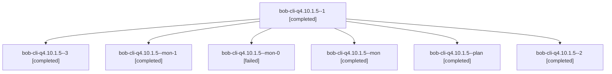

# Session: bob-cli-q4.10.1.5

[Agent Hoods](../README.md) / [bbugyi200](../users/bbugyi200/README.md) / [athena](../users/bbugyi200/machines/athena/README.md) / [bob-cli-q4](../users/bbugyi200/machines/athena/hoods/bob-cli-q4/README.md) / bob-cli-q4.10.1.5

Owner: `bbugyi200.athena` · Hood: `bob-cli-q4` · Members: 7 · Bead: [bob-cli-q4.10.1.5](https://github.com/bobs-org/bob-cli--beads/blob/main/pages/bob-cli-q4/bob-cli-q4.10.1.5.md)

## Lineage

The diagram is an optional enhancement; the ordered table below contains the same lineage in accessible text.

| Role | Agent | State | Model / provider | Timing | Commits | Prompt | Chat |
|---|---|---|---|---|---:|---|---|
| 1 | bob-cli-q4.10.1.5--1 | completed | gpt-6-luna / codex | 2026-11-26T01:54:01.575844+00:00 → 2026-11-26T02:17:21.046077+00:00 | 0 | [Prompt](../agents/bbugyi200.athena.bob-cli-q4.10.1.5--1/prompt.md) | [Chat](../agents/bbugyi200.athena.bob-cli-q4.10.1.5--1/chat.md) |
| 3 | bob-cli-q4.10.1.5--3 | completed | gpt-6-luna / codex | 2026-11-26T02:31:00.336707+00:00 → 2026-11-26T02:38:48.200586+00:00 | 0 | [Prompt](../agents/bbugyi200.athena.bob-cli-q4.10.1.5--3/prompt.md) | [Chat](../agents/bbugyi200.athena.bob-cli-q4.10.1.5--3/chat.md) |
| mon-1 | bob-cli-q4.10.1.5--mon-1 | completed | gpt-6-luna / codex | 2026-11-26T02:27:41.754247+00:00 → 2026-11-26T02:31:00.385118+00:00 | 0 | — | [Chat](../agents/bbugyi200.athena.bob-cli-q4.10.1.5--mon-1/chat.md) |
| mon-0 | bob-cli-q4.10.1.5--mon-0 | failed | gpt-6-luna / codex | 2026-11-26T02:15:36.996305+00:00 → 2026-11-26T02:22:40.626023+00:00 | 0 | — | [Chat](../agents/bbugyi200.athena.bob-cli-q4.10.1.5--mon-0/chat.md) |
| mon | bob-cli-q4.10.1.5--mon | completed | gpt-6-luna / codex | 2026-11-26T01:50:41.323582+00:00 → 2026-11-26T01:54:01.782608+00:00 | 0 | — | [Chat](../agents/bbugyi200.athena.bob-cli-q4.10.1.5--mon/chat.md) |
| plan | bob-cli-q4.10.1.5--plan | completed | gpt-6-luna / codex | 2026-11-26T01:27:19.636349+00:00 → 2026-11-26T01:52:24.973447+00:00 | 0 | [Prompt](../agents/bbugyi200.athena.bob-cli-q4.10.1.5--plan/prompt.md) | [Chat](../agents/bbugyi200.athena.bob-cli-q4.10.1.5--plan/chat.md) |
| 2 | bob-cli-q4.10.1.5--2 | completed | gpt-6-luna / codex | 2026-11-26T02:22:40.478674+00:00 → 2026-11-26T02:28:41.329759+00:00 | 0 | [Prompt](../agents/bbugyi200.athena.bob-cli-q4.10.1.5--2/prompt.md) | [Chat](../agents/bbugyi200.athena.bob-cli-q4.10.1.5--2/chat.md) |

## Neighbors

| Agent | Relation | State |
|---|---|---|
| [bob-cli-q4.10](bbugyi200.athena.bob-cli-q4.10.md) (session · 3) | ancestor | active 1, completed 2 |
| [bob-cli-q4.10.1.1](../agents/bbugyi200.athena.bob-cli-q4.10.1.1/README.md) | bob-cli-q4.10.1 hood | completed |
| [bob-cli-q4.10.1.2](bbugyi200.athena.bob-cli-q4.10.1.2.md) (session · 7) | bob-cli-q4.10.1 hood | completed 5, failed 2 |
| [bob-cli-q4.10.1.3](../agents/bbugyi200.athena.bob-cli-q4.10.1.3/README.md) | bob-cli-q4.10.1 hood | completed |
| [bob-cli-q4.10.1.4](bbugyi200.athena.bob-cli-q4.10.1.4.md) (session · 31) | bob-cli-q4.10.1 hood | completed 17, failed 14 |
| [bob-cli-q4.10.1.6](bbugyi200.athena.bob-cli-q4.10.1.6.md) (session · 5) | bob-cli-q4.10.1 hood | completed 4, failed 1 |
| [bob-cli-q4.10.1.6](../agents/bbugyi200.athena.bob-cli-q4.10.1.6/README.md) | bob-cli-q4.10.1 hood | failed |
| [bob-cli-q4.10.1.land](../agents/bbugyi200.athena.bob-cli-q4.10.1.land/README.md) | bob-cli-q4.10.1 hood | completed |
| [bob-cli-q4.1](../agents/bbugyi200.athena.bob-cli-q4.1/README.md) | bob-cli-q4 hood | completed |
| [bob-cli-q4.11](bbugyi200.athena.bob-cli-q4.11.md) (session · 3) | bob-cli-q4 hood | completed 2, failed 1 |
| [bob-cli-q4.12](bbugyi200.athena.bob-cli-q4.12.md) (session · 5) | bob-cli-q4 hood | completed 4, failed 1 |
| [bob-cli-q4.13](../agents/bbugyi200.athena.bob-cli-q4.13/README.md) | bob-cli-q4 hood | waiting |
| [bob-cli-q4.2](../agents/bbugyi200.athena.bob-cli-q4.2/README.md) | bob-cli-q4 hood | completed |
| [bob-cli-q4.3](bbugyi200.athena.bob-cli-q4.3.md) (session · 3) | bob-cli-q4 hood | completed 2, failed 1 |
| [bob-cli-q4.4](../agents/bbugyi200.athena.bob-cli-q4.4/README.md) | bob-cli-q4 hood | completed |
| [bob-cli-q4.5](bbugyi200.athena.bob-cli-q4.5.md) (session · 3) | bob-cli-q4 hood | completed 2, failed 1 |
| [bob-cli-q4.6](bbugyi200.athena.bob-cli-q4.6.md) (session · 3) | bob-cli-q4 hood | completed 3 |
| [bob-cli-q4.7](../agents/bbugyi200.athena.bob-cli-q4.7/README.md) | bob-cli-q4 hood | completed |
| [bob-cli-q4.8](bbugyi200.athena.bob-cli-q4.8.md) (session · 3) | bob-cli-q4 hood | active 1, completed 2 |
| [bob-cli-q4.8.1.1](../agents/bbugyi200.athena.bob-cli-q4.8.1.1/README.md) | bob-cli-q4 hood | completed |
| [bob-cli-q4.8.1.2](../agents/bbugyi200.athena.bob-cli-q4.8.1.2/README.md) | bob-cli-q4 hood | completed |
| [bob-cli-q4.8.1.3](bbugyi200.athena.bob-cli-q4.8.1.3.md) (session · 15) | bob-cli-q4 hood | completed 9, failed 6 |
| [bob-cli-q4.8.1.land](bbugyi200.athena.bob-cli-q4.8.1.land.md) (session · 3) | bob-cli-q4 hood | completed 3 |
| [bob-cli-q4.9](bbugyi200.athena.bob-cli-q4.9.md) (session · 3) | bob-cli-q4 hood | active 1, completed 2 |
| [bob-cli-q4.9.1.1](../agents/bbugyi200.athena.bob-cli-q4.9.1.1/README.md) | bob-cli-q4 hood | completed |
| [bob-cli-q4.9.1.2](../agents/bbugyi200.athena.bob-cli-q4.9.1.2/README.md) | bob-cli-q4 hood | completed |
| [bob-cli-q4.9.1.3](../agents/bbugyi200.athena.bob-cli-q4.9.1.3/README.md) | bob-cli-q4 hood | completed |
| [bob-cli-q4.9.1.4](../agents/bbugyi200.athena.bob-cli-q4.9.1.4/README.md) | bob-cli-q4 hood | completed |
| [bob-cli-q4.9.1.land](bbugyi200.athena.bob-cli-q4.9.1.land.md) (session · 17) | bob-cli-q4 hood | completed 12, failed 5 |
| [bob-cli-q4.land](../agents/bbugyi200.athena.bob-cli-q4.land/README.md) | bob-cli-q4 hood | waiting |
