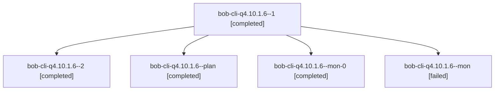

# Session: bob-cli-q4.10.1.6

[Agent Hoods](../README.md) / [bbugyi200](../users/bbugyi200/README.md) / [athena](../users/bbugyi200/machines/athena/README.md) / [bob-cli-q4](../users/bbugyi200/machines/athena/hoods/bob-cli-q4/README.md) / bob-cli-q4.10.1.6

Owner: `bbugyi200.athena` · Hood: `bob-cli-q4` · Members: 5 · Bead: [bob-cli-q4.10.1.6](https://github.com/bobs-org/bob-cli--beads/blob/main/pages/bob-cli-q4/bob-cli-q4.10.1.6.md)

## Lineage



The diagram is an optional enhancement; the ordered table below contains the same lineage in accessible text.

| Role | Agent | State | Model / provider | Timing | Commits | Prompt | Chat |
|---|---|---|---|---|---:|---|---|
| <a id="member-1"></a>1 | bob-cli-q4.10.1.6--1 | completed | gpt-6-astra / codex | 2026-11-26T09:00:24.356680+00:00 → 2026-11-26T09:23:20.760136+00:00 | 0 | [Prompt](../agents/bbugyi200.athena.bob-cli-q4.10.1.6--1/prompt.md) | [Chat](../agents/bbugyi200.athena.bob-cli-q4.10.1.6--1/chat.md) |
| <a id="member-2"></a>2 | bob-cli-q4.10.1.6--2 | completed | gpt-6-astra / codex | 2026-11-26T09:26:03.079681+00:00 → 2026-11-26T09:30:00.059200+00:00 | 0 | [Prompt](../agents/bbugyi200.athena.bob-cli-q4.10.1.6--2/prompt.md) | [Chat](../agents/bbugyi200.athena.bob-cli-q4.10.1.6--2/chat.md) |
| <a id="member-plan"></a>plan | bob-cli-q4.10.1.6--plan | completed | gpt-6-astra / codex | 2026-11-26T08:20:28.788472+00:00 → 2026-11-26T08:40:42.159376+00:00 | 0 | [Prompt](../agents/bbugyi200.athena.bob-cli-q4.10.1.6--plan/prompt.md) | [Chat](../agents/bbugyi200.athena.bob-cli-q4.10.1.6--plan/chat.md) |
| <a id="member-mon-0"></a>mon-0 | bob-cli-q4.10.1.6--mon-0 | completed | gpt-6-astra / codex | 2026-11-26T09:10:46.461792+00:00 → 2026-11-26T09:26:03.415562+00:00 | 0 | — | [Chat](../agents/bbugyi200.athena.bob-cli-q4.10.1.6--mon-0/chat.md) |
| <a id="member-mon"></a>mon | bob-cli-q4.10.1.6--mon | failed | gpt-6-astra / codex | 2026-11-26T08:40:02.152366+00:00 → 2026-11-26T09:00:24.501292+00:00 | 0 | — | [Chat](../agents/bbugyi200.athena.bob-cli-q4.10.1.6--mon/chat.md) |

## Variables

| Role | Variable | Value |
|---|---|---|
| 1 | `artifacts` | \[{bead: bob-cli-q4.10.1.6, kind: file, label: Navigation acceptance: clean-base gate failures and real Obsidian Undo evidence, path: /home/bryan/.sase/artifacts/agents/gh\_bobs-org\_\_bob-cli/2026112603… |
| 2 | `artifacts` | \[{bead: bob-cli-q4.10.1.6, kind: file, label: Navigation phase 6 final source, deployment hashes, and Obsidian smoke evidence, path: /home/bryan/.sase/artifacts/agents/gh\_bobs-org\_\_bob-cli/2026112604… |

#### artifacts

**Role:** `1`

```yaml
- bead: bob-cli-q4.10.1.6
  kind: file
  label: Navigation acceptance: clean-base gate failures and real Obsidian Undo evidence
  path: /home/bryan/.sase/artifacts/agents/gh_bobs-org__bob-cli/20261126035939/baseline-evidence-b39318575a69.json
  ref: file:explicit:161491026097b312bac5b238
  source_path: /home/bryan/.local/state/sase/workspaces/bobs-org/bob-cli/bob-cli_15/.git/nav-acceptance-verification/baseline-evidence.json
```

#### artifacts

**Role:** `2`

```yaml
- bead: bob-cli-q4.10.1.6
  kind: file
  label: Navigation phase 6 final source, deployment hashes, and Obsidian smoke evidence
  path: /home/bryan/.sase/artifacts/agents/gh_bobs-org__bob-cli/20261126042520/navigation-final-acceptance-evidence-78a2b8565f0d.json
  ref: file:explicit:732e3f1aa832605d383ecc46
  source_path: /home/bryan/.local/state/sase/workspaces/bobs-org/bob-cli/bob-cli_15/.git/nav-acceptance-verification/navigation-final-acceptance-evidence.json
```

Values are truncated for display; see each member's agent meta.json for the full values.

## Neighbors

| Agent | Relation | State |
|---|---|---|
| [bob-cli-q4.10](bbugyi200.athena.bob-cli-q4.10.md) (session · 3) | ancestor | active 1, completed 2 |
| [bob-cli-q4.10.1.1](../agents/bbugyi200.athena.bob-cli-q4.10.1.1/README.md) | bob-cli-q4.10.1 hood | completed |
| [bob-cli-q4.10.1.2](bbugyi200.athena.bob-cli-q4.10.1.2.md) (session · 7) | bob-cli-q4.10.1 hood | completed 5, failed 2 |
| [bob-cli-q4.10.1.3](../agents/bbugyi200.athena.bob-cli-q4.10.1.3/README.md) | bob-cli-q4.10.1 hood | completed |
| [bob-cli-q4.10.1.4](bbugyi200.athena.bob-cli-q4.10.1.4.md) (session · 31) | bob-cli-q4.10.1 hood | completed 17, failed 14 |
| [bob-cli-q4.10.1.5](bbugyi200.athena.bob-cli-q4.10.1.5.md) (session · 7) | bob-cli-q4.10.1 hood | completed 6, failed 1 |
| [bob-cli-q4.10.1.land](../agents/bbugyi200.athena.bob-cli-q4.10.1.land/README.md) | bob-cli-q4.10.1 hood | completed |
| [bob-cli-q4.1](../agents/bbugyi200.athena.bob-cli-q4.1/README.md) | bob-cli-q4 hood | completed |
| [bob-cli-q4.11](bbugyi200.athena.bob-cli-q4.11.md) (session · 3) | bob-cli-q4 hood | completed 2, failed 1 |
| [bob-cli-q4.12](bbugyi200.athena.bob-cli-q4.12.md) (session · 5) | bob-cli-q4 hood | completed 4, failed 1 |
| [bob-cli-q4.13](../agents/bbugyi200.athena.bob-cli-q4.13/README.md) | bob-cli-q4 hood | completed |
| [bob-cli-q4.2](../agents/bbugyi200.athena.bob-cli-q4.2/README.md) | bob-cli-q4 hood | completed |
| [bob-cli-q4.3](bbugyi200.athena.bob-cli-q4.3.md) (session · 3) | bob-cli-q4 hood | completed 2, failed 1 |
| [bob-cli-q4.4](../agents/bbugyi200.athena.bob-cli-q4.4/README.md) | bob-cli-q4 hood | completed |
| [bob-cli-q4.5](bbugyi200.athena.bob-cli-q4.5.md) (session · 3) | bob-cli-q4 hood | completed 2, failed 1 |
| [bob-cli-q4.6](bbugyi200.athena.bob-cli-q4.6.md) (session · 3) | bob-cli-q4 hood | completed 3 |
| [bob-cli-q4.7](../agents/bbugyi200.athena.bob-cli-q4.7/README.md) | bob-cli-q4 hood | completed |
| [bob-cli-q4.8](bbugyi200.athena.bob-cli-q4.8.md) (session · 3) | bob-cli-q4 hood | active 1, completed 2 |
| [bob-cli-q4.8.1.1](../agents/bbugyi200.athena.bob-cli-q4.8.1.1/README.md) | bob-cli-q4 hood | completed |
| [bob-cli-q4.8.1.2](../agents/bbugyi200.athena.bob-cli-q4.8.1.2/README.md) | bob-cli-q4 hood | completed |
| [bob-cli-q4.8.1.3](bbugyi200.athena.bob-cli-q4.8.1.3.md) (session · 15) | bob-cli-q4 hood | completed 9, failed 6 |
| [bob-cli-q4.8.1.land](bbugyi200.athena.bob-cli-q4.8.1.land.md) (session · 3) | bob-cli-q4 hood | completed 3 |
| [bob-cli-q4.9](bbugyi200.athena.bob-cli-q4.9.md) (session · 3) | bob-cli-q4 hood | active 1, completed 2 |
| [bob-cli-q4.9.1.1](../agents/bbugyi200.athena.bob-cli-q4.9.1.1/README.md) | bob-cli-q4 hood | completed |
| [bob-cli-q4.9.1.2](../agents/bbugyi200.athena.bob-cli-q4.9.1.2/README.md) | bob-cli-q4 hood | completed |
| [bob-cli-q4.9.1.3](../agents/bbugyi200.athena.bob-cli-q4.9.1.3/README.md) | bob-cli-q4 hood | completed |
| [bob-cli-q4.9.1.4](../agents/bbugyi200.athena.bob-cli-q4.9.1.4/README.md) | bob-cli-q4 hood | completed |
| [bob-cli-q4.9.1.land](bbugyi200.athena.bob-cli-q4.9.1.land.md) (session · 17) | bob-cli-q4 hood | completed 12, failed 5 |
| [bob-cli-q4.land](bbugyi200.athena.bob-cli-q4.land.md) (session · 3) | bob-cli-q4 hood | completed 3 |
