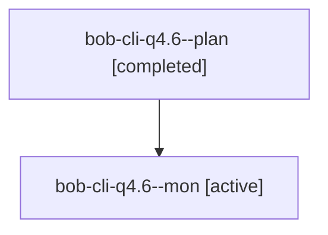

# Session: bob-cli-q4.6

[Agent Hoods](../README.md) / [bbugyi200](../users/bbugyi200/README.md) / [athena](../users/bbugyi200/machines/athena/README.md) / [bob-cli-q4](../users/bbugyi200/machines/athena/hoods/bob-cli-q4/README.md) / bob-cli-q4.6

Owner: `bbugyi200.athena` · Hood: `bob-cli-q4` · Members: 2 · Bead: [bob-cli-q4.6](https://github.com/bobs-org/bob-cli--beads/blob/main/pages/bob-cli-q4/bob-cli-q4.6.md)

## Lineage

The diagram is an optional enhancement; the ordered table below contains the same lineage in accessible text.

| Role | Agent | State | Model / provider | Timing | Commits | Prompt | Chat |
|---|---|---|---|---|---:|---|---|
| plan | bob-cli-q4.6--plan | completed | gpt-6-luna / codex | 2026-11-25T15:19:24.878594+00:00 → 2026-11-25T15:30:50.500625+00:00 | 0 | [Prompt](../agents/bbugyi200.athena.bob-cli-q4.6--plan/prompt.md) | [Chat](../agents/bbugyi200.athena.bob-cli-q4.6--plan/chat.md) |
| mon | bob-cli-q4.6--mon | active | gpt-6-luna / codex | 2026-11-25T15:29:45.533387+00:00 | 0 | — | — |

## Neighbors

| Agent | Relation | State |
|---|---|---|
| [bob-cli-q4.1](../agents/bbugyi200.athena.bob-cli-q4.1/README.md) | bob-cli-q4 hood | completed |
| [bob-cli-q4.10](../agents/bbugyi200.athena.bob-cli-q4.10/README.md) | bob-cli-q4 hood | waiting |
| [bob-cli-q4.11](../agents/bbugyi200.athena.bob-cli-q4.11/README.md) | bob-cli-q4 hood | waiting |
| [bob-cli-q4.12](../agents/bbugyi200.athena.bob-cli-q4.12/README.md) | bob-cli-q4 hood | waiting |
| [bob-cli-q4.13](../agents/bbugyi200.athena.bob-cli-q4.13/README.md) | bob-cli-q4 hood | waiting |
| [bob-cli-q4.2](../agents/bbugyi200.athena.bob-cli-q4.2/README.md) | bob-cli-q4 hood | completed |
| [bob-cli-q4.3](bbugyi200.athena.bob-cli-q4.3.md) (session · 3) | bob-cli-q4 hood | completed 2, failed 1 |
| [bob-cli-q4.4](../agents/bbugyi200.athena.bob-cli-q4.4/README.md) | bob-cli-q4 hood | active |
| [bob-cli-q4.5](bbugyi200.athena.bob-cli-q4.5.md) (session · 3) | bob-cli-q4 hood | completed 2, failed 1 |
| [bob-cli-q4.7](../agents/bbugyi200.athena.bob-cli-q4.7/README.md) | bob-cli-q4 hood | waiting |
| [bob-cli-q4.8](bbugyi200.athena.bob-cli-q4.8.md) (session · 3) | bob-cli-q4 hood | active 1, completed 2 |
| [bob-cli-q4.8.1.1](../agents/bbugyi200.athena.bob-cli-q4.8.1.1/README.md) | bob-cli-q4 hood | active |
| [bob-cli-q4.8.1.2](../agents/bbugyi200.athena.bob-cli-q4.8.1.2/README.md) | bob-cli-q4 hood | waiting |
| [bob-cli-q4.8.1.3](../agents/bbugyi200.athena.bob-cli-q4.8.1.3/README.md) | bob-cli-q4 hood | waiting |
| [bob-cli-q4.8.1.land](../agents/bbugyi200.athena.bob-cli-q4.8.1.land/README.md) | bob-cli-q4 hood | waiting |
| [bob-cli-q4.9](../agents/bbugyi200.athena.bob-cli-q4.9/README.md) | bob-cli-q4 hood | waiting |
| [bob-cli-q4.land](../agents/bbugyi200.athena.bob-cli-q4.land/README.md) | bob-cli-q4 hood | waiting |
