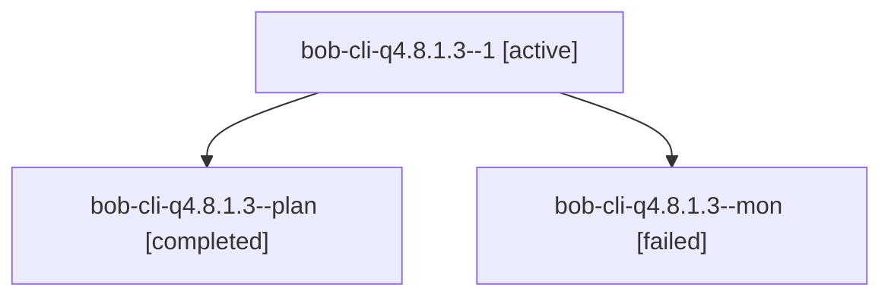

# Session: bob-cli-q4.8.1.3

[Agent Hoods](../README.md) / [bbugyi200](../users/bbugyi200/README.md) / [athena](../users/bbugyi200/machines/athena/README.md) / [bob-cli-q4](../users/bbugyi200/machines/athena/hoods/bob-cli-q4/README.md) / bob-cli-q4.8.1.3

Owner: `bbugyi200.athena` · Hood: `bob-cli-q4` · Members: 3 · Bead: [bob-cli-q4.8.1.3](https://github.com/bobs-org/bob-cli--beads/blob/main/pages/bob-cli-q4/bob-cli-q4.8.1.3.md)

## Lineage

The diagram is an optional enhancement; the ordered table below contains the same lineage in accessible text.

| Role | Agent | State | Model / provider | Timing | Commits | Prompt | Chat |
|---|---|---|---|---|---:|---|---|
| 1 | bob-cli-q4.8.1.3--1 | active | gpt-6-luna / codex | 2026-11-25T17:39:58.180059+00:00 | 0 | [Prompt](../agents/bbugyi200.athena.bob-cli-q4.8.1.3--1/prompt.md) | — |
| plan | bob-cli-q4.8.1.3--plan | completed | gpt-6-luna / codex | 2026-11-25T16:37:18.056895+00:00 → 2026-11-25T17:38:41.770876+00:00 | 0 | [Prompt](../agents/bbugyi200.athena.bob-cli-q4.8.1.3--plan/prompt.md) | [Chat](../agents/bbugyi200.athena.bob-cli-q4.8.1.3--plan/chat.md) |
| mon | bob-cli-q4.8.1.3--mon | failed | gpt-6-luna / codex | 2026-11-25T17:20:46.623627+00:00 → 2026-11-25T17:39:58.477075+00:00 | 0 | — | [Chat](../agents/bbugyi200.athena.bob-cli-q4.8.1.3--mon/chat.md) |

## Neighbors

| Agent | Relation | State |
|---|---|---|
| [bob-cli-q4.8](bbugyi200.athena.bob-cli-q4.8.md) (session · 3) | ancestor | active 1, completed 2 |
| [bob-cli-q4.8.1.1](../agents/bbugyi200.athena.bob-cli-q4.8.1.1/README.md) | bob-cli-q4.8.1 hood | completed |
| [bob-cli-q4.8.1.2](../agents/bbugyi200.athena.bob-cli-q4.8.1.2/README.md) | bob-cli-q4.8.1 hood | completed |
| [bob-cli-q4.8.1.land](../agents/bbugyi200.athena.bob-cli-q4.8.1.land/README.md) | bob-cli-q4.8.1 hood | waiting |
| [bob-cli-q4.1](../agents/bbugyi200.athena.bob-cli-q4.1/README.md) | bob-cli-q4 hood | completed |
| [bob-cli-q4.10](../agents/bbugyi200.athena.bob-cli-q4.10/README.md) | bob-cli-q4 hood | waiting |
| [bob-cli-q4.11](../agents/bbugyi200.athena.bob-cli-q4.11/README.md) | bob-cli-q4 hood | waiting |
| [bob-cli-q4.12](../agents/bbugyi200.athena.bob-cli-q4.12/README.md) | bob-cli-q4 hood | waiting |
| [bob-cli-q4.13](../agents/bbugyi200.athena.bob-cli-q4.13/README.md) | bob-cli-q4 hood | waiting |
| [bob-cli-q4.2](../agents/bbugyi200.athena.bob-cli-q4.2/README.md) | bob-cli-q4 hood | completed |
| [bob-cli-q4.3](bbugyi200.athena.bob-cli-q4.3.md) (session · 3) | bob-cli-q4 hood | completed 2, failed 1 |
| [bob-cli-q4.4](../agents/bbugyi200.athena.bob-cli-q4.4/README.md) | bob-cli-q4 hood | active |
| [bob-cli-q4.5](bbugyi200.athena.bob-cli-q4.5.md) (session · 3) | bob-cli-q4 hood | completed 2, failed 1 |
| [bob-cli-q4.6](bbugyi200.athena.bob-cli-q4.6.md) (session · 3) | bob-cli-q4 hood | completed 3 |
| [bob-cli-q4.7](../agents/bbugyi200.athena.bob-cli-q4.7/README.md) | bob-cli-q4 hood | completed |
| [bob-cli-q4.9](../agents/bbugyi200.athena.bob-cli-q4.9/README.md) | bob-cli-q4 hood | waiting |
| [bob-cli-q4.land](../agents/bbugyi200.athena.bob-cli-q4.land/README.md) | bob-cli-q4 hood | waiting |
