# Session: bob-cli-q4.8.1.3

[Agent Hoods](../README.md) / [bbugyi200](../users/bbugyi200/README.md) / [athena](../users/bbugyi200/machines/athena/README.md) / [bob-cli-q4](../users/bbugyi200/machines/athena/hoods/bob-cli-q4/README.md) / bob-cli-q4.8.1.3

Owner: `bbugyi200.athena` · Hood: `bob-cli-q4` · Members: 15 · Bead: [bob-cli-q4.8.1.3](https://github.com/bobs-org/bob-cli--beads/blob/main/pages/bob-cli-q4/bob-cli-q4.8.1.3.md)

## Lineage

```mermaid
flowchart TD
  n0["bob-cli-q4.8.1.3--3 [completed]"]
  n1["bob-cli-q4.8.1.3--mon-2 [failed]"]
  n0 --> n1
  n2["bob-cli-q4.8.1.3--7 [completed]"]
  n0 --> n2
  n3["bob-cli-q4.8.1.3--1 [completed]"]
  n0 --> n3
  n4["bob-cli-q4.8.1.3--4 [completed]"]
  n0 --> n4
  n5["bob-cli-q4.8.1.3--2 [completed]"]
  n0 --> n5
  n6["bob-cli-q4.8.1.3--mon-5 [completed]"]
  n0 --> n6
  n7["bob-cli-q4.8.1.3--plan [completed]"]
  n0 --> n7
  n8["bob-cli-q4.8.1.3--mon-0 [failed]"]
  n0 --> n8
  n9["bob-cli-q4.8.1.3--mon-3 [failed]"]
  n0 --> n9
  n10["bob-cli-q4.8.1.3--mon [failed]"]
  n0 --> n10
  n11["bob-cli-q4.8.1.3--5 [completed]"]
  n0 --> n11
  n12["bob-cli-q4.8.1.3--6 [completed]"]
  n0 --> n12
  n13["bob-cli-q4.8.1.3--mon-4 [failed]"]
  n0 --> n13
  n14["bob-cli-q4.8.1.3--mon-1 [failed]"]
  n0 --> n14
```

The diagram is an optional enhancement; the ordered table below contains the same lineage in accessible text.

| Role | Agent | State | Model / provider | Timing | Commits | Prompt | Chat |
|---|---|---|---|---|---:|---|---|
| 3 | bob-cli-q4.8.1.3--3 | completed | gpt-6-luna / codex | 2026-11-25T18:08:28.988791+00:00 → 2026-11-25T18:11:38.759018+00:00 | 0 | [Prompt](../agents/bbugyi200.athena.bob-cli-q4.8.1.3--3/prompt.md) | [Chat](../agents/bbugyi200.athena.bob-cli-q4.8.1.3--3/chat.md) |
| mon-2 | bob-cli-q4.8.1.3--mon-2 | failed | gpt-6-luna / codex | 2026-11-25T18:10:35.169060+00:00 → 2026-11-25T18:14:01.448984+00:00 | 0 | — | [Chat](../agents/bbugyi200.athena.bob-cli-q4.8.1.3--mon-2/chat.md) |
| 7 | bob-cli-q4.8.1.3--7 | completed | gpt-6-luna / codex | 2026-11-25T18:34:08.921334+00:00 → 2026-11-25T18:41:34.802031+00:00 | 0 | [Prompt](../agents/bbugyi200.athena.bob-cli-q4.8.1.3--7/prompt.md) | [Chat](../agents/bbugyi200.athena.bob-cli-q4.8.1.3--7/chat.md) |
| 1 | bob-cli-q4.8.1.3--1 | completed | gpt-6-luna / codex | 2026-11-25T17:39:58.180059+00:00 → 2026-11-25T17:56:54.183681+00:00 | 0 | [Prompt](../agents/bbugyi200.athena.bob-cli-q4.8.1.3--1/prompt.md) | [Chat](../agents/bbugyi200.athena.bob-cli-q4.8.1.3--1/chat.md) |
| 4 | bob-cli-q4.8.1.3--4 | completed | gpt-6-luna / codex | 2026-11-25T18:14:01.228421+00:00 → 2026-11-25T18:18:41.920453+00:00 | 0 | [Prompt](../agents/bbugyi200.athena.bob-cli-q4.8.1.3--4/prompt.md) | [Chat](../agents/bbugyi200.athena.bob-cli-q4.8.1.3--4/chat.md) |
| 2 | bob-cli-q4.8.1.3--2 | completed | gpt-6-luna / codex | 2026-11-25T17:59:58.908463+00:00 → 2026-11-25T18:06:01.769114+00:00 | 0 | [Prompt](../agents/bbugyi200.athena.bob-cli-q4.8.1.3--2/prompt.md) | [Chat](../agents/bbugyi200.athena.bob-cli-q4.8.1.3--2/chat.md) |
| mon-5 | bob-cli-q4.8.1.3--mon-5 | completed | gpt-6-luna / codex | 2026-11-25T18:30:21.277044+00:00 → 2026-11-25T18:34:08.995526+00:00 | 0 | — | [Chat](../agents/bbugyi200.athena.bob-cli-q4.8.1.3--mon-5/chat.md) |
| plan | bob-cli-q4.8.1.3--plan | completed | gpt-6-luna / codex | 2026-11-25T16:37:18.056895+00:00 → 2026-11-25T17:38:41.770876+00:00 | 0 | [Prompt](../agents/bbugyi200.athena.bob-cli-q4.8.1.3--plan/prompt.md) | [Chat](../agents/bbugyi200.athena.bob-cli-q4.8.1.3--plan/chat.md) |
| mon-0 | bob-cli-q4.8.1.3--mon-0 | failed | gpt-6-luna / codex | 2026-11-25T17:55:39.737648+00:00 → 2026-11-25T17:59:58.973034+00:00 | 0 | — | [Chat](../agents/bbugyi200.athena.bob-cli-q4.8.1.3--mon-0/chat.md) |
| mon-3 | bob-cli-q4.8.1.3--mon-3 | failed | gpt-6-luna / codex | 2026-11-25T18:17:45.800493+00:00 → 2026-11-25T18:21:19.941818+00:00 | 0 | — | [Chat](../agents/bbugyi200.athena.bob-cli-q4.8.1.3--mon-3/chat.md) |
| mon | bob-cli-q4.8.1.3--mon | failed | gpt-6-luna / codex | 2026-11-25T17:20:46.623627+00:00 → 2026-11-25T17:39:58.477075+00:00 | 0 | — | [Chat](../agents/bbugyi200.athena.bob-cli-q4.8.1.3--mon/chat.md) |
| 5 | bob-cli-q4.8.1.3--5 | completed | gpt-6-luna / codex | 2026-11-25T18:21:19.459351+00:00 → 2026-11-25T18:26:05.552044+00:00 | 0 | [Prompt](../agents/bbugyi200.athena.bob-cli-q4.8.1.3--5/prompt.md) | [Chat](../agents/bbugyi200.athena.bob-cli-q4.8.1.3--5/chat.md) |
| 6 | bob-cli-q4.8.1.3--6 | completed | gpt-6-luna / codex | 2026-11-25T18:28:06.341666+00:00 → 2026-11-25T18:31:44.865444+00:00 | 0 | [Prompt](../agents/bbugyi200.athena.bob-cli-q4.8.1.3--6/prompt.md) | [Chat](../agents/bbugyi200.athena.bob-cli-q4.8.1.3--6/chat.md) |
| mon-4 | bob-cli-q4.8.1.3--mon-4 | failed | gpt-6-luna / codex | 2026-11-25T18:24:30.307351+00:00 → 2026-11-25T18:28:06.358407+00:00 | 0 | — | [Chat](../agents/bbugyi200.athena.bob-cli-q4.8.1.3--mon-4/chat.md) |
| mon-1 | bob-cli-q4.8.1.3--mon-1 | failed | gpt-6-luna / codex | 2026-11-25T18:05:13.023966+00:00 → 2026-11-25T18:08:29.427402+00:00 | 0 | — | [Chat](../agents/bbugyi200.athena.bob-cli-q4.8.1.3--mon-1/chat.md) |

## Neighbors

| Agent | Relation | State |
|---|---|---|
| [bob-cli-q4.8](bbugyi200.athena.bob-cli-q4.8.md) (session · 3) | ancestor | active 1, completed 2 |
| [bob-cli-q4.8.1.1](../agents/bbugyi200.athena.bob-cli-q4.8.1.1/README.md) | bob-cli-q4.8.1 hood | completed |
| [bob-cli-q4.8.1.2](../agents/bbugyi200.athena.bob-cli-q4.8.1.2/README.md) | bob-cli-q4.8.1 hood | completed |
| [bob-cli-q4.8.1.land](bbugyi200.athena.bob-cli-q4.8.1.land.md) (session · 3) | bob-cli-q4.8.1 hood | completed 3 |
| [bob-cli-q4.1](../agents/bbugyi200.athena.bob-cli-q4.1/README.md) | bob-cli-q4 hood | completed |
| [bob-cli-q4.10](bbugyi200.athena.bob-cli-q4.10.md) (session · 3) | bob-cli-q4 hood | active 1, completed 2 |
| [bob-cli-q4.10.1.1](../agents/bbugyi200.athena.bob-cli-q4.10.1.1/README.md) | bob-cli-q4 hood | completed |
| [bob-cli-q4.10.1.2](bbugyi200.athena.bob-cli-q4.10.1.2.md) (session · 7) | bob-cli-q4 hood | completed 5, failed 2 |
| [bob-cli-q4.10.1.3](../agents/bbugyi200.athena.bob-cli-q4.10.1.3/README.md) | bob-cli-q4 hood | completed |
| [bob-cli-q4.10.1.4](bbugyi200.athena.bob-cli-q4.10.1.4.md) (session · 13) | bob-cli-q4 hood | active 1, completed 6, failed 6 |
| [bob-cli-q4.10.1.5](../agents/bbugyi200.athena.bob-cli-q4.10.1.5/README.md) | bob-cli-q4 hood | waiting |
| [bob-cli-q4.10.1.6](../agents/bbugyi200.athena.bob-cli-q4.10.1.6/README.md) | bob-cli-q4 hood | waiting |
| [bob-cli-q4.10.1.land](../agents/bbugyi200.athena.bob-cli-q4.10.1.land/README.md) | bob-cli-q4 hood | waiting |
| [bob-cli-q4.11](bbugyi200.athena.bob-cli-q4.11.md) (session · 3) | bob-cli-q4 hood | completed 2, failed 1 |
| [bob-cli-q4.12](../agents/bbugyi200.athena.bob-cli-q4.12/README.md) | bob-cli-q4 hood | waiting |
| [bob-cli-q4.13](../agents/bbugyi200.athena.bob-cli-q4.13/README.md) | bob-cli-q4 hood | waiting |
| [bob-cli-q4.2](../agents/bbugyi200.athena.bob-cli-q4.2/README.md) | bob-cli-q4 hood | completed |
| [bob-cli-q4.3](bbugyi200.athena.bob-cli-q4.3.md) (session · 3) | bob-cli-q4 hood | completed 2, failed 1 |
| [bob-cli-q4.4](../agents/bbugyi200.athena.bob-cli-q4.4/README.md) | bob-cli-q4 hood | completed |
| [bob-cli-q4.5](bbugyi200.athena.bob-cli-q4.5.md) (session · 3) | bob-cli-q4 hood | completed 2, failed 1 |
| [bob-cli-q4.6](bbugyi200.athena.bob-cli-q4.6.md) (session · 3) | bob-cli-q4 hood | completed 3 |
| [bob-cli-q4.7](../agents/bbugyi200.athena.bob-cli-q4.7/README.md) | bob-cli-q4 hood | completed |
| [bob-cli-q4.9](bbugyi200.athena.bob-cli-q4.9.md) (session · 3) | bob-cli-q4 hood | active 1, completed 2 |
| [bob-cli-q4.9.1.1](../agents/bbugyi200.athena.bob-cli-q4.9.1.1/README.md) | bob-cli-q4 hood | completed |
| [bob-cli-q4.9.1.2](../agents/bbugyi200.athena.bob-cli-q4.9.1.2/README.md) | bob-cli-q4 hood | completed |
| [bob-cli-q4.9.1.3](../agents/bbugyi200.athena.bob-cli-q4.9.1.3/README.md) | bob-cli-q4 hood | completed |
| [bob-cli-q4.9.1.4](../agents/bbugyi200.athena.bob-cli-q4.9.1.4/README.md) | bob-cli-q4 hood | completed |
| [bob-cli-q4.9.1.land](bbugyi200.athena.bob-cli-q4.9.1.land.md) (session · 9) | bob-cli-q4 hood | active 1, completed 6, failed 2 |
| [bob-cli-q4.land](../agents/bbugyi200.athena.bob-cli-q4.land/README.md) | bob-cli-q4 hood | waiting |
