# Session: bob-cli-q4.9.1.land

[Agent Hoods](../README.md) / [bbugyi200](../users/bbugyi200/README.md) / [athena](../users/bbugyi200/machines/athena/README.md) / [bob-cli-q4](../users/bbugyi200/machines/athena/hoods/bob-cli-q4/README.md) / bob-cli-q4.9.1.land

Owner: `bbugyi200.athena` · Hood: `bob-cli-q4` · Members: 12 · Bead: [bob-cli-q4.9.1](https://github.com/bobs-org/bob-cli--beads/blob/main/pages/bob-cli-q4/bob-cli-q4.9.1.md)

## Lineage

```mermaid
flowchart TD
  n0["bob-cli-q4.9.1.land--1 [completed]"]
  n1["bob-cli-q4.9.1.land--3 [completed]"]
  n0 --> n1
  n2["bob-cli-q4.9.1.land--mon-3 [active]"]
  n0 --> n2
  n3["bob-cli-q4.9.1.land--mon-2 [failed]"]
  n0 --> n3
  n4["bob-cli-q4.9.1.land--code [completed]"]
  n0 --> n4
  n5["bob-cli-q4.9.1.land--2 [completed]"]
  n0 --> n5
  n6["bob-cli-q4.9.1.land--mon-1 [failed]"]
  n0 --> n6
  n7["bob-cli-q4.9.1.land--mon-0 [failed]"]
  n0 --> n7
  n8["bob-cli-q4.9.1.land--mon [completed]"]
  n0 --> n8
  n9["bob-cli-q4.9.1.land--gate [completed]"]
  n0 --> n9
  n10["bob-cli-q4.9.1.land--plan [completed]"]
  n0 --> n10
  n11["bob-cli-q4.9.1.land--4 [completed]"]
  n0 --> n11
```

The diagram is an optional enhancement; the ordered table below contains the same lineage in accessible text.

| Role | Agent | State | Model / provider | Timing | Commits | Prompt | Chat |
|---|---|---|---|---|---:|---|---|
| 1 | bob-cli-q4.9.1.land--1 | completed | gpt-6-luna / codex | 2026-11-25T23:29:08.655711+00:00 → 2026-11-25T23:34:51.959003+00:00 | 0 | [Prompt](../agents/bbugyi200.athena.bob-cli-q4.9.1.land--1/prompt.md) | [Chat](../agents/bbugyi200.athena.bob-cli-q4.9.1.land--1/chat.md) |
| 3 | bob-cli-q4.9.1.land--3 | completed | gpt-6-luna / codex | 2026-11-25T23:49:16.676291+00:00 → 2026-11-26T00:00:46.098720+00:00 | 0 | [Prompt](../agents/bbugyi200.athena.bob-cli-q4.9.1.land--3/prompt.md) | [Chat](../agents/bbugyi200.athena.bob-cli-q4.9.1.land--3/chat.md) |
| mon-3 | bob-cli-q4.9.1.land--mon-3 | active | gpt-6-luna / codex | 2026-11-26T00:23:19.971441+00:00 | 0 | — | — |
| mon-2 | bob-cli-q4.9.1.land--mon-2 | failed | gpt-6-luna / codex | 2026-11-25T23:58:39.901874+00:00 → 2026-11-26T00:03:05.201617+00:00 | 0 | — | [Chat](../agents/bbugyi200.athena.bob-cli-q4.9.1.land--mon-2/chat.md) |
| code | bob-cli-q4.9.1.land--code | completed | gpt-6-luna / codex | 2026-11-25T22:39:49.742079+00:00 → 2026-11-25T23:27:49.819433+00:00 | 0 | — | [Chat](../agents/bbugyi200.athena.bob-cli-q4.9.1.land--code/chat.md) |
| 2 | bob-cli-q4.9.1.land--2 | completed | gpt-6-luna / codex | 2026-11-25T23:36:36.794418+00:00 → 2026-11-25T23:45:53.156704+00:00 | 0 | [Prompt](../agents/bbugyi200.athena.bob-cli-q4.9.1.land--2/prompt.md) | [Chat](../agents/bbugyi200.athena.bob-cli-q4.9.1.land--2/chat.md) |
| mon-1 | bob-cli-q4.9.1.land--mon-1 | failed | gpt-6-luna / codex | 2026-11-25T23:43:31.227763+00:00 → 2026-11-25T23:48:37.540268+00:00 | 0 | — | [Chat](../agents/bbugyi200.athena.bob-cli-q4.9.1.land--mon-1/chat.md) |
| mon-0 | bob-cli-q4.9.1.land--mon-0 | failed | gpt-6-luna / codex | 2026-11-25T23:34:09.981052+00:00 → 2026-11-25T23:36:36.946358+00:00 | 0 | — | [Chat](../agents/bbugyi200.athena.bob-cli-q4.9.1.land--mon-0/chat.md) |
| mon | bob-cli-q4.9.1.land--mon | completed | gpt-6-luna / codex | 2026-11-25T23:25:40.559638+00:00 → 2026-11-25T23:29:09.119136+00:00 | 0 | — | [Chat](../agents/bbugyi200.athena.bob-cli-q4.9.1.land--mon/chat.md) |
| gate | bob-cli-q4.9.1.land--gate | completed | opus / claude | 2026-11-25T22:38:52.219465+00:00 → 2026-11-25T22:39:00.898520+00:00 | 0 | — | [Chat](../agents/bbugyi200.athena.bob-cli-q4.9.1.land--gate/chat.md) |
| plan | bob-cli-q4.9.1.land--plan | completed | opus / claude | 2026-11-25T22:22:21.169924+00:00 → 2026-11-25T23:27:49.819433+00:00 | 0 | [Prompt](../agents/bbugyi200.athena.bob-cli-q4.9.1.land--plan/prompt.md) | [Chat](../agents/bbugyi200.athena.bob-cli-q4.9.1.land--plan/chat.md) |
| 4 | bob-cli-q4.9.1.land--4 | completed | gpt-6-luna / codex | 2026-11-26T00:03:04.722216+00:00 → 2026-11-26T00:25:40.864188+00:00 | 0 | [Prompt](../agents/bbugyi200.athena.bob-cli-q4.9.1.land--4/prompt.md) | [Chat](../agents/bbugyi200.athena.bob-cli-q4.9.1.land--4/chat.md) |

## Neighbors

| Agent | Relation | State |
|---|---|---|
| [bob-cli-q4.9](bbugyi200.athena.bob-cli-q4.9.md) (session · 3) | ancestor | active 1, completed 2 |
| [bob-cli-q4.9.1.1](../agents/bbugyi200.athena.bob-cli-q4.9.1.1/README.md) | bob-cli-q4.9.1 hood | completed |
| [bob-cli-q4.9.1.2](../agents/bbugyi200.athena.bob-cli-q4.9.1.2/README.md) | bob-cli-q4.9.1 hood | completed |
| [bob-cli-q4.9.1.3](../agents/bbugyi200.athena.bob-cli-q4.9.1.3/README.md) | bob-cli-q4.9.1 hood | completed |
| [bob-cli-q4.9.1.4](../agents/bbugyi200.athena.bob-cli-q4.9.1.4/README.md) | bob-cli-q4.9.1 hood | completed |
| [bob-cli-q4.1](../agents/bbugyi200.athena.bob-cli-q4.1/README.md) | bob-cli-q4 hood | completed |
| [bob-cli-q4.10](bbugyi200.athena.bob-cli-q4.10.md) (session · 3) | bob-cli-q4 hood | active 1, completed 2 |
| [bob-cli-q4.10.1.1](../agents/bbugyi200.athena.bob-cli-q4.10.1.1/README.md) | bob-cli-q4 hood | completed |
| [bob-cli-q4.10.1.2](bbugyi200.athena.bob-cli-q4.10.1.2.md) (session · 7) | bob-cli-q4 hood | completed 5, failed 2 |
| [bob-cli-q4.10.1.3](../agents/bbugyi200.athena.bob-cli-q4.10.1.3/README.md) | bob-cli-q4 hood | completed |
| [bob-cli-q4.10.1.4](bbugyi200.athena.bob-cli-q4.10.1.4.md) (session · 19) | bob-cli-q4 hood | active 1, completed 9, failed 9 |
| [bob-cli-q4.10.1.5](../agents/bbugyi200.athena.bob-cli-q4.10.1.5/README.md) | bob-cli-q4 hood | waiting |
| [bob-cli-q4.10.1.6](../agents/bbugyi200.athena.bob-cli-q4.10.1.6/README.md) | bob-cli-q4 hood | waiting |
| [bob-cli-q4.10.1.land](../agents/bbugyi200.athena.bob-cli-q4.10.1.land/README.md) | bob-cli-q4 hood | waiting |
| [bob-cli-q4.11](bbugyi200.athena.bob-cli-q4.11.md) (session · 3) | bob-cli-q4 hood | completed 2, failed 1 |
| [bob-cli-q4.12](../agents/bbugyi200.athena.bob-cli-q4.12/README.md) | bob-cli-q4 hood | waiting |
| [bob-cli-q4.13](../agents/bbugyi200.athena.bob-cli-q4.13/README.md) | bob-cli-q4 hood | waiting |
| [bob-cli-q4.2](../agents/bbugyi200.athena.bob-cli-q4.2/README.md) | bob-cli-q4 hood | completed |
| [bob-cli-q4.3](bbugyi200.athena.bob-cli-q4.3.md) (session · 3) | bob-cli-q4 hood | completed 2, failed 1 |
| [bob-cli-q4.4](../agents/bbugyi200.athena.bob-cli-q4.4/README.md) | bob-cli-q4 hood | completed |
| [bob-cli-q4.5](bbugyi200.athena.bob-cli-q4.5.md) (session · 3) | bob-cli-q4 hood | completed 2, failed 1 |
| [bob-cli-q4.6](bbugyi200.athena.bob-cli-q4.6.md) (session · 3) | bob-cli-q4 hood | completed 3 |
| [bob-cli-q4.7](../agents/bbugyi200.athena.bob-cli-q4.7/README.md) | bob-cli-q4 hood | completed |
| [bob-cli-q4.8](bbugyi200.athena.bob-cli-q4.8.md) (session · 3) | bob-cli-q4 hood | active 1, completed 2 |
| [bob-cli-q4.8.1.1](../agents/bbugyi200.athena.bob-cli-q4.8.1.1/README.md) | bob-cli-q4 hood | completed |
| [bob-cli-q4.8.1.2](../agents/bbugyi200.athena.bob-cli-q4.8.1.2/README.md) | bob-cli-q4 hood | completed |
| [bob-cli-q4.8.1.3](bbugyi200.athena.bob-cli-q4.8.1.3.md) (session · 15) | bob-cli-q4 hood | completed 9, failed 6 |
| [bob-cli-q4.8.1.land](bbugyi200.athena.bob-cli-q4.8.1.land.md) (session · 3) | bob-cli-q4 hood | completed 3 |
| [bob-cli-q4.land](../agents/bbugyi200.athena.bob-cli-q4.land/README.md) | bob-cli-q4 hood | waiting |
