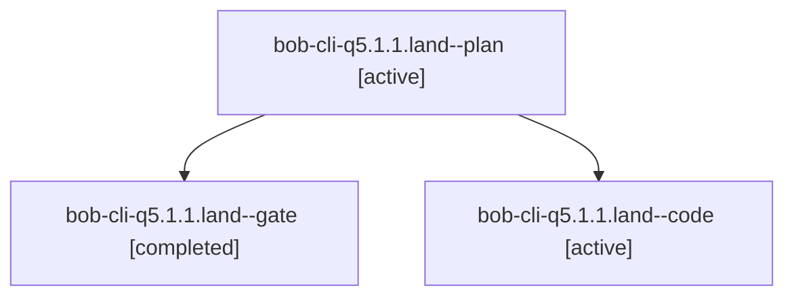

# Session: bob-cli-q5.1.1.land

[Agent Hoods](../README.md) / [bbugyi200](../users/bbugyi200/README.md) / [athena](../users/bbugyi200/machines/athena/README.md) / [bob-cli-q5](../users/bbugyi200/machines/athena/hoods/bob-cli-q5/README.md) / bob-cli-q5.1.1.land

Owner: `bbugyi200.athena` · Hood: `bob-cli-q5` · Members: 3 · Bead: [bob-cli-q5.1.1](https://github.com/bobs-org/bob-cli--beads/blob/main/pages/bob-cli-q5/bob-cli-q5.1.1.md)

## Lineage

The diagram is an optional enhancement; the ordered table below contains the same lineage in accessible text.

| Role | Agent | State | Model / provider | Timing | Commits | Prompt | Chat |
|---|---|---|---|---|---:|---|---|
| plan | bob-cli-q5.1.1.land--plan | active | opus / claude | 2026-11-25T23:27:48.610829+00:00 | [1](../agents/bbugyi200.athena.bob-cli-q5.1.1.land--plan/README.md#commits) | [Prompt](../agents/bbugyi200.athena.bob-cli-q5.1.1.land--plan/prompt.md) | [Chat](../agents/bbugyi200.athena.bob-cli-q5.1.1.land--plan/chat.md) |
| gate | bob-cli-q5.1.1.land--gate | completed | opus / claude | 2026-11-26T00:09:50.987756+00:00 → 2026-11-26T00:09:58.872158+00:00 | 0 | — | [Chat](../agents/bbugyi200.athena.bob-cli-q5.1.1.land--gate/chat.md) |
| code | bob-cli-q5.1.1.land--code | active | muse-spark-1.3-contributor / muse | 2026-11-26T00:10:30.010162+00:00 | 0 | — | — |

## Commits

| Role | Repo | Commit | Subject | Committed |
|---|---|---|---|---|
| plan | bob-cli | [`03ca3f7`](https://github.com/bobs-org/bob-cli/commit/03ca3f7e38f5708651c5351f305c586875466319) | feat(snooze): settle notes on add and retire unwired re-export allowances | 2026-11-25 19:09:08 EST |

## Neighbors

| Agent | Relation | State |
|---|---|---|
| [bob-cli-q5.1](bbugyi200.athena.bob-cli-q5.1.md) (session · 3) | ancestor | active 1, completed 2 |
| [bob-cli-q5.1.1.1](../agents/bbugyi200.athena.bob-cli-q5.1.1.1/README.md) | bob-cli-q5.1.1 hood | completed |
| [bob-cli-q5.1.1.2](../agents/bbugyi200.athena.bob-cli-q5.1.1.2/README.md) | bob-cli-q5.1.1 hood | completed |
| [bob-cli-q5.1.1.3](bbugyi200.athena.bob-cli-q5.1.1.3.md) (session · 11) | bob-cli-q5.1.1 hood | completed 7, failed 4 |
| [bob-cli-q5.1.1.4](../agents/bbugyi200.athena.bob-cli-q5.1.1.4/README.md) | bob-cli-q5.1.1 hood | completed |
| [bob-cli-q5.1.1.5](../agents/bbugyi200.athena.bob-cli-q5.1.1.5/README.md) | bob-cli-q5.1.1 hood | completed |
| [bob-cli-q5.2](../agents/bbugyi200.athena.bob-cli-q5.2/README.md) | bob-cli-q5 hood | waiting |
| [bob-cli-q5.3](../agents/bbugyi200.athena.bob-cli-q5.3/README.md) | bob-cli-q5 hood | waiting |
| [bob-cli-q5.4](../agents/bbugyi200.athena.bob-cli-q5.4/README.md) | bob-cli-q5 hood | waiting |
| [bob-cli-q5.5](../agents/bbugyi200.athena.bob-cli-q5.5/README.md) | bob-cli-q5 hood | waiting |
| [bob-cli-q5.6](../agents/bbugyi200.athena.bob-cli-q5.6/README.md) | bob-cli-q5 hood | waiting |
| [bob-cli-q5.7](../agents/bbugyi200.athena.bob-cli-q5.7/README.md) | bob-cli-q5 hood | waiting |
| [bob-cli-q5.8](../agents/bbugyi200.athena.bob-cli-q5.8/README.md) | bob-cli-q5 hood | waiting |
| [bob-cli-q5.9](../agents/bbugyi200.athena.bob-cli-q5.9/README.md) | bob-cli-q5 hood | waiting |
| [bob-cli-q5.land](../agents/bbugyi200.athena.bob-cli-q5.land/README.md) | bob-cli-q5 hood | waiting |
