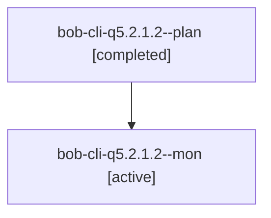

# Session: bob-cli-q5.2.1.2

[Agent Hoods](../README.md) / [bbugyi200](../users/bbugyi200/README.md) / [athena](../users/bbugyi200/machines/athena/README.md) / [bob-cli-q5](../users/bbugyi200/machines/athena/hoods/bob-cli-q5/README.md) / bob-cli-q5.2.1.2

Owner: `bbugyi200.athena` · Hood: `bob-cli-q5` · Members: 2 · Bead: [bob-cli-q5.2.1.2](https://github.com/bobs-org/bob-cli--beads/blob/main/pages/bob-cli-q5/bob-cli-q5.2.1.2.md)

## Lineage

The diagram is an optional enhancement; the ordered table below contains the same lineage in accessible text.

| Role | Agent | State | Model / provider | Timing | Commits | Prompt | Chat |
|---|---|---|---|---|---:|---|---|
| plan | bob-cli-q5.2.1.2--plan | completed | gpt-6-astra / codex | 2026-11-26T08:19:01.801287+00:00 → 2026-11-26T08:39:04.215538+00:00 | [1](../agents/bbugyi200.athena.bob-cli-q5.2.1.2--plan/README.md#commits) | [Prompt](../agents/bbugyi200.athena.bob-cli-q5.2.1.2--plan/prompt.md) | [Chat](../agents/bbugyi200.athena.bob-cli-q5.2.1.2--plan/chat.md) |
| mon | bob-cli-q5.2.1.2--mon | active | gpt-6-astra / codex | 2026-11-26T08:37:18.423027+00:00 | 0 | — | — |

## Commits

| Role | Repo | Commit | Subject | Committed |
|---|---|---|---|---|
| plan | bob-cli | [`b867865`](https://github.com/bobs-org/bob-cli/commit/b8678657640747b58ab418ef2206c86786b240db) | feat(freshness): exclude planned-today tasks from review and walks | 2026-11-26 03:38:14 EST |

## Neighbors

| Agent | Relation | State |
|---|---|---|
| [bob-cli-q5.2](bbugyi200.athena.bob-cli-q5.2.md) (session · 3) | ancestor | active 1, completed 2 |
| [bob-cli-q5.2.1.1](bbugyi200.athena.bob-cli-q5.2.1.1.md) (session · 5) | bob-cli-q5.2.1 hood | completed 3, failed 2 |
| [bob-cli-q5.2.1.3](../agents/bbugyi200.athena.bob-cli-q5.2.1.3/README.md) | bob-cli-q5.2.1 hood | waiting |
| [bob-cli-q5.2.1.4](../agents/bbugyi200.athena.bob-cli-q5.2.1.4/README.md) | bob-cli-q5.2.1 hood | waiting |
| [bob-cli-q5.2.1.land](../agents/bbugyi200.athena.bob-cli-q5.2.1.land/README.md) | bob-cli-q5.2.1 hood | waiting |
| [bob-cli-q5.1](bbugyi200.athena.bob-cli-q5.1.md) (session · 3) | bob-cli-q5 hood | active 1, completed 2 |
| [bob-cli-q5.1.1.1](../agents/bbugyi200.athena.bob-cli-q5.1.1.1/README.md) | bob-cli-q5 hood | completed |
| [bob-cli-q5.1.1.2](../agents/bbugyi200.athena.bob-cli-q5.1.1.2/README.md) | bob-cli-q5 hood | completed |
| [bob-cli-q5.1.1.3](bbugyi200.athena.bob-cli-q5.1.1.3.md) (session · 11) | bob-cli-q5 hood | completed 7, failed 4 |
| [bob-cli-q5.1.1.4](../agents/bbugyi200.athena.bob-cli-q5.1.1.4/README.md) | bob-cli-q5 hood | completed |
| [bob-cli-q5.1.1.5](../agents/bbugyi200.athena.bob-cli-q5.1.1.5/README.md) | bob-cli-q5 hood | completed |
| [bob-cli-q5.1.1.land](bbugyi200.athena.bob-cli-q5.1.1.land.md) (session · 3) | bob-cli-q5 hood | completed 3 |
| [bob-cli-q5.3](bbugyi200.athena.bob-cli-q5.3.md) (session · 3) | bob-cli-q5 hood | active 1, completed 2 |
| [bob-cli-q5.3.1.1](../agents/bbugyi200.athena.bob-cli-q5.3.1.1/README.md) | bob-cli-q5 hood | completed |
| [bob-cli-q5.3.1.2](../agents/bbugyi200.athena.bob-cli-q5.3.1.2/README.md) | bob-cli-q5 hood | active |
| [bob-cli-q5.3.1.3](../agents/bbugyi200.athena.bob-cli-q5.3.1.3/README.md) | bob-cli-q5 hood | waiting |
| [bob-cli-q5.3.1.land](../agents/bbugyi200.athena.bob-cli-q5.3.1.land/README.md) | bob-cli-q5 hood | waiting |
| [bob-cli-q5.4](../agents/bbugyi200.athena.bob-cli-q5.4/README.md) | bob-cli-q5 hood | waiting |
| [bob-cli-q5.5](../agents/bbugyi200.athena.bob-cli-q5.5/README.md) | bob-cli-q5 hood | waiting |
| [bob-cli-q5.6](../agents/bbugyi200.athena.bob-cli-q5.6/README.md) | bob-cli-q5 hood | waiting |
| [bob-cli-q5.7](../agents/bbugyi200.athena.bob-cli-q5.7/README.md) | bob-cli-q5 hood | waiting |
| [bob-cli-q5.8](../agents/bbugyi200.athena.bob-cli-q5.8/README.md) | bob-cli-q5 hood | waiting |
| [bob-cli-q5.9](../agents/bbugyi200.athena.bob-cli-q5.9/README.md) | bob-cli-q5 hood | waiting |
| [bob-cli-q5.land](../agents/bbugyi200.athena.bob-cli-q5.land/README.md) | bob-cli-q5 hood | waiting |
