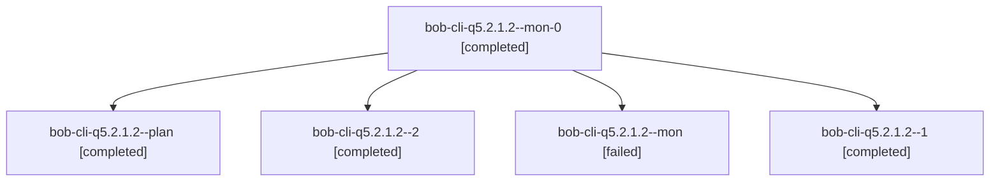

# Session: bob-cli-q5.2.1.2

[Agent Hoods](../README.md) / [bbugyi200](../users/bbugyi200/README.md) / [athena](../users/bbugyi200/machines/athena/README.md) / [bob-cli-q5](../users/bbugyi200/machines/athena/hoods/bob-cli-q5/README.md) / bob-cli-q5.2.1.2

Owner: `bbugyi200.athena` · Hood: `bob-cli-q5` · Members: 5 · Bead: [bob-cli-q5.2.1.2](https://github.com/bobs-org/bob-cli--beads/blob/main/pages/bob-cli-q5/bob-cli-q5.2.1.2.md)

## Lineage



The diagram is an optional enhancement; the ordered table below contains the same lineage in accessible text.

| Role | Agent | State | Model / provider | Timing | Commits | Prompt | Chat |
|---|---|---|---|---|---:|---|---|
| <a id="member-mon-0"></a>mon-0 | bob-cli-q5.2.1.2--mon-0 | completed | gpt-6-astra / codex | 2026-11-26T09:00:29.591582+00:00 → 2026-11-26T09:14:33.846437+00:00 | 0 | — | [Chat](../agents/bbugyi200.athena.bob-cli-q5.2.1.2--mon-0/chat.md) |
| <a id="member-plan"></a>plan | bob-cli-q5.2.1.2--plan | completed | gpt-6-astra / codex | 2026-11-26T08:19:01.801287+00:00 → 2026-11-26T08:39:04.215538+00:00 | [1](../agents/bbugyi200.athena.bob-cli-q5.2.1.2--plan/README.md#commits) | [Prompt](../agents/bbugyi200.athena.bob-cli-q5.2.1.2--plan/prompt.md) | [Chat](../agents/bbugyi200.athena.bob-cli-q5.2.1.2--plan/chat.md) |
| <a id="member-2"></a>2 | bob-cli-q5.2.1.2--2 | completed | gpt-6-astra / codex | 2026-11-26T09:14:33.584468+00:00 → 2026-11-26T09:20:13.700456+00:00 | 0 | [Prompt](../agents/bbugyi200.athena.bob-cli-q5.2.1.2--2/prompt.md) | [Chat](../agents/bbugyi200.athena.bob-cli-q5.2.1.2--2/chat.md) |
| <a id="member-mon"></a>mon | bob-cli-q5.2.1.2--mon | failed | gpt-6-astra / codex | 2026-11-26T08:37:18.423027+00:00 → 2026-11-26T08:54:40.283857+00:00 | 0 | — | [Chat](../agents/bbugyi200.athena.bob-cli-q5.2.1.2--mon/chat.md) |
| <a id="member-1"></a>1 | bob-cli-q5.2.1.2--1 | completed | gpt-6-astra / codex | 2026-11-26T08:55:02.630281+00:00 → 2026-11-26T09:02:05.970061+00:00 | [1](../agents/bbugyi200.athena.bob-cli-q5.2.1.2--1/README.md#commits) | [Prompt](../agents/bbugyi200.athena.bob-cli-q5.2.1.2--1/prompt.md) | [Chat](../agents/bbugyi200.athena.bob-cli-q5.2.1.2--1/chat.md) |

## Commits

| Role | Repo | Commit | Subject | Committed |
|---|---|---|---|---|
| plan | bob-cli | [`b867865`](https://github.com/bobs-org/bob-cli/commit/b8678657640747b58ab418ef2206c86786b240db) | feat(freshness): exclude planned-today tasks from review and walks | 2026-11-26 03:38:14 EST |
| 1 | bob-cli | [`bbcae8e`](https://github.com/bobs-org/bob-cli/commit/bbcae8e03383b33cae1efc21856c00488fe68e16) | test(walks): distinguish ignored snooze states from reasons | 2026-11-26 04:01:22 EST |

## Variables

| Role | Variable | Value |
|---|---|---|
| 2 | `artifacts` | \[{bead: bob-cli-q5.2.1.2, kind: file, label: q5.2.1.2 full gate and identical clean-base failures, path: /home/bryan/.sase/artifacts/agents/gh\_bobs-org\_\_bob-cli/20261126041353/q5-review-compare-evide… |

#### artifacts

**Role:** `2`

```yaml
- bead: bob-cli-q5.2.1.2
  kind: file
  label: q5.2.1.2 full gate and identical clean-base failures
  path: /home/bryan/.sase/artifacts/agents/gh_bobs-org__bob-cli/20261126041353/q5-review-compare-evidence-52ecf1831662.zip
  ref: file:explicit:0bc82d5d4b7f7164deb53e4c
  source_path: /tmp/q5-review-compare-evidence.zip
```

Values are truncated for display; see each member's agent meta.json for the full values.

## Neighbors

| Agent | Relation | State |
|---|---|---|
| [bob-cli-q5.2](bbugyi200.athena.bob-cli-q5.2.md) (session · 3) | ancestor | active 1, completed 2 |
| [bob-cli-q5.2.1.1](bbugyi200.athena.bob-cli-q5.2.1.1.md) (session · 5) | bob-cli-q5.2.1 hood | completed 3, failed 2 |
| [bob-cli-q5.2.1.3](../agents/bbugyi200.athena.bob-cli-q5.2.1.3/README.md) | bob-cli-q5.2.1 hood | completed |
| [bob-cli-q5.2.1.4](../agents/bbugyi200.athena.bob-cli-q5.2.1.4/README.md) | bob-cli-q5.2.1 hood | completed |
| [bob-cli-q5.2.1.land](bbugyi200.athena.bob-cli-q5.2.1.land.md) (session · 3) | bob-cli-q5.2.1 hood | completed 3 |
| [bob-cli-q5.1](bbugyi200.athena.bob-cli-q5.1.md) (session · 3) | bob-cli-q5 hood | active 1, completed 2 |
| [bob-cli-q5.1.1.1](../agents/bbugyi200.athena.bob-cli-q5.1.1.1/README.md) | bob-cli-q5 hood | completed |
| [bob-cli-q5.1.1.2](../agents/bbugyi200.athena.bob-cli-q5.1.1.2/README.md) | bob-cli-q5 hood | completed |
| [bob-cli-q5.1.1.3](bbugyi200.athena.bob-cli-q5.1.1.3.md) (session · 11) | bob-cli-q5 hood | completed 7, failed 4 |
| [bob-cli-q5.1.1.4](../agents/bbugyi200.athena.bob-cli-q5.1.1.4/README.md) | bob-cli-q5 hood | completed |
| [bob-cli-q5.1.1.5](../agents/bbugyi200.athena.bob-cli-q5.1.1.5/README.md) | bob-cli-q5 hood | completed |
| [bob-cli-q5.1.1.land](bbugyi200.athena.bob-cli-q5.1.1.land.md) (session · 3) | bob-cli-q5 hood | completed 3 |
| [bob-cli-q5.3](bbugyi200.athena.bob-cli-q5.3.md) (session · 3) | bob-cli-q5 hood | active 1, completed 2 |
| [bob-cli-q5.3.1.1](../agents/bbugyi200.athena.bob-cli-q5.3.1.1/README.md) | bob-cli-q5 hood | completed |
| [bob-cli-q5.3.1.2](../agents/bbugyi200.athena.bob-cli-q5.3.1.2/README.md) | bob-cli-q5 hood | completed |
| [bob-cli-q5.3.1.3](bbugyi200.athena.bob-cli-q5.3.1.3.md) (session · 7) | bob-cli-q5 hood | completed 6, failed 1 |
| [bob-cli-q5.3.1.land](bbugyi200.athena.bob-cli-q5.3.1.land.md) (session · 3) | bob-cli-q5 hood | completed 3 |
| [bob-cli-q5.4](bbugyi200.athena.bob-cli-q5.4.md) (session · 3) | bob-cli-q5 hood | active 1, completed 2 |
| [bob-cli-q5.4.1.1](bbugyi200.athena.bob-cli-q5.4.1.1.md) (session · 3) | bob-cli-q5 hood | completed 2, failed 1 |
| [bob-cli-q5.4.1.2](../agents/bbugyi200.athena.bob-cli-q5.4.1.2/README.md) | bob-cli-q5 hood | completed |
| [bob-cli-q5.4.1.3](../agents/bbugyi200.athena.bob-cli-q5.4.1.3/README.md) | bob-cli-q5 hood | completed |
| [bob-cli-q5.4.1.4](bbugyi200.athena.bob-cli-q5.4.1.4.md) (session · 13) | bob-cli-q5 hood | completed 10, failed 3 |
| [bob-cli-q5.4.1.5](../agents/bbugyi200.athena.bob-cli-q5.4.1.5/README.md) | bob-cli-q5 hood | completed |
| [bob-cli-q5.4.1.land](bbugyi200.athena.bob-cli-q5.4.1.land.md) (session · 7) | bob-cli-q5 hood | active 1, completed 5, failed 1 |
| [bob-cli-q5.5](bbugyi200.athena.bob-cli-q5.5.md) (session · 3) | bob-cli-q5 hood | active 1, completed 2 |
| [bob-cli-q5.5.1.1](../agents/bbugyi200.athena.bob-cli-q5.5.1.1/README.md) | bob-cli-q5 hood | completed |
| [bob-cli-q5.5.1.2](../agents/bbugyi200.athena.bob-cli-q5.5.1.2/README.md) | bob-cli-q5 hood | completed |
| [bob-cli-q5.5.1.3](../agents/bbugyi200.athena.bob-cli-q5.5.1.3/README.md) | bob-cli-q5 hood | completed |
| [bob-cli-q5.5.1.4](../agents/bbugyi200.athena.bob-cli-q5.5.1.4/README.md) | bob-cli-q5 hood | completed |
| [bob-cli-q5.5.1.5](bbugyi200.athena.bob-cli-q5.5.1.5.md) (session · 3) | bob-cli-q5 hood | completed 3 |
| [bob-cli-q5.5.1.6](../agents/bbugyi200.athena.bob-cli-q5.5.1.6/README.md) | bob-cli-q5 hood | waiting |
| [bob-cli-q5.5.1.land](../agents/bbugyi200.athena.bob-cli-q5.5.1.land/README.md) | bob-cli-q5 hood | waiting |
| [bob-cli-q5.6](../agents/bbugyi200.athena.bob-cli-q5.6/README.md) | bob-cli-q5 hood | waiting |
| [bob-cli-q5.7](bbugyi200.athena.bob-cli-q5.7.md) (session · 3) | bob-cli-q5 hood | active 1, completed 2 |
| [bob-cli-q5.7.1.1](../agents/bbugyi200.athena.bob-cli-q5.7.1.1/README.md) | bob-cli-q5 hood | completed |
| [bob-cli-q5.7.1.2](bbugyi200.athena.bob-cli-q5.7.1.2.md) (session · 3) | bob-cli-q5 hood | completed 2, failed 1 |
| [bob-cli-q5.7.1.3](bbugyi200.athena.bob-cli-q5.7.1.3.md) (session · 3) | bob-cli-q5 hood | completed 3 |
| [bob-cli-q5.7.1.land](bbugyi200.athena.bob-cli-q5.7.1.land.md) (session · 11) | bob-cli-q5 hood | completed 9, failed 2 |
| [bob-cli-q5.8](bbugyi200.athena.bob-cli-q5.8.md) (session · 3) | bob-cli-q5 hood | active 1, completed 2 |
| [bob-cli-q5.8.1.1](bbugyi200.athena.bob-cli-q5.8.1.1.md) (session · 8) | bob-cli-q5 hood | completed 4, failed 4 |
| [bob-cli-q5.8.1.2](../agents/bbugyi200.athena.bob-cli-q5.8.1.2/README.md) | bob-cli-q5 hood | completed |
| [bob-cli-q5.8.1.3](bbugyi200.athena.bob-cli-q5.8.1.3.md) (session · 5) | bob-cli-q5 hood | completed 3, failed 2 |
| [bob-cli-q5.8.1.4](bbugyi200.athena.bob-cli-q5.8.1.4.md) (session · 15) | bob-cli-q5 hood | completed 12, failed 3 |
| [bob-cli-q5.8.1.5](../agents/bbugyi200.athena.bob-cli-q5.8.1.5/README.md) | bob-cli-q5 hood | completed |
| [bob-cli-q5.8.1.6.1](../agents/bbugyi200.athena.bob-cli-q5.8.1.6.1/README.md) | bob-cli-q5 hood | active |
| [bob-cli-q5.8.1.6.2](../agents/bbugyi200.athena.bob-cli-q5.8.1.6.2/README.md) | bob-cli-q5 hood | waiting |
| [bob-cli-q5.8.1.6.3](../agents/bbugyi200.athena.bob-cli-q5.8.1.6.3/README.md) | bob-cli-q5 hood | waiting |
| [bob-cli-q5.8.1.6.4](../agents/bbugyi200.athena.bob-cli-q5.8.1.6.4/README.md) | bob-cli-q5 hood | waiting |
| [bob-cli-q5.8.1.6.5](../agents/bbugyi200.athena.bob-cli-q5.8.1.6.5/README.md) | bob-cli-q5 hood | waiting |
| [bob-cli-q5.8.1.6.land](../agents/bbugyi200.athena.bob-cli-q5.8.1.6.land/README.md) | bob-cli-q5 hood | waiting |
| [bob-cli-q5.8.1.land](bbugyi200.athena.bob-cli-q5.8.1.land.md) (session · 3) | bob-cli-q5 hood | active 1, completed 2 |
| [bob-cli-q5.9](../agents/bbugyi200.athena.bob-cli-q5.9/README.md) | bob-cli-q5 hood | waiting |
| [bob-cli-q5.land](../agents/bbugyi200.athena.bob-cli-q5.land/README.md) | bob-cli-q5 hood | waiting |
