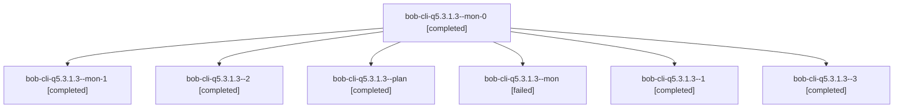

# Session: bob-cli-q5.3.1.3

[Agent Hoods](../README.md) / [bbugyi200](../users/bbugyi200/README.md) / [athena](../users/bbugyi200/machines/athena/README.md) / [bob-cli-q5](../users/bbugyi200/machines/athena/hoods/bob-cli-q5/README.md) / bob-cli-q5.3.1.3

Owner: `bbugyi200.athena` · Hood: `bob-cli-q5` · Members: 7 · Bead: [bob-cli-q5.3.1.3](https://github.com/bobs-org/bob-cli--beads/blob/main/pages/bob-cli-q5/bob-cli-q5.3.1.3.md)

## Lineage

The diagram is an optional enhancement; the ordered table below contains the same lineage in accessible text.

| Role | Agent | State | Model / provider | Timing | Commits | Prompt | Chat |
|---|---|---|---|---|---:|---|---|
| mon-0 | bob-cli-q5.3.1.3--mon-0 | completed | gpt-6-luna / codex | 2026-11-26T10:09:27.920720+00:00 → 2026-11-26T10:22:01.440244+00:00 | 0 | — | [Chat](../agents/bbugyi200.athena.bob-cli-q5.3.1.3--mon-0/chat.md) |
| mon-1 | bob-cli-q5.3.1.3--mon-1 | completed | gpt-6-luna / codex | 2026-11-26T10:27:58.176522+00:00 → 2026-11-26T10:36:34.317628+00:00 | 0 | — | [Chat](../agents/bbugyi200.athena.bob-cli-q5.3.1.3--mon-1/chat.md) |
| 2 | bob-cli-q5.3.1.3--2 | completed | gpt-6-luna / codex | 2026-11-26T10:22:01.353662+00:00 → 2026-11-26T10:29:09.626140+00:00 | 0 | [Prompt](../agents/bbugyi200.athena.bob-cli-q5.3.1.3--2/prompt.md) | [Chat](../agents/bbugyi200.athena.bob-cli-q5.3.1.3--2/chat.md) |
| plan | bob-cli-q5.3.1.3--plan | completed | gpt-6-luna / codex | 2026-11-26T09:16:59.552755+00:00 → 2026-11-26T09:55:34.782759+00:00 | 0 | [Prompt](../agents/bbugyi200.athena.bob-cli-q5.3.1.3--plan/prompt.md) | [Chat](../agents/bbugyi200.athena.bob-cli-q5.3.1.3--plan/chat.md) |
| mon | bob-cli-q5.3.1.3--mon | failed | gpt-6-luna / codex | 2026-11-26T09:54:33.898255+00:00 → 2026-11-26T10:04:30.964834+00:00 | 0 | — | [Chat](../agents/bbugyi200.athena.bob-cli-q5.3.1.3--mon/chat.md) |
| 1 | bob-cli-q5.3.1.3--1 | completed | gpt-6-luna / codex | 2026-11-26T10:04:30.662393+00:00 → 2026-11-26T10:10:23.923568+00:00 | 0 | [Prompt](../agents/bbugyi200.athena.bob-cli-q5.3.1.3--1/prompt.md) | [Chat](../agents/bbugyi200.athena.bob-cli-q5.3.1.3--1/chat.md) |
| 3 | bob-cli-q5.3.1.3--3 | completed | gpt-6-luna / codex | 2026-11-26T10:36:34.153672+00:00 → 2026-11-26T10:39:56.714538+00:00 | [1](../agents/bbugyi200.athena.bob-cli-q5.3.1.3--3/README.md#commits) | [Prompt](../agents/bbugyi200.athena.bob-cli-q5.3.1.3--3/prompt.md) | [Chat](../agents/bbugyi200.athena.bob-cli-q5.3.1.3--3/chat.md) |

## Commits

| Role | Repo | Commit | Subject | Committed |
|---|---|---|---|---|
| 3 | bob-cli | [`712d69d`](https://github.com/bobs-org/bob-cli/commit/712d69d9583cf80896879b501b0a9c886bdde2a4) | feat(capture): add snooze completion token | 2026-11-26 05:38:58 EST |

## Neighbors

| Agent | Relation | State |
|---|---|---|
| [bob-cli-q5.3](bbugyi200.athena.bob-cli-q5.3.md) (session · 3) | ancestor | active 1, completed 2 |
| [bob-cli-q5.3.1.1](../agents/bbugyi200.athena.bob-cli-q5.3.1.1/README.md) | bob-cli-q5.3.1 hood | completed |
| [bob-cli-q5.3.1.2](../agents/bbugyi200.athena.bob-cli-q5.3.1.2/README.md) | bob-cli-q5.3.1 hood | completed |
| [bob-cli-q5.3.1.land](bbugyi200.athena.bob-cli-q5.3.1.land.md) (session · 3) | bob-cli-q5.3.1 hood | completed 3 |
| [bob-cli-q5.1](bbugyi200.athena.bob-cli-q5.1.md) (session · 3) | bob-cli-q5 hood | active 1, completed 2 |
| [bob-cli-q5.1.1.1](../agents/bbugyi200.athena.bob-cli-q5.1.1.1/README.md) | bob-cli-q5 hood | completed |
| [bob-cli-q5.1.1.2](../agents/bbugyi200.athena.bob-cli-q5.1.1.2/README.md) | bob-cli-q5 hood | completed |
| [bob-cli-q5.1.1.3](bbugyi200.athena.bob-cli-q5.1.1.3.md) (session · 11) | bob-cli-q5 hood | completed 7, failed 4 |
| [bob-cli-q5.1.1.4](../agents/bbugyi200.athena.bob-cli-q5.1.1.4/README.md) | bob-cli-q5 hood | completed |
| [bob-cli-q5.1.1.5](../agents/bbugyi200.athena.bob-cli-q5.1.1.5/README.md) | bob-cli-q5 hood | completed |
| [bob-cli-q5.1.1.land](bbugyi200.athena.bob-cli-q5.1.1.land.md) (session · 3) | bob-cli-q5 hood | completed 3 |
| [bob-cli-q5.2](bbugyi200.athena.bob-cli-q5.2.md) (session · 3) | bob-cli-q5 hood | active 1, completed 2 |
| [bob-cli-q5.2.1.1](bbugyi200.athena.bob-cli-q5.2.1.1.md) (session · 5) | bob-cli-q5 hood | completed 3, failed 2 |
| [bob-cli-q5.2.1.2](bbugyi200.athena.bob-cli-q5.2.1.2.md) (session · 5) | bob-cli-q5 hood | completed 4, failed 1 |
| [bob-cli-q5.2.1.2](../agents/bbugyi200.athena.bob-cli-q5.2.1.2/README.md) | bob-cli-q5 hood | failed |
| [bob-cli-q5.2.1.3](../agents/bbugyi200.athena.bob-cli-q5.2.1.3/README.md) | bob-cli-q5 hood | completed |
| [bob-cli-q5.2.1.4](../agents/bbugyi200.athena.bob-cli-q5.2.1.4/README.md) | bob-cli-q5 hood | completed |
| [bob-cli-q5.2.1.land](bbugyi200.athena.bob-cli-q5.2.1.land.md) (session · 3) | bob-cli-q5 hood | completed 3 |
| [bob-cli-q5.4](bbugyi200.athena.bob-cli-q5.4.md) (session · 3) | bob-cli-q5 hood | active 1, completed 2 |
| [bob-cli-q5.4.1.1](bbugyi200.athena.bob-cli-q5.4.1.1.md) (session · 3) | bob-cli-q5 hood | completed 2, failed 1 |
| [bob-cli-q5.4.1.2](../agents/bbugyi200.athena.bob-cli-q5.4.1.2/README.md) | bob-cli-q5 hood | completed |
| [bob-cli-q5.4.1.3](../agents/bbugyi200.athena.bob-cli-q5.4.1.3/README.md) | bob-cli-q5 hood | completed |
| [bob-cli-q5.4.1.4](bbugyi200.athena.bob-cli-q5.4.1.4.md) (session · 13) | bob-cli-q5 hood | completed 10, failed 3 |
| [bob-cli-q5.4.1.5](../agents/bbugyi200.athena.bob-cli-q5.4.1.5/README.md) | bob-cli-q5 hood | completed |
| [bob-cli-q5.4.1.land](bbugyi200.athena.bob-cli-q5.4.1.land.md) (session · 7) | bob-cli-q5 hood | active 3, completed 3, failed 1 |
| [bob-cli-q5.5](../agents/bbugyi200.athena.bob-cli-q5.5/README.md) | bob-cli-q5 hood | waiting |
| [bob-cli-q5.6](../agents/bbugyi200.athena.bob-cli-q5.6/README.md) | bob-cli-q5 hood | waiting |
| [bob-cli-q5.7](bbugyi200.athena.bob-cli-q5.7.md) (session · 3) | bob-cli-q5 hood | active 1, completed 2 |
| [bob-cli-q5.7.1.1](../agents/bbugyi200.athena.bob-cli-q5.7.1.1/README.md) | bob-cli-q5 hood | completed |
| [bob-cli-q5.7.1.2](bbugyi200.athena.bob-cli-q5.7.1.2.md) (session · 3) | bob-cli-q5 hood | completed 2, failed 1 |
| [bob-cli-q5.7.1.3](bbugyi200.athena.bob-cli-q5.7.1.3.md) (session · 3) | bob-cli-q5 hood | completed 3 |
| [bob-cli-q5.7.1.land](bbugyi200.athena.bob-cli-q5.7.1.land.md) (session · 11) | bob-cli-q5 hood | completed 9, failed 2 |
| [bob-cli-q5.8](bbugyi200.athena.bob-cli-q5.8.md) (session · 3) | bob-cli-q5 hood | active 1, completed 2 |
| [bob-cli-q5.8.1.1](bbugyi200.athena.bob-cli-q5.8.1.1.md) (session · 8) | bob-cli-q5 hood | completed 4, failed 4 |
| [bob-cli-q5.8.1.2](../agents/bbugyi200.athena.bob-cli-q5.8.1.2/README.md) | bob-cli-q5 hood | completed |
| [bob-cli-q5.8.1.3](bbugyi200.athena.bob-cli-q5.8.1.3.md) (session · 2) | bob-cli-q5 hood | active 1, completed 1 |
| [bob-cli-q5.8.1.4](../agents/bbugyi200.athena.bob-cli-q5.8.1.4/README.md) | bob-cli-q5 hood | waiting |
| [bob-cli-q5.8.1.5](../agents/bbugyi200.athena.bob-cli-q5.8.1.5/README.md) | bob-cli-q5 hood | waiting |
| [bob-cli-q5.8.1.land](../agents/bbugyi200.athena.bob-cli-q5.8.1.land/README.md) | bob-cli-q5 hood | waiting |
| [bob-cli-q5.9](../agents/bbugyi200.athena.bob-cli-q5.9/README.md) | bob-cli-q5 hood | waiting |
| [bob-cli-q5.land](../agents/bbugyi200.athena.bob-cli-q5.land/README.md) | bob-cli-q5 hood | waiting |
