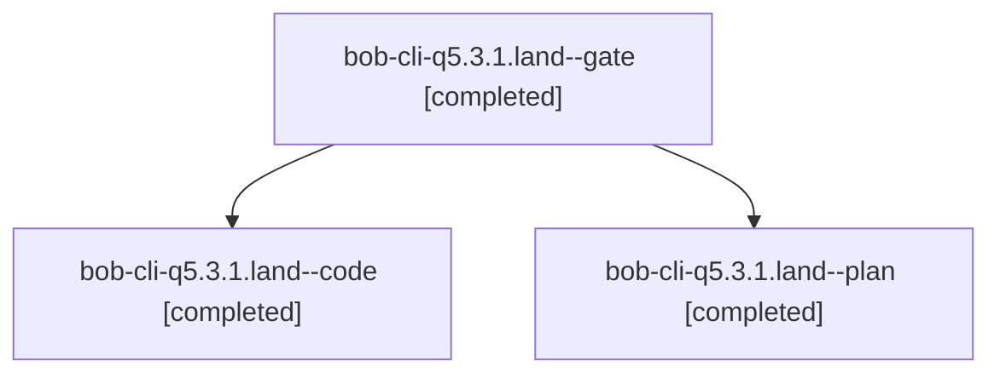

# Session: bob-cli-q5.3.1.land

[Agent Hoods](../README.md) / [bbugyi200](../users/bbugyi200/README.md) / [athena](../users/bbugyi200/machines/athena/README.md) / [bob-cli-q5](../users/bbugyi200/machines/athena/hoods/bob-cli-q5/README.md) / bob-cli-q5.3.1.land

Owner: `bbugyi200.athena` · Hood: `bob-cli-q5` · Members: 3 · Bead: [bob-cli-q5.3.1](https://github.com/bobs-org/bob-cli--beads/blob/main/pages/bob-cli-q5/bob-cli-q5.3.1.md)

## Lineage



The diagram is an optional enhancement; the ordered table below contains the same lineage in accessible text.

| Role | Agent | State | Model / provider | Timing | Commits | Prompt | Chat |
|---|---|---|---|---|---:|---|---|
| <a id="member-gate"></a>gate | bob-cli-q5.3.1.land--gate | completed | gpt-6-astra / codex | 2026-11-26T10:51:47.528793+00:00 → 2026-11-26T10:51:56.274170+00:00 | 0 | — | [Chat](../agents/bbugyi200.athena.bob-cli-q5.3.1.land--gate/chat.md) |
| <a id="member-code"></a>code | bob-cli-q5.3.1.land--code | completed | muse-spark-1.3-contributor / muse | 2026-11-26T10:52:34.069746+00:00 → 2026-11-26T11:37:03.615016+00:00 | [1](../agents/bbugyi200.athena.bob-cli-q5.3.1.land--code/README.md#commits) | — | [Chat](../agents/bbugyi200.athena.bob-cli-q5.3.1.land--code/chat.md) |
| <a id="member-plan"></a>plan | bob-cli-q5.3.1.land--plan | completed | gpt-6-astra / codex | 2026-11-26T10:40:21.065462+00:00 → 2026-11-26T11:37:03.615016+00:00 | 0 | [Prompt](../agents/bbugyi200.athena.bob-cli-q5.3.1.land--plan/prompt.md) | [Chat](../agents/bbugyi200.athena.bob-cli-q5.3.1.land--plan/chat.md) |

## Commits

| Role | Repo | Commit | Subject | Committed |
|---|---|---|---|---|
| code | bob-cli | [`7048c5c`](https://github.com/bobs-org/bob-cli/commit/7048c5c489ebadcb577ad1281a4c3fb85c2190de) | feat(capture): finish snooze drop preview parity and completion alias merge | 2026-11-26 06:35:24 EST |

## Variables

| Role | Variable | Value |
|---|---|---|
| plan | `artifacts` | \[{bead: bob-cli-q5.3.1, kind: file, label: Capture snooze landing: numeric drop parse/execution mismatch, path: /home/bryan/.sase/artifacts/agents/gh\_bobs-org\_\_bob-cli/20261125193618/q531-reproductio… |

#### artifacts

**Role:** `plan`

```yaml
- bead: bob-cli-q5.3.1
  kind: file
  label: Capture snooze landing: numeric drop parse/execution mismatch
  path: /home/bryan/.sase/artifacts/agents/gh_bobs-org__bob-cli/20261125193618/q531-reproductions-1f5164e8b50d.json
  ref: file:explicit:5bbffb8fc717828765ca25af
  source_path: /tmp/q531-reproductions.json
```

Values are truncated for display; see each member's agent meta.json for the full values.

## Neighbors

| Agent | Relation | State |
|---|---|---|
| [bob-cli-q5.3](bbugyi200.athena.bob-cli-q5.3.md) (session · 3) | ancestor | active 1, completed 2 |
| [bob-cli-q5.3.1.1](../agents/bbugyi200.athena.bob-cli-q5.3.1.1/README.md) | bob-cli-q5.3.1 hood | completed |
| [bob-cli-q5.3.1.2](../agents/bbugyi200.athena.bob-cli-q5.3.1.2/README.md) | bob-cli-q5.3.1 hood | completed |
| [bob-cli-q5.3.1.3](bbugyi200.athena.bob-cli-q5.3.1.3.md) (session · 7) | bob-cli-q5.3.1 hood | completed 6, failed 1 |
| [bob-cli-q5.1](bbugyi200.athena.bob-cli-q5.1.md) (session · 3) | bob-cli-q5 hood | active 1, completed 2 |
| [bob-cli-q5.1.1.1](../agents/bbugyi200.athena.bob-cli-q5.1.1.1/README.md) | bob-cli-q5 hood | completed |
| [bob-cli-q5.1.1.2](../agents/bbugyi200.athena.bob-cli-q5.1.1.2/README.md) | bob-cli-q5 hood | completed |
| [bob-cli-q5.1.1.3](bbugyi200.athena.bob-cli-q5.1.1.3.md) (session · 11) | bob-cli-q5 hood | completed 7, failed 4 |
| [bob-cli-q5.1.1.4](../agents/bbugyi200.athena.bob-cli-q5.1.1.4/README.md) | bob-cli-q5 hood | completed |
| [bob-cli-q5.1.1.5](../agents/bbugyi200.athena.bob-cli-q5.1.1.5/README.md) | bob-cli-q5 hood | completed |
| [bob-cli-q5.1.1.land](bbugyi200.athena.bob-cli-q5.1.1.land.md) (session · 3) | bob-cli-q5 hood | completed 3 |
| [bob-cli-q5.2](bbugyi200.athena.bob-cli-q5.2.md) (session · 3) | bob-cli-q5 hood | active 1, completed 2 |
| [bob-cli-q5.2.1.1](bbugyi200.athena.bob-cli-q5.2.1.1.md) (session · 5) | bob-cli-q5 hood | completed 3, failed 2 |
| [bob-cli-q5.2.1.2](bbugyi200.athena.bob-cli-q5.2.1.2.md) (session · 5) | bob-cli-q5 hood | completed 4, failed 1 |
| [bob-cli-q5.2.1.2](../agents/bbugyi200.athena.bob-cli-q5.2.1.2/README.md) | bob-cli-q5 hood | failed |
| [bob-cli-q5.2.1.3](../agents/bbugyi200.athena.bob-cli-q5.2.1.3/README.md) | bob-cli-q5 hood | completed |
| [bob-cli-q5.2.1.4](../agents/bbugyi200.athena.bob-cli-q5.2.1.4/README.md) | bob-cli-q5 hood | completed |
| [bob-cli-q5.2.1.land](bbugyi200.athena.bob-cli-q5.2.1.land.md) (session · 3) | bob-cli-q5 hood | completed 3 |
| [bob-cli-q5.4](bbugyi200.athena.bob-cli-q5.4.md) (session · 3) | bob-cli-q5 hood | active 1, completed 2 |
| [bob-cli-q5.4.1.1](bbugyi200.athena.bob-cli-q5.4.1.1.md) (session · 3) | bob-cli-q5 hood | completed 2, failed 1 |
| [bob-cli-q5.4.1.2](../agents/bbugyi200.athena.bob-cli-q5.4.1.2/README.md) | bob-cli-q5 hood | completed |
| [bob-cli-q5.4.1.3](../agents/bbugyi200.athena.bob-cli-q5.4.1.3/README.md) | bob-cli-q5 hood | waiting |
| [bob-cli-q5.4.1.4](../agents/bbugyi200.athena.bob-cli-q5.4.1.4/README.md) | bob-cli-q5 hood | waiting |
| [bob-cli-q5.4.1.5](../agents/bbugyi200.athena.bob-cli-q5.4.1.5/README.md) | bob-cli-q5 hood | waiting |
| [bob-cli-q5.4.1.land](../agents/bbugyi200.athena.bob-cli-q5.4.1.land/README.md) | bob-cli-q5 hood | waiting |
| [bob-cli-q5.5](../agents/bbugyi200.athena.bob-cli-q5.5/README.md) | bob-cli-q5 hood | waiting |
| [bob-cli-q5.6](../agents/bbugyi200.athena.bob-cli-q5.6/README.md) | bob-cli-q5 hood | waiting |
| [bob-cli-q5.7](bbugyi200.athena.bob-cli-q5.7.md) (session · 3) | bob-cli-q5 hood | active 1, completed 2 |
| [bob-cli-q5.7.1.1](../agents/bbugyi200.athena.bob-cli-q5.7.1.1/README.md) | bob-cli-q5 hood | completed |
| [bob-cli-q5.7.1.2](bbugyi200.athena.bob-cli-q5.7.1.2.md) (session · 2) | bob-cli-q5 hood | active 1, completed 1 |
| [bob-cli-q5.7.1.3](../agents/bbugyi200.athena.bob-cli-q5.7.1.3/README.md) | bob-cli-q5 hood | waiting |
| [bob-cli-q5.7.1.land](../agents/bbugyi200.athena.bob-cli-q5.7.1.land/README.md) | bob-cli-q5 hood | waiting |
| [bob-cli-q5.8](../agents/bbugyi200.athena.bob-cli-q5.8/README.md) | bob-cli-q5 hood | waiting |
| [bob-cli-q5.9](../agents/bbugyi200.athena.bob-cli-q5.9/README.md) | bob-cli-q5 hood | waiting |
| [bob-cli-q5.land](../agents/bbugyi200.athena.bob-cli-q5.land/README.md) | bob-cli-q5 hood | waiting |
