# Session: bob-cli-q5.4.1.4

[Agent Hoods](../README.md) / [bbugyi200](../users/bbugyi200/README.md) / [athena](../users/bbugyi200/machines/athena/README.md) / [bob-cli-q5](../users/bbugyi200/machines/athena/hoods/bob-cli-q5/README.md) / bob-cli-q5.4.1.4

Owner: `bbugyi200.athena` · Hood: `bob-cli-q5` · Members: 13 · Bead: [bob-cli-q5.4.1.4](https://github.com/bobs-org/bob-cli--beads/blob/main/pages/bob-cli-q5/bob-cli-q5.4.1.4.md)

## Lineage

```mermaid
flowchart TD
  n0["bob-cli-q5.4.1.4--4 [completed]"]
  n1["bob-cli-q5.4.1.4--5 [completed]"]
  n0 --> n1
  n2["bob-cli-q5.4.1.4--plan [completed]"]
  n0 --> n2
  n3["bob-cli-q5.4.1.4--mon [completed]"]
  n0 --> n3
  n4["bob-cli-q5.4.1.4--mon-1 [failed]"]
  n0 --> n4
  n5["bob-cli-q5.4.1.4--mon-2 [failed]"]
  n0 --> n5
  n6["bob-cli-q5.4.1.4--1 [completed]"]
  n0 --> n6
  n7["bob-cli-q5.4.1.4--2 [completed]"]
  n0 --> n7
  n8["bob-cli-q5.4.1.4--6 [completed]"]
  n0 --> n8
  n9["bob-cli-q5.4.1.4--mon-4 [completed]"]
  n0 --> n9
  n10["bob-cli-q5.4.1.4--mon-0 [completed]"]
  n0 --> n10
  n11["bob-cli-q5.4.1.4--3 [completed]"]
  n0 --> n11
  n12["bob-cli-q5.4.1.4--mon-3 [failed]"]
  n0 --> n12
```

The diagram is an optional enhancement; the ordered table below contains the same lineage in accessible text.

| Role | Agent | State | Model / provider | Timing | Commits | Prompt | Chat |
|---|---|---|---|---|---:|---|---|
| 4 | bob-cli-q5.4.1.4--4 | completed | gpt-6-luna / codex | 2026-11-26T16:01:17.253547+00:00 → 2026-11-26T16:06:56.009298+00:00 | 0 | [Prompt](../agents/bbugyi200.athena.bob-cli-q5.4.1.4--4/prompt.md) | [Chat](../agents/bbugyi200.athena.bob-cli-q5.4.1.4--4/chat.md) |
| 5 | bob-cli-q5.4.1.4--5 | completed | gpt-6-luna / codex | 2026-11-26T16:09:44.996850+00:00 → 2026-11-26T16:16:49.412215+00:00 | 0 | [Prompt](../agents/bbugyi200.athena.bob-cli-q5.4.1.4--5/prompt.md) | [Chat](../agents/bbugyi200.athena.bob-cli-q5.4.1.4--5/chat.md) |
| plan | bob-cli-q5.4.1.4--plan | completed | gpt-6-luna / codex | 2026-11-26T14:40:27.703848+00:00 → 2026-11-26T15:17:30.002279+00:00 | 0 | [Prompt](../agents/bbugyi200.athena.bob-cli-q5.4.1.4--plan/prompt.md) | [Chat](../agents/bbugyi200.athena.bob-cli-q5.4.1.4--plan/chat.md) |
| mon | bob-cli-q5.4.1.4--mon | completed | gpt-6-luna / codex | 2026-11-26T15:15:30.975355+00:00 → 2026-11-26T15:19:02.734665+00:00 | 0 | — | [Chat](../agents/bbugyi200.athena.bob-cli-q5.4.1.4--mon/chat.md) |
| mon-1 | bob-cli-q5.4.1.4--mon-1 | failed | gpt-6-luna / codex | 2026-11-26T15:41:12.228288+00:00 → 2026-11-26T15:45:14.477483+00:00 | 0 | — | [Chat](../agents/bbugyi200.athena.bob-cli-q5.4.1.4--mon-1/chat.md) |
| mon-2 | bob-cli-q5.4.1.4--mon-2 | failed | gpt-6-luna / codex | 2026-11-26T15:57:42.042705+00:00 → 2026-11-26T16:01:17.534126+00:00 | 0 | — | [Chat](../agents/bbugyi200.athena.bob-cli-q5.4.1.4--mon-2/chat.md) |
| 1 | bob-cli-q5.4.1.4--1 | completed | gpt-6-luna / codex | 2026-11-26T15:19:02.325136+00:00 → 2026-11-26T15:32:47.847815+00:00 | 0 | [Prompt](../agents/bbugyi200.athena.bob-cli-q5.4.1.4--1/prompt.md) | [Chat](../agents/bbugyi200.athena.bob-cli-q5.4.1.4--1/chat.md) |
| 2 | bob-cli-q5.4.1.4--2 | completed | gpt-6-luna / codex | 2026-11-26T15:34:16.523099+00:00 → 2026-11-26T15:42:59.112434+00:00 | 0 | [Prompt](../agents/bbugyi200.athena.bob-cli-q5.4.1.4--2/prompt.md) | [Chat](../agents/bbugyi200.athena.bob-cli-q5.4.1.4--2/chat.md) |
| 6 | bob-cli-q5.4.1.4--6 | completed | gpt-6-luna / codex | 2026-11-26T16:19:39.989720+00:00 → 2026-11-26T16:27:36.083457+00:00 | 0 | [Prompt](../agents/bbugyi200.athena.bob-cli-q5.4.1.4--6/prompt.md) | [Chat](../agents/bbugyi200.athena.bob-cli-q5.4.1.4--6/chat.md) |
| mon-4 | bob-cli-q5.4.1.4--mon-4 | completed | gpt-6-luna / codex | 2026-11-26T16:15:06.810442+00:00 → 2026-11-26T16:19:40.465222+00:00 | 0 | — | [Chat](../agents/bbugyi200.athena.bob-cli-q5.4.1.4--mon-4/chat.md) |
| mon-0 | bob-cli-q5.4.1.4--mon-0 | completed | gpt-6-luna / codex | 2026-11-26T15:31:04.360601+00:00 → 2026-11-26T15:34:16.997390+00:00 | 0 | — | [Chat](../agents/bbugyi200.athena.bob-cli-q5.4.1.4--mon-0/chat.md) |
| 3 | bob-cli-q5.4.1.4--3 | completed | gpt-6-luna / codex | 2026-11-26T15:45:14.178903+00:00 → 2026-11-26T15:59:34.511373+00:00 | 0 | [Prompt](../agents/bbugyi200.athena.bob-cli-q5.4.1.4--3/prompt.md) | [Chat](../agents/bbugyi200.athena.bob-cli-q5.4.1.4--3/chat.md) |
| mon-3 | bob-cli-q5.4.1.4--mon-3 | failed | gpt-6-luna / codex | 2026-11-26T16:05:20.603289+00:00 → 2026-11-26T16:09:45.204688+00:00 | 0 | — | [Chat](../agents/bbugyi200.athena.bob-cli-q5.4.1.4--mon-3/chat.md) |

## Neighbors

| Agent | Relation | State |
|---|---|---|
| [bob-cli-q5.4](bbugyi200.athena.bob-cli-q5.4.md) (session · 3) | ancestor | active 1, completed 2 |
| [bob-cli-q5.4.1.1](bbugyi200.athena.bob-cli-q5.4.1.1.md) (session · 3) | bob-cli-q5.4.1 hood | completed 2, failed 1 |
| [bob-cli-q5.4.1.2](../agents/bbugyi200.athena.bob-cli-q5.4.1.2/README.md) | bob-cli-q5.4.1 hood | completed |
| [bob-cli-q5.4.1.3](../agents/bbugyi200.athena.bob-cli-q5.4.1.3/README.md) | bob-cli-q5.4.1 hood | completed |
| [bob-cli-q5.4.1.5](../agents/bbugyi200.athena.bob-cli-q5.4.1.5/README.md) | bob-cli-q5.4.1 hood | completed |
| [bob-cli-q5.4.1.land](bbugyi200.athena.bob-cli-q5.4.1.land.md) (session · 7) | bob-cli-q5.4.1 hood | active 3, completed 3, failed 1 |
| [bob-cli-q5.1](bbugyi200.athena.bob-cli-q5.1.md) (session · 3) | bob-cli-q5 hood | active 1, completed 2 |
| [bob-cli-q5.1.1.1](../agents/bbugyi200.athena.bob-cli-q5.1.1.1/README.md) | bob-cli-q5 hood | completed |
| [bob-cli-q5.1.1.2](../agents/bbugyi200.athena.bob-cli-q5.1.1.2/README.md) | bob-cli-q5 hood | completed |
| [bob-cli-q5.1.1.3](bbugyi200.athena.bob-cli-q5.1.1.3.md) (session · 11) | bob-cli-q5 hood | completed 7, failed 4 |
| [bob-cli-q5.1.1.4](../agents/bbugyi200.athena.bob-cli-q5.1.1.4/README.md) | bob-cli-q5 hood | completed |
| [bob-cli-q5.1.1.5](../agents/bbugyi200.athena.bob-cli-q5.1.1.5/README.md) | bob-cli-q5 hood | completed |
| [bob-cli-q5.1.1.land](bbugyi200.athena.bob-cli-q5.1.1.land.md) (session · 3) | bob-cli-q5 hood | completed 3 |
| [bob-cli-q5.2](bbugyi200.athena.bob-cli-q5.2.md) (session · 3) | bob-cli-q5 hood | active 1, completed 2 |
| [bob-cli-q5.2.1.1](bbugyi200.athena.bob-cli-q5.2.1.1.md) (session · 5) | bob-cli-q5 hood | completed 3, failed 2 |
| [bob-cli-q5.2.1.2](bbugyi200.athena.bob-cli-q5.2.1.2.md) (session · 5) | bob-cli-q5 hood | completed 4, failed 1 |
| [bob-cli-q5.2.1.2](../agents/bbugyi200.athena.bob-cli-q5.2.1.2/README.md) | bob-cli-q5 hood | failed |
| [bob-cli-q5.2.1.3](../agents/bbugyi200.athena.bob-cli-q5.2.1.3/README.md) | bob-cli-q5 hood | completed |
| [bob-cli-q5.2.1.4](../agents/bbugyi200.athena.bob-cli-q5.2.1.4/README.md) | bob-cli-q5 hood | completed |
| [bob-cli-q5.2.1.land](bbugyi200.athena.bob-cli-q5.2.1.land.md) (session · 3) | bob-cli-q5 hood | completed 3 |
| [bob-cli-q5.3](bbugyi200.athena.bob-cli-q5.3.md) (session · 3) | bob-cli-q5 hood | active 1, completed 2 |
| [bob-cli-q5.3.1.1](../agents/bbugyi200.athena.bob-cli-q5.3.1.1/README.md) | bob-cli-q5 hood | completed |
| [bob-cli-q5.3.1.2](../agents/bbugyi200.athena.bob-cli-q5.3.1.2/README.md) | bob-cli-q5 hood | completed |
| [bob-cli-q5.3.1.3](bbugyi200.athena.bob-cli-q5.3.1.3.md) (session · 7) | bob-cli-q5 hood | completed 6, failed 1 |
| [bob-cli-q5.3.1.land](bbugyi200.athena.bob-cli-q5.3.1.land.md) (session · 3) | bob-cli-q5 hood | completed 3 |
| [bob-cli-q5.5](../agents/bbugyi200.athena.bob-cli-q5.5/README.md) | bob-cli-q5 hood | waiting |
| [bob-cli-q5.6](../agents/bbugyi200.athena.bob-cli-q5.6/README.md) | bob-cli-q5 hood | waiting |
| [bob-cli-q5.7](bbugyi200.athena.bob-cli-q5.7.md) (session · 3) | bob-cli-q5 hood | active 1, completed 2 |
| [bob-cli-q5.7.1.1](../agents/bbugyi200.athena.bob-cli-q5.7.1.1/README.md) | bob-cli-q5 hood | completed |
| [bob-cli-q5.7.1.2](bbugyi200.athena.bob-cli-q5.7.1.2.md) (session · 3) | bob-cli-q5 hood | completed 2, failed 1 |
| [bob-cli-q5.7.1.3](bbugyi200.athena.bob-cli-q5.7.1.3.md) (session · 3) | bob-cli-q5 hood | completed 3 |
| [bob-cli-q5.7.1.land](bbugyi200.athena.bob-cli-q5.7.1.land.md) (session · 11) | bob-cli-q5 hood | completed 9, failed 2 |
| [bob-cli-q5.8](bbugyi200.athena.bob-cli-q5.8.md) (session · 3) | bob-cli-q5 hood | active 1, completed 2 |
| [bob-cli-q5.8.1.1](bbugyi200.athena.bob-cli-q5.8.1.1.md) (session · 8) | bob-cli-q5 hood | completed 4, failed 4 |
| [bob-cli-q5.8.1.2](../agents/bbugyi200.athena.bob-cli-q5.8.1.2/README.md) | bob-cli-q5 hood | completed |
| [bob-cli-q5.8.1.3](bbugyi200.athena.bob-cli-q5.8.1.3.md) (session · 2) | bob-cli-q5 hood | active 2 |
| [bob-cli-q5.8.1.4](../agents/bbugyi200.athena.bob-cli-q5.8.1.4/README.md) | bob-cli-q5 hood | waiting |
| [bob-cli-q5.8.1.5](../agents/bbugyi200.athena.bob-cli-q5.8.1.5/README.md) | bob-cli-q5 hood | waiting |
| [bob-cli-q5.8.1.land](../agents/bbugyi200.athena.bob-cli-q5.8.1.land/README.md) | bob-cli-q5 hood | waiting |
| [bob-cli-q5.9](../agents/bbugyi200.athena.bob-cli-q5.9/README.md) | bob-cli-q5 hood | waiting |
| [bob-cli-q5.land](../agents/bbugyi200.athena.bob-cli-q5.land/README.md) | bob-cli-q5 hood | waiting |
