# Session: bob-cli-q5.5.1.land

[Agent Hoods](../README.md) / [bbugyi200](../users/bbugyi200/README.md) / [athena](../users/bbugyi200/machines/athena/README.md) / [bob-cli-q5](../users/bbugyi200/machines/athena/hoods/bob-cli-q5/README.md) / bob-cli-q5.5.1.land

Owner: `bbugyi200.athena` · Hood: `bob-cli-q5` · Members: 23 · Bead: [bob-cli-q5.5.1](https://github.com/bobs-org/bob-cli--beads/blob/main/pages/bob-cli-q5/bob-cli-q5.5.1.md)

## Lineage

```mermaid
flowchart TD
  n0["bob-cli-q5.5.1.land--7 [completed]"]
  n1["bob-cli-q5.5.1.land--9 [completed]"]
  n0 --> n1
  n2["bob-cli-q5.5.1.land--mon-6 [failed]"]
  n0 --> n2
  n3["bob-cli-q5.5.1.land--mon-8 [failed]"]
  n0 --> n3
  n4["bob-cli-q5.5.1.land--4 [completed]"]
  n0 --> n4
  n5["bob-cli-q5.5.1.land--a [completed]"]
  n0 --> n5
  n6["bob-cli-q5.5.1.land--1 [completed]"]
  n0 --> n6
  n7["bob-cli-q5.5.1.land--mon-2 [failed]"]
  n0 --> n7
  n8["bob-cli-q5.5.1.land--mon-0 [failed]"]
  n0 --> n8
  n9["bob-cli-q5.5.1.land--2 [completed]"]
  n0 --> n9
  n10["bob-cli-q5.5.1.land--6 [completed]"]
  n0 --> n10
  n11["bob-cli-q5.5.1.land--5 [completed]"]
  n0 --> n11
  n12["bob-cli-q5.5.1.land--mon [failed]"]
  n0 --> n12
  n13["bob-cli-q5.5.1.land--gate [completed]"]
  n0 --> n13
  n14["bob-cli-q5.5.1.land--plan [completed]"]
  n0 --> n14
  n15["bob-cli-q5.5.1.land--mon-1 [failed]"]
  n0 --> n15
  n16["bob-cli-q5.5.1.land--3 [completed]"]
  n0 --> n16
  n17["bob-cli-q5.5.1.land--mon-7 [failed]"]
  n0 --> n17
  n18["bob-cli-q5.5.1.land--8 [completed]"]
  n0 --> n18
  n19["bob-cli-q5.5.1.land--mon-3 [failed]"]
  n0 --> n19
  n20["bob-cli-q5.5.1.land--code [completed]"]
  n0 --> n20
  n21["bob-cli-q5.5.1.land--mon-5 [failed]"]
  n0 --> n21
  n22["bob-cli-q5.5.1.land--mon-4 [failed]"]
  n0 --> n22
```



The diagram is an optional enhancement; the ordered table below contains the same lineage in accessible text.

| Role | Agent | State | Model / provider | Timing | Commits | Prompt | Chat |
|---|---|---|---|---|---:|---|---|
| <a id="member-7"></a>7 | bob-cli-q5.5.1.land--7 | completed | gpt-6-luna / codex | 2026-11-27T05:49:38.895575+00:00 → 2026-11-27T05:53:17.623345+00:00 | 0 | [Prompt](../agents/bbugyi200.athena.bob-cli-q5.5.1.land--7/prompt.md) | [Chat](../agents/bbugyi200.athena.bob-cli-q5.5.1.land--7/chat.md) |
| <a id="member-9"></a>9 | bob-cli-q5.5.1.land--9 | completed | gpt-6-luna / codex | 2026-11-27T06:00:20.315755+00:00 → 2026-11-27T06:06:48.418580+00:00 | 0 | [Prompt](../agents/bbugyi200.athena.bob-cli-q5.5.1.land--9/prompt.md) | [Chat](../agents/bbugyi200.athena.bob-cli-q5.5.1.land--9/chat.md) |
| <a id="member-mon-6"></a>mon-6 | bob-cli-q5.5.1.land--mon-6 | failed | gpt-6-luna / codex | 2026-11-27T05:52:20.189171+00:00 → 2026-11-27T05:55:10.096082+00:00 | 0 | — | [Chat](../agents/bbugyi200.athena.bob-cli-q5.5.1.land--mon-6/chat.md) |
| <a id="member-mon-8"></a>mon-8 | bob-cli-q5.5.1.land--mon-8 | failed | gpt-6-luna / codex | 2026-11-27T06:06:07.538958+00:00 → 2026-11-27T06:09:08.496499+00:00 | 0 | — | [Chat](../agents/bbugyi200.athena.bob-cli-q5.5.1.land--mon-8/chat.md) |
| <a id="member-4"></a>4 | bob-cli-q5.5.1.land--4 | completed | gpt-6-luna / codex | 2026-11-27T05:14:39.649320+00:00 → 2026-11-27T05:22:50.592807+00:00 | 0 | [Prompt](../agents/bbugyi200.athena.bob-cli-q5.5.1.land--4/prompt.md) | [Chat](../agents/bbugyi200.athena.bob-cli-q5.5.1.land--4/chat.md) |
| <a id="member-a"></a>a | bob-cli-q5.5.1.land--a | completed | gpt-6-luna / codex | 2026-11-27T06:09:07.854894+00:00 → 2026-11-27T06:27:58.638584+00:00 | 0 | [Prompt](../agents/bbugyi200.athena.bob-cli-q5.5.1.land--a/prompt.md) | [Chat](../agents/bbugyi200.athena.bob-cli-q5.5.1.land--a/chat.md) |
| <a id="member-1"></a>1 | bob-cli-q5.5.1.land--1 | completed | gpt-6-luna / codex | 2026-11-27T04:17:14.220867+00:00 → 2026-11-27T04:27:11.430194+00:00 | 0 | [Prompt](../agents/bbugyi200.athena.bob-cli-q5.5.1.land--1/prompt.md) | [Chat](../agents/bbugyi200.athena.bob-cli-q5.5.1.land--1/chat.md) |
| <a id="member-mon-2"></a>mon-2 | bob-cli-q5.5.1.land--mon-2 | failed | gpt-6-luna / codex | 2026-11-27T05:11:13.410380+00:00 → 2026-11-27T05:14:39.950799+00:00 | 0 | — | [Chat](../agents/bbugyi200.athena.bob-cli-q5.5.1.land--mon-2/chat.md) |
| <a id="member-mon-0"></a>mon-0 | bob-cli-q5.5.1.land--mon-0 | failed | gpt-6-luna / codex | 2026-11-27T04:26:18.364323+00:00 → 2026-11-27T04:29:12.281930+00:00 | 0 | — | [Chat](../agents/bbugyi200.athena.bob-cli-q5.5.1.land--mon-0/chat.md) |
| <a id="member-2"></a>2 | bob-cli-q5.5.1.land--2 | completed | gpt-6-luna / codex | 2026-11-27T04:29:11.985772+00:00 → 2026-11-27T04:39:33.938086+00:00 | 0 | [Prompt](../agents/bbugyi200.athena.bob-cli-q5.5.1.land--2/prompt.md) | [Chat](../agents/bbugyi200.athena.bob-cli-q5.5.1.land--2/chat.md) |
| <a id="member-6"></a>6 | bob-cli-q5.5.1.land--6 | completed | gpt-6-luna / codex | 2026-11-27T05:35:42.743994+00:00 → 2026-11-27T05:48:04.771970+00:00 | 0 | [Prompt](../agents/bbugyi200.athena.bob-cli-q5.5.1.land--6/prompt.md) | [Chat](../agents/bbugyi200.athena.bob-cli-q5.5.1.land--6/chat.md) |
| <a id="member-5"></a>5 | bob-cli-q5.5.1.land--5 | completed | gpt-6-luna / codex | 2026-11-27T05:25:16.563451+00:00 → 2026-11-27T05:33:53.619834+00:00 | 0 | [Prompt](../agents/bbugyi200.athena.bob-cli-q5.5.1.land--5/prompt.md) | [Chat](../agents/bbugyi200.athena.bob-cli-q5.5.1.land--5/chat.md) |
| <a id="member-mon"></a>mon | bob-cli-q5.5.1.land--mon | failed | gpt-6-luna / codex | 2026-11-27T04:10:14.911577+00:00 → 2026-11-27T04:17:14.354249+00:00 | 0 | — | [Chat](../agents/bbugyi200.athena.bob-cli-q5.5.1.land--mon/chat.md) |
| <a id="member-gate"></a>gate | bob-cli-q5.5.1.land--gate | completed | opus / claude | 2026-11-27T03:47:27.003870+00:00 → 2026-11-27T03:47:35.718524+00:00 | 0 | — | [Chat](../agents/bbugyi200.athena.bob-cli-q5.5.1.land--gate/chat.md) |
| <a id="member-plan"></a>plan | bob-cli-q5.5.1.land--plan | completed | opus / claude | 2026-11-27T03:10:01.331254+00:00 → 2026-11-27T04:13:57.327417+00:00 | [1](../agents/bbugyi200.athena.bob-cli-q5.5.1.land--plan/README.md#commits) | [Prompt](../agents/bbugyi200.athena.bob-cli-q5.5.1.land--plan/prompt.md) | [Chat](../agents/bbugyi200.athena.bob-cli-q5.5.1.land--plan/chat.md) |
| <a id="member-mon-1"></a>mon-1 | bob-cli-q5.5.1.land--mon-1 | failed | gpt-6-luna / codex | 2026-11-27T04:38:49.629213+00:00 → 2026-11-27T04:44:06.652131+00:00 | 0 | — | [Chat](../agents/bbugyi200.athena.bob-cli-q5.5.1.land--mon-1/chat.md) |
| <a id="member-3"></a>3 | bob-cli-q5.5.1.land--3 | completed | gpt-6-luna / codex | 2026-11-27T04:44:06.603863+00:00 → 2026-11-27T05:11:51.242493+00:00 | 0 | [Prompt](../agents/bbugyi200.athena.bob-cli-q5.5.1.land--3/prompt.md) | [Chat](../agents/bbugyi200.athena.bob-cli-q5.5.1.land--3/chat.md) |
| <a id="member-mon-7"></a>mon-7 | bob-cli-q5.5.1.land--mon-7 | failed | gpt-6-luna / codex | 2026-11-27T05:57:09.762802+00:00 → 2026-11-27T06:00:20.395177+00:00 | 0 | — | [Chat](../agents/bbugyi200.athena.bob-cli-q5.5.1.land--mon-7/chat.md) |
| <a id="member-8"></a>8 | bob-cli-q5.5.1.land--8 | completed | gpt-6-luna / codex | 2026-11-27T05:55:09.733643+00:00 → 2026-11-27T05:57:41.646384+00:00 | 0 | [Prompt](../agents/bbugyi200.athena.bob-cli-q5.5.1.land--8/prompt.md) | [Chat](../agents/bbugyi200.athena.bob-cli-q5.5.1.land--8/chat.md) |
| <a id="member-mon-3"></a>mon-3 | bob-cli-q5.5.1.land--mon-3 | failed | gpt-6-luna / codex | 2026-11-27T05:20:58.346244+00:00 → 2026-11-27T05:25:16.706964+00:00 | 0 | — | [Chat](../agents/bbugyi200.athena.bob-cli-q5.5.1.land--mon-3/chat.md) |
| <a id="member-code"></a>code | bob-cli-q5.5.1.land--code | completed | gpt-6-luna / codex | 2026-11-27T03:48:09.093217+00:00 → 2026-11-27T04:13:57.327417+00:00 | [1](../agents/bbugyi200.athena.bob-cli-q5.5.1.land--code/README.md#commits) | — | [Chat](../agents/bbugyi200.athena.bob-cli-q5.5.1.land--code/chat.md) |
| <a id="member-mon-5"></a>mon-5 | bob-cli-q5.5.1.land--mon-5 | failed | gpt-6-luna / codex | 2026-11-27T05:46:14.252358+00:00 → 2026-11-27T05:49:39.024033+00:00 | 0 | — | [Chat](../agents/bbugyi200.athena.bob-cli-q5.5.1.land--mon-5/chat.md) |
| <a id="member-mon-4"></a>mon-4 | bob-cli-q5.5.1.land--mon-4 | failed | gpt-6-luna / codex | 2026-11-27T05:31:00.538745+00:00 → 2026-11-27T05:35:43.059562+00:00 | 0 | — | [Chat](../agents/bbugyi200.athena.bob-cli-q5.5.1.land--mon-4/chat.md) |

## Commits

| Role | Repo | Commit | Subject | Committed |
|---|---|---|---|---|
| plan | bob-cli | [`dfb5e75`](https://github.com/bobs-org/bob-cli/commit/dfb5e7550051ce797bcb7d2de665900c0eaf2fde) | docs(snooze): describe the landed snooze-marks mirror and cross-link Today marks and plan | 2026-11-26 22:46:13 EST |
| code | bob-cli | [`d9f5774`](https://github.com/bobs-org/bob-cli/commit/d9f57741c248db678bcf43b56eade3b16a2e88f4) | docs: describe snooze clock labels and glyph contract | 2026-11-26 23:11:29 EST |

## Variables

| Role | Variable | Value |
|---|---|---|
| a | `artifacts` | \[{bead: bob-cli-q5.5, kind: file, label: Post-deploy Obsidian startup smoke report, path: /home/bryan/.sase/artifacts/agents/gh\_bobs-org\_\_bob-cli/20261127010830/report-smoke-postdeploy-9e6704feb288.j… |
| plan | `artifacts` | \[{kind: file, label: Snooze-marks e2e report on pre-epic bob-plugins feaa5b42 (Reading tomato baseline), path: /home/bryan/.sase/artifacts/agents/gh\_bobs-org\_\_bob-cli/20261126153908/base-report-c5920… |

#### artifacts

**Role:** `a`

```yaml
- bead: bob-cli-q5.5
  kind: file
  label: Post-deploy Obsidian startup smoke report
  path: /home/bryan/.sase/artifacts/agents/gh_bobs-org__bob-cli/20261127010830/report-smoke-postdeploy-9e6704feb288.json
  ref: file:explicit:02441f8e4443975b75eab2cb
  source_path: /home/bryan/.cache/bob-cli-snooze-clock-render-fix/report-smoke-postdeploy.json
```

#### artifacts

**Role:** `plan`

```yaml
- kind: file
  label: Snooze-marks e2e report on pre-epic bob-plugins feaa5b42 (Reading tomato baseline)
  path: /home/bryan/.sase/artifacts/agents/gh_bobs-org__bob-cli/20261126153908/base-report-c59201e5dd92.json
  ref: file:explicit:9c81ddbaa8df1a6b70768210
  source_path: /home/bryan/.cache/q551-land/base-report.json
```

Values are truncated for display; see each member's agent meta.json for the full values.

## Neighbors

| Agent | Relation | State |
|---|---|---|
| [bob-cli-q5.5](bbugyi200.athena.bob-cli-q5.5.md) (session · 3) | ancestor | active 1, completed 2 |
| [bob-cli-q5.5.1.1](../agents/bbugyi200.athena.bob-cli-q5.5.1.1/README.md) | bob-cli-q5.5.1 hood | completed |
| [bob-cli-q5.5.1.2](../agents/bbugyi200.athena.bob-cli-q5.5.1.2/README.md) | bob-cli-q5.5.1 hood | completed |
| [bob-cli-q5.5.1.3](../agents/bbugyi200.athena.bob-cli-q5.5.1.3/README.md) | bob-cli-q5.5.1 hood | completed |
| [bob-cli-q5.5.1.4](../agents/bbugyi200.athena.bob-cli-q5.5.1.4/README.md) | bob-cli-q5.5.1 hood | completed |
| [bob-cli-q5.5.1.5](bbugyi200.athena.bob-cli-q5.5.1.5.md) (session · 3) | bob-cli-q5.5.1 hood | completed 3 |
| [bob-cli-q5.5.1.6](../agents/bbugyi200.athena.bob-cli-q5.5.1.6/README.md) | bob-cli-q5.5.1 hood | completed |
| [bob-cli-q5.1](bbugyi200.athena.bob-cli-q5.1.md) (session · 3) | bob-cli-q5 hood | active 1, completed 2 |
| [bob-cli-q5.1.1.1](../agents/bbugyi200.athena.bob-cli-q5.1.1.1/README.md) | bob-cli-q5 hood | completed |
| [bob-cli-q5.1.1.2](../agents/bbugyi200.athena.bob-cli-q5.1.1.2/README.md) | bob-cli-q5 hood | completed |
| [bob-cli-q5.1.1.3](bbugyi200.athena.bob-cli-q5.1.1.3.md) (session · 11) | bob-cli-q5 hood | completed 7, failed 4 |
| [bob-cli-q5.1.1.4](../agents/bbugyi200.athena.bob-cli-q5.1.1.4/README.md) | bob-cli-q5 hood | completed |
| [bob-cli-q5.1.1.5](../agents/bbugyi200.athena.bob-cli-q5.1.1.5/README.md) | bob-cli-q5 hood | completed |
| [bob-cli-q5.1.1.land](bbugyi200.athena.bob-cli-q5.1.1.land.md) (session · 3) | bob-cli-q5 hood | completed 3 |
| [bob-cli-q5.2](bbugyi200.athena.bob-cli-q5.2.md) (session · 3) | bob-cli-q5 hood | active 1, completed 2 |
| [bob-cli-q5.2.1.1](bbugyi200.athena.bob-cli-q5.2.1.1.md) (session · 5) | bob-cli-q5 hood | completed 3, failed 2 |
| [bob-cli-q5.2.1.2](bbugyi200.athena.bob-cli-q5.2.1.2.md) (session · 5) | bob-cli-q5 hood | completed 4, failed 1 |
| [bob-cli-q5.2.1.2](../agents/bbugyi200.athena.bob-cli-q5.2.1.2/README.md) | bob-cli-q5 hood | failed |
| [bob-cli-q5.2.1.3](../agents/bbugyi200.athena.bob-cli-q5.2.1.3/README.md) | bob-cli-q5 hood | completed |
| [bob-cli-q5.2.1.4](../agents/bbugyi200.athena.bob-cli-q5.2.1.4/README.md) | bob-cli-q5 hood | completed |
| [bob-cli-q5.2.1.land](bbugyi200.athena.bob-cli-q5.2.1.land.md) (session · 3) | bob-cli-q5 hood | completed 3 |
| [bob-cli-q5.3](bbugyi200.athena.bob-cli-q5.3.md) (session · 3) | bob-cli-q5 hood | active 1, completed 2 |
| [bob-cli-q5.3.1.1](../agents/bbugyi200.athena.bob-cli-q5.3.1.1/README.md) | bob-cli-q5 hood | completed |
| [bob-cli-q5.3.1.2](../agents/bbugyi200.athena.bob-cli-q5.3.1.2/README.md) | bob-cli-q5 hood | completed |
| [bob-cli-q5.3.1.3](bbugyi200.athena.bob-cli-q5.3.1.3.md) (session · 7) | bob-cli-q5 hood | completed 6, failed 1 |
| [bob-cli-q5.3.1.land](bbugyi200.athena.bob-cli-q5.3.1.land.md) (session · 3) | bob-cli-q5 hood | completed 3 |
| [bob-cli-q5.4](bbugyi200.athena.bob-cli-q5.4.md) (session · 3) | bob-cli-q5 hood | active 1, completed 2 |
| [bob-cli-q5.4.1.1](bbugyi200.athena.bob-cli-q5.4.1.1.md) (session · 3) | bob-cli-q5 hood | completed 2, failed 1 |
| [bob-cli-q5.4.1.2](../agents/bbugyi200.athena.bob-cli-q5.4.1.2/README.md) | bob-cli-q5 hood | completed |
| [bob-cli-q5.4.1.3](../agents/bbugyi200.athena.bob-cli-q5.4.1.3/README.md) | bob-cli-q5 hood | completed |
| [bob-cli-q5.4.1.4](bbugyi200.athena.bob-cli-q5.4.1.4.md) (session · 13) | bob-cli-q5 hood | completed 10, failed 3 |
| [bob-cli-q5.4.1.5](../agents/bbugyi200.athena.bob-cli-q5.4.1.5/README.md) | bob-cli-q5 hood | completed |
| [bob-cli-q5.4.1.land](bbugyi200.athena.bob-cli-q5.4.1.land.md) (session · 7) | bob-cli-q5 hood | active 1, completed 5, failed 1 |
| [bob-cli-q5.6](bbugyi200.athena.bob-cli-q5.6.md) (session · 3) | bob-cli-q5 hood | active 1, completed 2 |
| [bob-cli-q5.6.1.1](../agents/bbugyi200.athena.bob-cli-q5.6.1.1/README.md) | bob-cli-q5 hood | completed |
| [bob-cli-q5.6.1.2](../agents/bbugyi200.athena.bob-cli-q5.6.1.2/README.md) | bob-cli-q5 hood | completed |
| [bob-cli-q5.6.1.3](../agents/bbugyi200.athena.bob-cli-q5.6.1.3/README.md) | bob-cli-q5 hood | completed |
| [bob-cli-q5.6.1.4](../agents/bbugyi200.athena.bob-cli-q5.6.1.4/README.md) | bob-cli-q5 hood | completed |
| [bob-cli-q5.6.1.land](bbugyi200.athena.bob-cli-q5.6.1.land.md) (session · 6) | bob-cli-q5 hood | completed 6 |
| [bob-cli-q5.7](bbugyi200.athena.bob-cli-q5.7.md) (session · 3) | bob-cli-q5 hood | active 1, completed 2 |
| [bob-cli-q5.7.1.1](../agents/bbugyi200.athena.bob-cli-q5.7.1.1/README.md) | bob-cli-q5 hood | completed |
| [bob-cli-q5.7.1.2](bbugyi200.athena.bob-cli-q5.7.1.2.md) (session · 3) | bob-cli-q5 hood | completed 2, failed 1 |
| [bob-cli-q5.7.1.3](bbugyi200.athena.bob-cli-q5.7.1.3.md) (session · 3) | bob-cli-q5 hood | completed 3 |
| [bob-cli-q5.7.1.land](bbugyi200.athena.bob-cli-q5.7.1.land.md) (session · 11) | bob-cli-q5 hood | completed 9, failed 2 |
| [bob-cli-q5.8](bbugyi200.athena.bob-cli-q5.8.md) (session · 3) | bob-cli-q5 hood | active 1, completed 2 |
| [bob-cli-q5.8.1.1](bbugyi200.athena.bob-cli-q5.8.1.1.md) (session · 8) | bob-cli-q5 hood | completed 4, failed 4 |
| [bob-cli-q5.8.1.2](../agents/bbugyi200.athena.bob-cli-q5.8.1.2/README.md) | bob-cli-q5 hood | completed |
| [bob-cli-q5.8.1.3](bbugyi200.athena.bob-cli-q5.8.1.3.md) (session · 5) | bob-cli-q5 hood | completed 3, failed 2 |
| [bob-cli-q5.8.1.4](bbugyi200.athena.bob-cli-q5.8.1.4.md) (session · 15) | bob-cli-q5 hood | completed 12, failed 3 |
| [bob-cli-q5.8.1.5](../agents/bbugyi200.athena.bob-cli-q5.8.1.5/README.md) | bob-cli-q5 hood | completed |
| [bob-cli-q5.8.1.6.1](bbugyi200.athena.bob-cli-q5.8.1.6.1.md) (session · 13) | bob-cli-q5 hood | completed 10, failed 3 |
| [bob-cli-q5.8.1.6.2](../agents/bbugyi200.athena.bob-cli-q5.8.1.6.2/README.md) | bob-cli-q5 hood | completed |
| [bob-cli-q5.8.1.6.3](bbugyi200.athena.bob-cli-q5.8.1.6.3.md) (session · 7) | bob-cli-q5 hood | completed 5, failed 2 |
| [bob-cli-q5.8.1.6.4](bbugyi200.athena.bob-cli-q5.8.1.6.4.md) (session · 5) | bob-cli-q5 hood | completed 4, failed 1 |
| [bob-cli-q5.8.1.6.5](bbugyi200.athena.bob-cli-q5.8.1.6.5.md) (session · 10) | bob-cli-q5 hood | active 2, completed 8 |
| [bob-cli-q5.8.1.6.5.1.1](bbugyi200.athena.bob-cli-q5.8.1.6.5.1.1.md) (session · 7) | bob-cli-q5 hood | active 1, completed 6 |
| [bob-cli-q5.8.1.6.5.1.2](../agents/bbugyi200.athena.bob-cli-q5.8.1.6.5.1.2/README.md) | bob-cli-q5 hood | waiting |
| … and 7 more in the [hood roster](../users/bbugyi200/machines/athena/hoods/bob-cli-q5/README.md) | bob-cli-q5 hood | — |
